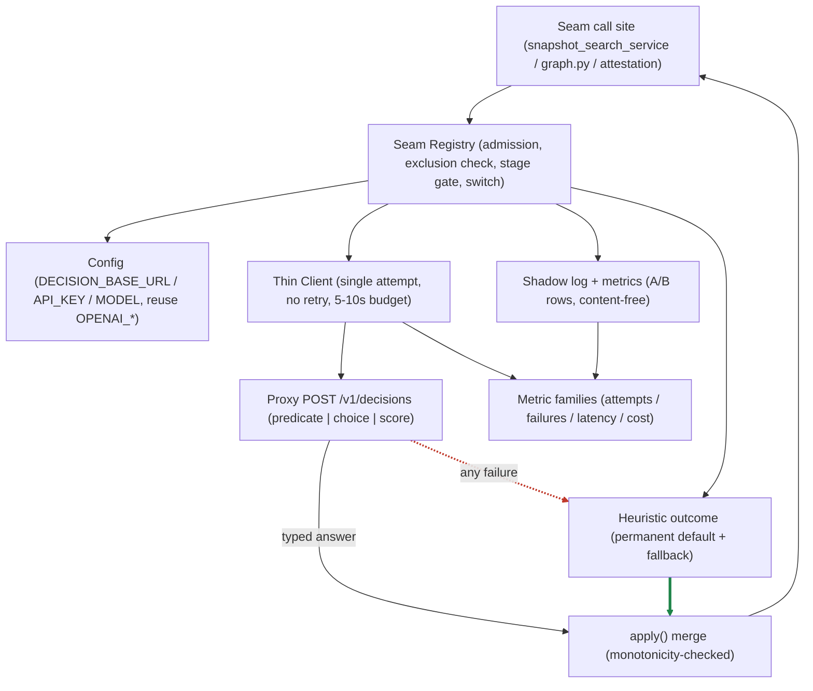

# Architecture Recommendation — Ensemble Decision Module (Thin Client + Seam Registry)

> **Status:** **RATIFIED P1 SHADOW-ONLY — Emperor ratification 2026-11-09: "yeah, look good, go ahead, shadow only for now".** Design of record. P1 implementation authorised (client + registry + shadow instrumentation); seams 2/3/4 unregistered; S4 shadow-only. (The leader's giter commits at finalize.)
> **Scope item:** 7 of 7 (the umbrella). **Normative source:** `scope-and-doctrine.md` — cited by §id, never re-quoted.
> **Base:** `docs/decision-module` @ `5da1021f2` · **Set:** `scope-and-doctrine.md`, `thin-client.md`, `seam-registry.md`, `controls-and-phasing.md`, this file.

---

## §1 Recommendation

Adopt a **thin, single-attempt, fail-open typed client** to the proxy's `POST /v1/decisions` surface, placed behind a **seam registry** that admits an overlay at a decision point only under the standing doctrine: the deterministic heuristic remains the permanent default **and** fallback (D1), every overlay failure yields the heuristic result (D2), every seam shadows before it decides (D3), the attestation lane stays rescue-band-only with its `DENY` rung heuristic-owned (D4), and the five exact/deterministic decision points stay permanently excluded (D5). **Pilot on S1** — snapshot L3 stage-3 selection — because it is one module, its three blocking consumers need no change, it already has a fail-open branch, and it has a single outbound choke point; map it with **one `choice` call that replaces the ad-hoc chat call in C2** — a single call returning a **calibrated distribution over every candidate**, so the overlay owns the ranked top-K set exactly as today's chat call does; in **C1** the chat call still ships unchanged and the overlay is called **detached** (the two configurations are specified in `seam-registry.md` §5.1.1) — leaving the fused stage-2 rerank as the fail-open and forbidding the overlay's "no answer" from ever surfacing as an empty selection. **S3's overlay consult is placed in the router's ladder-routing branch (`daemon/graph.py:4261` `should_continue`, ghost block `:4380-4402`, master gate `:4384`), inside the branch that `ENSEMBLE_SYMPTOM_REPAIR_LADDER` gates — so that switch gates the overlay as well as the routing.**

**In C2 the overlay replaces the chat call ON THE DECIDING PATH; the baseline chat selection is RETAINED (not deleted) as the KILL TARGET.** The C2 kill contract is scoped per configuration: in **C0/C1** a kill ⇒ byte-identical decisions; in **C2** a kill ⇒ the baseline chat selection is restored, **conditional on the retention build requirement** (`seam-registry.md` §5.1.1). **Defer S2** (only 1 of 4 candidate inputs is a structured value at the seam today), **stage S3** behind the shared phrase-catalog scanner registered once, and **keep S4 last** with the canonical judge untouched as the fallback. Ship **P1** (client + registry + shadow instrumentation) before **P2** (A/B window), **P3** (Emperor gate → S1 deciding), and **P4** (one seam at a time, each with its own shadow cycle); rollback is **kill switch plus unregister**, never a deploy.

---

## §2 Component diagram

The diagram's two load-bearing edges are styled apart from the rest: the **red dashed `Proxy -.->|any failure| Heuristic`** (D2 — the external call never blocks and never raises into the caller) and the **thick green `Heuristic ==> Apply`** (D1 — the heuristic outcome is always an argument to the merge, so an overlay answer can never *replace* it, only be combined with it). *Diagram syntax was validated at the **parser** level against mermaid **11.16.0** (a locally installed copy; this worktree has no `node_modules`, and the repo declares `^11.4.0`). **No rendering was performed**, and no repo test exercises this diagram.*

---

## §3 Traceability matrix — 7 scope items

| # | Scope item | Where it is specified | Key acceptance property |
|---|---|---|---|
| 1 | **The thin client** | `thin-client.md` §1–§8 — §2 contract, §3 config/reuse rules, §4 transport + per-lane timeout budget, §5 the fail-closed→fail-open delta, §6 the **30-row** failure table (whole-consult fail-open, `seam_fault`, catch-all status, **disjoint failure/suppressed vocabularies**), §7 provisioning + deploy-order, §8 the typed mapping per seam + §8.2.1 the confidence floor | Every failure class names the heuristic result; status-only error branching; single attempt, no retry |
| 2 | **The seam registry** | `seam-registry.md` §1–§4 — §2 the typed seam interface + the `apply` and monotonicity contracts, §2.3 the **whole-consult fail-open fence**, §3 registration-time exclusion enforcement, §4 registry-owned vs seam-owned | The registry owns the call (so no seam can add a retry); `apply` cannot widen the outcome space |
| 3 | **The seam catalog + re-validation table** | `seam-registry.md` §5.1–§5.4 (S1–S4 entries, the typed-mapping verdict, the deferral rationale), **§5.1.1 the three configurations C0/C1/C2** with the kill contract, and §6 (the re-validation table) + `scope-and-doctrine.md` §S.2 (re-validated anchors) and §S.3 (published corrections table) | Four entries with corrected anchors; pilot rationale; deferral reasons; adjacent defects marked out of scope |
| 4 | **Observability** | `controls-and-phasing.md` §2 — §2.2 global families (with the `mode` label and the closed `suppressed_total` reason vocabulary), §2.3 shadow families, §2.4 per-seam families (incl. S4's `leader_completion_gate` baseline), §2.5 the S1 import-graph constraint, §2.6 the shadow-log schema + content policy + retention + **shadow-writer failure tolerance**, §2.8 the **observability contract** (substrate, retention, access control, **decision-audit trail**), §2.9 the **liveness observable** | Baseline instrumentation precedes the first overlay call; content-free log; the fail-open identity is observable |
| 5 | **Kill switches + throttle** | `controls-and-phasing.md` §3 — §3.1 the switches with a **resolution mode for every switch this set operates** and **how the operator flips it**, §3.1.1 the **DB-backed, operator-scoped, live-read** switch store (the **settings:write** channel, read-per-consult, the global-master holder, the widened value types, the **write→read-back→verify** protocol, durability), §3.2 the switch-off property **scoped per configuration** + its acceptance artefact, §3.2.1 **fail-closed polarity**, §3.2.2 the **gate-composition rule**, §3.3 the coverage matrix (incl. the **canonical judge call**, the **`gate_config` third surface**, the **global master**, the **stage key**, the shadow writer, **switch resolution**, and the **in-flight call**), §3.4 the operator procedure + trip conditions, §3.5 the throttle, **`seam-registry.md` §3.4 the default states, boot seeding, and admission rule** | Switch-off ⇒ never calls out ⇒ **byte-identical decisions** (observability differs — expected deltas are the confirmation signal). **C0/C1** kill ⇒ byte-identical to pre-overlay; **C2** kill ⇒ restores the baseline chat selection, byte-identical to pre-overlay **production** behaviour, **conditional on the retention build requirement** |
| 6 | **Phasing** | `controls-and-phasing.md` §4 — P1/P2/P3/P4 gates, each phase named against the configuration (**C0 → C1 → C2**), with **S4 entering deciding only in the additive form** + §4.1 rollback | The Emperor gate precedes the first `deciding` seam; rollback needs no deploy |
| 7 | **Rejected alternatives** | this file, §4 (RA-1 … RA-8) | Each rejection carries a reason **and** an anchor |

**Doctrine coverage:** D1 → `thin-client.md` §1, `seam-registry.md` §2.1; D2 → `thin-client.md` §6, `controls-and-phasing.md` §2.2; D3 → `controls-and-phasing.md` §2.3, §4 (P1–P3); D4 → `seam-registry.md` §2.2, §5.4; D5 → `seam-registry.md` §3, `scope-and-doctrine.md` §D5.

---

## §4 Rejected alternatives

| # | Alternative | Why rejected | Anchor |
|---|---|---|---|
| **RA-1** | **A new decision service** (a separate daemon or process for decisions) | It adds a deployment unit, a network hop, and — decisively — a **new failure domain** to a capability whose entire value proposition is that it must never block (D2). The decision surface **already exists** as the proxy; a service in front of it would only add a way to fail. The daemon already reaches the proxy for chat, embeddings and image generation, so no new topology is needed either. | PX-9 (the lane is always-on in code), `scope-and-doctrine.md` §S.1 (daemon↔proxy topology) |
| **RA-2** | **Per-lane bespoke clients** (each seam writes its own HTTP call) | It multiplies the failure table by the number of lanes: the 30-row fail-open guarantee becomes N independent implementations of D2, each needing its own verification, and a per-lane client can quietly grow a retry, a cache, or a second call. One client, one failure table, one owner of the transport. | `thin-client.md` §6, D2, IP-5 |
| **RA-3** | **Client retry / failover** | The proxy issues **no idempotency keys**, so a retry **double-bills** (PX-6); and a retry delays the caller past its fail-open budget, breaching D2's "external API can never block" clause. There is also no httpx-shaped failover helper to reuse — the existing failover service is a chat-path abstraction, and the graph path deliberately strips `base_url_backup` before lanes read it. The image-generation transport, the closest precedent, is single-attempt. | PX-6, IP-2, IP-5 |
| **RA-4** | **Async submit / poll** (submit the decision, poll for the result) | The decision surface is a **blocking single JSON** response — there is no async job API to submit to, and no SSE to stream. The contrast case is instructive: the OD design lane needed async submit/poll because its provider **kills buffered responses** behind Cloudflare (see the PARKED planning item `.agents/shared/planning/od-generate-async-poll/`), and even there the submit/poll shape was **parked**, not adopted. The decision surface has neither the buffering problem nor the async API, so the pattern would be pure added machinery. | PX-6, `.agents/shared/planning/od-generate-async-poll/` (PARKED) |
| **RA-5** | **In-daemon decision logic** (implement the scoring/decision logic inside the daemon rather than delegating to the proxy) | The census shows decision-making is **scattered across 16 points**, each with 1–3 callers in one subsystem. The problem is not the absence of *logic* — it is the absence of a uniform **admission point** for an overlay. The registry unifies admission (one place that enforces D1–D5) **without adding new decision logic**; in-daemon logic would add a second source of truth for exactly the decisions D1 keeps deterministic. | `scope-and-doctrine.md` §S.1, D1 |
| **RA-6** | **A provider request-field** (let the caller choose the decision provider) | **Contract-impossible.** The request carries no provider field: the provider is bound to the **credential row** of the model. The client cannot select a provider, and a field it sent would be ignored. Multiple providers are expressed as **multiple model rows** — an operator provisioning concern, not a client one. | PX-4 |
| **RA-7** | **`/v1/models` discovery** (enumerate models to find a decision model) | Decision models are **excluded from the model list** — their ids are configured, not discovered. A discovery step would find nothing, and would add a network dependency at boot for a capability that is configured by construction. The model id is the literal purpose-id `"decision"`. | PX-5, IP-1 |
| **RA-8** | **Register an overlay for a decision point outside the vetted four** (treat any of the 16 census points as overlay-eligible on discovery) | The standing exclusion list is **closed by default**: extension requires a documented **cause** and the **Emperor's approval** (`scope-and-doctrine.md` §D5.2), and a registration naming an EX-1…EX-5 role is **refused at registration time** before any call path exists (`scope-and-doctrine.md` §D5.1, `seam-registry.md` §3). "We found another decision point" is a reason to *propose* a seam, not to register one. | `scope-and-doctrine.md` §D5.1 and §D5.2; `seam-registry.md` §3 |

---

## §5 Open questions — SETTLED (both ratified 2026-11-09)

**Q1 — Cost-ceiling policy — SETTLED.** The Emperor ratified option (a): a **global cost ceiling of USD 50 per month (owner: the Emperor)** with an **automatic trip** that switches the overlay off when it is reached, plus a **per-seam share** so one seam cannot consume the whole budget. The binding ceiling, auto-trip mechanism, and operator notification are specified in `controls-and-phasing.md` §5 and §3.4 (T5). Options (b) (per-seam ceilings only) and (c) (operator-set, no auto-trip) are **rejected** by the ratification.

**Q2 — Shadow-log content stance — SETTLED.** The Emperor ratified option (a): **content-free** — ids, hashes, scores, probabilities, counts, latencies, enum labels only; never credentials, never user text, never request/response payloads. The Q2(b) redaction branch is **foreclosed**: v1 is content-free by the WRITE-TIME content policy (`controls-and-phasing.md` §2.6); a non-agent-readable sink stays a **named future (v2 build requirement)**. The audit-trail posture follows in `controls-and-phasing.md` §2.8. Options (b) (content-bearing with redaction) is **rejected** by the ratification.

---

## §6 Status

**RATIFIED P1 SHADOW-ONLY (Emperor, 2026-11-09: "yeah, look good, go ahead, shadow only for now").** P1 implementation is authorised by this document set: client + registry + shadow instrumentation, seams 2/3/4 unregistered, S4 shadow-only. The ratification gate that matters next is **P3** (`controls-and-phasing.md` §4): no seam may enter `deciding` before the Emperor ratifies it, and the pilot's own transition from `shadow` to `deciding` is the first such decision.

---

---

> **Self-certification evidence (the PASS-1/2/3 change logs, the propagation table, the claim-level ledger, the detector output, the content-loss audit list, the record of removed strings, and the budget) lives in `anchor-audit.md`** — read it by section id. This document carries design content only (§1–§6).
