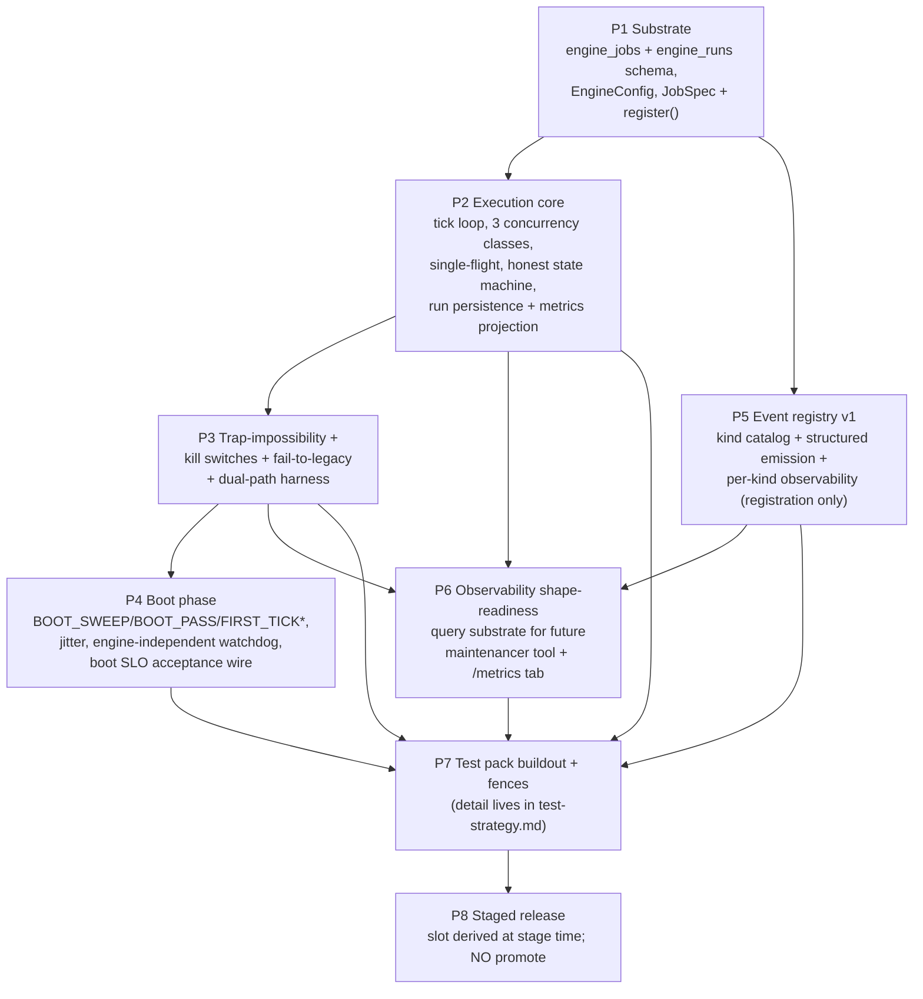

# Phase 1 — Substrate: schema, config surface, self-describing registration API

**Lane:** `feature/engine-arc-phase1` @ `/home/nea/ensemble-src-wt-engine-arc-p1`
**Base:** `aed3eabce` (= `b71742fe3` / v0.31.23 + Phase-0 study docs)
**Binding inputs:** `../central-polling-engine-study/decision-report.md` §B.1 / §B.2 (lines 110-131) / §B.3 / §B.5, `research-anchors.md` (all anchors re-greped at THIS tree), commission addendum (Emperor 2026-11-21).

---

## 0. Program frame (read once, this file)

**Why this program exists (cite, don't restate).** The Phase-0 study scored **gate-hold 3.80 vs build 2.65**; the Emperor **overruled the gate-hold**. Verbatim rulings (Discord, 2026-11-21) that bind every phase below:

| Ruling | Verbatim | Where it binds |
|---|---|---|
| #1 Build | "Build the engine." | Phases 1-4, 8 |
| #1 phasing | "we build the engine first but don't use yet, then pick one by one" | Phase 4 (dormant boot), Phase 3 (dual-path), OUT-OF-SCOPE (no module migrates) |
| #3 event registry | "For no 3: event register is need. Why: it help on central loging, debug management, metric..." | Phase 5 |
| Boot SLO (CLOSED) | "Boot wall clock is 2 minutes" = `boot_epoch` → readyz-green ≤ **120s** | Phase 4 acceptance gate |
| Addendum | "the register function should include like service tag name, category, module information (use for metric, management,..debug easier). Tldr: each service bring it info/meta when register. Later we may even have tool for maintenancer agent to use or even a table chart on metrics tabs" | Phase 1 (JobSpec), Phase 6 (shape-readiness) |

Both scores are recorded on ledger ENSEMBLE-38; the verbatim ruling record lives in the sibling `decisions.md` (not this file).

**Design authority.** `decision-report.md` **§B.2 lines 110-131 is the FROZEN design** — Phase 1 implements it faithfully. §B.1's primitives become engine **internals** per §E.1 ("B uses C's primitives as internals"). This plan does not re-litigate §B.2; where a decision is genuinely open, this file records the choice and the anchor it rests on.

### 0.1 Program-level OUT OF SCOPE (stated once; each phase repeats only its own slice)

- **Migration tail** (~20 eligible modules, ≈4-10h/module, each its own gated commission per the one-by-one rule). Phase 1 builds the harness; it migrates **nothing**.
- **Fan-out primitive unification** (GAP-15, six incompatible primitives). Phase 5 registers kinds over substrates that exist; it does not unify envelopes.
- **Queue-depth triggers** (GAP-14 — no plumbing exists). Phase 5 names the seam only.
- **Wakeup churn** (§B.4 — worker-pool claim path, 4.6%/3.3%). Separate commission.
- **Families 8-9 + scheduler substrate standalone PERMANENTLY** (§A.6: ram-guard, wedge/loop-lag, readiness/livez, DST scheduler). The engine must never host them; Phase 4's watchdog copies the *thread* shape but owns no probe.
- **Any refactoring of existing periodic mechanisms.** The engine is a NEW subsystem; no legacy loop is edited or deleted in Phase 1.
- **Live contact beyond read-only telemetry**, any promote (Emperor ceremony owns the flip).

### 0.2 Dependency graph (all phases)

`P2 ∥ P5` after `P1` (disjoint file trees: `daemon/services/engine/` vs `daemon/services/event_registry/`). `P3 → P4` is a **hard single-ownership ordering**, not a preference: both would otherwise edit `daemon/services/engine/execution.py` and `registry.py` (see §0.3's ownership map — P2 owns the modules P3 extends, so P3 cannot precede P2).

### 0.2a Program totals (the phase estimates, summed)

| Phase | Name | Est-h low | Est-h high | Mid |
|---|---|---|---|---|
| P1 | Substrate: schema, config surface, self-describing registration API | 22 | 35 | ≈28 |
| P2 | Execution core: tick loop, classes, single-flight, honest state machine | 28 | 38 | ≈33 |
| P3 | Trap-impossibility guardrails, kill switches, fail-to-legacy, dual-path | 22 | 37 | ≈29 |
| P4 | Boot phase: classes, deadline, boot SLO, engine-independent watchdog, `api.py` | 20 | 33 | ≈26 |
| P5 | Event registry v1 (registration + observability only) | 18 | 31 | ≈24 |
| P6 | Observability shape-readiness: query substrate + convergence + gated census | 9 | 15 | ≈12 |
| P7 | Test pack buildout, registration, cross-cutting gates | 12 | 23 | ≈17 |
| P8 | Staged release (no promote) | 5 | 10 | ≈7 |
| | **TOTAL** | **136** | **222** | **≈176** |

**Band check.** The commission's anchor is ≈162h with a 118-222h band. The sum lands at **136-222 (≈176 mid)** — inside the band, ≈9% above the anchor (176/162 = +8.6%; recomputed — approver iteration-002 fold M-3/N-h, supersedes the stale ~10% figure and the 137/≈177 totals whose P7 low bucket summed to 12, not 13). The excess is attributable to three things the brief's component table did not price separately: (a) the `SERVICES_*` continuity table + dead-knob cleanup (P1, ≈5h — the brief folded it into "config continuity" without the **28 repo-wide dead-knob site edits** the dead-knob deletes require (review fold F-2: the earlier 26 was a tests/-scoped count that missed 2 registered pack sites)); (b) the engine-independent watchdog **drill** plus its evidence artifact (P4, ≈4h — the brief priced the watchdog build, not the "built AND drilled" acceptance); (c) the diff-census record the metrics pack will require (P6, ≈1h — measured, ~27 frozenset entries). P7's pack REGISTRATION is separate from the per-phase pack AUTHORING (each phase's last task), which is where the brief's component-10 hours sit.

### 0.3 Ownership map (single-ownership invariant — REJECT-grade)

Every file edit below is claimed by **exactly one** phase. Duplicate claiming is a REJECT.

| File / tree | Owner | Consumed by |
|---|---|---|
| `daemon/migrations/versions/20261121_120000_create_engine_jobs.sql` | P1 | — |
| `daemon/migrations/versions/20261121_120001_create_engine_runs.sql` | P1 | — |
| `daemon/repositories/engine/models.py`, `__init__.py`, `repository.py` | P1 | P2 |
| `daemon/manager.py` (late-import registration block only) | P1 | — |
| `daemon/config.py` (`EngineConfig` + `Config.engine` field + `load_config` yaml pass-through) | P1 | P3, P4 |
| `config.yaml` (`engine:` section) | P1 | — |
| `daemon/services/engine/__init__.py`, `spec.py` (JobSpec, triggers, validation, metadata) | P1 | P2, P3, P5 |
| `daemon/services/engine/registry.py` (`register()` registration half — T1.8 CREATE) | P1 | P2, P3 |
| `daemon/services/engine/registry.py` (dynamic re-registration EDIT — P3 T3.5; ordered after P2 per the §P1:66 hard ordering — P3 modifies what P2 owns) | P3 (edit; file created by P1) | — |
| `daemon/services/engine/estate.py` (the 12-knob `SERVICES_*` continuity table — DATA ONLY) | P1 | the migration program (Phase 2+, not Phase 1) |
| `daemon/config.py` dead-knob deletes + 2 re-label docstrings (T1.12/T1.13, same phase as `EngineConfig`) | P1 | — |
| `tests/**` `checkpoint_interval` / `worker_poll_interval` call-site cleanup (T1.12) | P1 | — |
| `daemon/plugin_subsystem/config_compat_contract.py` — T1.12 D-1 tolerated-retired-key extension to the stage-time contract MINTER (owner P1) **[P7-Leg-E adjudication — 2026-11-21: ADD-A-MAP-ROW, do NOT revert (revert = RC=3 restore on the promote ENTRY gate — functional regression); see plan-overview attestation row 71]** | P1 | — |
| `daemon/services/engine/execution.py`, `state.py`, `locks.py`, `dispatch.py`, `metrics.py`, `engine.py` (EngineService construct/start/stop — T2.5) | P2 | P3, P4 (wiring constructs EngineService), P6 |
| `daemon/services/engine/guardrails.py` (`dependencies` getter discipline, dead detector) | P3 | P4 |
| `daemon/services/engine/killswitch.py`, `dualpath.py` | P3 | P4 |
| `daemon/services/engine/boot.py` (boot classes + deadlines) | P4 | — |
| `daemon/services/engine/watchdog.py` | P4 | — |
| `daemon/api.py` (lifespan: engine start + boot sweep insertion + watchdog start + shutdown) | **P4 ONLY** | — |
| `daemon/api.py` (**router catalogue only**: ONE `include_router(engine_router)` line) | **P6 ONLY** (the lifespan is P4's; the two regions are ~2600 lines apart) | — |
| `daemon/services/event_registry/**` (catalog / emit / metrics; **no repository, no migration** — D5.2/D5.3) | P5 | P6 |
| `daemon/services/child_reports.py`, `daemon/services/error_reporting.py` (class-1 bridge: ≤5 lines adjacent to the existing `_fire_terminal_child_and_deliver` call sites) | P5 | — |
| **`daemon/routers/answer_helper.py`, `daemon/services/job_recovery_service.py`, `daemon/services/event_publisher.py`, `daemon/services/midflight_qa.py`, `daemon/services/job_feedback_observer.py`, `daemon/services/ram_guard_events.py`, `daemon/services/stale_task_recovery.py`** — P5 **class-2 durable-bus bridge: ≤5-line tail-observe bridges only** (`record(...)` at the `EventBus.create_event` **CALLER**, never inside `create_event` — `daemon/services/event_bus.py:155` stays untouched, it is the GAP-15 fan-out chokepoint Phase 1 is fenced from). **The 10 emission sites (7 files), enumerated:** (1) `routers/answer_helper.py:419` `QUESTION_ANSWERED` *(uncharted in the event census — Card 4 lists `answer_helper.py:441` as a `notify_work_watchers` consumer, not this emitter)*; (2) `services/job_recovery_service.py:4509` `JOB_COMPLETED` finalize-witness *(uncharted in the event census — `census-periodic.md` row 6 names the DriftReconcile loop, not this emitter)*; (3) `services/event_publisher.py:78` `INSTANCE_LIFECYCLE` *(census EV-17 anchors the root-only broadcast gate at `:86-93`; the `create_event` call is `:78`)*; (4) `services/midflight_qa.py:505` `QUESTION_REQUESTED`, (5) `:579` `MIDFLIGHT_REPORT`, (6) `:766` `STUCK_AWAITING_ANSWER`, (7) `:853` `CHILD_QUESTION_STILL_PENDING` *(census EV-30, which anchors the emitters as `:456`/`:505`/`:542`/`:718`/`:825` — the `:882-935` escalation leg is broadcaster+watcher, no `create_event`)*; (8) `services/job_feedback_observer.py:2400` `JOB_COMPLETED` *(census EV-19, anchored `:2370-2420`)*; (9) `services/ram_guard_events.py:142` `RAM_LIMIT_EXCEEDED` *(census EV-54, anchored `:120-175`)*; (10) `services/stale_task_recovery.py:945` `task_recovery_*` *(census §N, anchored `:945`)*. **Excluded by the fence:** `services/event_bus.py:155` (the `create_event` body — option (b), REJECTED) and the `services/message_processing_errors.py:287` `event_repo` fallback (not a class-2 `EventBus` caller). **[L-9 extension — 2026-11-21: enumeration gap closed; see decisions.md §Leader rulings L-9]** | P5 | — |
| **`daemon/services/instance_messaging.py`, `daemon/services/message_processing_errors.py`, `daemon/repositories/room/membership.py`, `daemon/repositories/room/repository.py`, `daemon/services/room_delivery.py`** — P5 **final bridge increment: ≤5-line tail-observe bridges only** (same L-9 discipline — `record(...)` at `EventBus.create_event` CALLERs, `create_event` itself untouched). **8 producer-outside-map kinds / 13 landed sites, enumerated as landed:** `instance_messaging:2893` (message_received); `message_processing_errors:277`/`:299` (error — `:299` is the `event_repo` fallback previously excluded at `:287` by the L-9 enumeration round, now consciously INCLUDED per L-10, disclosed in-code with `source="event_repo_fallback"`); `room/membership:407`/`:531` (room_join/room_leave); `room/repository:1179` (room_purged); `room_delivery:879`/`:907`/`:918`/`:1033`/`:1105`/`:1203`/`:1241` (room_tag_delivery/room_proposal/room_decision). Terminal-state contract: every catalog kind bridged-or-pinned — the L-9 row's "Excluded by the fence" note for `message_processing_errors.py:287` is OVERRIDDEN by this L-10 inclusion; the bidirectional census leg pins drift; further map extension structurally impossible. **[L-10 extension — 2026-11-21: final bridge increment; see decisions.md §Leader rulings L-10]** [path correction — P7 Leg E finding 2, 2026-11-21: services/ → repositories/ prefix] | P5 | — |
| `daemon/services/report_delivery_recovery.py` **or** `daemon/repositories/report_injection/repository.py` (class-3 bridge — implementation picks ONE seam) | P5 | — |
| `daemon/graph.py` (P5 class-4 attestation-bridge CALLER observation — ≤5-line `record(...)` adjacent to the ledger call sites `safe_increment` `:7111` / `safe_set_escalated_and_reset` `:7141` / `safe_reset` `:7159`; the sibling caller site `daemon/services/child_reports.py` `:2505/:2644` is already claimed by the class-1 bridge row above; `attestation_ledger.py` itself is NOT touched — P5 observes at callers, phase5 §Parallelism) **[map-completion — approver iteration-002 (M-5): phase7 Leg E/AC4 makes "daemon/ diff ⊆ ownership map" release-blocking; the attestation-bridge callers were absent and a compliant P5 implementation would have REDs its own gate]** | P5 | — |
| `daemon/services/engine/projection.py` (query/read model) | P6 | — |
| `daemon/routers/engine.py` (**a NEW router** — three GETs; NOT an edit to `metrics.py` / `maintenance.py` / `jobs.py`, each of which has a route-count pin) | P6 | — |
| `tests/unit/metrics/test_metrics_family_adjudication.py` — `PRE_EXISTING_DAEMON_OFFENDERS` additions AND (only if T6.3 is taken) verdict/registry/band edits | **P6 ONLY** (the census ceremony + the diff-census record — fence F-1 / phase6 §6.1a) | — |
| `tests/**`, `test/packs/**` + `.agents/tester/PACKS.md` registration blocks | P7 (per-phase packs authored by the owning phase, REGISTERED by P7) | — |

### 0.4 Tree facts re-verified at THIS tree (fresh greps, 2026-11-21)

| Fact | Measured now | Note |
|---|---|---|
| `.sql` migrations in `daemon/migrations/versions/` | **134** | `research-anchors.md`'s earlier "127" corrected to 134 at approver iteration-001 (N-6; FA-2 census); newest = `20261119_000001_add_proposal_decision_columns.sql`. Always assert the **delta**, never an absolute. **[release-B figure fold — 2026-11-21: 134 → 137 at tree (verified); the 134 was the iteration-001 correction, itself superseded by the lanes' subsequent migrations]** |
| `ServicesConfig` fields | **70** | `daemon/config.py:2143`, `env_prefix="SERVICES_"` :2146 |
| `MANAGED_KEYS` live entries | **19** (AST literal count == runtime len) | `daemon/services/settings_service.py:253`; last = `wedge_notice_emission_enabled`; **pinned** `tests/test_settings_resolution.py:676` (`== 19`) + duplicate-literal AST guard `tests/test_daemon_settings_api.py:713-760` |
| `EventKind` members | **24** | `daemon/repositories/event/models.py`; SQLite `event.kind` CHECK lists only **8** (`20260412_000002_create_event_table.sql:14-19`) — already stale, do not rely on the CHECK |
| Readiness components | **4** (`database`, `queue_freshness`, `services`, `checkpoint_saver`) | `daemon/services/readiness.py:95-100`; pinned by `tests/test_health_probes.py:157` |
| `job_metrics()` consumers | **1** — the method itself + one test | `daemon/services/maintenance.py:603-622`; shape pinned (`set(block) == {"last_success_ts","consecutive_skips"}`) at `tests/unit/test_maintenance_idle_starvation.py:800-804`. **Not** wired to `/metrics`. |
| Metrics family census | **28 verdicts / 18 registered / 13 chart-primary** **[TREE-TRUTH RECONCILE — 2026-11-21 (P6 review #3): 28 → 29 verdicts / 18 → 19 registered; chart-primary 13 STANDS (verified at tree 2f36e8aed94c); planning-time figures predate the landed family extension (F24)]** | `daemon/services/metrics_query/wiring/adjudication.py`; pinned `tests/unit/metrics/test_metrics_family_adjudication.py:415-453` |
| RDRS interval read site (explorer open item a) | `daemon/services/pool_orchestrator.py:370` (`interval_seconds=svc.report_delivery_recovery_interval_seconds`), ctor `:363`, `enabled=` `:379`, wiring entry `manager.setup_worker_pool()` `daemon/api.py:1011` | **Note the path**: it is `daemon/services/pool_orchestrator.py`, NOT `daemon/services/worker_pool/pool_orchestrator.py` (that directory does not exist). |
| Awaited pre-yield boot calls (open item b) | **29** await/await-shaped sites in `daemon/api.py:926-3937` (yield at `:4056`) | explicit list in phase4 §2.1 |
| Migration `create_all` order | `SQLModel.metadata.create_all` `daemon/manager.py:1072`; migration runner `:1076`; `_ensure_postgres_columns()` `:1094` | brand-new tables need **no** ensure mirror |

---

## 1. Objective

Land the **substrate** the whole engine stands on, with nothing executing:

1. **Two tables, two migration files** — `engine_jobs` (mutable registration + last-outcome columns) and `engine_runs` (append-only run audit), each in its **own** `.sql` file, SQLite-valid, `IF NOT EXISTS` throughout, every string column `TEXT`, plus the SQLModel models registered in the manager's late-import block **before** `create_all`.
2. **`EngineConfig`** — the `ENSEMBLE_ENGINE_*` knob surface (engine-wide enabled / shadow / tick resolution / executor sizing / watchdog / boot deadlines / run retention), with the yaml pass-through that keeps env as the canonical resolver.
3. **`JobSpec` + `register()`** — the frozen §B.2 registration contract **plus** the Emperor addendum's self-describing metadata: `service_tag`, `category`, `module_info`, `description`, and an extensible `metadata` dict, carried into the durable row and surfaced by every observability projection downstream.
4. **The trigger type union** — `Interval(seconds, jitter, first_tick_immediate | first_tick_offset)` | `Event(kind, filter)` — with registration-time validation (exactly one trigger; `max_runtime_s > 0`).

**Nothing in this phase executes a job.** No tick loop, no dispatch, no boot sweep: those are P2/P4.

---

## 2. Scope

**In:** the two migrations, the two models + repository, the manager registration block, `EngineConfig` + yaml, `JobSpec`/`TriggerSpec`/`ServiceMeta`/validation, and the **registration-time** half of `register()` (validate → upsert by id → version bump → RAM cache insert). Unit tests owned by P7 may be authored here.

**Out:** tick loop / dispatch / single-flight / state machine / run persistence (P2); dependency getters, kill switches, fail-to-legacy, dual-path harness (P3); boot classes, watchdog, api.py wiring (P4); event-kind catalog (P5); query projection + any read route (P6); the in-flight-tick cancellation half of dynamic re-registration (P3 — it needs the execution core).

---

## 3. Decisions (each with its anchor)

| ID | Decision | Rationale (anchor) | Rejected |
|---|---|---|---|
| D1.1 | **Two migration files**, one per table: `20261121_120000_create_engine_jobs.sql`, `20261121_120001_create_engine_runs.sql` | House rule: every new table gets its OWN `.sql` (research-anchors §1; 134 files at this tree, zero exceptions). Distinct prefixes ⇒ the dup-prefix guard (`tests/migration/test_migration_dup_prefix_guard.py` `DuplicateMigrationVersionError`) never fires; prefixes `20261121_*` are free (max = `20261119_000001`) | single multi-table file (allowed by precedent for a lane that RATIFIES it — board / memoir-v2 — but the commission mandates separate files here) **[release-B figure fold — 2026-11-21: 134 → 137 at tree (verified); the 134 was the iteration-001 correction, itself superseded by the lanes' subsequent migrations]** |
| D1.2 | Every `CREATE` is `CREATE TABLE IF NOT EXISTS`; every string column is **TEXT**; named `CREATE [UNIQUE] INDEX IF NOT EXISTS`; no inline `;` inside comments; a `-- DOWN` section | `create_all` runs FIRST at boot (`manager.py:1072`) and the runner applies the file immediately after → a bare `CREATE` raises, the runner swallows it on the idempotent-skip branch, and the file degrades to a **silent no-op on every boot** (`20261109_021154_create_memoir_v2_tables.sql:64-73`). Style model: `20261018_090003_create_resource_pid_map.sql` (dual-driver notes :24-34, runtime-splitter note :40-43) | bare `CREATE TABLE` (silent no-op); `VARCHAR` (house rule: TEXT on both drivers); inline `;` in comments (runner strips only full-line `--`) |
| D1.3 | Models registered in the manager late-import block **immediately before** `SQLModel.metadata.create_all(self._engine)` (`daemon/manager.py:1072`), following the app_settings / resource_monitor / board / bash_spawn / PSL / memoir / POK / room precedent (`:956`, `:964`, `:1006`, `:1015`, `:1035`, `:1052`, `:1066`) | brand-new tables: `create_all` is the PG source-of-truth; the `.sql` is the SQLite path. **NO** `_ensure_postgres_columns` mirror (that hook is for COLUMN evolution on pre-existing tables) | putting DDL in `_ensure_postgres_columns` (wrong hook class; one shared transaction, fail-loud, whole-boot abort) |
| D1.4 | `engine_jobs.id` is a **stable slug TEXT PK** (e.g. `orphan-watcher`, `sources-gc`), not a uuid | The addendum's `service_tag` IS the ops identity; a uuid PK would force a second unique index and make operator greps/`maintenancer` queries indirect. Dynamic re-registration is "upsert **by id**" (§B.2:118) — a slug makes that literal | uuid4 PK + unique slug (two identities, one truth each) |
| D1.5 | `engine_jobs` carries `version INT` bumped on every successful re-registration | §B.2:118 "version bump" is part of the dynamic re-registration contract; persisting it makes "did my re-registration land?" answerable from the DB alone | RAM-only version (survives no restart — the OrphanWatcher classroom) |
| D1.6 | `engine_runs` is **append-only**, `id` is an autoincrement INTEGER PK, and it carries `boot_id` + `host_pid` | Append-only audit is the §B.2 DB-source-of-truth half; `boot_id`/`host_pid` are the discriminator that lets an operator separate runs across restarts (precedent: `bash_spawn_registry.boot_id`, `daemon/repositories/bash_spawn/models.py`) | updating run rows (loses the append-only audit property) |
| D1.7 | JSON payloads (`metadata`, `event_filter`, `error_digest`) are stored as **TEXT** in the `.sql` and typed with the house dual-driver `JSONBType` (`daemon/repositories/infra/types.py:35-70`) | house dual-driver convention; memoir precedent (`source_episode_ids` typed JSONBType, `phase1-plan.md` D1.14) for exactly this reason | native `ARRAY`/`JSONB` DDL in the `.sql` (breaks every SQLite boot) |
| D1.8 | One `EngineConfig(BaseSettings)` with `env_prefix="ENSEMBLE_ENGINE_"`, mounted as `Config.engine`, with a yaml pass-through **only when** `config.yaml` carries an `engine:` section | mirrors `SchedulingConfig` (`daemon/config.py:3345`, prefixture `ENSEMBLE_SCHEDULING_`) and `JobSystemConfig` (`:3305`); the yaml pass-through is `load_config`'s existing pattern (`:9170-9176` for job_system/scheduling, `:9143-9168` for services) so env stays the canonical resolver for absent keys | `SERVICES_ENGINE_*` (wrong prefix — the commission names `ENSEMBLE_ENGINE_*`); adding engine fields to `ServicesConfig` (pollutes a 70-field class with a different subsystem's knobs) |
| D1.9 | **Engine dormancy truth table** (three independent axes; P3/P4 implement the reads, P1 freezes the names): `ENSEMBLE_ENGINE_ENABLED` (tick loop runs) · `ENSEMBLE_ENGINE_SHADOW_MODE` (due-ness computed + `would_fire` recorded, `execute_fn` **never** invoked) · `SERVICES_<MODULE>_USE_ENGINE` (per-module execution ownership; OFF ⇒ the module's legacy loop owns execution) | §B.2:124 kill-switch set + §B.2 revert flags; the Emperor phase rule needs a posture where the engine is observable but executes nothing. Defaults: `enabled=true`, `shadow_mode=true`, zero `USE_ENGINE` flags set ⇒ **registered, observing, executing nothing** — N observer specs registered at boot per AMD-1 (registration-for-observation is NOT migration; zero `USE_ENGINE` estate migrations) | a single `enabled` bit (cannot express "observe but don't run"); defaulting `enabled=false` (the engine would be invisible — no registration, no projection, nothing to look at) |
| D1.10 | `JobSpec` is a frozen dataclass; `ServiceMeta` is a nested frozen dataclass (`service_tag`, `service_name`, `category`, `module_info`, `description`, `metadata: Mapping[str, Any]`); `category` is an **open enum with a documented starter vocabulary** (`reconciler`, `recovery_sweep`, `probe`, `telemetry`, `realtime_guard`, `event_consumer`, `engine_self`, `housekeeping`) | the addendum requires the info at registration and says metadata must be extensible; a closed enum would refuse the next service class the estate grows. The starter vocabulary is a *label discipline* (feeds F-1's `allowed_values`), not a gate | free-text `category` (unbounded label cardinality — the exact class `allowed_values` exists to bound, `daemon/checkpoint_metrics.py:770-790`); a closed `Literal` (refuses new classes) |
| D1.11 | `register()` is **synchronous** from the caller's view but performs the DB upsert via `asyncio.to_thread` on the running loop (an `aregister` coroutine) with a thin sync wrapper for pre-loop registration contexts | estate idiom is `await asyncio.to_thread(...)` around every sync repo call (research-anchors §4); boot-time registration happens INSIDE the lifespan loop, so a blocking sync write would sit on the loop | a blocking sync write at boot (off-loop discipline v0.27.14); fire-and-forget registration (registration must be confirmable — it returns the stored `version`) |
| D1.12 | Validation raises a typed `EngineSpecError` at registration; `interval_seconds >= 1`, `max_runtime_s > 0`, `priority in 0..9`, `jitter >= 0`, exactly one trigger, `timeout_policy in {cancel, extend}`, `concurrency_class in {MAIN_LOOP, DB_OFFLOAD, DEDICATED_EXECUTOR}` | §B.2:112 "Validation at registration: exactly one trigger; max_runtime>0"; the pydantic-style fail-fast house posture (`ServicesConfig` `Field(ge=1)` fail-fast at boot) | permissive registration (a bad spec becomes a runtime mystery) |

---

## 4. Task decomposition

| ID | Task | Outcome | Files / anchors |
|---|---|---|---|
| **T1.1** | Write `engine_jobs` migration | file exists; `discover_migrations` accepts the prefix (no dup); fresh-SQLite apply green; all CREATEs `IF NOT EXISTS`; DOWN section present | `daemon/migrations/versions/20261121_120000_create_engine_jobs.sql` (style: `20261018_090003_create_resource_pid_map.sql:1-43, :47-93`) |
| **T1.2** | Write `engine_runs` migration | same, distinct prefix | `daemon/migrations/versions/20261121_120001_create_engine_runs.sql` |
| **T1.3** | `daemon/repositories/engine/models.py` — `EngineJob` (SQLModel) + `EngineRun` (SQLModel), column set = §5 DDL, `__table_args__` indexes byte-identical to the `.sql` (3-site lockstep: model ↔ migration ↔ P7's pack) | models importable; `SQLModel.metadata` carries both tables; index names match the `.sql` exactly | `daemon/repositories/engine/models.py`; type precedent `daemon/repositories/infra/types.py:35-70` |
| **T1.4** | `daemon/repositories/engine/repository.py` — closed surface: `upsert_job`, `get_job`, `list_jobs(category=None, service_tag=None)`, `append_run`, `stamp_job_outcome`; every method sync (callers off-load) | the repo is the ONLY writer of both tables; no general update path (mirrors the memoir closed-repository discipline) | `daemon/repositories/engine/repository.py` |
| **T1.5** | Manager late-import registration block | after a PG boot, both tables exist via `create_all`; a second boot is a no-op; SQLite boots via the `.sql` files | `daemon/manager.py` — insert beside the room block at `:1066-1070`, immediately before `SQLModel.metadata.create_all(self._engine)` `:1072` |
| **T1.6** | `EngineConfig` + `Config.engine` + `load_config` pass-through + `config.yaml` section | env `ENSEMBLE_ENGINE_*` resolves every field; a yaml `engine:` section is honored **and** env still wins on a present key; an absent section leaves pydantic-settings as the resolver | `daemon/config.py` (`EngineConfig` near `:3305`/`:3345`; `Config` field near `:7190`; pass-through near `:9170-9176`); `config.yaml` (new `engine:` section, near `job_system:` `:569`) |
| **T1.7** | `daemon/services/engine/spec.py` — `ServiceMeta`, `IntervalTrigger`, `EventTrigger`, `JobSpec`, `EngineSpecError`, `validate_spec()` | a spec round-trips to/from the row; each validation rule has its own error code | `daemon/services/engine/spec.py` |
| **T1.8** | `register()` (registration half) — validate → upsert by id → `version += 1` → RAM cache insert → return stored version; a re-registration of an identical spec is a no-op echo | registering twice yields `version` 1 then 2; re-registering identical content yields the same version (no churn) | `daemon/services/engine/registry.py` |
| **T1.9** | Author the P1 unit pack (registration contract, spec validation, migration delta, model/index lockstep, config resolution) — **registers** in P7's pack | pack present; P7 owns the PACKS.md row | `test/packs/engine_substrate_unit_test.sh` + `tests/unit/services/engine/test_registration.py`, `test_spec.py` (file names per `test-strategy.md` §1.1) |
| **T1.10** | Freeze the `TriggerSpec` interface so P2 and P5 can run in parallel | an `EventTrigger(kind, filter)` is a **data** spec; the engine's dispatch exposes `on_event_kind(kind) -> callback` registration that P5 fills. No P5 import from P2. | documented in `spec.py` + phase5 §3 |
| **T1.11** | **`SERVICES_*` continuity table** — a CODE table (not a doc) mapping the 12 in-scope knobs 1:1 onto continuity job ids, with each knob's **default preserved verbatim** | `CONTINUITY_JOBS: tuple[ContinuitySpec, ...]` — 12 rows `(job_id, services_attr, default_seconds, category, service_tag, module_info)`; a test reads `ServicesConfig.model_fields` and asserts every declared `services_attr` exists and its `Field.default` equals the recorded default (a knob default drifting under the table REDs) | `daemon/services/engine/estate.py` (data only — no registration, no execution); knobs + defaults from `research-anchors.md` §3: watch_reconcile `config.py:2906` d=300 · mission_strand_heal `:2938` d=300 · report_delivery_recovery `:2267` d=300 (+ `:2258` enabled) · sources_gc `:3054` d=3600 (+ `:3033`) · eligible_pending `:2664` d=90 · orphan_watcher `:2695` d=90 (+ grace `:2716` d=30) · job_lock `:2771` d=90 · tmp_image `:3141` d=3600 · plane_sync_watchdog `:2832` d=300 · stale_pause `:2434` d=300 (+ `:2426`) · waiting_children_watchdog `:2619` d=3600 (+ `:2609`) · drift_reconcile `:2246` d=300 |
| **T1.12** | **Dead-knob cleanup** — remove the three consumer-less knobs; delete their test references | `lease_heartbeat_interval_seconds` (`config.py:3220`, **zero test references** — clean delete), `worker_poll_interval` (`:2148`, 5 test files assign it), `checkpoint_interval` (`:1309`). Deleting a **kwarg-passed** field is the delicate half: `PersistenceConfig(checkpoint_interval=1, …)` would `TypeError`. **Site census re-baselined (review fold F-2, repo-wide — the old 21 was tests/-scoped): the FULL 28-site set: 21 pydantic `PersistenceConfig(checkpoint_interval=…)` kwargs + 5 `worker_poll_interval` SET files + 2 pack sites** **[CORRECTED — P1-review 2026-11-21: census = 20 `checkpoint_interval=` kwargs (18 non-pack + 2 pack) / 28 consumer sites / 32 unique edit sites / 29 files; prior "21 kwargs + 5 SET + 2 pack" double-counted the packs; atomicity invariant now reads on 32 unique edit sites / 29 files (consumer sites 28; kwargs 20).]** — the two registered PASS packs `test/packs/ri_e2e_capstone_real_engine_test.py:372` and `test/packs/wc_wake_e2e_capstone_test.py:343` also construct `PersistenceConfig(checkpoint_interval=1)` and would `TypeError` on field deletion — every site's kwarg/assignment is dropped in the same change. **AMD-9 mechanism correction:** `MagicMock(spec=…)` **allows SET** (only `spec_set=` refuses) — the real explosion vectors are the pydantic constructor kwargs + GET-on-spec-mock of a deleted field, so the cleanup targets the kwargs sites first. **RE-DERIVATION GATE (review fold F-9):** the dead-knob census is RE-DERIVED at merge-base-confirm time, immediately before execution (repo-wide greps for `checkpoint_interval` / `worker_poll_interval` / `lease_heartbeat_interval_seconds`) — origin/latest moved during review (`b71742fe3` → `01ec292da`, ~20 commits / 29 code files, incl. a dead-knob site) and will move again before this ~176h build merges (total recounted 136/222 ≈176 mid — approver iteration-002 N-h); the gate is wired rather than re-derived at-pass (anchors-are-leads house rule). P4's anchor set is likewise re-grepped at execution start | `daemon/config.py`; test sites measured at this tree: `tests/conftest.py:536` (`services.worker_poll_interval`), `tests/test_spawn_limit_edge_cases.py:44, :47`, `tests/unit/test_builtin_mcp_servers.py:301`, `tests/unit/test_context7_builtin.py:308`, `tests/unit/test_webfetch_builtin.py:528`; `checkpoint_interval` kwargs across 21 files (e.g. `tests/test_manager.py:77`, `tests/test_manager_shutdown.py:60`, `tests/test_progressive_dispatch.py:38`, `tests/test_question_pack_boot_rehydrate.py:102`, `tests/tools/test_auto_kill_integration.py:1085`, plus 16 integration files) **plus the 2 pack sites above** — D-1 consequence: the tolerated-retired-key declarations extend the stage-time contract MINTER at `daemon/plugin_subsystem/config_compat_contract.py` (P7-Leg-E adjudicated map row — see §0.3) |
| **T1.13** | **2 misfiled re-labels** — label-only, no field moves | `observer_health_check_interval_seconds` (`config.py:3313`, lives in `JobSystemConfig` and is **ALIVE** — `daemon/services/job_feedback_observer.py:384`) and `min_interval_seconds` (`:3434`, lives in `NotifyUserConfig`, env is `ENSEMBLE_NOTIFY_USER_MIN_INTERVAL_SECONDS`). Both get a corrected docstring/description naming their true owner; **neither moves** (a move would change its env var and silently disable a live knob) | `daemon/config.py:3313`, `:3434` |

---

## 5. Proposed DDL (the contract; exact index names pinned in T1.1-T1.3)

**`engine_jobs`** (mutable registration + last-outcome; DB source of truth, RAM-cached)

| Column | Type | Notes |
|---|---|---|
| `id` | TEXT PK | the ops slug (D1.4) |
| `version` | INTEGER NOT NULL DEFAULT 1 | bumped on re-registration (D1.5) |
| `service_tag` | TEXT NOT NULL | addendum: the stable ops id; metrics label |
| `service_name` | TEXT NULL | human name |
| `category` | TEXT NOT NULL | addendum: label + taxonomy |
| `module_info` | TEXT NULL | addendum: origin module path / package / component |
| `description` | TEXT NULL | addendum |
| `metadata` | TEXT NULL | addendum: extensible JSON |
| `trigger_kind` | TEXT NOT NULL | `interval` \| `event` (exactly one) |
| `interval_seconds` | REAL NULL | |
| `jitter_seconds` | REAL NULL | |
| `first_tick_kind` | TEXT NULL | `immediate` \| `delayed` \| NULL |
| `first_tick_offset_seconds` | REAL NULL | first-class replacement for drift's `+30s` (§B.2:130) |
| `event_kind` | TEXT NULL | the registry kind (P5's catalog) |
| `event_filter` | TEXT NULL | JSON |
| `max_runtime_s` | REAL NOT NULL | |
| `timeout_policy` | TEXT NOT NULL | `cancel` \| `extend` |
| `retry_max` | INTEGER NOT NULL DEFAULT 0 | |
| `retry_backoff_base_s` | REAL NULL | |
| `retry_backoff_cap_s` | REAL NULL | |
| `priority` | INTEGER NOT NULL DEFAULT 5 | 0..9 |
| `concurrency_class` | TEXT NOT NULL | `MAIN_LOOP` \| `DB_OFFLOAD` \| `DEDICATED_EXECUTOR` |
| `kill_switch_key` | TEXT NULL | per-job kill switch (§B.2) |
| `enabled` | INTEGER NOT NULL DEFAULT 1 | registration-level off (unregister semantics) |
| `last_run_at` | TEXT NULL | ISO-8601 UTC |
| `last_outcome` | TEXT NULL | `SUCCEEDED` \| `SKIPPED_*` \| `FAILED_BACKOFF` \| `TIMED_OUT` |
| `last_skip_reason` | TEXT NULL | |
| `consecutive_skips` | INTEGER NOT NULL DEFAULT 0 | |
| `dead` | INTEGER NOT NULL DEFAULT 0 | the meta-liveness flag (P3 sets it) |
| `registered_at` | TEXT NOT NULL | |
| `updated_at` | TEXT NOT NULL | |

Indexes: `idx_engine_jobs_category (category)`, `idx_engine_jobs_service_tag (service_tag)`, `idx_engine_jobs_trigger (trigger_kind)`.

**`engine_runs`** (append-only audit)

`id INTEGER PK AUTOINCREMENT` · `job_id TEXT NOT NULL` · `service_tag TEXT` · `started_at TEXT NOT NULL` · `finished_at TEXT NULL` · `outcome TEXT NOT NULL` · `skip_reason TEXT NULL` · `duration_seconds REAL NULL` · `attempt INTEGER NOT NULL DEFAULT 1` · `error_class TEXT NULL` · `error_digest TEXT NULL` · `boot_id TEXT NULL` · `host_pid INTEGER NULL`.

Indexes: `idx_engine_runs_job_started (job_id, started_at)` (DESC where the dialect allows), `idx_engine_runs_outcome (outcome)`.

> Retention (30d prune) is **out of scope for P1**. Shadow rows are NOT empty-by-design under AMD-1: the boot block's N observer specs append `SKIPPED_SHADOW` rows as they come due, and **P2 specifies a retention bound for shadow rows (house TTL/sweep pattern; bounded append-only growth)** (AMD-1(e); architect finding 17: ~15–25 priority specs × per-due-interval rows ≈ 10⁵–10⁶ rows/yr). The 30d prune itself rides the module-migration tail (recorded as a routed follow-up, never an inline change).

---

## 6. Effort

| Bucket | Low | High | Basis |
|---|---|---|---|
| 2 migrations + 2 models + repo (T1.1-T1.5) | 7 | 11 | style model 93 lines; two tables; dual-driver typing; registration block is 10 lines |
| `EngineConfig` + yaml + pass-through (T1.6) | 3 | 5 | `SchedulingConfig` shape + the `load_config` section pattern |
| `spec.py` + `registry.py` + validation (T1.7-T1.8, T1.10) | 5 | 8 | frozen §B.2 contract + addendum fields; 9 validation rules; version-bump upsert |
| `SERVICES_*` continuity table (T1.11) | 2 | 3 | 12 rows of data + a drift test |
| Dead-knob cleanup + re-labels (T1.12, T1.13) | 3 | 6 | 3 field deletes, **28 dead-knob site edits — the FULL CS-8 set** (21 pydantic `PersistenceConfig(checkpoint_interval=…)` kwargs + 5 `worker_poll_interval` SET files + 2 pack kwarg sites — F-2 repo-wide census; the earlier "23 kwarg call sites" named only the kwarg half) **[CORRECTED — P1-review 2026-11-21: census = 20 `checkpoint_interval=` kwargs (18 non-pack + 2 pack) / 28 consumer sites / 32 unique edit sites / 29 files; prior "21 kwargs + 5 SET + 2 pack" double-counted the packs; atomicity invariant now reads on 32 unique edit sites / 29 files (consumer sites 28; kwargs 20).]**, 2 docstring fixes |
| P1 unit pack authored (T1.9) | 2 | 2 | authored here, REGISTERED by P7 |
| **Phase total** | **22** | **35** | ~**28 mid** |

---

## 7. Fences that constrain this phase

**F-1 — the metrics family census is a CLOSED SET (HARD; constrains P2's and P6's projection design, declared here because P1 fixes the column contract that feeds it).**
`tests/unit/metrics/test_metrics_family_adjudication.py` pins: `:415-426` `len(CATALOG_FAMILY_VERDICTS) == 28` **and** the key set == the exact expected set; **[TREE-TRUTH RECONCILE — 2026-11-21 (P6 review #3): 28 → 29 (verified at tree 2f36e8aed94c — fence pin now `:436`); planning-time figure predates the landed family extension (F24)]** `:428-434` exactly 12 IN + 6 PARTIAL and `REGISTERED_FAMILIES == full + partial`; `:436-438` `set(registry.registered_families()) == set(REGISTERED_FAMILIES)`; `:440-452` every registered family carries a `FAMILY_SERIES_BANDS` entry; `:883-906` the measured closed label space + `BASELINE_SERIES = 89` ≤ `GLOBAL_SERIES_CAP = 2000`. Consequence for this program: **a new metrics family (`engine_jobs`) is not a free add** — it requires, in ONE conscious change: a `CATALOG_FAMILY_VERDICTS` row, a `REGISTERED_FAMILIES` member, a `FAMILY_SERIES_BANDS` ceiling, and (if the family lives outside `WIRING_ROOT`) an `ALLOWED_DAEMON_DIFF`/`PRE_EXISTING_DAEMON_OFFENDERS` record. Design consequence carried into P2/P6: the engine's projection is published through its **own** surface first; promoting it INTO the metrics family census is a separate, explicitly-gated task (phase6 T6.3), never a side-effect of P1/P2.

**F-2 — `job_metrics()`'s shape is pinned byte-exactly (HARD; constrains P2).**
`tests/unit/test_maintenance_idle_starvation.py:800-804` asserts `set(block) == {"last_success_ts", "consecutive_skips"}` for every maintenance job. Therefore the engine's `next_due` / `last_duration_seconds` / `last_outcome` / `skips_total{reason}` / `dead` **must not be added to that dict**. The convergence is expressed as an engine-side projection that MAPS both sources into one view (phase2 T2.9, phase6 T6.2). This is the concrete reason "converge, don't mint" (§B.1) is implementable without breaking a live pin.

**F-3 — `resource_pid_map` dormancy fence (HARD; constrains the column contract).**
`tests/test_resource_control_seam.py:294-346`: `_NAME_RE = re.compile(r"\b(action_by|acted_at)\b")` (:300) forbids ANY `daemon/**/*.py` file (except `daemon/models/resource_monitor.py`) from naming `action_by`/`acted_at`, and `:323-346` forbids any string literal combining `resource_pid_map` with `action`. **Constraint honored by design:** `engine_jobs`/`engine_runs` use `last_outcome` / `stamp_job_outcome` and never name `action_by`, `acted_at`, or the string `action`. P7 adds an `_NAME_RE`-shaped pin for the engine tables (house style for a new dormant surface).

**F-4 — `MANAGED_KEYS` count is pinned at 19 (HARD; constrains P3's kill-switch design).**
`tests/test_settings_resolution.py:676` asserts `len(MANAGED_KEYS) == 19`; `tests/test_daemon_settings_api.py:713-760` AST-guards the literal for duplicate keys and asserts `literal_count == runtime_len`. Consequence: if any engine knob is a DB-tier managed key (e.g. the engine-wide kill switch on the `decision/kill.py` model), the SAME change must bump `19 → N` and give the key either a scalar-leaf `config_path` or an explicit `config_path=None`. **Phase-1 decision:** engine knobs are env/config-tier (`ENSEMBLE_ENGINE_*`), NOT managed keys — zero census churn in Phase 1; a DB-tier engine kill switch is a routed follow-up (phase3 §6 F-4).

**F-5 — `test_settings_source_order_pin.py` is a byte-offset pin on `daemon/api.py`** (`load_config()` → `apply_db_settings_overrides(` → `InstanceManager(` ordering). Any P4 edit must preserve the ordering and not duplicate those anchors. Noted here because P1 fixes `Config.engine`, and P4 will read it inside the same lifespan body.

**F-6 — the `event.kind` SQLite CHECK lists only 8 kinds.** `20260412_000002_create_event_table.sql:14-19` (stale for 24 enum members). The event registry (P5) must NOT depend on that CHECK, and must not extend `EventKind` expecting SQLite acceptance. Recorded here so P1's `event_kind` column is understood as a **registry** kind string, not as a FK/CHECK into `event.kind`.

**F-29 — dead-knob deletion fence (constrains T1.12; mechanism CORRECTED per AMD-9, review fold F-2).**
`tests/conftest.py:535-548` builds `config.services = MagicMock(spec=ServicesConfig)` and then assigns attributes (`worker_poll_interval = 0.5`, `stale_task_recovery_interval = 60`, …). **Mechanism correction (AMD-9): a `spec=` mock ALLOWS SET** (only `spec_set=` refuses writes) — the earlier "spec= refuses SET ⇒ fixture-construction explosion" rationale was wrong. The REAL explosion vectors are: (a) the **pydantic constructor kwargs** — a deleted field turns every `PersistenceConfig(checkpoint_interval=…)` into `TypeError: unexpected keyword`; (b) **GET-on-spec-mock** of a deleted field (`AttributeError` at test time).
**Therefore T1.12 is ONE change containing both halves:** the field deletion AND every call-site removal, over **the FULL 28-site set: 21 pydantic `PersistenceConfig(checkpoint_interval=…)` kwargs + 5 `worker_poll_interval` SET files + 2 pack sites** **[CORRECTED — P1-review 2026-11-21: census = 20 `checkpoint_interval=` kwargs (18 non-pack + 2 pack) / 28 consumer sites / 32 unique edit sites / 29 files; prior "21 kwargs + 5 SET + 2 pack" double-counted the packs]** — repo-wide, not tests/-scoped: the two registered PASS packs `test/packs/ri_e2e_capstone_real_engine_test.py:372` and `test/packs/wc_wake_e2e_capstone_test.py:343` construct `PersistenceConfig(checkpoint_interval=1)` and break on field deletion. The site list is measured (not guessed) AND re-derived at merge-base-confirm time (review fold F-9 gate — origin/latest moved during review, `b71742fe3` → `01ec292da`, incl. a dead-knob site). A partial change is strictly worse than no change.

**F-30 — `ServicesConfig` switch-presence pins are name-scoped, not count-scoped (bounds T1.12/T1.13).**
`tests/job_queue/test_running_zombie_sweep.py:2528-2537` asserts `mission_strand_heal_running_zombie_enabled` **in** `ServicesConfig.model_fields` and `mission_strand_heal_enabled` **not in** it. No pin asserts a *count* of `ServicesConfig` fields (measured: zero `len(...model_fields)` assertions on `ServicesConfig`), so the three deletes do not trip a count pin — but the deletes must not remove a pinned name (none of the three is pinned). **Therefore** T1.12 is safe on this axis; recorded so a future reader does not assume a count pin exists and invent one.

---

## 8. Dependencies

- **Phase:** none (entry phase).
- **External:** none live. Read-only tree work only.
- **Consumes:** `daemon/migrations/versions/` conventions; `daemon/repositories/infra/types.py` (JSONBType); `daemon/config.py` section patterns.
- **Blocks:** P2 (needs models/spec/config), P5 (needs `TriggerSpec` + `event_kind` column), P6 (needs the row contract).

## 9. Parallelism

- **Single lane.** P1 is the serialization point of the program; its five file clusters (migrations / models+repo / config / spec+registry / manager block) are small enough that splitting costs more in merge risk than it saves.
- After P1 lands, **P2 and P5 run in parallel on disjoint trees** (`daemon/services/engine/` vs `daemon/services/event_registry/`) with the `TriggerSpec` interface frozen by T1.10.
- Worktree-lane parallelizable: yes (a second worktree can branch from P1's tip for P5).

## 10. Risks / mitigations

| Risk | Impact | Mitigation |
|---|---|---|
| Migration degrades to a silent no-op on SQLite (bare `CREATE`) | a table that never exists on SQLite; first write fails at runtime | Every `CREATE` carries `IF NOT EXISTS`; T1.1/T1.2 acceptance applies the file to a **throwaway** SQLite DB and asserts the table list (P7 pack) |
| Duplicate migration prefix | `DuplicateMigrationVersionError` at boot; PG lane unaffected but SQLite dies | Distinct prefixes `…120000` / `…120001`; assert the pair's prefix uniqueness in the pack (delta form, never an absolute count) |
| Model ↔ migration index drift (the 3-site lockstep) | SQLite and PG schemas diverge silently | `__table_args__` and the `.sql` index names are pinned byte-identical in the T1.1-T1.3 acceptance + P7 pack |
| `EngineConfig` pass-through shadowed by a yaml literal | env stops winning; operator flip appears not to work | Follow the `job_system`/`scheduling` pattern verbatim (pass through ONLY when the section exists, so pydantic-settings stays canonical for absent keys); assert an env-wins test |
| The slug PK collides with a future module id rename | a renamed service appears as a NEW job (double registration) | `service_tag` is the ops identity and the PK **[CORRECTED — P1-review 2026-11-21 (AMD-7 doc half): the code truth (verified at all 3 lockstep sites by the reviewer) is `id` = slug TEXT PK (rename = re-registration); `service_tag` = NOT NULL UNIQUE via `uq_engine_jobs_service_tag`. The earlier "service_tag … the PK" wording contradicted the D1.4/AMD-7 ruling; the PK is `id`, and `service_tag` carries uniqueness separately.]**; a rename is a re-registration with an explicit migration note (documented in `spec.py`), never a silent second row |
| The engine's `metadata` dict grows unbounded | a JSON blob nobody can query | `maintenancer`/UI read shapes are fixed in P6 as a **closed** top-level key set (`owner`, `docs`, `slo`, `notes`) with free-form values |
| Table lands empty and nobody notices it is broken | P2 builds on sand | T1.5 acceptance asserts both tables exist after a boot on BOTH drivers (SQLite throwaway + scratch PG), and that a second boot is a no-op |

## 11. Acceptance gates (measurable)

| ID | Gate |
|---|---|
| AC1 | Exactly **two** new `.sql` files with distinct prefixes; both applied to a throwaway SQLite DB with zero failing statements; table list == `{engine_jobs, engine_runs}`; every `CREATE` carries `IF NOT EXISTS`; each file has a DOWN section; every string column is TEXT |
| AC2 | MySQL/`SQLModel.metadata` carries both tables after the manager registration block; index names match the `.sql` byte-identically (3-site lockstep); no `_ensure_postgres_columns` entry added |
| AC3 | Real scratch PG boot: both tables materialized by `create_all`; a second boot is a no-op (no error, no duplicate); SQLite throwaway boot green |
| AC4 | `EngineConfig` resolves all fields from `ENSEMBLE_ENGINE_*`; a yaml `engine:` section is honored and an env value still wins on a present key; an absent section leaves pydantic defaults (assert the default `enabled=true` / `shadow_mode=true` — the dormant posture) |
| AC5 | `JobSpec` validation: each of the 9 `EngineSpecError` classes fires on its trigger input; a valid spec round-trips through `upsert_job` → `get_job` with `version == 1`; re-registering identical content echoes `version == 1`; re-registering a changed spec yields `version == 2` and `updated_at` moves |
| AC6 | The addendum is structurally satisfied: every persisted `engine_jobs` row carries a NON-NULL `service_tag` and `category`, and `module_info`/`description`/`metadata` are accepted without schema change (assert a row with a 5-key metadata dict) |
| AC7 | Zero execution: no tick loop, no dispatch, no `execute_fn` invocation exists in the P1 tree (`grep`-asserted); `daemon/api.py` unchanged by this phase |
| AC8 | `MANAGED_KEYS` still 19; `CATALOG_FAMILY_VERDICTS` still 28; `READINESS_COMPONENT_NAMES` still 4; migrations delta == +2 unique prefixes |
| AC9 | **Continuity table:** all 12 `SERVICES_*` knobs have a `ContinuitySpec` row whose `services_attr` resolves on `ServicesConfig.model_fields` and whose recorded default equals the live `Field.default` (a knob default drifting under the table REDs). The table is DATA: no job is registered, nothing executes |
| AC10 | **Dead-knob cleanup COMPLETE in one change:** `lease_heartbeat_interval_seconds`, `worker_poll_interval`, `checkpoint_interval` are gone from their config classes; zero test/daemon references remain (`grep` empty); the full suite still COLLECTS (no `MagicMock(spec=…)` `AttributeError`, no pydantic `unexpected keyword`) — the collection check is the real gate |
| AC11 | **Re-labels only:** `observer_health_check_interval_seconds` and `min_interval_seconds` keep their class and env var (their live consumers — `job_feedback_observer.py:384` and the `notify_user` rate limiter — behave identically); only their descriptions change; no field moves |

---

## 12. Cross-document reconciliation (siblings written in parallel)

Three sibling artifacts in this directory were authored concurrently with these phase files. Where they touch this plan, the disposition is recorded here so the reader is not left to discover a mismatch.

### 12.1 `test-strategy.md` (test detail authority)

| Item | test-strategy says | This plan says | Disposition |
|---|---|---|---|
| Test file NAMES | `tests/unit/services/test_engine_<capability>.py` (T1-T10, §1.1) | `tests/unit/services/engine/test_<module>.py` | **test-strategy WINS** — its §1.1 explicitly says "the FILE names below are the stable contract; import paths adjust to wherever the implementation lands the engine module". The phase plans' paths are indicative; the implementation lane uses test-strategy's file names. |
| Pack form | `tests/packs/*.py` mutation matrix + `.sh` boot smokes + a `.txt` node list (§1.2) | phase7 D7.1 says the same split | **Consistent.** |
| Leg→phase binding | §1.4 states the BINDING RULE (a pin rides the phase that CREATES the symbol it pins) and gives default bindings | each phase authors its own pack | **Consistent in rule.** The phase numbering below is authoritative for WHICH phase; test-strategy's capability→phase defaults map 1:1 onto it (T1→P1, T2/T3/T4→P2, T5/T6→P3, T7/T8→P4, T9→P5, T10→P4). |
| Dormant default semantics | §3.1 T8: "`ENSEMBLE_ENGINE_ENABLED` default OFF semantics" | D1.9: `enabled=true` **+** `shadow_mode=true` by default | **ROUTED DECISION (see 12.4).** Both produce "executes nothing"; only this plan's combination also produces the §C.1 shadow observability (`would_fire` computed). `enabled=false` alone yields no due-evaluation and therefore no shadow evidence. **[RESOLVED-BY-RULING (c) — approver iteration-002 same-family sweep: T8 was reworded to CS-5 (D-3 ADOPT — ships `enabled=true` + `shadow_mode=true`); the flagged fork is settled and this row is the historical record of it — the T8 phrasing quoted here no longer exists live in test-strategy.md]** |
| Boot-SLO gate shape | §5 defaults to a boot-epoch-start timed probe (the "c" shape) | phase4 §4.3 cites both anchors and leaves the gate wiring to SLO-1/2/3 | **See 12.2.** |
| Mutation matrix scope | 14 pin families / 23 legs | phase7 Leg F says "≈34 mutations, one per AC" | **Superseded:** test-strategy's 23-leg matrix is the DETAIL authority for mutations; phase7 Leg F's count is the upper envelope (per-AC) and is satisfied by the 23 documented legs + the per-phase extras. Reconcile at implementation time to the union, deduplicated. |

### 12.2 `boot-slo-measurement.md` (numbers + gate-wiring analysis)

That document's §5 recommends gate wiring **(b) host-frame** (`unit ActiveEnterTimestamp` → `/readyz` 200) over **(c) boot_epoch-frame**, because `capture_boot_epoch` is stamped at `daemon/api.py:969-971` — **after** `manager.initialize()` — so (c) silently excludes interpreter start + imports + `manager.initialize()`, the largest boot segments, and it mixes a DB clock with a host clock (~4-4.7 s measured offset, unstable across pod moves).

**Disposition for these plans:**
- **Phase 4 cites the Emperor's literal anchor** (`boot_epoch` → readyz-green ≤ 120s) because that is the CLOSED ruling, and wires SLO-1/2/3 so EITHER frame can be computed from the same evidence (the rehearsal records `boot_epoch`, the first readyz composite instant, AND the daemon process start if the harness can see it).
- **The frame choice is explicitly a delegated decision**, flagged in that document's §7 open questions 1-3 (start-anchor capture; (b) vs (c); whether the cold-DB class is in scope). These plans do **not** pre-empt it.
- **The engine's own obligation is frame-independent:** SLO-1 (its block ≤250ms dormant) and SLO-2 (it sits after the readiness task's creation) hold under either frame. That is why Phase 4 can accept the gate without resolving the fork.
- **Numbers are not duplicated here.** `boot-slo-measurement.md` holds them (live max 23.2s / median 13.1s over n=19; cold-DB 67s; ~97s and ~53s headroom respectively). Phase 4 cites the file by name only.

### 12.3 `phase2-pilot-recommendation.md` (the pilot, not in Phase 1)

Its recommendation — `OrphanWatcherSweepService` post-fix, `DB_OFFLOAD` registration class **[corrected — leader ruling (approver iteration-002): the earlier "MAIN_LOOP class" here is superseded — the sweep's `execute_fn` performs a per-tick DB write (`dependency_bus.py:3230-3255` UPDATE `dependency_watchers` via `asyncio.to_thread`, entered from `orphan_watcher_sweep.py:229-236`), which disqualifies MAIN_LOOP under the P7 pin (phase2-plan D2.2/risk-table); ruling verbatim in `decisions.md` §Leader rulings]**, `SERVICES_ORPHAN_WATCHER_USE_ENGINE` — is **compatible with this plan's harness and adds no Phase-1 work**:
- The harness flag shape (`SERVICES_<MODULE>_USE_ENGINE`, default OFF) matches P3 D3.7/D3.8 exactly.
- Its greenlight criteria (per the review-fold re-baselining) are CS-2 (≥2 independent boots of shadow evidence on the priority targets (one of which is the staged-release boot smoke), AND long-cadence maturity: every registered target has been shadow-evaluated through ≥2× its interval, AND a ≥48h live soak post-promote before the pilot flip.) and CS-3 (Zero false shadow-dead on healthy mechanisms — now reading on the CS-9 observer carve-out, leader ruling approver iteration-002) — i.e. **it consumes P2's `dead` computation and P6's projection**, both of which exist after this program.
- Its stated prerequisite (the fast-lane late-bind fix landing first) is the same coupling fact recorded in phase3 §6.1.
- **No conflict.** Phase 1 ships the flag family and no module registrations; the pilot is a later activation.

### 12.4 The one decision this plan set flags rather than settles

**`ENSEMBLE_ENGINE_ENABLED` default polarity.** This plan chooses `enabled=true` + `shadow_mode=true` because the Emperor asked for an engine that is built *and observable* while executing nothing ("build the engine first but don't use yet"), and §C.1's shadow posture requires computing `would_fire` — impossible with the tick loop disabled. `test-strategy.md`'s T8 phrasing ("default OFF semantics") is compatible with the *observable outcome* but not with the *field value*. **[RESOLVED-BY-RULING (c) — approver iteration-002 same-family sweep: T8 reworded to CS-5 (D-3 ADOPT); the pre-ruling T8 phrasing discussed here was withdrawn — retained as the historical framing of the routed decision.]**

**If the architect prefers `enabled=false` as the literal default**, the consequence is: the engine constructs, registers, and exposes its inventory, but computes **no** due-ness — so no `would_fire`, no `dead` detection, no shadow evidence, and the pilot's greenlight criterion (§12.3) becomes unsatisfiable. That is the entire cost, and it is a P3/P4 one-line change (`D1.9`'s defaults) plus a re-derivation of phase2 D2.13's shadow path. **Recommendation: keep `enabled=true` + `shadow_mode=true`, and state it that way in the release notes** so "dormant" is never confused with "absent".

---

## 13. Explorer open items — resolved (research-anchors.md §Open questions)

| # | Open item | Resolution (measured at this tree) | Where it lands |
|---|---|---|---|
| (a) | **RDRS interval read site** — `report_delivery_recovery_interval_seconds` (`config.py:2267`) consumed by "worker pool" per census | **Resolved: `daemon/services/pool_orchestrator.py:370`** (`interval_seconds=(svc.report_delivery_recovery_interval_seconds)`), in the ctor call starting `:363`; `enabled=svc.report_delivery_recovery_enabled` at `:379`; the whole block runs inside `InstanceManager.setup_worker_pool()`, called from `daemon/api.py:1011`. **Path correction:** `daemon/services/pool_orchestrator.py` — there is **no** `daemon/services/worker_pool/` package (the census's shorthand implied one). It is a `try/except`-wrapped wiring block, and a source-structure pin extracts it (`tests/unit/test_recovery_wiring_failure.py:19-25`) — so any later change to that block must keep its try/except shape. | phase1 T1.11 (continuity row 3); no code edit in Phase 1 |
| (b) | **"~11 awaited passes" accounting** | **Resolved: 29** awaited/await-shaped calls on the lifespan path before the yield (`api.py:926` → `:3937`, `yield` at `:4056`), enumerated one-per-line with class labels in **phase4 §4.1**, plus 7 `create_task` fire-and-forget tasks and 1 thread cluster. The census's "~11" is a subset (it excludes `asyncio.to_thread` one-shots, the conditional blocks, and the auth/vscode tails). | phase4 §4.1 (the explicit list); phase4 D4.3/D4.9 (insertion point + cost bound) |
| (c) | **`MANAGED_KEYS` live count** (`settings_service.py:253`; module docstring drift "NINE" `:80` vs "EIGHTEEN" `:91`) | **Resolved: 19**, AST-counted from the literal and cross-checked at runtime (`len(MANAGED_KEYS) == 19` is asserted at `tests/test_settings_resolution.py:676`; the duplicate-key AST guard is `tests/test_daemon_settings_api.py:713-760`). The last-added key is `wedge_notice_emission_enabled` (DB/ENV-only, `config_path=None`). The docstring at `:226` states NINETEEN; `:80`/`:91` are stale history lines the module's own prose labels as such. | phase1 F-4; phase3 F-4 (no engine knob becomes a managed key in Phase 1 ⇒ the count stays 19) |

**Why these matter for the plan:** (a) fixes the continuity table's third row's read-site anchor AND supplies a fence-shaped fact (the wiring block's try/except is source-pinned); (b) makes the boot-SLO cost discussion concrete instead of inheriting a census estimate; (c) makes the kill-switch tier decision (env/config vs DB-managed) a priced choice rather than an accidental census bump.
