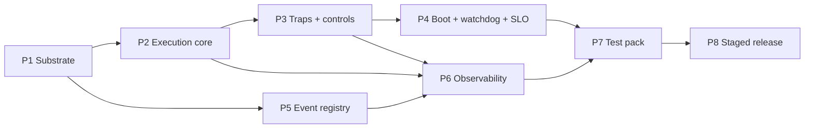

# Engine Arc Phase 1 — Implementation Plan (Overview)

**Commission:** Central Polling/Event-Management Engine — BUILD (Emperor overruled gate-hold; scores gate 3.80 vs build 2.65, both recorded on ledger ENSEMBLE-38, Discord 2026-11-21).
**Pipeline stage:** 1 of 4 (planner → **architect** → reviewer → approver). This directory is the planner-stage deliverable set.
**Worktree / base:** `/home/nea/ensemble-src-wt-engine-arc-p1` · branch `feature/engine-arc-phase1` · HEAD `aed3eabce` = base `b71742fe3` (v0.31.23) + Phase-0 study docs.
**Binding design:** `../central-polling-engine-study/decision-report.md` §B.2 (frozen engine design — ALL 10 components), §B.1 primitives as engine internals, §B.3 event catalog. Census anchors taken @ `bf4bfde6e`; ALL code anchors in this plan re-verified at `b71742fe3` (18 drifted — see `research-anchors.md` §9).
**Date:** 2026-11-21. **Rulings verbatim:** recorded in `decisions.md` Part A.

---

## 1. Objective

Build the central engine (frozen §B.2, all 10 components) **plus** the Emperor-ruled event registry (registration + observability layer only), with self-describing registration (Emperor addendum), shipping **DORMANT** — registered, observing, executing nothing — so the Phase-2 pilot (recommended: OrphanWatcher post-fix) is a single flag flip. Boot SLO 120s (boot_epoch→readyz-green, Emperor-set, CLOSED) is the acceptance gate for the boot-phase component. No module migrates in Phase 1; no existing periodic mechanism is refactored.

## 2. The Five Pillars → Deliverables

| Pillar | Scope | Primary deliverable |
|---|---|---|
| 1. Engine (frozen §B.2) | JobSpec+registration, `engine_jobs`+`engine_runs` (own .sql each), execution classes, single-flight, honest state machine, trap-impossibility, kill switches (FAIL-TO-LEGACY), boot-phase classes + engine-independent watchdog BUILT AND DRILLED, SERVICES_* continuity + dead-knob cleanup, dual-path harness | `phase1..4-plan.md`, `phase6-plan.md`, `phase7-plan.md` |
| 2. Event registry | Kind catalog (§B.3 classes 1–4; class 5 deferred_v2), structured emission w/ ids, per-kind metrics (firing counts, consumers, lag); NO fan-out unification, NO queue-depth triggers (seam named only) | `phase5-plan.md` |
| 3. Emperor addendum | Self-describing register(): service_tag/service_name, category, module_info, description, extensible metadata; metrics labels service_tag+category; ANTICIPATES maintenancer tool + /metrics UI tab (design-for, not build) | folded into P1 (schema/API), P6 (read substrate) |
| 4. Dormant boot | Registered, observing, executing NOTHING by default; dual-path harness makes Phase-2 pilot a flag flip | `phase2-pilot-recommendation.md`, P3/P4 |
| 5. Boot SLO | Measure current vs 120s bar; wire acceptance gate | `boot-slo-measurement.md`, P4 |

## 3. Phase Decomposition (detail in phaseN-plan.md; authority: those files)

| Phase | Name | Objective | Est-h (low/high) | Depends |
|---|---|---|---|---|
| P1 | Substrate | 2 migration files + models/repo + EngineConfig + self-describing JobSpec/register() + SERVICES_* continuity + dead-knob cleanup | 22/35 | — |
| P2 | Execution core | Tick loop, 3 concurrency classes, single-flight, honest state machine (incl. SHADOW skip), durable run record | 28/38 | P1 |
| P3 | Trap-impossibility + controls | Getter-at-tick deps, LOUD boot assertion, dead=true, kill switches fail-to-legacy, dual-path harness | 22/37 | P2 |
| P4 | Boot phase + watchdog | Boot-phase classes + jitter, engine-independent watchdog built AND drilled, boot-SLO ≤120s wire, the ONE api.py lifespan edit | 20/33 | P3 |
| P5 | Event registry v1 | Kind catalog over existing substrates, bounded emission ring, per-kind observability, labeled failure postures | 18/31 | P1 |
| P6 | Observability shape-readiness | `/api/engine/*` read substrate (3 GETs), read-time union with `job_metrics()`, GATED metrics-family ceremony (default deferred) | 9/15 | P2,P3,P5 |
| P7 | Test pack buildout | 10 pack registrations, mutation matrix, dormant/diff-audit/fence-sweep legs | 12/23 | P1–P6 |
| P8 | Staged release | Slot derived live at stage time (W9), delta-only rollback adjudication, dormant disclosure, NO promote | 5/10 | P7 |
| **Total** | | | **136/222 (≈176 mid)** | |

**Band verdict: INSIDE 118–222.** ≈9% above the 162h anchor; excess priced in `phase1-plan.md` §0.2a: 28-site repo-wide dead-knob cleanup (≈5h; review fold F-2 — the earlier 26 was tests/-scoped), watchdog drill (≈4h), diff-census record (≈1h) — carrying costs the anchor folded in. Test estimate cross-check: `test-strategy.md` 28/48h vs P7 12/23h + per-phase AC test effort (reconciled: P7 is pack assembly; component tests ride each phase; P7 recount per approver iteration-002 N-h).

## 4. Dependency & Parallelism

Parallel lanes: **P4 ∥ P5** after P3/P1 respectively; P6 fans in. With the fast lane (`fix/phase1-live-defects`) running concurrently: file overlap is **`daemon/api.py` only** (live-defects regions `:1226-1272`/`:3018-3041`/`:4532-4547`; engine P4 lifespan ~`:3740` + shutdown <`:4600`, P6 include_router ~`:6359`) — textually disjoint, either merge order auto-merges; P4 must additionally avoid the strings `tests/test_settings_source_order_pin.py` anchors on.

## 5. Research Base (2 explorers, both HIGH confidence)

Key findings that shaped the plan (full: `research-anchors.md`, `research-bootslo-raw.md`):
- **Anchor drift is real:** 18 census anchors moved bf4bfde6e→b71742fe3 (all old→new listed); event-surface anchors unchanged; both live traps (OrphanWatcher born-dead ctor-capture `orphan_watcher_sweep.py:131-138`; JobLockSweep Template-B PEXIT `:241-250`) verified INTACT.
- **Migrations:** 134 .sql files (blueprint's "119" stale; the study-note 127 was itself stale — architect FA-2 census); IF NOT EXISTS mandatory (create_all runs first — bare CREATE silently no-ops); `engine_jobs`+`engine_runs` get separate files.
- **Awaited boot passes: 29** (+7 create_task +1 thread cluster), enumerated per-line in phase4 §4.1 — the census "~11" was a subset. `MANAGED_KEYS` = 19 live (AST-counted, pinned) → engine switches stay env/config tier in Phase 1. RDRS interval read site corrected: `pool_orchestrator.py:370` (no `worker_pool/` package).
- **Fences (30 surveyed; 5 material — see §7 Risks):** zero existing fences on `engine_jobs`/`engine_runs`/`ENSEMBLE_ENGINE`/`job_metrics` (names unclaimed); closed metrics census forces zero-family registration with a gated ceremony; `job_metrics()` byte-shape pin forces read-time union, never edit.
- **Boot telemetry:** no dedicated duration field exists; gate `READYZ_BUDGET_S=120` clocks a DIFFERENT window (post-handback); never subtract `boot_epoch` (DB clock) from `detail.checked_at` (host clock) — ~4s offset.

## 6. Boot SLO — Verdict (detail: `boot-slo-measurement.md`)

**Typical boots are COMFORTABLY UNDER 120s.** 19 live promote boots: median 13.1s / p90 22.8s / max 23.2s (= 19.3% of budget, ~5× headroom); hard-reboot drill 13–15s; worst cold-DB (sandbox fresh-PG) 67s ≈ 1.8× headroom. Near/over cases are **PRE-EXISTING conditions, not Phase-1 regressions**: (a) 67s sandbox cold-DB shape; (b) 2026-10-09 v0.18.5 DB-outage promote — readyz never green in budget (probe-timeout-under-load class, predates this lane ~6 weeks). Inherited "302s"/"~54s" figures unverifiable in files — marked not-counted.

**Gate wiring (dispatcher adjudication):** host-frame gate — start anchor owned by whatever launches the boot (test harness / promote lane; `boot_smoke.sh:496-524` already polls, raise `POLL_TIMEOUT` 45→≥120s) → poll `/readyz` `status=="ready"` → delta ≤120s. Because unit-start precedes the `boot_epoch` stamp, a host-frame pass implies the Emperor's boot_epoch-frame SLO **a fortiori**. Literal-`boot_epoch` binding remains available as durable telemetry (add `first_ready_db_clock` to the boot record, `boot_record.py:269`) — routed follow-up, not gate-blocking. Gate scope: all boot classes this lane can produce (dev cold-DB included); live-promote stays the binding reference class.

## 7. Top Risks (full registers in phase docs)

1. **F-23 diff-census record (~27 entries, release-blocking)** — `git diff --name-only` vs fixed LANE_BASE with enumerated allowlists; the record is maintained by the changing lane. Single biggest hidden cost the fence check surfaced; owned by P6.
2. **F-29 dead-knob deletion fence** (`tests/conftest.py:535`) — dead-knob deletion explodes unless **all 28 repo-wide sites are cleaned atomically** (review fold F-2: 21 pydantic kwargs + 5 worker_poll_interval SET files + 2 registered pack sites **[CORRECTED — P1-review 2026-11-21: census = 20 `checkpoint_interval=` kwargs (18 non-pack + 2 pack) / 28 consumer sites / 32 unique edit sites / 29 files; prior "21 kwargs + 5 SET + 2 pack" double-counted the packs]**; AMD-9 mechanism: spec= allows SET — the real vectors are the pydantic kwargs + GET-on-spec-mock). P1 T1.12 = ONE task, not two; census re-derived at merge-base-confirm time (review fold F-9 gate).
3. **`daemon/api.py` shared file with the fast lane** — textually disjoint today, but both lanes land in one file; explicit-pathspec commits + merge-order check at finalize (house concurrent-commit rules).
4. **Clock-frame trap in boot measurement** — any future gate that mixes DB/host clocks inflates by ~4s and can false-fail near the bar; the a-fortiori host-frame design eliminates the dependency.
5. **Shadow-evidence dependency of the pilot greenlight** — if the engine ships default-OFF (not observing), `would_fire`/`dead`/shadow evidence never accumulates and the Phase-2 greenlight criteria become unsatisfiable (see adjudication D-3).
6. **Watchdog must be DRILLED, not assumed** — evidence artifact required (P4 + `test-strategy.md` §4: stall-leg + cancel-leg drills with independent-recovery assertion).

## 8. Cross-Document Reconciliation (dispatcher adjudications — record in decisions.md Part C)

- **D-1 Test authority:** `test-strategy.md` owns test FILE names (its §1.1 = stable contract) and the mutation matrix (23 legs = authority; phase docs' "≈34 per-AC" = upper envelope).
- **D-2 Boot-SLO frame:** host-frame gate (b) adopted — see §6. `test-strategy.md` §5's timed-probe carrier is (b)-shaped (harness owns the start anchor); no inconsistency survives this ruling.
- **D-3 `ENSEMBLE_ENGINE_ENABLED` polarity: ship `enabled=true` + `shadow_mode=true`.** Pillar 4 verbatim is "REGISTERED, OBSERVING, EXECUTING NOTHING" — observing requires the tick loop to run and record shadow evidence; default-OFF would make the Phase-2 greenlight criteria (≥2 cycles shadow, zero false-dead) unsatisfiable and violate the pillar's "OBSERVING". Execution remains impossible by construction: no module carries `SERVICES_<MODULE>_USE_ENGINE=1` in Phase 1. `ENSEMBLE_ENGINE_ENABLED=false` stays the one-flag full-off. (Phase docs flagged this fork; dispatcher rules; architect may veto in review.) [RESOLVED-BY-RULING (c): ADOPT, no veto]
- **D-4 Numbering:** Emperor's frame adopted — build = Phase 1, first migration (pilot) = Phase 2. Study §C.2's "Phase 1 — pilot" predates the BUILD ruling; mapping recorded.
- **D-5 RDRS path correction:** `pool_orchestrator.py:370` (there is no `daemon/services/worker_pool/` package).

## 9. Fast Lane & Release Strategy (facts from phase docs; recommendation owned by decisions.md)

Coupling facts: file overlap `daemon/api.py` only, textually disjoint (auto-merge either order); the Phase-2 pilot **structurally depends** on the OrphanWatcher fix (`fix/phase1-live-defects`) landing in `latest` — the pilot's parity baseline is unanswerable while the service is born-dead; no duplicate work (fast-lane late-bind fix = one service; engine `dead=true` contract = the general detector — complementary). Release slots derived LIVE at release-prep per W9; NO live promote (Emperor ceremony).

**Dispatcher recommendation (for decisions.md to adopt/refine): TWO staged releases — defects-first.** The two live-defect fixes are small, independently verifiable, and ready long before the 136–222h engine build completes; holding them for one combined release delays live remediation (OrphanWatcher born-dead + 70MB bash-reaper leak) for no coupling benefit, since the api.py regions are disjoint and the pilot only needs the fix in `latest` by Phase-2 time, not by engine-merge time.

## 10. Phase-2 Pilot Recommendation (detail: `phase2-pilot-recommendation.md`)

**OrphanWatcherSweepService, post-fix** — reconcilers family, `DB_OFFLOAD` registration class **[corrected — leader ruling (approver iteration-002): per-tick DB writes (`dependency_bus.py:3230-3255` UPDATE via `asyncio.to_thread`, entered from `orphan_watcher_sweep.py:229-236`) disqualify MAIN_LOOP under the P7 pin; ruling verbatim in `decisions.md` §Leader rulings — the earlier "MAIN_LOOP class" here is superseded]**, 90s cadence. Strongest reasons: (1) exact motivating specimen for the getter-at-first-tick primitive (ctor-capture born-dead verified intact at this tree; 216 no-op ticks live); (2) smallest single-topology blast radius, and the fast-lane fix isolates engine behavior from defect; (3) gains a kill switch it never had, with a dormant-shadow before/after baseline. Greenlight criteria are measurable and RE-BASELINED per architect ruling (a) / AMD-1(c) (canonical strings CS-2..CS-4 live in `phase2-pilot-recommendation.md` §5 — see the §PREDICATE LEDGER below; the ceremony-gated "≥2 release cycles" framing and the `job_metrics`-family dependency are withdrawn): shadow-evidence maturity per ruling (a); zero false shadow-dead on healthy mechanisms (CS-3, reading on the CS-9 observer carve-out); fix landed+verified legacy-side (runs_total>0 under engine execution is post-flip acceptance); boot-SLO gate green dormant; watchdog drill evidence; mutation pins in PACKS.md. Alternatives assessed and rejected-as-first with reasoning.

## 11. Out of Scope (explicit)

Migration tail (~20 eligible modules, ≈4–10h/module, each its own gated commission — one-by-one rule) · fan-out primitive unification (GAP-15) · queue-depth triggers (GAP-14, seam named) · wakeup churn (§B.4, separate commission) · families 8–9 + scheduler substrate (standalone permanently) · any live contact beyond read-only telemetry · NO refactoring of existing periodic mechanisms (dormant boot).

## 12. Open Questions Carried Upward (architect stage; none Emperor-blocking)

1. **Shadow duration before pilot flip** — ~~≥2 release cycles (conservative)~~ vs early flip on OrphanWatcher's own health? (`phase2-pilot-recommendation.md` presents both.) **[WITHDRAWN option — round-2 fold sweep, 2026-11-21:** the ceremony-gated "≥2 release cycles" option is withdrawn by architect ruling (a) / AMD-1(c); the re-baselined criterion is CS-2 (verbatim in `phase2-pilot-recommendation.md` §5). Question retained as the record of what was carried upward.**]
2. **Second migrant ordering** — healthy-sweep (parity proof) vs PEXIT-class (JobLock/SourcesGc)? Phase-2+ concern; registry evidence will inform. [RESOLVED-BY-RULING (b): JobLockSweepService second — primitive-proven-second framing]
3. **D-3 polarity ratification** — dispatcher ruled enabled+shadow; architect review may veto. [RESOLVED-BY-RULING (c): ADOPT, no veto — ships enabled=true + shadow_mode=true]
4. **Start-anchor build-side emit** — confirm the harness/promote-lane owns it (dispatcher ruling) or route a daemon-side emit (deferred-task seam `api.py:1082-1093`) if promote-lane capture proves brittle. [RESOLVED-BY-RULING (d): D-2 RATIFIED — harness/promote-lane owns the anchor; daemon-side emit = named fallback]

## 13. Provenance

Produced by the planner-stage dispatch: 2 explorers (`research-anchors.md` — anchors/fences/hook points; `research-bootslo-raw.md` — live read-only boot telemetry) + 3 workers (phases w/ `grep-fence-check-before-design-substrate` skill applied — 30 fences surveyed; tests; slo+pilot) + this synthesis (planner, aggregator boundary). All workers planning-only: zero code, zero test runs, zero git mutations; commit lands via the decisions lane. Census anchor caveat: re-grep at use time — 18 anchors already drifted one base-version apart.

---

## §PREDICATE LEDGER (review-fold reconciliation, 2026-11-21)

Added by the review-fold reconciliation pass (findings F-1..F-10). **Body wins, ledger mirrors** — every canonical string below appears VERBATIM in the body site(s) it governs; a body/ledger divergence is resolved in the body's favor and the ledger corrected in the same change.

### (i) Canonical strings (one per re-baselined predicate)

| ID | Predicate | Canonical string (verbatim in body) | Governing body site(s) |
|---|---|---|---|
| CS-1 | Dormant-boot posture — observer-spec semantics (AMD-1) | `N observer specs registered, zero executables (`execute_fn` withheld), shadow rows present` | `phase4-plan.md` D4.11 · AC4 · AC8 · `phase7-plan.md` Leg D · `test-strategy.md` §3.2 leg 1 · `phase8-plan.md` D8.4(a) |
| CS-2 | Greenlight criterion 1 — ruling (a) rewording, verbatim | `≥2 independent boots of shadow evidence on the priority targets (one of which is the staged-release boot smoke), AND long-cadence maturity: every registered target has been shadow-evaluated through ≥2× its interval, AND a ≥48h live soak post-promote before the pilot flip.` | `phase2-pilot-recommendation.md` §5 criterion 1 |
| CS-3 | Greenlight criterion 2 (AMD-1(c) shadow-dead semantics) — **[SUPERSEDED AS A STANDALONE PREDICATE → CS-9, leader ruling approver iteration-002: the bare string was UNDECIDABLE — D2.15's zero-runs-in-2×interval dead definition + D3.4's run-required recovery made it unsatisfiable for every execute_fn-withheld spec; criterion 2 now reads on CS-9's decidable carve-out; the string itself survives as criterion 2's head]** | `Zero false shadow-dead on healthy mechanisms` | `phase2-pilot-recommendation.md` §5 criterion 2 |
| CS-4 | Greenlight criterion 5 split (AMD-1(c)) | `fix-landed verification stays legacy-side (the fast-lane lane's own evidence); "runs_total>0 for OrphanWatcher **under engine execution**" moves to the pilot's post-flip acceptance evidence` | `phase2-pilot-recommendation.md` §5 criterion 5 |
| CS-5 | D-3 adopt / dormant-default semantics (AMD-3(c)) | `ships `enabled=true` + `shadow_mode=true`; dormant-default = registered observer specs, zero executables, shadow rows accumulating; per-job `USE_ENGINE` all unset.` | `test-strategy.md` §1.1 T8 · §3.1 |
| CS-6 | Shadow-row cadence (AMD-1 + D2.13) | `shadow rows are BY DESIGN one `SKIPPED_SHADOW` row per due job per interval` | `phase2-plan.md` AC9 |
| CS-7 | Shadow-row retention bound (AMD-1(e)) | `P2 specifies a retention bound for shadow rows (house TTL/sweep pattern; bounded append-only growth)` | `phase1-plan.md` §5 retention note |
| CS-8 | Dead-knob site census — repo-wide, 28 sites (review fold F-2; AMD-9 mechanism) **[CORRECTED — P1-review 2026-11-21: census = 20 `checkpoint_interval=` kwargs (18 non-pack + 2 pack) / 28 consumer sites / 32 unique edit sites / 29 files; the prior "21 kwargs + 5 SET + 2 pack" double-counted the 2 pack sites (they sit inside the 20); the dev's 34 double-counts the packs; the dev's "28 was a double-count artifact" claim = their off-by-2. Old canonical retained as superseded: `the FULL 28-site set: 21 pydantic PersistenceConfig(checkpoint_interval=…) kwargs + 5 worker_poll_interval SET files + 2 pack sites`.]** | `20 `checkpoint_interval=` kwargs (18 non-pack + 2 pack) + … — 28 consumer sites / 32 unique edit sites / 29 files` | `phase1-plan.md` T1.12 · §7 F-29 |
| CS-9 | Observer-liveness carve-out (leader ruling, approver iteration-002 — SUPERSEDES CS-3 as the standalone predicate; canonical carve-out string, verbatim in `decisions.md` §Leader rulings) | `for specs with execute_fn withheld, dead ⇔ zero SKIPPED_SHADOW rows in 2× interval (the observable execution-substitute); D3.4 recovery is N/A for observers (no run exists to recover)` | `phase2-plan.md` D2.15 · `phase3-plan.md` D3.4 · `phase2-pilot-recommendation.md` §5 criterion 2 · `plan-overview.md` §10 |

### (ii) DELETION RECORD (withdrawn predicate strings — the `registrations=0` / zero-engine_runs / writes-no-rows / "registers nothing" family)

| Withdrawn string | Removed from | Replaced by |
|---|---|---|
| `registrations=0` (posture INFO pin) | `phase4-plan.md` AC4 | `registrations=N observer specs` + CS-1 |
| `registrations=0` (release-blocking boot assertion) | `phase7-plan.md` Leg D | CS-1 |
| "with zero registrations" (leg phrasing) | `phase7-plan.md` T7.4 | "N observer specs registered (zero executables — the D4.11 posture)" |
| "registers nothing" (zero-estate-contact AC) | `phase4-plan.md` AC8 | CS-1 |
| "with zero estate registrations" (default-posture tail of the dormancy truth table) | `phase1-plan.md` D1.9 | "N observer specs registered at boot per AMD-1 (registration-for-observation is NOT migration; zero `USE_ENGINE` estate migrations)" |
| "writes no rows" (dormant AC) | `phase2-plan.md` AC9 | CS-6 |
| "zero `engine_runs` rows" + "zero `engine_jobs` rows created by the engine itself" (boot assertions) | `phase7-plan.md` Leg D | "`engine_runs` carries ONLY `outcome=SKIPPED_SHADOW` rows (one per due job per interval)" |
| "ships dormant with zero registrations" (ceremony disclosure (a)) | `phase8-plan.md` D8.4(a) | "observer-spec posture — CS-1" |
| `SELECT count(*) FROM engine_runs == 0` (dormant-boot proof) | `test-strategy.md` §3.2 leg 1 | CS-1 + SKIPPED_SHADOW-rows-only assertion |
| "`ENSEMBLE_ENGINE_ENABLED` default OFF semantics" (T8 authoring pin) | `test-strategy.md` §1.1 T8 | CS-5 (D-3 adopt) |
| "`ENSEMBLE_ENGINE_ENABLED` unset/OFF ⇒ … executes NOTHING" (unset-implies-off semantics) | `test-strategy.md` §3.1 first bullet | CS-5 + explicit-OFF-only bullet (unset resolves to the shipped `enabled=true` default per AMD-8) |
| "≥2 release cycles" (ceremony-gated criterion-1 framing) | `phase2-pilot-recommendation.md` §5 criterion 1; `plan-overview.md` §10 summary | CS-2 (ruling (a) verbatim) |
| "converged `job_metrics` family" (criterion-1 family dependency; D-6 explicitly rejects families) | `phase2-pilot-recommendation.md` §5 criterion 1 | engine's own in-process snapshot (D2.14) |
| "The engine is built only if the gate fires" (pre-ruling remnant — not the registration family; recorded for completeness) | `phase2-pilot-recommendation.md` §6 (marked SUPERSEDED, retained as the migration-escalation criteria it actually governs) + §5 falsification item (iii) (bracket note) | F-7 note: the §E.3 gate governs MIGRATION ESCALATION only, never the build (build unconditional per Emperor ruling #1) |
| "Phase 1 is dormant with **zero** registrations, so the blast radius at ship time is nil" (risk-table mitigation premise; A-1) | `phase2-plan.md` §9 Risks (first-row Mitigation cell, L112) | CS-5 posture: ships `enabled=true` + `shadow_mode=true` with N observer specs registered, zero executables, `USE_ENGINE` all unset — blast radius nil BECAUSE nothing executes (dispatch structurally impossible) |
| "≥2 release cycles of dormant shadow evidence" (SECOND instance — cross-ref restatement; A-2) | `phase1-plan.md` §12.3 cross-ref bullet, L356 | CS-2 + CS-3 (criterion framing cited by id; bolded consequence clause survives) |
| "registration of 0-2 fixture jobs" (D4.9 cost-bound premise correction; R-1) | `phase4-plan.md` D4.9, L40 | "registration of N observer specs, zero executables — CS-1 posture, no execution" (≤250ms bound unchanged) |
| "the sweep's work is pure in-memory watcher reconciliation (no DB touch on the hot path)" + the MAIN_LOOP registration class for OrphanWatcher (pilot class family; leader ruling L-7, approver iteration-002) | `phase2-pilot-recommendation.md` §1 L10, §3 L30 ("No DB-offload or dedicated-executor complexity"), §3 L32 (class-fit paragraph), §4 conclusion ("single-topology"); `plan-overview.md` §10; `phase1-plan.md` §12.3 | `DB_OFFLOAD` registration class per the ruling (verbatim in `decisions.md` §Leader rulings; factual basis `dependency_bus.py:3230-3255` UPDATE via `asyncio.to_thread`, entered from `orphan_watcher_sweep.py:229-236`; P7 pin phase2-plan D2.2/:116); old strings retained inside visible [corrected — leader ruling …] brackets at each site |
| "dead=true ⇔ zero runs in 2× interval" AS APPLIED UNQUALIFIED to execute_fn-withheld observer specs (CS-3 family; leader ruling L-8, approver iteration-002) | `phase2-plan.md` D2.15; `phase3-plan.md` D3.4 (recovery requires a successful RUN — N/A for observers); `phase2-pilot-recommendation.md` §5 criterion 2 (undecidable standalone reading) | CS-9 observer carve-out: dead ⇔ zero `SKIPPED_SHADOW` rows in 2× interval; D3.4 recovery N/A for observers; criterion 2 reads on that definition (supersession recorded at the CS-3 ledger row, which stays readable with its SUPERSEDED marking) |

**Ruling-record note:** literal `registrations=0` occurrences REMAIN inside `architecture-recommendation.md` (§1(c) correction, findings register #1, AMD-1). These are the ruling text itself quoting the withdrawn string AS the thing withdrawn ("Amend D4.11 from `registrations=0` to `registrations=N observer specs`") — visibly self-marking it superseded, retained per F-10's single-edit restriction on that file. They are ruling record, not live predicates.

### Re-derivation gate disclosure (review fold F-9)

origin/latest MOVED during review — `b71742fe3` → `01ec292da` (~20 commits, 29 code files, incl. a dead-knob site) — and will move again before this ~176h build merges (total recounted 136/222 ≈176 mid — approver iteration-002 N-h). Dispatcher ruling: wire an EXPLICIT RE-DERIVATION GATE rather than re-deriving at-pass. Wired: (1) the dead-knob census is re-derived at merge-base-confirm time, immediately before execution (`phase1-plan.md` T1.12); (2) P4's anchor set (the 29-pass inventory + api.py region anchors) is re-grepped at execution start (`phase4-plan.md` §4.1).

### (iii) Closing ATTESTATION — every changed row in this pass

1. `plan-overview.md` — §3 Band verdict row (26→28-site census echo, F-2); §7 Risk 2 (F-29 row restated: 28 repo-wide sites, AMD-9 mechanism, F-9 gate); §10 pilot summary (criteria re-baselined per ruling (a)/AMD-1(c), CS-2..CS-4 pointers); NEW §PREDICATE LEDGER section (this section).
2. `phase1-plan.md` — §0.2a Band check (a)-clause (28 repo-wide dead-knob sites, F-2); D1.9 default-posture tail (withdrawn "zero estate registrations", AMD-1 observer-spec posture); T1.12 row (F-2 census CS-8 + AMD-9 mechanism + F-9 re-derivation gate; pack sites added to anchors cell); §5 retention note (AMD-1(e), CS-7); §6 Effort dead-knob row (23 kwarg call sites = 21 tests/ + 2 pack files); §7 F-29 fence (AMD-9 mechanism correction + CS-8 + F-9 gate).
3. `phase2-plan.md` — AC9 (withdrawn "zero estate registrations"/"writes no rows"; CS-6).
4. `phase2-pilot-recommendation.md` — §5 criterion 1 (CS-2 verbatim, F-1 site 7 + F-6); §5 criterion 2 (CS-3, AMD-1(c)); §5 criterion 5 (CS-4, AMD-1(c) split); §5 Falsification item (iii) (corroboration bracket); §6 heading note + "B (subset engine)" bullet (F-7 SUPERSEDED marking).
5. `phase4-plan.md` — D4.11 (AMD-1: `registrations=0` → N observer specs, execute_fn withheld, T1.11 cadences; withdrawn string named as WITHDRAWN in Rejected cell); §4.1 Consequence paragraph (F-9 anchor-freshness gate); T4.4 (AMD-5: `set_event_sink(...)` composition line named; canary `register()` site + `SERVICES_<CANARY>_USE_ENGINE` fixture one-owner sentence); AC4 (CS-1); AC8 (CS-1).
6. `phase7-plan.md` — T7.4 (withdrawn "with zero registrations"); Leg D (CS-1, RELEASE-BLOCKING re-baseline).
7. `phase8-plan.md` — §4 Release-scoping note over T8.1–T8.9 (AMD-4 two-invocation machinery + F-5 ownership sentence + rationale); D8.4(a) (CS-1 observer-spec disclosure); D8.6 (AMD-4 two-release staging + ownership); T8.1 (release B/A split marker); T8.4 (per-release adjudication marker).
8. `test-strategy.md` — §1.1 T8 (CS-5, AMD-3(c)); §3.1 (CS-5 char-for-char + D2.13 shadow-row cadence + AMD-8 unset semantics); §3.2 leg 1 (CS-1 + SKIPPED_SHADOW-rows-only).
9. `research-anchors.md` — §2 "Engine-independent watchdog" insertion-point line (F-3: asyncio research shape marked SUPERSEDED; BUILT daemon-thread shape per AMD-2/D4.6; research history retained).
10. `architecture-recommendation.md` — §4 AMD-5 block ONLY (F-10 one-line supersession note: FA-6 "P4 declares the registry Out" vs set_event_sink-in-T4.4 safe under D4.10's guarded-block posture). No other line in this file touched.

**Round-2 fold (2026-11-21)** — four surviving same-family instances the round-1 sweep missed (risk tables / cross-refs / rationale cells — the round-2 lesson). Zero design change; reconciliation only:
11. `phase2-plan.md` §9 Risks first-row Mitigation cell (A-1, L112) — dormant "**zero** registrations" premise → CS-5 posture (ships `enabled=true` + `shadow_mode=true` + N observer specs, zero executables, `USE_ENGINE` all unset; blast radius nil BECAUSE nothing executes).
12. `phase1-plan.md` §12.3 cross-ref bullet (A-2, L356) — "≥2 release cycles of dormant shadow evidence" restatement (a SECOND instance of the withdrawn string, in a cross-ref section) → CS-2 + CS-3 cited by id; bolded consequence clause preserved.
13. `test-strategy.md` §4 design-constraints paragraph (R-2, L124) — asyncio-loop research shape marked SUPERSEDED with the research-anchors.md:86 bracket convention; BUILT daemon-thread shape per AMD-2/D4.6 (shared-atomic state channel, engine-independent recovery).
14. `phase4-plan.md` D4.9 (R-1, L40) — "registration of 0-2 fixture jobs" premise → "registration of N observer specs, zero executables — CS-1 posture, no execution"; ≤250ms bound unchanged.
15. `phase4-plan.md` SLO-1 must-not-regress table (sweep-driven, L119) — a SECOND "0-2 fixture registrations" premise → "N observer specs registered, zero executables — CS-1 posture"; ≤250ms bound unchanged.
16. `plan-overview.md` §12 open question 1 (sweep-driven, L107) — the "≥2 release cycles (conservative)" option struck + bracket-WITHDRAWN (ruling (a)/AMD-1(c); re-baselined criterion CS-2). Question retained as the carried-upward record.
17. `decisions.md` Part E items 1–4 (round-2 residue follow-up) — each marked RESOLVED-BY-RULING (a)/(b)/(c)/(d); historical question text retained verbatim, bracket-appended per the package's visible-mark convention.
18. `plan-overview.md` §12 items 2–4 + `phase2-pilot-recommendation.md` L110 (round-2 residue, final) — marked RESOLVED-BY-RULING (b)/(c)/(d); the "healthy-vs-PEXIT / either is defensible" and "architect review may veto" pre-ruling framings now visibly resolved.
19. D-3 veto caveat (`decisions.md` D-3 entry; `plan-overview.md` §8 D-3 line) + `boot-slo-measurement.md` open questions 1–2 (round-2 residue closeout) — marked RESOLVED-BY-RULING (c)/(d); veto-cost note discharged per ruling (c), start-anchor and (b)-vs-(c) reconcile resolved per ruling (d)/AMD-6. Historical text retained verbatim.
Plus this ledger: DELETION RECORD gains the three withdrawn strings (A-1/A-2/R-1); ATTESTATION gains this Round-2 subsection.

**Approver iteration-001 fold (2026-11-21)** — AMD-6 application + notes reconciliation (final cycle, all items landed; every changed row of THIS pass):
20. `test-strategy.md` §5 Measurement-method bullet (B-1) — AMD-6 applied: probe re-pointed to the harness-owned HOST-frame start anchor (unit `ActiveEnterTimestamp` / launcher `starting:` line) → poll `/readyz` until `status=="ready"` → delta ≤120s, ONE frame; `boot_epoch`→first-ready DB stamp demoted to TELEMETRY ONLY (never a gate input); daemon-side readyz-green emit = NAMED FALLBACK; old mixed-frame construction retained inside a [SUPERSEDED — AMD-6, approver iteration-001] bracket.
21. `decisions.md` D-2 Owner line (B-2) — the "already (b)-shaped" clause marked FALSE/corrected per architecture-recommendation.md §1(d); §5 was mixed-frame until fold B-1.
22. `boot-slo-measurement.md` §7 open question 2 bracket (B-3) — amended: the §5 rewrite LANDED at approver iteration-001 (B-1), not round-1; §5 Coordination note gained an [APPLIED — approver iteration-001] bracket (same reconciliation family).
23. `plan-overview.md` §PREDICATE LEDGER (B-4) — this Approver iteration-001 subsection itself.
24. `phase4-plan.md` §4.3 (B-5) — Gate line probe-frame clarifier (host-frame probe, a-fortiori per ruling (d)); start-anchor table row re-pointed to the host-frame anchor (`boot_epoch` = telemetry only); [SUPERSEDED — AMD-6] bracket on the old DB-clock start row; SLO-3 rehearsal row recomputed on the host-frame delta (the `first readyz composite → boot_epoch` mixed subtraction withdrawn). Self-sweep (a) catches, same family: §4.1 must-not-regress bucket window marked boot_epoch-frame TELEMETRY (gate probe host-frame per §4.3/AMD-6); T4.7 acceptance cell re-pointed to the HOST-FRAME delta `readyz_green − boot_start` with `boot_epoch` observability as TELEMETRY (the old mixed-frame compute target bracketed SUPERSEDED).
25. `plan-overview.md` §5 (N-6) — migration census 127 → 134 (FA-2; study-note 127 marked stale).
26. `research-anchors.md` §1 (N-6) — count 127 → 134 (tree-verified); 3-NEWEST enumeration corrected to the real newest three (`20261119_000001_add_proposal_decision_columns.sql` / `20261116_083000_add_room_resolution_warnings.sql` / `20261115_120000_add_room_proposal_dedup_columns.sql`) + max-number line updated; §9 drift-table row 127 → 134; `phase1-plan.md` T1-census cell's "research-anchors says 127 — STALE" note co-corrected (the accusation is stale once the target is fixed).
27. `decisions.md` Part D (N-7) — items 8–11 appended: OPEN-UNTIL-APPLIED records for AMD-7 (service_tag UNIQUE + :305 PK-wording), AMD-8 (absent-vs-malformed env split → P1 AC4 + P3 T3.2), AMD-10 (two ordered follow-ups → Part D), AMD-11 (:165 "70-field" absolute + phase8-plan.md:33 D8.3 "zero hits" false vs test_sqlite_guards.py:84/:138). Plan bodies NOT edited (recording route per approver).
28. `decisions.md` Part B (N-8) — reconciliation line: commission "migrations deferred" = MODULE migrations only; the engine's OWN two additive .sql files (`engine_jobs.sql`, `engine_runs.sql`) land in P1 per §B.2 — no tension.
29. `phase2-pilot-recommendation.md` (N-9) — :18 census line + :124 code-anchors line: `config.py:2633` → `:2695`; `daemon/orphan_watcher_sweep.py` → `daemon/services/orphan_watcher_sweep.py`.
30. `phase5-plan.md` :34 (N-9) — dead `event_bus.py:60-72` queue anchor → `:251/:289-303`.
31. `test-strategy.md` M-02 row (N-9) — dead `maintenance.py:260-269` citation marked [citation SUPERSEDED — approver iteration-001]; landed v0.31.11 shape cited (`:524-528`/`:530-532`/`:568-601`).
32. `plan-overview.md` :6 (N-9) — "`research-anchors.md` §Q9" → "§9".
33. `plan-overview.md` §3 (N-10) — total mid ≈180 → ≈177 (floor-mid sum-accurate); band verdict ≈11% → ≈9% (derived co-correction); sibling instances co-corrected to the same figure: `phase1-plan.md` (:80 TOTAL row + :82 band check) and `decisions.md` D-entry echo (:95 "137/222 h (≈177 mid)").
34. `phase1-plan.md` §6 effort row (N-10) — "23 kwarg call sites" reworded to the FULL 28-site CS-8 set (21 pydantic kwargs + 5 SET + 2 pack **[CORRECTED — P1-review 2026-11-21: census = 20 `checkpoint_interval=` kwargs (18 non-pack + 2 pack) / 28 consumer sites / 32 unique edit sites / 29 files; prior "21 kwargs + 5 SET + 2 pack" double-counted the packs]**).
35. `test-strategy.md` node totals (N-10) — "≈61–107" → "71–107" (§2 total line + §8 effort row).

**Approver iteration-002 fold (2026-11-21)** — leader rulings + mechanical folds + package-wide closure (final pass before cap; every changed row of THIS pass):
36. `test-strategy.md` §3.2 leg 2 (M-1) — `ENSEMBLE_ENGINE_SHADOW_MODE=false` pinned explicitly in the canary-activation boot env (AMD-3, arch-rec :137-138), with ALL REAL `SERVICES_*_USE_ENGINE` unset (canary fixture = the ONLY executable registration); "pilot-shaped" re-anchored to "pilot-shaped registration"; under shipped `shadow_mode=true` the leg's "EXACTLY one engine job activates" assertion was structurally unrunnable (D2.13 never invokes `execute_fn`).
37. `test-strategy.md` §4 drill steps 1-2 (M-1) — the same shadow-off override pinned on the drill's boot env; both legs (A stall / B death) named as requiring it (each is a real `execute_fn` interaction, impossible under D2.13's shadow posture); leg-2 parenthetical added.
38. `phase4-plan.md` D4.9 rationale (M-2) — the second un-folded clock reference ("Measured against the boot_epoch→readyz-green clock") re-pointed to the host-frame probe window (§4.3/AMD-6 `readyz_green − boot_start`; block-internal figure via `time.perf_counter` per SLO-1), with the superseded wording named in an inline bracket.
39. `phase4-plan.md` AC6 (M-2) — the 4th mixed-frame site: withdrawn `first_readyz_composite − boot_epoch` replaced by the HOST-FRAME delta `readyz_green − boot_start` per §4.3/AMD-6 (`boot_epoch` stamp = TELEMETRY ONLY), matching SLO-3's folded row; supersession named inline.
40. `phase4-plan.md` AC8 + §4.1 Consequence (M-4) — awaited-pass count recounted from the file's own enumeration: pre-insertion 29 (unchanged), engine block at position 28 ⇒ mechanical post-insertion count **30**; the undefined "on the estate's behalf" carve-out DELETED and DEFINED ("the 29 estate passes individually unchanged; the +1 is the engine's own registration pass, tested by the SLO-2 anchor pin").
41. `phase1-plan.md` :80 TOTAL row + :82 band check (M-3 + N-h) — ≈9% co-correction landed on disk (was ~10%): "136-222 (≈176 mid) — inside the band, ≈9% above the anchor (176/162 = +8.6%)", with the recount basis named (P7 low bucket sums to 12, not 13).
42. `decisions.md` D-10 (M-3 + N-h) — "~11% above the 162 h anchor" → "≈9% above the 162 h anchor (176/162 = +8.6%)"; 137/222 (≈177 mid) → 136/222 (≈176 mid); cross-check P7 13/23 → 12/23. Attestation row 33's claim now TRUE on disk (audit: MATCH-after-fix).
43. `phase1-plan.md` §0.3 ownership map (M-5) — three additions: `daemon/services/engine/registry.py` as TWO phase-scoped rows (P1-create T1.8 / P3-edit T3.5, ordered per the §P1:66 hard ordering), `engine.py` added to the P2 module row (T2.5; consumed by P4 wiring + P6), and `daemon/graph.py` as the P5 class-4 attestation-bridge caller row (ledger call sites `safe_increment :7111` / `safe_set_escalated_and_reset :7141` / `safe_reset :7159`; child_reports sibling site already claimed). Without them phase7 Leg E/AC4 ("daemon/ diff ⊆ ownership map", release-blocking) would RED a compliant implementation.
44. `decisions.md` D-8 (M-6) — corrected entry + [CORRECTED — AMD-9] bracket: FULL 28-site CS-8 set in the decision line; the pre-AMD-9 "26 `MagicMock(spec=…)` call sites" + "fixture explodes at construction" named inside the bracket as count-stale + mechanism-disproven (`spec=` allows SET; real vectors = 21 pydantic kwargs + GET-on-spec-mock; arch-rec FA-6 "STANDS, mechanism corrected").
45. `decisions.md` NEW §Leader rulings (approver iteration-002, 2026-11-21) — both rulings recorded VERBATIM (L-7 pilot registration class = DB_OFFLOAD; L-8 D2.15 observer carve-out + D3.4 recovery N/A), each with its factual basis and the fold-site list.
46. `phase2-pilot-recommendation.md` (L-7 + N-c) — §1 L10 class → `DB_OFFLOAD` (ruling quoted); §3 blast-radius rewritten (legacy topology vs engine class separated; "No DB-offload … complexity" withdrawn); §3 class-fit paragraph re-written on the facts (`dependency_bus.py:3230-3255` per-tick UPDATE via `asyncio.to_thread`, entered from `orphan_watcher_sweep.py:229-236`; P7 pin D2.2/:116); §3 proven-list gains the `DB_OFFLOAD(to_thread)` dispatch proof; §3 not-proven list drops it (moved, bracketed); §4 telemetry-alternative row reworded off the dead "simplest class" premise; §4 conclusion "(ii)" re-anchored to single-LEGACY-topology + ruled engine class; §2 anchor corrections (§A.6 → §A.1†; §C.0.1 → §C.0 item 1, both with bracketed corrections); §5 criterion 1's §A.5 rank list corrected to the decision-report's own ranking (rank-1 OrphanWatcher restored; SourcesGc moved to the rank-7 healthy tail where §A.5 places it); §5 criterion 2 reads on CS-9 (L-8).
47. `phase2-plan.md` D2.15 (L-8) — observer carve-out added (CS-9 string).
48. `phase3-plan.md` D3.4 (L-8) — recovery N/A for observers added (CS-9 string).
49. `plan-overview.md` §10 (L-7/L-8) — pilot summary class → `DB_OFFLOAD` (ruling pointer); criterion-2 mention now cites CS-3 reading on CS-9.
50. `phase1-plan.md` §12.3 (L-7/L-8) — pilot cross-ref class → `DB_OFFLOAD` (ruling pointer); CS-3 citation annotated "reading on the CS-9 observer carve-out".
51. `plan-overview.md` §PREDICATE LEDGER (L-7/L-8) — CS-3 row marked SUPERSEDED-as-standalone-predicate → CS-9 (row retained, readable); NEW CS-9 row (canonical carve-out string); DELETION RECORD gains two rows (the "pure in-memory / no DB touch" + MAIN_LOOP-class family; the unqualified zero-runs dead definition as applied to observers); this Approver iteration-002 subsection itself.
52. `plan-overview.md` §3 + §9 (N-h) — P7 13/23 → 12/23; Total 137/222 (≈177 mid) → 136/222 (≈176 mid); "137–222h engine build" → "136–222h".
53. `phase8-plan.md` D8.6 + §4 Release-scoping note (N-h) — "137–222h build" → "136–222h" (2 sites).
54. `decisions.md` D-11 rationale (N-h) — "137–222 h engine build" → "136–222 h".
55. `phase7-plan.md` §5 total row (N-h) — low bucket sum recounted from the file's own buckets (2+2+2+1+3+1+1): 13 → **12**; "~18 mid" → "~17 mid" (floor-mid convention, matching the package's §0.2 phase-table convention).
56. `phase1-plan.md` P7 row (N-h) — 13/23/≈18 → 12/23/≈17 (the same recount, propagated).
57. `phase7-plan.md` T7.6 + AC6 (N-h) — fence-file count recounted from Leg G's own enumeration: 15 → **16** (the Leg G list names 16 files — `test_daemon_settings_api.py` + `test_settings_resolution.py` are TWO files joined by "+" in one bullet).
58. `test-strategy.md` §7 fence table (N-a) — two relied-on fences added as rows: F-1 metrics-family census (`test_metrics_family_adjudication.py` — closed 28/18/13 census + diff pin + can-it-fail self-proof) and F-2 `job_metrics()` byte-shape (`test_maintenance_idle_starvation.py:800-804`); D-1 makes §7 the test authority, so the relied-on fences must be enumerable there.
59. `test-strategy.md` §7 opt_o8 row (N-b) — line range corrected :33-40 → :464-527 (the sweep behavior pins; :33-40 is the import block), extending the existing CORRECTION note; phase7 Leg G already cites :464-527.
60. `test-strategy.md` §5 (N-d) — the "noise band" conjunct made DECIDABLE: "Gate = ≤120s hard AND within the recorded baseline dispersion that doc establishes (live-promote median 13.1 s / p90 22.8 s / max 23.2 s; cold-DB class 45/67 s)" — the undefined "noise band" term (absent from boot-slo-measurement.md's own vocabulary) withdrawn.
61. `boot-slo-measurement.md` §7 (N-d + N-f) — the must-not-regress clause's "noise band" re-pointed to this doc's own recorded dispersion numbers (decidable form, mirroring fold 60); §7 open question 3 bracketed RESOLVED-BY-RULING with the §6/plan-overview disposition (gate scope covers all boot classes the lane produces, dev cold-DB included; live-promote stays the binding reference class).
62. `research-anchors.md` §Open questions (N-g) — each of the three unbracketed questions bracketed with its disposition: Q1 RESOLVED-BY-FOLD (D-5/N-9 — read site re-verified `pool_orchestrator.py:370`); Q2 RESOLVED-BY-FOLD (phase4 §4.1 states its own explicit 29-pass enumeration, superseding the census "~11"); Q3 RESOLVED-BY-FOLD (D-7 — live registry counted = 19, AST==runtime, pinned `test_settings_resolution.py:676`).
63. `phase6-plan.md` offender count (N-h recount result) — recounted from the census's own enumeration (AST parse of the `PRE_EXISTING_DAEMON_OFFENDERS` frozenset): **99 at the plan base b71742fe3, at lane HEAD 401aeeea2, and at moved-latest 01ec292da** — the tracking note's "99→100" is adjudicated a MISCOUNT; NO disk change; the two ":99 entries, measured" pins stand. (origin/latest's CURRENT restructured pin — LANE_BASE 0b5624dc9, different shape — is out of the package's measured scope; the F-9 re-derivation gate governs at merge-base-confirm.)
64. Package-wide closure (mandated) — both-variant sweep across all 16 files (old-variant survivors = ZERO outside sanctioned brackets; per-family counts in the pass report); attestation-vs-disk audit rows 1-35 re-verified (every row MATCH or MATCH-after-fix); count-pin recount executed with the results above (99 offenders stands; 134 migrations; 28 sites; 71–107 nodes; 19 MANAGED_KEYS; 29 awaited pre-insertion / 30 post-insertion; 16 fence files; 12/23 P7; 136/222/≈176 totals; ≈9%; 9 CS strings; 35+29 attestation rows).

65. P1-review correction rows (2026-11-21) — CS-8 census corrected to 20/28/32/29 (20 `checkpoint_interval=` kwargs (18 non-pack + 2 pack) / 28 consumer sites / 32 unique edit sites / 29 files); AMD-7 doc half reworded (id = slug TEXT PK; service_tag = NOT NULL UNIQUE via `uq_engine_jobs_service_tag`). Changed rows: plan-overview.md CS-8 row + this attestation row; decisions.md D-8 entry bracket; phase1-plan.md T1.12 row + §6 row bracket; phase1-plan.md risk-table row (`service_tag` … the PK) bracket. Commit body of implementation commit 62045b0a3 carries the wrong claim — commit history is immutable; this correction row is the record.

66. **L-9 / P5 class-2 ownership-map extension (2026-11-21)** — `phase1-plan.md` §0.3 ownership map gains ONE P5 row: the 7 files carrying the **10 class-2 durable-bus bridge emission sites**, bracketed **[L-9 extension — 2026-11-21: enumeration gap closed; see decisions.md §Leader rulings L-9]** and scoped "≤5-line tail-observe bridges only". **This is an ENUMERATION GAP CLOSED, not a design change** — the same defect class the approver caught at iteration 002 (M-5, the missing P5 attestation-bridge caller row) and the same reason: phase7 Leg E/AC4 makes "`daemon/` diff ⊆ ownership map" release-blocking, so an enumerated-in-body-but-absent-from-map bridge set would RED a compliant P5 implementation's own gate. The map was built before the event census was read for callers of `EventBus.create_event`; `decisions.md` §Leader rulings L-9 now records the per-site ruling (option (a)) plus the census basis for every one of the 10 sites, and `phase5-plan.md` T5.4's pre-existing "callers, not inside `create_event`" wording is CONFIRMED rather than edited. Changed rows: `phase1-plan.md` §0.3 (the new P5 row above the class-3 row); `decisions.md` §Leader rulings (L-9 entry, appended after L-8); `plan-overview.md` (this row). No other planning text touched.

67. **L-10/L-11 records + P5 final bridge map extension + class-2 census addendum (2026-11-21)** — `decisions.md` §Leader rulings gains L-10 (8 producer-outside-map kinds bridged per L-9 discipline; `create_event` untouched; the previously-excluded `error` `event_repo` fallback `:287`→landed `:299` consciously INCLUDED, `source="event_repo_fallback"`) and L-11 (6 zero-producer kinds stay DECLARED-SILENT with pinned reasons — bridges would be fabricated telemetry, F-12/D5.12 class; enum retirement = separate commission). `phase1-plan.md` §0.3 gains ONE P5 row (5 files / 13 landed sites, bracket **[L-10 extension — 2026-11-21: final bridge increment; see decisions.md §Leader rulings L-10]**, scoped "≤5-line tail-observe bridges only"; the L-9 row's `message_processing_errors.py:287` fence-exclusion is OVERRIDDEN by L-10). `census-events.md` gains an ADDITIVE bracket at the class-2 durable-EventBus family (no census row rewritten) re-deriving the final class-2 tally **25 = 10 (L-9) + 2 (in-map child_reports producers) + 13 (L-10: 1+2+2+1+7)**. **Disclosed and adjudicated here: the `room_join` ±1 over-count window** — caller-transaction rollback can over-count the `room_join` bridge emission by one; this is a telemetry-accuracy note only with ZERO delivery impact (the bridge is tail-observe, never in the delivery path); carried so phase7/auditors see it was ADJUDICATED, not missed. Changed rows: `decisions.md` §Leader rulings (L-10, L-11 appended after L-9); `phase1-plan.md` §0.3 (L-10 map row above the class-3 row); `census-events.md` (additive L-10 bracket after the MASTER TABLE); `plan-overview.md` (this row). No other planning text touched.

68. **P6-review-#3 body reconcile (2026-11-21)** — `phase6-plan.md` §6.1/§6.1a figures reconciled to tree truth with ADDITIVE drift brackets (planning-time figures retained, never rewritten): verdicts 28 → 29 (fence pin `assert len(verdicts) == 29`, moved `:415-426` → `:436`; the landed family extension F24 also moved the IN split 12 → 13 and REGISTERED_FAMILIES 18 → 19), LANE_BASE 644c2bfaa → 0b5624dc9 (`:58` → `:74`; re-pointed at the 2026-11-21 tester gate — old-anchor census 308 changed / 157 inherited offenders, true-base census 21 / 0), ALLOWED_DAEMON_DIFF 29 → 30 entries, PRE_EXISTING_DAEMON_OFFENDERS 99 → 65 entries — every figure verified at tree 2f36e8aed94c by AST parse of the pack + `adjudication.py`. **Code + pins are self-consistent; the drift was BODY-ONLY.** Both-variant sweep (package-wide over all 16 files; no separate study dir exists — the package dir IS the study scope): old-variant unmarked live text bracketed at 17 sites — `phase6-plan.md` (:41, :56, :81, :82, :89, :93, :105), `phase2-plan.md` (:84), `phase5-plan.md` (:47, :93, :94), `decisions.md` (:72, :112, plus the `28 → 29` unfencing mention in the :72 rationale), `phase7-plan.md` (:117), `phase1-plan.md` (:131, :265), `test-strategy.md` (:168); sanctioned survivors = attestation rows 63/64 (HISTORY rows, untouched — row 63's “99 stands” is true at its measurement time and is cited in the `phase6-plan.md` :93 bracket as superseded going forward). Chart-primary 13 verified STANDING (`CHART_PRIMARY_ROSTER` = 13 entries). Also disclosed: the `phase6-plan.md` :105 “NOT in either set” claim is superseded — `child_reports.py` + `report_delivery_recovery.py` are now recorded offenders; only `error_reporting.py` remains outside both sets. Changed rows: the 7 bracketed files + this row. No code edits, no test runs, no push.
