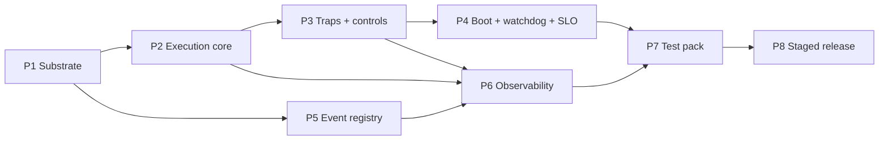

# Engine Arc Phase 1 — Implementation Plan (Overview)

**Commission:** Central Polling/Event-Management Engine — BUILD (Emperor overruled gate-hold; scores gate 3.80 vs build 2.65, both recorded on ledger ENSEMBLE-38, Discord 2026-11-21).
**Pipeline stage:** 1 of 4 (planner → **architect** → reviewer → approver). This directory is the planner-stage deliverable set.
**Worktree / base:** `/home/nea/ensemble-src-wt-engine-arc-p1` · branch `feature/engine-arc-phase1` · HEAD `aed3eabce` = base `b71742fe3` (v0.31.23) + Phase-0 study docs.
**Binding design:** `../central-polling-engine-study/decision-report.md` §B.2 (frozen engine design — ALL 10 components), §B.1 primitives as engine internals, §B.3 event catalog. Census anchors taken @ `bf4bfde6e`; ALL code anchors in this plan re-verified at `b71742fe3` (18 drifted — see `research-anchors.md` §Q9).
**Date:** 2026-11-21. **Rulings verbatim:** recorded in `decisions.md` Part A.

---

## 1. Objective

Build the central engine (frozen §B.2, all 10 components) **plus** the Emperor-ruled event registry (registration + observability layer only), with self-describing registration (Emperor addendum), shipping **DORMANT** — registered, observing, executing nothing — so the Phase-2 pilot (recommended: OrphanWatcher post-fix) is a single flag flip. Boot SLO 120s (boot_epoch→readyz-green, Emperor-set, CLOSED) is the acceptance gate for the boot-phase component. No module migrates in Phase 1; no existing periodic mechanism is refactored.

## 2. The Five Pillars → Deliverables

| Pillar | Scope | Primary deliverable |
|---|---|---|
| 1. Engine (frozen §B.2) | JobSpec+registration, `engine_jobs`+`engine_runs` (own .sql each), execution classes, single-flight, honest state machine, trap-impossibility, kill switches (FAIL-TO-LEGACY), boot-phase classes + engine-independent watchdog BUILT AND DRILLED, SERVICES_* continuity + dead-knob cleanup, dual-path harness | `phase1..4-plan.md`, `phase6-plan.md`, `phase7-plan.md` |
| 2. Event registry | Kind catalog (§B.3 classes 1–4; class 5 deferred_v2), structured emission w/ ids, per-kind metrics (firing counts, consumers, lag); NO fan-out unification, NO queue-depth triggers (seam named only) | `phase5-plan.md` |
| 3. Emperor addendum | Self-describing register(): service_tag/service_name, category, module_info, description, extensible metadata; metrics labels service_tag+category; ANTICIPATES maintenancer tool + /metrics UI tab (design-for, not build) | folded into P1 (schema/API), P6 (read substrate) |
| 4. Dormant boot | Registered, observing, executing NOTHING by default; dual-path harness makes Phase-2 pilot a flag flip | `phase2-pilot-recommendation.md`, P3/P4 |
| 5. Boot SLO | Measure current vs 120s bar; wire acceptance gate | `boot-slo-measurement.md`, P4 |

## 3. Phase Decomposition (detail in phaseN-plan.md; authority: those files)

| Phase | Name | Objective | Est-h (low/high) | Depends |
|---|---|---|---|---|
| P1 | Substrate | 2 migration files + models/repo + EngineConfig + self-describing JobSpec/register() + SERVICES_* continuity + dead-knob cleanup | 22/35 | — |
| P2 | Execution core | Tick loop, 3 concurrency classes, single-flight, honest state machine (incl. SHADOW skip), durable run record | 28/38 | P1 |
| P3 | Trap-impossibility + controls | Getter-at-tick deps, LOUD boot assertion, dead=true, kill switches fail-to-legacy, dual-path harness | 22/37 | P2 |
| P4 | Boot phase + watchdog | Boot-phase classes + jitter, engine-independent watchdog built AND drilled, boot-SLO ≤120s wire, the ONE api.py lifespan edit | 20/33 | P3 |
| P5 | Event registry v1 | Kind catalog over existing substrates, bounded emission ring, per-kind observability, labeled failure postures | 18/31 | P1 |
| P6 | Observability shape-readiness | `/api/engine/*` read substrate (3 GETs), read-time union with `job_metrics()`, GATED metrics-family ceremony (default deferred) | 9/15 | P2,P3,P5 |
| P7 | Test pack buildout | 10 pack registrations, mutation matrix, dormant/diff-audit/fence-sweep legs | 13/23 | P1–P6 |
| P8 | Staged release | Slot derived live at stage time (W9), delta-only rollback adjudication, dormant disclosure, NO promote | 5/10 | P7 |
| **Total** | | | **137/222 (≈180 mid)** | |

**Band verdict: INSIDE 118–222.** ≈11% above the 162h anchor; excess priced in `phase1-plan.md` §0.2a: 28-site repo-wide dead-knob cleanup (≈5h; review fold F-2 — the earlier 26 was tests/-scoped), watchdog drill (≈4h), diff-census record (≈1h) — carrying costs the anchor folded in. Test estimate cross-check: `test-strategy.md` 28/48h vs P7 13/23h + per-phase AC test effort (reconciled: P7 is pack assembly; component tests ride each phase).

## 4. Dependency & Parallelism

Parallel lanes: **P4 ∥ P5** after P3/P1 respectively; P6 fans in. With the fast lane (`fix/phase1-live-defects`) running concurrently: file overlap is **`daemon/api.py` only** (live-defects regions `:1226-1272`/`:3018-3041`/`:4532-4547`; engine P4 lifespan ~`:3740` + shutdown <`:4600`, P6 include_router ~`:6359`) — textually disjoint, either merge order auto-merges; P4 must additionally avoid the strings `tests/test_settings_source_order_pin.py` anchors on.

## 5. Research Base (2 explorers, both HIGH confidence)

Key findings that shaped the plan (full: `research-anchors.md`, `research-bootslo-raw.md`):
- **Anchor drift is real:** 18 census anchors moved bf4bfde6e→b71742fe3 (all old→new listed); event-surface anchors unchanged; both live traps (OrphanWatcher born-dead ctor-capture `orphan_watcher_sweep.py:131-138`; JobLockSweep Template-B PEXIT `:241-250`) verified INTACT.
- **Migrations:** 127 .sql files (blueprint's "119" stale); IF NOT EXISTS mandatory (create_all runs first — bare CREATE silently no-ops); `engine_jobs`+`engine_runs` get separate files.
- **Awaited boot passes: 29** (+7 create_task +1 thread cluster), enumerated per-line in phase4 §4.1 — the census "~11" was a subset. `MANAGED_KEYS` = 19 live (AST-counted, pinned) → engine switches stay env/config tier in Phase 1. RDRS interval read site corrected: `pool_orchestrator.py:370` (no `worker_pool/` package).
- **Fences (30 surveyed; 5 material — see §7 Risks):** zero existing fences on `engine_jobs`/`engine_runs`/`ENSEMBLE_ENGINE`/`job_metrics` (names unclaimed); closed metrics census forces zero-family registration with a gated ceremony; `job_metrics()` byte-shape pin forces read-time union, never edit.
- **Boot telemetry:** no dedicated duration field exists; gate `READYZ_BUDGET_S=120` clocks a DIFFERENT window (post-handback); never subtract `boot_epoch` (DB clock) from `detail.checked_at` (host clock) — ~4s offset.

## 6. Boot SLO — Verdict (detail: `boot-slo-measurement.md`)

**Typical boots are COMFORTABLY UNDER 120s.** 19 live promote boots: median 13.1s / p90 22.8s / max 23.2s (= 19.3% of budget, ~5× headroom); hard-reboot drill 13–15s; worst cold-DB (sandbox fresh-PG) 67s ≈ 1.8× headroom. Near/over cases are **PRE-EXISTING conditions, not Phase-1 regressions**: (a) 67s sandbox cold-DB shape; (b) 2026-10-09 v0.18.5 DB-outage promote — readyz never green in budget (probe-timeout-under-load class, predates this lane ~6 weeks). Inherited "302s"/"~54s" figures unverifiable in files — marked not-counted.

**Gate wiring (dispatcher adjudication):** host-frame gate — start anchor owned by whatever launches the boot (test harness / promote lane; `boot_smoke.sh:496-524` already polls, raise `POLL_TIMEOUT` 45→≥120s) → poll `/readyz` `status=="ready"` → delta ≤120s. Because unit-start precedes the `boot_epoch` stamp, a host-frame pass implies the Emperor's boot_epoch-frame SLO **a fortiori**. Literal-`boot_epoch` binding remains available as durable telemetry (add `first_ready_db_clock` to the boot record, `boot_record.py:269`) — routed follow-up, not gate-blocking. Gate scope: all boot classes this lane can produce (dev cold-DB included); live-promote stays the binding reference class.

## 7. Top Risks (full registers in phase docs)

1. **F-23 diff-census record (~27 entries, release-blocking)** — `git diff --name-only` vs fixed LANE_BASE with enumerated allowlists; the record is maintained by the changing lane. Single biggest hidden cost the fence check surfaced; owned by P6.
2. **F-29 dead-knob deletion fence** (`tests/conftest.py:535`) — dead-knob deletion explodes unless **all 28 repo-wide sites are cleaned atomically** (review fold F-2: 21 pydantic kwargs + 5 worker_poll_interval SET files + 2 registered pack sites; AMD-9 mechanism: spec= allows SET — the real vectors are the pydantic kwargs + GET-on-spec-mock). P1 T1.12 = ONE task, not two; census re-derived at merge-base-confirm time (review fold F-9 gate).
3. **`daemon/api.py` shared file with the fast lane** — textually disjoint today, but both lanes land in one file; explicit-pathspec commits + merge-order check at finalize (house concurrent-commit rules).
4. **Clock-frame trap in boot measurement** — any future gate that mixes DB/host clocks inflates by ~4s and can false-fail near the bar; the a-fortiori host-frame design eliminates the dependency.
5. **Shadow-evidence dependency of the pilot greenlight** — if the engine ships default-OFF (not observing), `would_fire`/`dead`/shadow evidence never accumulates and the Phase-2 greenlight criteria become unsatisfiable (see adjudication D-3).
6. **Watchdog must be DRILLED, not assumed** — evidence artifact required (P4 + `test-strategy.md` §4: stall-leg + cancel-leg drills with independent-recovery assertion).

## 8. Cross-Document Reconciliation (dispatcher adjudications — record in decisions.md Part C)

- **D-1 Test authority:** `test-strategy.md` owns test FILE names (its §1.1 = stable contract) and the mutation matrix (23 legs = authority; phase docs' "≈34 per-AC" = upper envelope).
- **D-2 Boot-SLO frame:** host-frame gate (b) adopted — see §6. `test-strategy.md` §5's timed-probe carrier is (b)-shaped (harness owns the start anchor); no inconsistency survives this ruling.
- **D-3 `ENSEMBLE_ENGINE_ENABLED` polarity: ship `enabled=true` + `shadow_mode=true`.** Pillar 4 verbatim is "REGISTERED, OBSERVING, EXECUTING NOTHING" — observing requires the tick loop to run and record shadow evidence; default-OFF would make the Phase-2 greenlight criteria (≥2 cycles shadow, zero false-dead) unsatisfiable and violate the pillar's "OBSERVING". Execution remains impossible by construction: no module carries `SERVICES_<MODULE>_USE_ENGINE=1` in Phase 1. `ENSEMBLE_ENGINE_ENABLED=false` stays the one-flag full-off. (Phase docs flagged this fork; dispatcher rules; architect may veto in review.) [RESOLVED-BY-RULING (c): ADOPT, no veto]
- **D-4 Numbering:** Emperor's frame adopted — build = Phase 1, first migration (pilot) = Phase 2. Study §C.2's "Phase 1 — pilot" predates the BUILD ruling; mapping recorded.
- **D-5 RDRS path correction:** `pool_orchestrator.py:370` (there is no `daemon/services/worker_pool/` package).

## 9. Fast Lane & Release Strategy (facts from phase docs; recommendation owned by decisions.md)

Coupling facts: file overlap `daemon/api.py` only, textually disjoint (auto-merge either order); the Phase-2 pilot **structurally depends** on the OrphanWatcher fix (`fix/phase1-live-defects`) landing in `latest` — the pilot's parity baseline is unanswerable while the service is born-dead; no duplicate work (fast-lane late-bind fix = one service; engine `dead=true` contract = the general detector — complementary). Release slots derived LIVE at release-prep per W9; NO live promote (Emperor ceremony).

**Dispatcher recommendation (for decisions.md to adopt/refine): TWO staged releases — defects-first.** The two live-defect fixes are small, independently verifiable, and ready long before the 137–222h engine build completes; holding them for one combined release delays live remediation (OrphanWatcher born-dead + 70MB bash-reaper leak) for no coupling benefit, since the api.py regions are disjoint and the pilot only needs the fix in `latest` by Phase-2 time, not by engine-merge time.

## 10. Phase-2 Pilot Recommendation (detail: `phase2-pilot-recommendation.md`)

**OrphanWatcherSweepService, post-fix** — reconcilers family, MAIN_LOOP class, 90s cadence. Strongest reasons: (1) exact motivating specimen for the getter-at-first-tick primitive (ctor-capture born-dead verified intact at this tree; 216 no-op ticks live); (2) smallest single-topology blast radius, and the fast-lane fix isolates engine behavior from defect; (3) gains a kill switch it never had, with a dormant-shadow before/after baseline. Greenlight criteria are measurable and RE-BASELINED per architect ruling (a) / AMD-1(c) (canonical strings CS-2..CS-4 live in `phase2-pilot-recommendation.md` §5 — see the §PREDICATE LEDGER below; the ceremony-gated "≥2 release cycles" framing and the `job_metrics`-family dependency are withdrawn): shadow-evidence maturity per ruling (a); zero false shadow-dead on healthy mechanisms; fix landed+verified legacy-side (runs_total>0 under engine execution is post-flip acceptance); boot-SLO gate green dormant; watchdog drill evidence; mutation pins in PACKS.md. Alternatives assessed and rejected-as-first with reasoning.

## 11. Out of Scope (explicit)

Migration tail (~20 eligible modules, ≈4–10h/module, each its own gated commission — one-by-one rule) · fan-out primitive unification (GAP-15) · queue-depth triggers (GAP-14, seam named) · wakeup churn (§B.4, separate commission) · families 8–9 + scheduler substrate (standalone permanently) · any live contact beyond read-only telemetry · NO refactoring of existing periodic mechanisms (dormant boot).

## 12. Open Questions Carried Upward (architect stage; none Emperor-blocking)

1. **Shadow duration before pilot flip** — ~~≥2 release cycles (conservative)~~ vs early flip on OrphanWatcher's own health? (`phase2-pilot-recommendation.md` presents both.) **[WITHDRAWN option — round-2 fold sweep, 2026-11-21:** the ceremony-gated "≥2 release cycles" option is withdrawn by architect ruling (a) / AMD-1(c); the re-baselined criterion is CS-2 (verbatim in `phase2-pilot-recommendation.md` §5). Question retained as the record of what was carried upward.**]
2. **Second migrant ordering** — healthy-sweep (parity proof) vs PEXIT-class (JobLock/SourcesGc)? Phase-2+ concern; registry evidence will inform. [RESOLVED-BY-RULING (b): JobLockSweepService second — primitive-proven-second framing]
3. **D-3 polarity ratification** — dispatcher ruled enabled+shadow; architect review may veto. [RESOLVED-BY-RULING (c): ADOPT, no veto — ships enabled=true + shadow_mode=true]
4. **Start-anchor build-side emit** — confirm the harness/promote-lane owns it (dispatcher ruling) or route a daemon-side emit (deferred-task seam `api.py:1082-1093`) if promote-lane capture proves brittle. [RESOLVED-BY-RULING (d): D-2 RATIFIED — harness/promote-lane owns the anchor; daemon-side emit = named fallback]

## 13. Provenance

Produced by the planner-stage dispatch: 2 explorers (`research-anchors.md` — anchors/fences/hook points; `research-bootslo-raw.md` — live read-only boot telemetry) + 3 workers (phases w/ `grep-fence-check-before-design-substrate` skill applied — 30 fences surveyed; tests; slo+pilot) + this synthesis (planner, aggregator boundary). All workers planning-only: zero code, zero test runs, zero git mutations; commit lands via the decisions lane. Census anchor caveat: re-grep at use time — 18 anchors already drifted one base-version apart.

---

## §PREDICATE LEDGER (review-fold reconciliation, 2026-11-21)

Added by the review-fold reconciliation pass (findings F-1..F-10). **Body wins, ledger mirrors** — every canonical string below appears VERBATIM in the body site(s) it governs; a body/ledger divergence is resolved in the body's favor and the ledger corrected in the same change.

### (i) Canonical strings (one per re-baselined predicate)

| ID | Predicate | Canonical string (verbatim in body) | Governing body site(s) |
|---|---|---|---|
| CS-1 | Dormant-boot posture — observer-spec semantics (AMD-1) | `N observer specs registered, zero executables (`execute_fn` withheld), shadow rows present` | `phase4-plan.md` D4.11 · AC4 · AC8 · `phase7-plan.md` Leg D · `test-strategy.md` §3.2 leg 1 · `phase8-plan.md` D8.4(a) |
| CS-2 | Greenlight criterion 1 — ruling (a) rewording, verbatim | `≥2 independent boots of shadow evidence on the priority targets (one of which is the staged-release boot smoke), AND long-cadence maturity: every registered target has been shadow-evaluated through ≥2× its interval, AND a ≥48h live soak post-promote before the pilot flip.` | `phase2-pilot-recommendation.md` §5 criterion 1 |
| CS-3 | Greenlight criterion 2 (AMD-1(c) shadow-dead semantics) | `Zero false shadow-dead on healthy mechanisms` | `phase2-pilot-recommendation.md` §5 criterion 2 |
| CS-4 | Greenlight criterion 5 split (AMD-1(c)) | `fix-landed verification stays legacy-side (the fast-lane lane's own evidence); "runs_total>0 for OrphanWatcher **under engine execution**" moves to the pilot's post-flip acceptance evidence` | `phase2-pilot-recommendation.md` §5 criterion 5 |
| CS-5 | D-3 adopt / dormant-default semantics (AMD-3(c)) | `ships `enabled=true` + `shadow_mode=true`; dormant-default = registered observer specs, zero executables, shadow rows accumulating; per-job `USE_ENGINE` all unset.` | `test-strategy.md` §1.1 T8 · §3.1 |
| CS-6 | Shadow-row cadence (AMD-1 + D2.13) | `shadow rows are BY DESIGN one `SKIPPED_SHADOW` row per due job per interval` | `phase2-plan.md` AC9 |
| CS-7 | Shadow-row retention bound (AMD-1(e)) | `P2 specifies a retention bound for shadow rows (house TTL/sweep pattern; bounded append-only growth)` | `phase1-plan.md` §5 retention note |
| CS-8 | Dead-knob site census — repo-wide, 28 sites (review fold F-2; AMD-9 mechanism) | `the FULL 28-site set: 21 pydantic `PersistenceConfig(checkpoint_interval=…)` kwargs + 5 `worker_poll_interval` SET files + 2 pack sites` | `phase1-plan.md` T1.12 · §7 F-29 |

### (ii) DELETION RECORD (withdrawn predicate strings — the `registrations=0` / zero-engine_runs / writes-no-rows / "registers nothing" family)

| Withdrawn string | Removed from | Replaced by |
|---|---|---|
| `registrations=0` (posture INFO pin) | `phase4-plan.md` AC4 | `registrations=N observer specs` + CS-1 |
| `registrations=0` (release-blocking boot assertion) | `phase7-plan.md` Leg D | CS-1 |
| "with zero registrations" (leg phrasing) | `phase7-plan.md` T7.4 | "N observer specs registered (zero executables — the D4.11 posture)" |
| "registers nothing" (zero-estate-contact AC) | `phase4-plan.md` AC8 | CS-1 |
| "with zero estate registrations" (default-posture tail of the dormancy truth table) | `phase1-plan.md` D1.9 | "N observer specs registered at boot per AMD-1 (registration-for-observation is NOT migration; zero `USE_ENGINE` estate migrations)" |
| "writes no rows" (dormant AC) | `phase2-plan.md` AC9 | CS-6 |
| "zero `engine_runs` rows" + "zero `engine_jobs` rows created by the engine itself" (boot assertions) | `phase7-plan.md` Leg D | "`engine_runs` carries ONLY `outcome=SKIPPED_SHADOW` rows (one per due job per interval)" |
| "ships dormant with zero registrations" (ceremony disclosure (a)) | `phase8-plan.md` D8.4(a) | "observer-spec posture — CS-1" |
| `SELECT count(*) FROM engine_runs == 0` (dormant-boot proof) | `test-strategy.md` §3.2 leg 1 | CS-1 + SKIPPED_SHADOW-rows-only assertion |
| "`ENSEMBLE_ENGINE_ENABLED` default OFF semantics" (T8 authoring pin) | `test-strategy.md` §1.1 T8 | CS-5 (D-3 adopt) |
| "`ENSEMBLE_ENGINE_ENABLED` unset/OFF ⇒ … executes NOTHING" (unset-implies-off semantics) | `test-strategy.md` §3.1 first bullet | CS-5 + explicit-OFF-only bullet (unset resolves to the shipped `enabled=true` default per AMD-8) |
| "≥2 release cycles" (ceremony-gated criterion-1 framing) | `phase2-pilot-recommendation.md` §5 criterion 1; `plan-overview.md` §10 summary | CS-2 (ruling (a) verbatim) |
| "converged `job_metrics` family" (criterion-1 family dependency; D-6 explicitly rejects families) | `phase2-pilot-recommendation.md` §5 criterion 1 | engine's own in-process snapshot (D2.14) |
| "The engine is built only if the gate fires" (pre-ruling remnant — not the registration family; recorded for completeness) | `phase2-pilot-recommendation.md` §6 (marked SUPERSEDED, retained as the migration-escalation criteria it actually governs) + §5 falsification item (iii) (bracket note) | F-7 note: the §E.3 gate governs MIGRATION ESCALATION only, never the build (build unconditional per Emperor ruling #1) |
| "Phase 1 is dormant with **zero** registrations, so the blast radius at ship time is nil" (risk-table mitigation premise; A-1) | `phase2-plan.md` §9 Risks (first-row Mitigation cell, L112) | CS-5 posture: ships `enabled=true` + `shadow_mode=true` with N observer specs registered, zero executables, `USE_ENGINE` all unset — blast radius nil BECAUSE nothing executes (dispatch structurally impossible) |
| "≥2 release cycles of dormant shadow evidence" (SECOND instance — cross-ref restatement; A-2) | `phase1-plan.md` §12.3 cross-ref bullet, L356 | CS-2 + CS-3 (criterion framing cited by id; bolded consequence clause survives) |
| "registration of 0-2 fixture jobs" (D4.9 cost-bound premise correction; R-1) | `phase4-plan.md` D4.9, L40 | "registration of N observer specs, zero executables — CS-1 posture, no execution" (≤250ms bound unchanged) |

**Ruling-record note:** literal `registrations=0` occurrences REMAIN inside `architecture-recommendation.md` (§1(c) correction, findings register #1, AMD-1). These are the ruling text itself quoting the withdrawn string AS the thing withdrawn ("Amend D4.11 from `registrations=0` to `registrations=N observer specs`") — visibly self-marking it superseded, retained per F-10's single-edit restriction on that file. They are ruling record, not live predicates.

### Re-derivation gate disclosure (review fold F-9)

origin/latest MOVED during review — `b71742fe3` → `01ec292da` (~20 commits, 29 code files, incl. a dead-knob site) — and will move again before this ~180h build merges. Dispatcher ruling: wire an EXPLICIT RE-DERIVATION GATE rather than re-deriving at-pass. Wired: (1) the dead-knob census is re-derived at merge-base-confirm time, immediately before execution (`phase1-plan.md` T1.12); (2) P4's anchor set (the 29-pass inventory + api.py region anchors) is re-grepped at execution start (`phase4-plan.md` §4.1).

### (iii) Closing ATTESTATION — every changed row in this pass

1. `plan-overview.md` — §3 Band verdict row (26→28-site census echo, F-2); §7 Risk 2 (F-29 row restated: 28 repo-wide sites, AMD-9 mechanism, F-9 gate); §10 pilot summary (criteria re-baselined per ruling (a)/AMD-1(c), CS-2..CS-4 pointers); NEW §PREDICATE LEDGER section (this section).
2. `phase1-plan.md` — §0.2a Band check (a)-clause (28 repo-wide dead-knob sites, F-2); D1.9 default-posture tail (withdrawn "zero estate registrations", AMD-1 observer-spec posture); T1.12 row (F-2 census CS-8 + AMD-9 mechanism + F-9 re-derivation gate; pack sites added to anchors cell); §5 retention note (AMD-1(e), CS-7); §6 Effort dead-knob row (23 kwarg call sites = 21 tests/ + 2 pack files); §7 F-29 fence (AMD-9 mechanism correction + CS-8 + F-9 gate).
3. `phase2-plan.md` — AC9 (withdrawn "zero estate registrations"/"writes no rows"; CS-6).
4. `phase2-pilot-recommendation.md` — §5 criterion 1 (CS-2 verbatim, F-1 site 7 + F-6); §5 criterion 2 (CS-3, AMD-1(c)); §5 criterion 5 (CS-4, AMD-1(c) split); §5 Falsification item (iii) (corroboration bracket); §6 heading note + "B (subset engine)" bullet (F-7 SUPERSEDED marking).
5. `phase4-plan.md` — D4.11 (AMD-1: `registrations=0` → N observer specs, execute_fn withheld, T1.11 cadences; withdrawn string named as WITHDRAWN in Rejected cell); §4.1 Consequence paragraph (F-9 anchor-freshness gate); T4.4 (AMD-5: `set_event_sink(...)` composition line named; canary `register()` site + `SERVICES_<CANARY>_USE_ENGINE` fixture one-owner sentence); AC4 (CS-1); AC8 (CS-1).
6. `phase7-plan.md` — T7.4 (withdrawn "with zero registrations"); Leg D (CS-1, RELEASE-BLOCKING re-baseline).
7. `phase8-plan.md` — §4 Release-scoping note over T8.1–T8.9 (AMD-4 two-invocation machinery + F-5 ownership sentence + rationale); D8.4(a) (CS-1 observer-spec disclosure); D8.6 (AMD-4 two-release staging + ownership); T8.1 (release B/A split marker); T8.4 (per-release adjudication marker).
8. `test-strategy.md` — §1.1 T8 (CS-5, AMD-3(c)); §3.1 (CS-5 char-for-char + D2.13 shadow-row cadence + AMD-8 unset semantics); §3.2 leg 1 (CS-1 + SKIPPED_SHADOW-rows-only).
9. `research-anchors.md` — §2 "Engine-independent watchdog" insertion-point line (F-3: asyncio research shape marked SUPERSEDED; BUILT daemon-thread shape per AMD-2/D4.6; research history retained).
10. `architecture-recommendation.md` — §4 AMD-5 block ONLY (F-10 one-line supersession note: FA-6 "P4 declares the registry Out" vs set_event_sink-in-T4.4 safe under D4.10's guarded-block posture). No other line in this file touched.

**Round-2 fold (2026-11-21)** — four surviving same-family instances the round-1 sweep missed (risk tables / cross-refs / rationale cells — the round-2 lesson). Zero design change; reconciliation only:
11. `phase2-plan.md` §9 Risks first-row Mitigation cell (A-1, L112) — dormant "**zero** registrations" premise → CS-5 posture (ships `enabled=true` + `shadow_mode=true` + N observer specs, zero executables, `USE_ENGINE` all unset; blast radius nil BECAUSE nothing executes).
12. `phase1-plan.md` §12.3 cross-ref bullet (A-2, L356) — "≥2 release cycles of dormant shadow evidence" restatement (a SECOND instance of the withdrawn string, in a cross-ref section) → CS-2 + CS-3 cited by id; bolded consequence clause preserved.
13. `test-strategy.md` §4 design-constraints paragraph (R-2, L124) — asyncio-loop research shape marked SUPERSEDED with the research-anchors.md:86 bracket convention; BUILT daemon-thread shape per AMD-2/D4.6 (shared-atomic state channel, engine-independent recovery).
14. `phase4-plan.md` D4.9 (R-1, L40) — "registration of 0-2 fixture jobs" premise → "registration of N observer specs, zero executables — CS-1 posture, no execution"; ≤250ms bound unchanged.
15. `phase4-plan.md` SLO-1 must-not-regress table (sweep-driven, L119) — a SECOND "0-2 fixture registrations" premise → "N observer specs registered, zero executables — CS-1 posture"; ≤250ms bound unchanged.
16. `plan-overview.md` §12 open question 1 (sweep-driven, L107) — the "≥2 release cycles (conservative)" option struck + bracket-WITHDRAWN (ruling (a)/AMD-1(c); re-baselined criterion CS-2). Question retained as the carried-upward record.
17. `decisions.md` Part E items 1–4 (round-2 residue follow-up) — each marked RESOLVED-BY-RULING (a)/(b)/(c)/(d); historical question text retained verbatim, bracket-appended per the package's visible-mark convention.
18. `plan-overview.md` §12 items 2–4 + `phase2-pilot-recommendation.md` L110 (round-2 residue, final) — marked RESOLVED-BY-RULING (b)/(c)/(d); the "healthy-vs-PEXIT / either is defensible" and "architect review may veto" pre-ruling framings now visibly resolved.
19. D-3 veto caveat (`decisions.md` D-3 entry; `plan-overview.md` §8 D-3 line) + `boot-slo-measurement.md` open questions 1–2 (round-2 residue closeout) — marked RESOLVED-BY-RULING (c)/(d); veto-cost note discharged per ruling (c), start-anchor and (b)-vs-(c) reconcile resolved per ruling (d)/AMD-6. Historical text retained verbatim.
Plus this ledger: DELETION RECORD gains the three withdrawn strings (A-1/A-2/R-1); ATTESTATION gains this Round-2 subsection.
