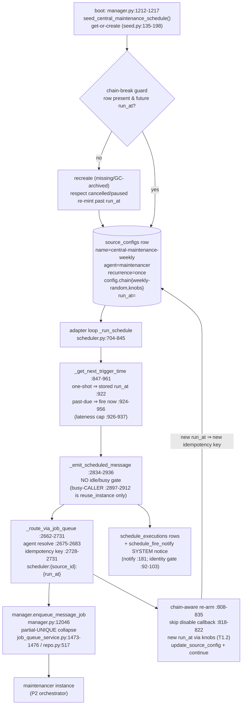

# Phase 1 — Trigger Chain, Arming & Re-arm Guard (Central Maintenance System)

**Objective:** Establish the self-rescheduling weekly trigger that fires a uniform-random minute inside a configurable ICT window and dispatches DIRECTLY to the `maintenancer` agent, with a reboot/GC-resilient guard that keeps the chain alive — carrying NO idle/busyness precondition anywhere.

**Status:** PLANNED

---

## Scope

### In scope
- A single scheduler `source_configs` row (`recurrence="once"`, `agent="maintenancer"`) whose `run_at` is rewritten at each fire — the self-rescheduling one-shot chain (R1).
- Env-first window / weekday / timezone knobs with ICT defaults, resolved at each ARM/RE-ARM and echoed into the row config for audit (D-F).
- A uniform-random minute picker (inclusive window, next-weekday-boundary arithmetic, ICT anchoring via `anchor_local_to_utc`).
- A re-arm seam that rewrites `run_at` immediately AFTER dispatch — independent of run success (D-G).
- A boot-time chain-break guard (get-or-recreate) adjacent to the existing tool-usage seeder hook, plus an optional UN_GATED daily backstop design.
- No-idle design statement embedded in every new seam; failure-mode table.

### Out of scope
- The orchestrator agent upgrade (Phase 2 — cross-ref `phase2-plan.md (sibling)`), the five lane bodies (`phase3-plan.md (sibling)`), and report/receipt/manual-trigger/FE (`phase4-plan.md (sibling)`). The full `maintenancer` orchestrator prompt is a P2 artifact; P1 uses a placeholder message body.
- The test suite and staging (Phase 5 — cross-ref `phase5-plan.md (sibling)`); P1 only NAMES the pins it needs.
- Any code, daemon run, DB write, git mutation, or install — this lane plans only.

---

## Preconditions & dependencies

- **Upstream:** `origin/latest @ 1b9797ab7` (this worktree `feature/central-maintenance-system`). The scheduler substrate exists and is reusable as-is (verified anchors below). Upstream later moved to `86e196576` (engine-arc-p1 merge, 160 files, ZERO frontend changes, deletes `tests/unit/test_scheduler_deferred_delivery_pin.py`) — rebase discipline deferred to P5/R7.
- **Downstream:** P2 upgrades the `maintenancer` seat so the dispatched turn can spawn lane children; P5 owns the pins and staging.
- **Parallelizable-with:** P2/P3/P4 (disjoint files/contracts). P1 fixes the row `name`, `agent`, `instance_mode`, and the `config.chain` block shape; siblings must not redefine those.
- **Base rule:** all work under `/home/nea/ensemble-src-wt-maintsys`. NEVER from `/home/nea/ensemble-src` (detached canonical, stale for hbk code).

---

## Design decisions consumed

- **R1 (trigger mechanics):** self-rescheduling ONE-SHOT chain — one `recurrence="once"` row whose `run_at` is rewritten at each fire. A new `run_at` ⇒ a new idempotency key automatically (`scheduler:{source_id}:{run_at.isoformat()}`, `daemon/sources/adapters/scheduler.py:2728-2731`). A weekly cron is explicitly REJECTED: `m h * * D` cannot re-roll its minute.
- **R2 (no idle gating):** fires regardless of busyness; no system-idle precondition on trigger or dispatch. The old daemon-internal tier's idle-only starvation (500 skips / 0 executions) is regression-PINNED in P5. File-level safety inside the disk sweep remains (P3).
- **R3 (direct dispatch):** `config.agent = "maintenancer"` — the adapter resolves it via `registry.resolve_to_id` (`scheduler.py:2675-2683`); agent existence is fail-fast at create time (`daemon/services/scheduling_service.py:744-748`). NOT via Ari.
- **Emperor (random-time trigger):** the window is a KNOB, re-rolled weekly, NOT a fixed 01:00 start; no idle gating anywhere on trigger/dispatch.
- **D-D (manual trigger):** P1 documents the mechanics only (one-shot at `run_at=now` → `maintenancer`, Ari holds the `scheduling` grant at `agents/ari/meta.json:34`); the receipt shape is P4's.
- **D-F (knobs) — REFINEMENT:** env-first knobs with ICT defaults, read at each ARM/RE-ARM. **Refinement with evidence:** the tool path CANNOT carry window/random keys — `ScheduleCreatePayload` (`scheduling_service.py:132-175`) has only `label/agent/message/when/timezone/recurrence/weekday/cron_expression/project_id/priority/instance_mode`, and `_build_config_json` (`:429-461`) copies only known keys. Therefore the chain row is created/owned by CODE (boot seeder pattern, `daemon/repositories/source/seed.py:135-198`), NOT by `task_schedule`. Manual-trigger rows via `task_schedule` are one-shot immediates that never re-arm (no `chain` block). The row config JSON records the RESOLVED values for audit; env remains authoritative at the next re-arm. The row-config-JSON-as-knob-source alternative (REST edit) is REJECTED: `ScheduleUpdatePayload` (`scheduling_service.py:231-244`) has no arbitrary-config passthrough — only `when` rewrites `run_at` (`:1050-1081`), which cannot change window knobs.
- **D-G (chain identity) — REFINEMENT:** ONE row, `recurrence="once"`, `run_at` rewritten at each fire. **Seam chosen = (a) adapter-side `config.chain` mechanism**, re-armed immediately AFTER dispatch. Rejections: **(b)** `schedule_fire_notify` consumer hook — it is a per-fire SYSTEM notice gated by `creator present AND creator != recipient` (`daemon/services/schedule_fire_notify.py:5, :92-103`, entrypoint `:181`); a daemon-seeded chain row has no creator, so the notice can be dropped, and a notification side-effect is the wrong primitive for arming. **(c)** `_on_complete_callback` (`scheduler.py:818-822` → `daemon/sources/registry.py:608-620`) — it fires on CONSUMPTION and by default DISABLES the row (`:616-617`), conflating "consumed" with "re-arm" and fighting the chain; it is touched only to add a chain-aware skip, never used as the driver. **(d)** `MaintenanceService` daily UN_GATED job as DRIVER — the old tier is separate and LIVE (`phase3-plan.md:44`, `daemon/services/maintenance.py`); coupling the new chain to it risks the `IDLE_GATED` unknown-name default trap (`maintenance.py:132`, `tests/unit/test_maintenance_idle_starvation.py:112-132`). Accepted only as an OPTIONAL daily backstop guard (never the driver), and if added MUST be registered `UN_GATED` explicitly.

---

## Tasks

### Task 1.1 — Chain row seeder (`config.chain` block + resolved knobs)
- **Description:** Add `seed_central_maintenance_schedule(engine)` modeled on `daemon/repositories/source/seed.py:135-198`: deterministic `uuid5(NAMESPACE_DNS, "central-maintenance-weekly")` source_id (precedent `seed.py:38`), idempotent get-by-id then get-by-name (`:161-166`, NO-OP in any state to preserve operator intent), `enabled=True`, `autostart=True`, status promoted to `RUNNING` (`:188-193`) so `start_all` picks it up; whole body fail-open try/except (`:196-198`). Config keys: `agent="maintenancer"`, `message=<placeholder, cross-ref P2>`, `timezone="Asia/Ho_Chi_Minh"`, `recurrence="once"`, `local_time=<HH:MM echo>`, `run_at=<minted ISO UTC>`, `instance_mode="new_instance"`, `project_id=<system default, precedent seed.py:158>`, and `chain={"mode":"weekly-random","window_start":...,"window_end":...,"weekday":...,"timezone":...,"run_at_utc":...}` recording the RESOLVED knobs.
- **Touch points:** new `daemon/repositories/source/maintenance_seed.py` (or extend `seed.py`); export via `__all__` mirroring `seed.py:201`.
- **Verification:** seed twice ⇒ exactly one row (mirror `tests/unit/repositories/test_tool_usage_seed_lifecycle.py:136-145`); config JSON contains the `chain` block with resolved values; status `RUNNING`.
- **Agent hint:** `coder`.

### Task 1.2 — Env-first knob resolver + uniform-random minute picker
- **Description:** New helper (e.g. `daemon/services/maintenance_schedule_knobs.py`): read `ENSEMBLE_MAINT_WINDOW_START` (default `01:00`), `ENSEMBLE_MAINT_WINDOW_END` (default `05:00`), `ENSEMBLE_MAINT_WEEKDAY` (default e.g. `0`=Sunday, canonical 0=Sun..6=Sat per `scheduling_service.py:160-165`), `ENSEMBLE_MAINT_TIMEZONE` (default `Asia/Ho_Chi_Minh`) at each ARM/RE-ARM. Validate `start < end` on the same day (no midnight crossing in v1 — flag crossing-midnight as out of scope). Choose minute uniformly from `[start_total_min, end_total_min)` via `randrange` (document EXPLICIT inclusivity: start inclusive, end exclusive; 01:00–05:00 ⇒ 240 candidate minutes). Weekday-boundary: convert Sunday-based knob to Python `weekday()` via `(D+6)%7`, pick the NEXT D occurrence; build naive local datetime, anchor with `daemon/util/tz.py:353-384` `anchor_local_to_utc(dt, ZoneInfo(tz))` (ICT fixed UTC+7, no DST ⇒ fold/gap pass-through), and if the anchored instant is `<= now` roll +7 days and re-anchor. Compute the instant DIRECTLY — no croniter (one-shot chain avoids the cron path entirely).
- **Touch points:** new `daemon/services/maintenance_schedule_knobs.py`; consume in Task 1.1/1.4.
- **Verification:** picker unit tests (uniformity smoke, inclusivity, weekday boundary, tz conversion) — named for P5.
- **Agent hint:** `coder`.

### Task 1.3 — Re-arm seam: adapter-side `config.chain` post-dispatch rewrite
- **Description:** In `daemon/sources/adapters/scheduler.py`, after a one-shot fire's durable dispatch (`_route_via_job_queue` `:2662-2731` → `enqueue_message_job`), if the row config carries `chain.mode="weekly-random"`, compute the next `run_at` (Task 1.2) and rewrite it immediately — independent of run success. Concretely: make the one-shot consumption branch (`:808-835`) chain-aware so it does NOT permanently consume/disable: skip the `_on_complete_callback` disable (`:818-822` → `registry.py:608-620`) for chain rows; reset `_is_one_time_executed=False`, set `self._run_at=<new>`, persist new `run_at` + resolved knobs via `source_repo.update_source_config` (light write, no full adapter teardown), and `continue` the loop so the SAME adapter serves the next week. Because the idempotency key derives from `self._run_at` (`:2728-2731`), the new week mints a fresh key automatically. Keep this generic: keyed on `config.chain`, not on a hardcoded schedule name.
- **Touch points:** `daemon/sources/adapters/scheduler.py` (one-shot branch `:808-835`, dispatch path `:2662-2731`, `_parse_schedule_config` `:502` to expose `config.chain`); `daemon/sources/registry.py:608-620` (chain-aware disable skip).
- **Verification:** re-arm-independence test (run fails ⇒ next `run_at` still minted, key differs) — named for P5; structural pin that the dispatch path has no idle consult.
- **Agent hint:** `coder` (scheduler-adapter fluency).

### Task 1.4 — Boot-time chain-break guard (get-or-recreate)
- **Description:** Immediately adjacent to the tool-usage seeder hook (`daemon/manager.py:1212-1217`, fail-open try/except), call the Task 1.1 seeder (get-or-create) so a MISSING row is RECREATED — source-GC can archive scheduler rows (`daemon/migrations/versions/20261107_122648_create_source_gc_archive_tables.sql:9,35-37`; GC lanes `manager.py:6870,6897,6962`). Semantics: (i) row MISSING/archived ⇒ RECREATE (never just repair); (ii) row CANCELLED/paused = OPERATOR INTENT ⇒ respect, do not fight (`TaskScheduleUpdateInput.paused` `daemon/tools/scheduling.py:128`; seeder NO-OP-in-any-state `seed.py:164-166`); (iii) `run_at` PAST ⇒ boot past-due auto-fire handles daemon-down by default (`scheduler.py:924-956`, lateness cap `SchedulingConfig.one_shot_max_lateness_seconds` `:926-937`, default unlimited ⇒ fires NOW), but if a cap is set and the fire is SKIPPED (`:938-955`), the guard must detect a past `run_at` with no dispatch and re-mint the next occurrence. Optional daily backstop: a NEW `MaintenanceService` job registered `UN_GATED` (mirror `tests/unit/test_maintenance_idle_starvation.py:194-208`), never the primary driver.
- **Touch points:** `daemon/manager.py` (~1212-1217); `daemon/repositories/source/maintenance_seed.py` (recreate + past-`run_at` repair); optional `daemon/services/maintenance.py` job registration.
- **Verification:** guard tests (missing row recreated incl. post-GC; cancelled respected; past-due auto-fire) — named for P5.
- **Agent hint:** `coder`.

### Task 1.5 — No-idle design attestation + failure-mode documentation
- **Description:** Embed the no-idle statement in the design: the chain trigger and dispatch path (`scheduler.py:2834-2936` `_emit_scheduled_message`, `:2662-2731` `_route_via_job_queue`) has NO idle/busy-gate concept; its only deferral is busy-CALLER for `reuse_instance` mode (`:2897-2912`), which does NOT apply to `new_instance`. No new seam may consult `JOB_IDLE_POLICIES` / `_is_idle`. Document the failure-mode table below as the phase's acceptance ledger.
- **Touch points:** this plan file (design record); P5 test names.
- **Verification:** structural pin that the chain path never references idle policies (P5).
- **Agent hint:** `coder` / `doc-writer`.

---

## Architecture — fire path + re-arm + guard

**Seam file:line index (all verified in-worktree):**
- Row config build: `daemon/services/scheduling_service.py:429-461` (`_build_config_json`); payload shape `:132-175`; agent fail-fast `:744-748`.
- Adapter: `daemon/sources/adapters/scheduler.py` — class `:211`, one-shot force-new-instance `:351-358`, agent key `:367`, tz chain `:389-407`, config parse `:502`, fire outcomes `:243-258`, loop `:704-845`, one-shot next-time `:847-961` (stored `run_at` `:922`, past-due `:924-956`, lateness cap `:926-937`), consumption gate `:808-835`, completion callback `:818-822`, dispatch `:2662-2731` (key `:2728-2731`), emit `:2834-2936` (busy-CALLER `:2897-2912`).
- Completion-disable: `daemon/sources/registry.py:608-620`.
- Idempotency collapse: `daemon/services/job_queue_service.py:1473-1476`, `daemon/repositories/job_queue/repository.py:517`, 24h key TTL `job_queue_service.py:276`.
- Boot seed template: `daemon/repositories/source/seed.py:135-198`; hook `daemon/manager.py:1212-1217`; `start_all` ~`16996`.
- TZ layer: `daemon/util/tz.py` — `anchor_local_to_utc :353`, `resolve_timezone :283`, cron path `:529+` (NOT used by the chain).
- Source-GC archive: `daemon/migrations/versions/20261107_122648_create_source_gc_archive_tables.sql:9,35-37`; GC lanes `daemon/manager.py:6870,6897,6962`.
- Idle-starvation pin substrate: `tests/unit/test_maintenance_idle_starvation.py:194-208` (MUTATION TARGET), `:78-85` (busy fixture), `:112-132` (structural policy pin).

---

## Failure modes

| Failure | Behavior | Mitigation / owner |
|---|---|---|
| Run fails (maintenancer job errors) | Re-arm already happened at dispatch ⇒ next `run_at` minted regardless | Task 1.3 seam; P5 re-arm-independence test |
| Adapter dies / one-shot consumption disables row | Default `_on_complete_callback` disables (`registry.py:616-617`) ⇒ chain would stall | Chain-aware skip (Task 1.3) + boot guard re-enable (Task 1.4) |
| Row archived by source-GC | Row gone from `source_configs` ⇒ no adapter | Boot guard get-or-recreate (Task 1.4) |
| Daemon down at fire | Past-due one-shot fires at next boot (default unlimited lateness) | `scheduler.py:924-956`; if cap set ⇒ SKIPPED (`:938-955`) ⇒ guard re-mints (Task 1.4) |
| Operator pauses / cancels | `paused`/`cancelled` is operator intent | Respect — seeder NO-OP-in-any-state (`seed.py:164-166`); do not fight |
| Window knobs invalid (start ≥ end / midnight cross) | No safe fire instant | Fail-closed: log loud warning + no arm; guard retries next boot; v1 forbids midnight crossing |

---

## Risks & mitigations

| ID | Risk | Impact | Mitigation |
|---|---|---|---|
| R-P1-1 | Chain stalls because one-shot consumption disables the row | high | Chain-aware re-arm (T1.3) + boot guard (T1.4) + P5 independence test |
| R-P1-2 | Re-arm seam conflated with the 5s same-episode `rearmed` outcome (`scheduler.py:245`) | high | Distinguish weekly re-arm from same-episode re-arm in code comments; structural pin |
| R-P1-3 | Idle gating creeps into trigger/dispatch | high | No-idle attestation (T1.5) + P5 two-legged R2 pin (MUTATION TARGET) |
| R-P1-4 | Weekday-boundary / past-window arithmetic picks today-past instant | medium | Explicit next-D algorithm + +7d re-anchor (T1.2); P5 boundary test |
| R-P1-5 | Operator intent overwritten by aggressive guard | medium | Respect cancelled/paused; NO-OP-in-any-state seeder; P5 guard tests |
| R-P1-6 | Source-GC archives the chain row between boots | medium | Boot recreate (T1.4); P5 post-GC guard test |
| R-P1-7 | Lateness cap set ⇒ daemon-down fire SKIPPED ⇒ chain stall | low | Guard detects past `run_at` with no dispatch and re-mints (T1.4); document cap interaction |

---

## Acceptance criteria

- AC1: Exactly one `source_configs` row named `central-maintenance-weekly`, `agent="maintenancer"`, `recurrence="once"`, `instance_mode="new_instance"`, config carries `chain` block with resolved knobs; seeding twice ⇒ one row.
- AC2: At each arm/re-arm the fire instant is a uniform-random minute in `[start,end)` on the next weekday D, anchored to ICT (`anchor_local_to_utc`), stored as ISO UTC in `run_at`; no croniter involvement.
- AC3: Re-arm occurs at dispatch, independent of run success; a failed run still yields a new `run_at` and a new idempotency key; the row is NOT disabled by the one-shot completion callback.
- AC4: Boot guard recreates a missing/archived row, respects cancelled/paused, and re-mints a past `run_at`; optional daily backstop is `UN_GATED` if present.
- AC5: No chain trigger/dispatch/guard seam references `JOB_IDLE_POLICIES` or `_is_idle`; the busy-CALLER deferral is proven inapplicable to `new_instance`.
- AC6: Failure-mode table rows each have a named mitigation and a P5 test anchor.

---

## Verification plan (P5 owns the suite; P1 names its needed pins)

- **Picker unit tests:** uniformity smoke, `[start,end)` inclusivity, weekday-boundary (today-past ⇒ next week), ICT tz conversion, invalid-window fail-closed.
- **R2 two-legged pin (MUTATION TARGET):** (i) BEHAVIORAL — busy fixture (mirror `test_maintenance_idle_starvation.py:78-85`) + due one-shot maintenancer row ⇒ `enqueue_message_job` fired with `scheduler:{source_id}:{run_at}` key, no idle consult; assert busy-CALLER deferral (`:2897-2912`) not reached for `new_instance`. (ii) STRUCTURAL — AST/grep pin that chain trigger+dispatch path never references `JOB_IDLE_POLICIES`/`_is_idle` (mirror `:112-132`).
- **Re-arm independence:** run fails ⇒ next `run_at` still minted, key differs, row stays enabled.
- **Guard tests:** missing row recreated (incl. post-GC archive), cancelled respected, past-due auto-fire, lateness-cap SKIP re-mint.
- **Seed lifecycle:** mirror `tests/unit/repositories/test_tool_usage_seed_lifecycle.py:136-145`.
- **REST/E2E mirrors:** `tests/test_scheduler_api.py:22-129` mock-manager fixture (fence temp DBs); `tests/integration/test_scheduled_tasks_e2e.py:163` (one-shot creates JobItem), `:257` (cancelled never dispatches), `:418` (beyond-cap no dispatch with reason).

---

## Open questions

- **Re-arm persistence granularity:** confirm whether the light `source_repo.update_source_config` write (T1.3) is sufficient for the next boot's adapter construction, or whether a full `update_schedule` rebuild (`scheduling_service.py:1005`, stop→mutate→rebuild→register→start `:574-606`) is required. P5 should prove boot-persistence of the rewritten `run_at`; if light write is insufficient, upgrade T1.3 to the rebuild path (re-enable must survive `registry.py:616-617`). No blocker to planning.
- **Default weekday value:** `ENSEMBLE_MAINT_WEEKDAY` default is proposed `0` (Sunday). Leader/planner may ratify a different default day; the knob is value-agnostic, so this is a one-line default change, not a redesign.
- **Optional daily backstop:** include the UN_GATED `MaintenanceService` job in P1 scope, or leave it to a later phase? Plan specs it as optional (never the driver); needs a leader call at implementation time if the boot guard alone is judged insufficient.
- **Upstream deletion interaction:** `origin/latest 86e196576` deletes `tests/unit/test_scheduler_deferred_delivery_pin.py`; P5 must confirm no new P1 test depends on it (rebase discipline, R7).
