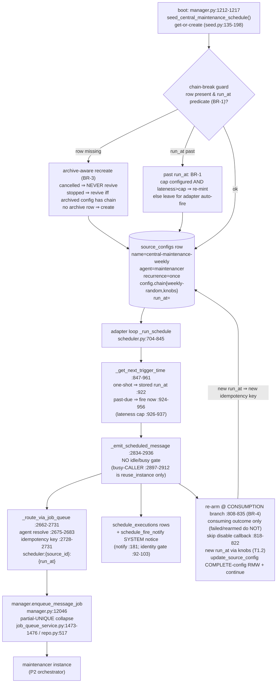

# Phase 1 — Trigger Chain, Arming & Re-arm Guard (Central Maintenance System)

**Objective:** Establish the self-rescheduling weekly trigger that fires a uniform-random minute inside a configurable ICT window and dispatches DIRECTLY to the `maintenancer` agent, with a reboot/GC-resilient guard that keeps the chain alive — carrying NO idle/busyness precondition anywhere.

**Status:** PLANNED

---

## Scope

### In scope
- A single scheduler `source_configs` row (`recurrence="once"`, `agent="maintenancer"`) whose `run_at` is rewritten at each fire — the self-rescheduling one-shot chain (R1).
- Env-first window / weekday / timezone knobs with ICT defaults, resolved at each ARM/RE-ARM and echoed into the row config for audit (D-F).
- A uniform-random minute picker (inclusive window, next-weekday-boundary arithmetic, ICT anchoring via `anchor_local_to_utc`).
- A re-arm seam in the one-shot **consumption branch** (`scheduler.py:808-835` — the SINGLE re-arm authority) that rewrites `run_at` on consuming fire outcomes — independent of run success (a FAILED dispatch does not consume and never advances the chain) (D-G).
- A boot-time chain-break guard (archive-aware get-or-recreate) adjacent to the existing tool-usage seeder hook, plus an optional UN_GATED daily backstop design.
- No-idle design statement embedded in every new seam; failure-mode table.

### Out of scope
- The orchestrator agent upgrade (Phase 2 — cross-ref `phase2-plan.md (sibling)`), the five lane bodies (`phase3-plan.md (sibling)`), and report/receipt/manual-trigger/FE (`phase4-plan.md (sibling)`). The full `maintenancer` orchestrator prompt is a P2 artifact; P1 uses a placeholder message body.
- The test suite and staging (Phase 5 — cross-ref `phase5-plan.md (sibling)`); P1 only NAMES the pins it needs.
- Any code, daemon run, DB write, git mutation, or install — this lane plans only.

---

## Preconditions & dependencies

- **Upstream:** `origin/latest @ 1b9797ab7` (this worktree `feature/central-maintenance-system`). The scheduler substrate exists and is reusable as-is (verified anchors below). Upstream later moved to `86e196576` (engine-arc-p1 merge, 160 files, ZERO frontend changes, deletes `tests/unit/test_scheduler_deferred_delivery_pin.py`) — rebase discipline deferred to P5/R7.
- **Downstream:** P2 upgrades the `maintenancer` seat so the dispatched turn can spawn lane children; P5 owns the pins and staging.
- **Parallelizable-with:** P2/P3/P4 (disjoint files/contracts). P1 fixes the row `name`, `agent`, `instance_mode`, and the `config.chain` block shape; siblings must not redefine those.
- **Base rule:** all work under `/home/nea/ensemble-src-wt-maintsys`. NEVER from `/home/nea/ensemble-src` (detached canonical, stale for hbk code).

---

## Design decisions consumed

- **R1 (trigger mechanics):** self-rescheduling ONE-SHOT chain — one `recurrence="once"` row whose `run_at` is rewritten at each fire. A new `run_at` ⇒ a new idempotency key automatically (`scheduler:{source_id}:{run_at.isoformat()}`, `daemon/sources/adapters/scheduler.py:2728-2731`). A weekly cron is explicitly REJECTED: `m h * * D` cannot re-roll its minute.
- **R2 (no idle gating):** fires regardless of busyness; no system-idle precondition on trigger or dispatch. The old daemon-internal tier's idle-only starvation (500 skips / 0 executions) is regression-PINNED in P5. File-level safety inside the disk sweep remains (P3).
- **R3 (direct dispatch):** `config.agent = "maintenancer"` — the adapter resolves it via `registry.resolve_to_id` (`scheduler.py:2675-2683`); agent existence is fail-fast at create time (`daemon/services/scheduling_service.py:744-748`). NOT via Ari.
- **Emperor (random-time trigger):** the window is a KNOB, re-rolled weekly, NOT a fixed 01:00 start; no idle gating anywhere on trigger/dispatch.
- **D-D (manual trigger):** P1 documents the mechanics only (one-shot at `run_at=now` → `maintenancer`, Ari holds the `scheduling` grant at `agents/ari/meta.json:34`); the receipt shape is P4's.
- **D-F (knobs) — REFINEMENT:** env-first knobs with ICT defaults, read at each ARM/RE-ARM. **Refinement with evidence:** the tool path CANNOT carry window/random keys — `ScheduleCreatePayload` (`scheduling_service.py:132-175`) has only `label/agent/message/when/timezone/recurrence/weekday/cron_expression/project_id/priority/instance_mode`, and `_build_config_json` (`:429-461`) copies only known keys. Therefore the chain row is created/owned by CODE (boot seeder pattern, `daemon/repositories/source/seed.py:135-198`), NOT by `task_schedule`. Manual-trigger rows via `task_schedule` are one-shot immediates that never re-arm (no `chain` block). The row config JSON records the RESOLVED values for audit; env remains authoritative at the next re-arm. The row-config-JSON-as-knob-source alternative (REST edit) is REJECTED: `ScheduleUpdatePayload` (`scheduling_service.py:231-244`) has no arbitrary-config passthrough — only `when` rewrites `run_at` (`:1050-1081`), which cannot change window knobs.
- **D-G (chain identity) — REFINEMENT:** ONE row, `recurrence="once"`, `run_at` rewritten at each fire. **Seam chosen = (a) adapter-side `config.chain` mechanism**, re-armed in the one-shot **consumption branch** (`scheduler.py:808-835`) — the SINGLE re-arm authority (a FAILED dispatch does not consume and never advances the chain; BR-4). Rejections: **(b)** `schedule_fire_notify` consumer hook — it is a per-fire SYSTEM notice gated by `creator present AND creator != recipient` (`daemon/services/schedule_fire_notify.py:5, :92-103`, entrypoint `:181`); a daemon-seeded chain row has no creator, so the notice can be dropped, and a notification side-effect is the wrong primitive for arming. **(c)** `_on_complete_callback` (`scheduler.py:818-822` → `daemon/sources/registry.py:608-620`) — it fires on CONSUMPTION and by default DISABLES the row (`:616-617`), conflating "consumed" with "re-arm" and fighting the chain; it is touched only to add a chain-aware skip, never used as the driver. **(d)** `MaintenanceService` daily UN_GATED job as DRIVER — the old tier is separate and LIVE (`phase3-plan.md:44`, `daemon/services/maintenance.py`); coupling the new chain to it risks the `IDLE_GATED` unknown-name default trap (`maintenance.py:352` — CORRECTED anchor, `tests/unit/test_maintenance_idle_starvation.py:112-132`). Accepted only as an OPTIONAL daily backstop guard (never the driver), and if added MUST be registered `UN_GATED` explicitly (the idle DEFAULT lives at `daemon/services/maintenance.py:352` — CORRECTED, the earlier `:132` anchor was wrong).
- **Architect validation addendum (binding, folded here):** `architecture-recommendation.md` §7 — **BR-1** (guard re-mint predicate), **BR-2** (at-least-once semantics), **BR-3** (archive-aware recreate), **BR-4** (re-arm write contract), **BR-5** (tz honesty), **BR-6** (canonical no-idle predicate). Their operative text is reproduced at each landing site below — Task 1.2 (BR-5), Task 1.3 (BR-4), Task 1.4 (BR-1, BR-3), Task 1.5 (BR-6), the Failure-modes table (BR-2), and AC3/AC4/AC5. This phase doc is now the single source of truth for those requirements; the addendum remains the verdict record.

---

## Tasks

### Task 1.1 — Chain row seeder (`config.chain` block + resolved knobs)
- **Description:** Add `seed_central_maintenance_schedule(engine)` modeled on `daemon/repositories/source/seed.py:135-198`: deterministic `uuid5(NAMESPACE_DNS, "central-maintenance-weekly")` source_id (precedent `seed.py:38`), idempotent get-by-id then get-by-name (`:161-166`, NO-OP in any state to preserve operator intent), `enabled=True`, `autostart=True`, status promoted to `RUNNING` (`:188-193`) so `start_all` picks it up; whole body fail-open try/except (`:196-198`). Config keys: `agent="maintenancer"`, `message=<placeholder, cross-ref P2>`, `timezone="Asia/Ho_Chi_Minh"`, `recurrence="once"`, `local_time=<HH:MM echo>`, `run_at=<minted ISO UTC>`, `instance_mode="new_instance"`, `project_id=<system default, precedent seed.py:158>`, and `chain={"mode":"weekly-random","window_start":...,"window_end":...,"weekday":...,"timezone":...,"run_at_utc":...}` recording the RESOLVED knobs.
- **Touch points:** new `daemon/repositories/source/maintenance_seed.py` (EXACT path — it is one of the four files in the BR-6 AST file set; do NOT fold the seeder into `seed.py`); export via `__all__` mirroring `seed.py:201`.
- **Verification:** seed twice ⇒ exactly one row (mirror `tests/unit/repositories/test_tool_usage_seed_lifecycle.py:136-145`); config JSON contains the `chain` block with resolved values; status `RUNNING`.
- **Agent hint:** `coder`.

### Task 1.2 — Env-first knob resolver + uniform-random minute picker
- **Description:** New helper `daemon/services/maintenance_schedule_knobs.py` (EXACT path — one of the four files in the BR-6 AST file set): read `ENSEMBLE_MAINT_WINDOW_START` (default `01:00`), `ENSEMBLE_MAINT_WINDOW_END` (default `05:00`), `ENSEMBLE_MAINT_WEEKDAY` (default e.g. `0`=Sunday, canonical 0=Sun..6=Sat per `scheduling_service.py:160-165`), `ENSEMBLE_MAINT_TIMEZONE` (default `Asia/Ho_Chi_Minh`) at each ARM/RE-ARM. Validate `start < end` on the same day (no midnight crossing in v1 — flag crossing-midnight as out of scope). Choose minute uniformly from `[start_total_min, end_total_min)` via `randrange` (document EXPLICIT inclusivity: start inclusive, end exclusive; 01:00–05:00 ⇒ 240 candidate minutes). Weekday-boundary: convert Sunday-based knob to Python `weekday()` via `(D+6)%7`, pick the NEXT D occurrence; build naive local datetime and anchor it with `daemon/util/tz.py:353-384` `anchor_local_to_utc(dt, ZoneInfo(tz))`, which returns an `(aware, warning)` TUPLE — the tuple is consumed, never discarded. Compute the instant DIRECTLY — no croniter (one-shot chain avoids the cron path entirely).
- **BR-5** — tz honesty (operative text):
  > The picker MUST consume `anchor_local_to_utc`'s `(aware, warning)` tuple — gap ⇒ shift-forward + loud warning, fold ⇒ `fold=0` — and FAIL-CLOSED if the anchored instant leaves `[start,end)`. The earlier "fold/gap pass-through" wording is CORRECTED: it was an ICT-DEFAULT statement (ICT is a fixed UTC+7 offset with no DST); the tz KNOB advertises arbitrary zones, so gap/fold are real cases, not pass-through.
  - **Implementation consequence:** the anchored instant is re-checked against `[start,end)` **in the resolved local zone**; if it falls outside, the picker fails CLOSED (no arm, loud warning surfaced) rather than silently shifting the fire to an out-of-window minute. A non-empty `warning` is always surfaced — never swallowed.
- **Touch points:** new `daemon/services/maintenance_schedule_knobs.py`; consume in Task 1.1/1.3/1.4.
- **Verification:** picker unit tests (uniformity smoke, inclusivity, weekday boundary, tz conversion) — named for P5.
- **Agent hint:** `coder`.

### Task 1.3 — Re-arm seam: adapter-side `config.chain` consumption-branch rewrite (single authority, `scheduler.py:808-835`)
- **Description:** The re-arm seam lives in the ONE-SHOT **CONSUMPTION BRANCH** of `daemon/sources/adapters/scheduler.py` — the `:808-835` span (verified: consumption gate `:814`, completion callback `:818-822`) — as the **SOLE re-arm authority**. On a CONSUMING outcome (`_CONSUMING_FIRE_OUTCOMES` = `direct` / `deferred_durable` / `refused_permanent`, `:243-258`; `failed` and `rearmed` are NOT consuming), the chain row rewrites its own `run_at` for the next week. A **FAILED dispatch therefore does NOT advance the chain** — it re-arms on the 5s same-episode cadence with the SAME key, preserving at-most-once. *(The earlier wording "re-arm inside `_route_via_job_queue`" is WITHDRAWN — it would advance the chain on a dispatch failure and lose a week.)*
  Mechanics: skip the `_on_complete_callback` disable for chain rows (`:818-822` → `registry.py:608-620`); reset `_is_one_time_executed=False`, set `self._run_at=<new>`, and persist via `source_repo.update_source_config` as a **READ-MODIFY-WRITE of the COMPLETE config** — `agent` / `message` / `timezone` / `recurrence` / `instance_mode` / `project_id` / the `chain` block are ALL preserved — because `update_source_config` FULL-REPLACES the config column (`daemon/repositories/source/repository.py:178-201`: *"The `config` field is **always written as a full replace** … Callers are expected to build and pass a complete config object — there is no partial key-level merge at this layer"*). The rewrite fires ONLY when `config.chain` is present AND the row is not paused/cancelled. Because the idempotency key derives from `self._run_at` (`:2728-2731`), the new week mints a fresh key automatically. Keep this generic: keyed on `config.chain`, not on a hardcoded schedule name.
- **BR-4** — re-arm write contract (operative text):
  > Placement pinned to the one-shot CONSUMPTION branch (`:808-835`; FAILED dispatch does not advance the chain — already enforced by `_CONSUMING_FIRE_OUTCOMES`); the light write is a read-modify-write of the COMPLETE config (`update_source_config` full-replaces — `repository.py:178-201`); rewrite only when `config.chain` present AND row not paused/cancelled. Persistence assertion in P5 T5.3.
- **Touch points:** `daemon/sources/adapters/scheduler.py` (one-shot consumption branch `:808-835`, dispatch path `:2662-2731`, `_parse_schedule_config` `:502` to expose `config.chain`); `daemon/sources/registry.py:608-620` (chain-aware disable skip).
- **Verification:** re-arm-independence test (run fails ⇒ next `run_at` still minted, key differs) — named for P5; structural pin that the dispatch path has no idle consult.
- **Agent hint:** `coder` (scheduler-adapter fluency).

### Task 1.4 — Boot-time chain-break guard (archive-aware get-or-recreate)
- **Description:** Immediately adjacent to the tool-usage seeder hook (`daemon/manager.py:1212-1217`, fail-open try/except), call the Task 1.1 seeder (get-or-create). Source-GC can archive scheduler rows — the GC predicate is `source_type=='scheduler' AND enabled==False AND status IN ('stopped','cancelled') AND age>retention` (`daemon/repositories/source/repository.py:728-772`; service `daemon/services/sources_gc_service.py`; wiring `daemon/api.py:2192-2205`; defaults `daemon/config.py:3047-3110` — retention 14d, hourly). An ARMED chain row (`enabled=True`) is therefore GC-INELIGIBLE — mid-week GC of the live row is IMPOSSIBLE; only a DISABLED row (operator-cancelled, or `stopped`) can be collected. The guard runs BEFORE any adapter exists (the seeder hook sits inside `InstanceManager.__init__`; sources start later at `daemon/api.py:3168` `manager.start_sources()`) — which is exactly why an unconditional past-`run_at` re-mint would silently pre-empt the adapter's auto-fire.
  Semantics: (i) row MISSING ⇒ consult the ARCHIVE first, then act per **BR-3** below — never just "repair"; (ii) row CANCELLED/paused = OPERATOR INTENT ⇒ respect, do not fight (`TaskScheduleUpdateInput.paused` `daemon/tools/scheduling.py:128`; seeder NO-OP-in-any-state `seed.py:164-166`); (iii) `run_at` PAST ⇒ the EXACT **BR-1** predicate below — NOT an unconditional re-mint; (iv) **BR-15 — reportless-week detector (this task is its P1 landing site):** after the guard pass, the boot hook checks whether the most recent chain fire produced a `run-*.md` in the artifact root (`.agents/maintenancer/RESULTS/` — BR-16; resolved against the LIVE-INSTALL daemon project root at boot, never a worktree); on a miss it surfaces a `report_anomaly`/board notice — NEVER authors a stub, NEVER self-heals, NEVER re-fires (surface-only, per DP-1: the L3 reportless week is accepted but must never be SILENT). Optional daily backstop: a NEW `MaintenanceService` job registered `UN_GATED` (mirror `tests/unit/test_maintenance_idle_starvation.py:194-208`), never the primary driver.
- **BR-1** — guard re-mint predicate (operative text):
  > Re-mint a past `run_at` ONLY when a lateness cap is configured AND lateness > cap (mirror `scheduler.py:926-937`); otherwise leave the past `run_at` for the adapter's auto-fire. Rewrite AC4 accordingly; delete the un-implementable "no dispatch" phrasing from T1.4(iii). Test legs: boot with cap unset ⇒ `run_at` untouched; cap exceeded ⇒ re-minted (P5 T5.4).
  > Sub-semantics (addendum §1 A3): a late fire **VOIDS the missed random minute**; a multi-week outage yields **exactly ONE** late run; the next slot = the next weekday-D counted from the re-arm ⇒ the effective interval is **5–13 days, not 7**.
  - **Implementation consequence:** the guard READS the cap from `SchedulingConfig.one_shot_max_lateness_seconds` (`daemon/config.py:3367-3373`; default `None` = unlimited) and compares `now - run_at` against it exactly as the adapter does (`scheduler.py:926-937`). With the default (cap unset) the past `run_at` is LEFT ALONE so the adapter's past-due auto-fire (`:924-956`) delivers the late run. The earlier "detect a past `run_at` with no dispatch" phrasing is DELETED — it is un-implementable at guard time (no dispatch has been attempted yet).
- **BR-3** — archive-aware recreate (operative text):
  > The guard consults `source_configs_archive` (source_id + name + status + config snapshot) BEFORE recreating: `cancelled` ⇒ NEVER revive; `stopped` ⇒ revive IFF the archived config snapshot carries a `chain` block (same keying as the re-arm seam — one concept, one marker); no archive row ⇒ create. Never re-archive over a stale snapshot (PK collision, `repository.py:83-84`).
  - **Implementation consequence:** archive columns verified at `daemon/repositories/source/models.py:221-251` (`source_id` PK, `name`, `config`, `status`, …) / `daemon/migrations/versions/20261107_122648_create_source_gc_archive_tables.sql:80-93` (span includes the `source_id` PK at `:81` — BR-3-load-bearing). An operator-cancelled chain writes `enabled=False, status='cancelled'` atomically (`daemon/services/scheduling_service.py:897` → `daemon/repositories/source/repository.py:604-607`) ⇒ GC-eligible ⇒ archived ⇒ the live row is ABSENT; the archive-aware guard must NOT resurrect it (the previous unconditional get-or-create DID, against the plan's own "respect operator intent" rule). The re-archive path must never collide the archive PK (`repository.py:83-84` `archive_id_collision`).
- **Touch points:** `daemon/manager.py` (~1212-1217); `daemon/repositories/source/maintenance_seed.py` (archive-aware recreate + BR-1 past-`run_at` repair + **BR-15 reportless-week detector clause** + **seeder creates `.agents/maintenancer/RESULTS/` at first boot** — resolved against the LIVE-INSTALL daemon project root, never a worktree; P1's seeder OWNS this dir-creation step; P4 Task 4.8 references it as a zero-edit consumer); optional `daemon/services/maintenance.py` job registration.
- **Verification:** guard tests (BR-1: cap unset ⇒ untouched, cap exceeded ⇒ re-minted; BR-3: cancelled-archived not resurrected, stopped+chain revived; missing row recreated; cancelled respected) — named for P5.
- **Agent hint:** `coder`.

### Task 1.5 — No-idle design attestation + failure-mode documentation
- **Description:** Embed the no-idle statement in the design: the chain trigger and dispatch path (`scheduler.py:2834-2936` `_emit_scheduled_message`, `:2662-2731` `_route_via_job_queue`) has NO idle/busy-gate concept; its only deferral is busy-CALLER for `reuse_instance` mode (`:2897-2912`), which does NOT apply to `new_instance`. No new seam may consult `JOB_IDLE_POLICIES` / `IdlePolicy` / `_is_idle`. Document the failure-mode table below as the phase's acceptance ledger.
- **BR-6** — canonical no-idle predicate (operative text; **this task is the SINGLE SOURCE OF TRUTH** for the predicate string — P1 AC5 and P5 T5.1 cite the block below VERBATIM, character-identical):
  > Structural leg = AST (docstrings/comments excluded) over exactly `daemon/sources/adapters/scheduler.py`, `daemon/services/maintenance_schedule_knobs.py`, `daemon/repositories/source/maintenance_seed.py`, `daemon/manager.py`; assert no reference resolving to `JOB_IDLE_POLICIES`/`IdlePolicy`/`_is_idle`. Behavioral leg per P5 T5.1. One mutation (idle-gate insertion in the chain branch) must RED both legs. ONE canonical predicate string — P1 T1.5 is the single source; AC5 and P5 T5.1 cite it VERBATIM (predicate-ledger convention).

  The canonical predicate string (verbatim, one line):

  ```
  no reference resolving to JOB_IDLE_POLICIES, IdlePolicy, or _is_idle in daemon/sources/adapters/scheduler.py, daemon/services/maintenance_schedule_knobs.py, daemon/repositories/source/maintenance_seed.py, or daemon/manager.py
  ```

- **Touch points:** this plan file (design record); the four AST-scoped files named in the predicate. *(Verification-surface reference only: the test file `tests/unit/test_maintenance_no_idle_trigger.py` is P5-OWNED — P1 names it as the pin's home, never as a P1 touch point.)*
- **Verification:** P5 T5.1 AST structural leg over the EXACTLY four files above (the assertion surface is pinned here so a grep over "the chain path" cannot be mistaken for coverage) + P5 T5.1 behavioral leg; one idle-gate mutation REDS both.
- **Agent hint:** `coder` / `doc-writer`.

---

## Architecture — fire path + re-arm + guard



**Seam file:line index (all verified in-worktree):**
- Row config build: `daemon/services/scheduling_service.py:429-461` (`_build_config_json`); payload shape `:132-175`; agent fail-fast `:744-748`.
- Adapter: `daemon/sources/adapters/scheduler.py` — class `:211`, one-shot force-new-instance `:351-358`, agent key `:367`, tz chain `:389-407`, config parse `:502`, fire outcomes `:243-258`, loop `:704-845`, one-shot next-time `:847-961` (stored `run_at` `:922`, past-due `:924-956`, lateness cap `:926-937`), consumption gate `:808-835`, completion callback `:818-822`, dispatch `:2662-2731` (key `:2728-2731`), emit `:2834-2936` (busy-CALLER `:2897-2912`).
- Completion-disable: `daemon/sources/registry.py:608-620`.
- Idempotency collapse: `daemon/services/job_queue_service.py:1473-1476`, `daemon/repositories/job_queue/repository.py:517`, 24h key TTL `job_queue_service.py:276`.
- Boot seed template: `daemon/repositories/source/seed.py:135-198`; hook `daemon/manager.py:1212-1217`; `start_all` ~`16996`.
- TZ layer: `daemon/util/tz.py` — `anchor_local_to_utc :353`, `resolve_timezone :283`, cron path `:529+` (NOT used by the chain).
- Source-GC archive: `daemon/migrations/versions/20261107_122648_create_source_gc_archive_tables.sql:9,35-37`; GC predicate `daemon/repositories/source/repository.py:728-772`; service `daemon/services/sources_gc_service.py`; wiring `daemon/api.py:2192-2205`; defaults `daemon/config.py:3047-3110`; archive table `daemon/migrations/versions/20261107_122648_create_source_gc_archive_tables.sql:80-93` (source_id PK at `:81`); archive model `daemon/repositories/source/models.py:221-251`; archive-PK collision guard `daemon/repositories/source/repository.py:83-84` (CORRECTED — the earlier GC-lane anchors in manager.py were WRONG; manager.py carries no GC lane).
- Idle-starvation pin substrate: `tests/unit/test_maintenance_idle_starvation.py:194-208` (MUTATION TARGET), `:78-85` (busy fixture), `:112-132` (structural policy pin), `:113` (set-equality census), `:172` (un_gated count == 9); the idle DEFAULT lives at `daemon/services/maintenance.py:352` (`JOB_IDLE_POLICIES.get(name, IdlePolicy.IDLE_GATED)` — CORRECTED, the earlier `:132` anchor was wrong).
- Idempotency-key TTL: 24h default `daemon/services/job_queue_service.py:276`; dedup-compensation race reasoning `daemon/services/instance_messaging.py:3578-3597`.
- Lateness cap knob: `daemon/config.py:3367-3373` (`one_shot_max_lateness_seconds`, default `None` = unlimited); adapter read `scheduler.py:926-937`.
- Source start ordering: seed hook `daemon/manager.py:1212-1217` → `manager.start_sources()` `daemon/api.py:3168`; registry boot filter `daemon/sources/registry.py:325-334` (skip stopped/cancelled — anchor re-verified 2026-11-22).

---

## Failure modes

| Failure | Behavior | Mitigation / owner |
|---|---|---|
| Run fails (maintenancer job errors) | The re-arm already happened at the CONSUMPTION branch ⇒ next `run_at` minted regardless of the run's own outcome | Task 1.3 seam (BR-4); P5 re-arm-independence test. NOTE: a **dispatch** failure (`failed` outcome) does NOT advance the chain — `_CONSUMING_FIRE_OUTCOMES` excludes it (`scheduler.py:243-258`), so the same key is retried on the 5s cadence |
| Adapter dies / one-shot consumption disables row | Default `_on_complete_callback` disables (`registry.py:616-617`) ⇒ chain would stall | Chain-aware skip (Task 1.3) + boot guard re-enable (Task 1.4) |
| Row archived by source-GC | Only a DISABLED row is GC-eligible (`repository.py:728-772`) ⇒ an armed chain row cannot be collected mid-week; an operator-cancelled one is archived and the live row goes ABSENT | Archive-aware recreate (BR-3, Task 1.4): cancelled ⇒ NEVER revive; stopped+chain ⇒ revive |
| Daemon down at fire | Past-due one-shot fires at next boot (default unlimited lateness, `scheduler.py:924-956`); the late fire **voids the missed random minute** | BR-1 predicate (Task 1.4): re-mint ONLY when a cap is configured AND lateness > cap; otherwise leave the past `run_at` for the auto-fire |
| **Outage > 24h (at-least-once)** | The idempotency key's 24h TTL expires (`job_queue_service.py:276`) ⇒ the boot re-dispatch inserts a **REAL second run** — two run_ids / two reports / two sweeps. TOLERATED BY DESIGN | BR-2 (below). Do **NOT** widen the substrate key TTL: widening would make the >24h boot re-dispatch collapse into the consumed JobItem = a MISSED WEEK — strictly worse |
| **Intra-TTL claim race** | The dedup-compensation race (`instance_messaging.py:3578-3597`, "Race reasoning (worker-pool claim between prelude and enqueue)") can WASTE ONE dispatch inside the TTL — code-acknowledged | BR-2 (below); at-most-once holds within the TTL, the wasted dispatch is the documented cost |
| Multi-week outage | Exactly ONE late run (not one per missed week); the next slot = the next weekday-D from the re-arm ⇒ the effective interval is **5–13 days, not 7** | BR-1 sub-semantics (Task 1.4) |
| Operator pauses / cancels | `paused`/`cancelled` is operator intent | Respect — seeder NO-OP-in-any-state (`seed.py:164-166`); BR-3 forbids reviving a cancelled archived row |
| Window knobs invalid (start ≥ end / midnight cross) | No safe fire instant | Fail-closed: log loud warning + no arm; guard retries next boot; v1 forbids midnight crossing |
| Anchored instant outside `[start,end)` (tz gap/fold) | BR-5 gap ⇒ shift-forward + loud warning; the shifted instant can leave the window | Fail-closed: no arm, warning surfaced (Task 1.2) |

- **BR-2** — at-least-once semantics (operative text):
  > Document at-least-once semantics in the P1 failure-mode table: late fire at boot voids the missed random minute; one run per multi-week outage; **>24h outage ⇒ key-TTL expiry ⇒ a REAL second run** (two run_ids/reports tolerated by design); the intra-TTL claim race can waste one dispatch (code-acknowledged). Test leg: enqueue with expired key ⇒ 2nd JobItem (P5 T5.3). Do NOT widen the substrate key TTL (global blast radius; widening would make the >24h boot re-dispatch collapse into the consumed JobItem = a missed week — worse).

---

## Risks & mitigations

| ID | Risk | Impact | Mitigation |
|---|---|---|---|
| R-P1-1 | Chain stalls because one-shot consumption disables the row | high | Chain-aware re-arm (T1.3) + boot guard (T1.4) + P5 independence test |
| R-P1-2 | Re-arm seam conflated with the 5s same-episode `rearmed` outcome (`scheduler.py:245`) | high | Distinguish weekly re-arm from same-episode re-arm in code comments; structural pin |
| R-P1-3 | Idle gating creeps into trigger/dispatch | high | No-idle attestation (T1.5) + P5 two-legged R2 pin (MUTATION TARGET) |
| R-P1-4 | Weekday-boundary / past-window arithmetic picks today-past instant | medium | Explicit next-D algorithm + +7d re-anchor (T1.2); P5 boundary test |
| R-P1-5 | Operator intent overwritten by aggressive guard | medium | Respect cancelled/paused; NO-OP-in-any-state seeder; P5 guard tests |
| R-P1-6 | Source-GC archives the chain row between boots | medium | Archive-aware boot recreate (T1.4/BR-3); P5 T5.4 legs (c)/(d)/(e) |
| R-P1-7 | Lateness cap set ⇒ daemon-down fire SKIPPED ⇒ chain stall | low | BR-1 predicate: re-mint ONLY when a cap is configured AND lateness > cap; otherwise the adapter auto-fire handles it (T1.4); document cap interaction |
| R-P1-8 | Unconditional past-`run_at` re-mint pre-empts the adapter auto-fire ⇒ **silent missed week** | high | BR-1 exact predicate (T1.4) — the guard runs before any adapter exists (`manager.py:1212-1217` vs `daemon/api.py:3168`), so a blanket re-mint would skip the missed week; P5 T5.4 legs (cap unset ⇒ untouched; cap exceeded ⇒ re-minted) |
| R-P1-9 | Guard resurrects an operator-cancelled chain (cancelled → GC-archived → absent → unconditional get-or-create) | high | BR-3 archive-aware recreate (T1.4); P5 T5.4 leg (cancelled-archived NOT resurrected) |
| R-P1-10 | Re-arm write drops `agent`/`message`/`timezone`/`recurrence` (config column full-replaces) ⇒ chain dies next boot | high | BR-4 read-modify-write of the COMPLETE config (`repository.py:178-201`); P5 T5.3 completeness assertion |
| R-P1-11 | Key-TTL expiry after a >24h outage yields a duplicate weekly run | medium | Documented as at-least-once BY DESIGN (BR-2); TTL deliberately NOT widened (widening ⇒ missed week); P5 T5.3 leg (expired key ⇒ 2nd JobItem) |
| R-P1-12 | tz gap/fold pushes the anchored instant outside the window | medium | BR-5 fail-closed (T1.2); P5 T5.2 DST-zone leg |

---

## Acceptance criteria

- AC1: Exactly one `source_configs` row named `central-maintenance-weekly`, `agent="maintenancer"`, `recurrence="once"`, `instance_mode="new_instance"`, config carries `chain` block with resolved knobs; seeding twice ⇒ one row.
- AC2: At each arm/re-arm the fire instant is a uniform-random minute in `[start,end)` on the next weekday D, anchored to ICT (`anchor_local_to_utc`), stored as ISO UTC in `run_at`; no croniter involvement.
- AC3: Re-arm occurs at the one-shot CONSUMPTION branch, independent of the RUN's success; a failed run still yields a new `run_at` and a new idempotency key; the row is NOT disabled by the one-shot completion callback; a FAILED DISPATCH does not advance the chain (BR-4).
- AC4: Boot guard is ARCHIVE-AWARE (BR-3): a missing row consults `source_configs_archive` first — `cancelled` ⇒ NEVER revived; `stopped` ⇒ revived IFF the archived config snapshot carries a `chain` block; no archive row ⇒ created. A present cancelled/paused row is respected (operator intent). A past `run_at` is re-minted ONLY when a lateness cap is configured AND lateness > cap (BR-1); otherwise the past `run_at` is LEFT for the adapter's auto-fire. Optional daily backstop, if present, is `UN_GATED`.
- AC5: The chain's trigger/dispatch/guard seams carry **no idle consult** — asserted by the canonical predicate below (cited VERBATIM from T1.5, the single source of truth; P5 T5.1 cites the same string character-identically):

  ```
  no reference resolving to JOB_IDLE_POLICIES, IdlePolicy, or _is_idle in daemon/sources/adapters/scheduler.py, daemon/services/maintenance_schedule_knobs.py, daemon/repositories/source/maintenance_seed.py, or daemon/manager.py
  ```

  The busy-CALLER deferral is proven inapplicable to `new_instance`.
- AC6: Failure-mode table rows each have a named mitigation and a P5 test anchor; the BR-2 at-least-once semantics (>24h outage ⇒ a REAL second run; intra-TTL claim race may waste one dispatch; multi-week outage ⇒ exactly ONE late run; interval 5–13 days) are stated in that table and the key TTL is deliberately NOT widened.

---

## Verification plan (P5 owns the suite; P1 names its needed pins)

- **Picker unit tests:** uniformity smoke (bucket-count with fixed tolerance / deterministic seed), `[start,end)` inclusivity, weekday-boundary (today-past ⇒ next week), ICT tz conversion, invalid-window fail-closed, and a DST-zone leg (America/New_York gap day + fold day ⇒ deterministic instant inside the window) — BR-5.
- **R2 two-legged pin (MUTATION TARGET), file `tests/unit/test_maintenance_no_idle_trigger.py`:** (i) BEHAVIORAL — busy fixture (mirror `test_maintenance_idle_starvation.py:78-85`) + due one-shot maintenancer row ⇒ `enqueue_message_job` fired with `scheduler:{source_id}:{run_at}` key, no idle consult; assert busy-CALLER deferral (`:2897-2912`) not reached for `new_instance`. (ii) STRUCTURAL — **AST** (docstrings/comments excluded; real-AST precedent `tests/unit/test_defer_busy_witness_caller_pin.py:128-140` — `ast.parse` + `ast.walk` over source trees; do NOT copy text-scan "precedents", BR-6 forbids grep) over EXACTLY the four files in the canonical predicate (BR-6). ONE mutation (idle-gate insertion in the chain branch) REDS BOTH legs.
- **Re-arm independence + config completeness:** run fails ⇒ next `run_at` still minted, key differs, row stays enabled; the COMPLETE config survives the re-arm write (`agent`/`message`/`timezone`/`recurrence` intact) — BR-4.
- **At-least-once (BR-2):** enqueue with an EXPIRED idempotency key ⇒ a SECOND JobItem (two runs documented, TTL not widened).
- **Guard tests:** BR-1 legs (boot with cap unset ⇒ `run_at` untouched; cap exceeded ⇒ re-minted); BR-3 legs (cancelled-archived NOT resurrected; stopped+chain revived); missing row recreated; cancelled respected; past-due auto-fire.
- **Seed lifecycle:** mirror `tests/unit/repositories/test_tool_usage_seed_lifecycle.py:136-145`.
- **REST/E2E mirrors:** `tests/test_scheduler_api.py:22-129` mock-manager fixture (fence temp DBs); `tests/integration/test_scheduled_tasks_e2e.py:163` (one-shot creates JobItem), `:257` (cancelled never dispatches), `:418` (beyond-cap no dispatch with reason).

---

## Open questions

- **Re-arm persistence granularity:** confirm whether the light `source_repo.update_source_config` write (T1.3) is sufficient for the next boot's adapter construction, or whether a full `update_schedule` rebuild (`scheduling_service.py:1005`, stop→mutate→rebuild→register→start `:574-606`) is required. P5 should prove boot-persistence of the rewritten `run_at`; if light write is insufficient, upgrade T1.3 to the rebuild path (re-enable must survive `registry.py:616-617`). No blocker to planning. NOTE (BR-4): whichever path is chosen, the write MUST be a read-modify-write of the COMPLETE config — the config column full-replaces (`repository.py:178-201`).
- **Default weekday value:** `ENSEMBLE_MAINT_WEEKDAY` default is proposed `0` (Sunday). Leader/planner may ratify a different default day; the knob is value-agnostic, so this is a one-line default change, not a redesign.
- **Optional daily backstop:** include the UN_GATED `MaintenanceService` job in P1 scope, or leave it to a later phase? Plan specs it as optional (never the driver); needs a leader call at implementation time if the boot guard alone is judged insufficient.
- **Upstream keep-green interaction (CORRECTED 2026-11-22):** `tests/unit/test_scheduler_deferred_delivery_pin.py` SURVIVES at `86e196576` AND at current `origin/latest` (`8894f86a`) — the earlier "deleted" claim was false (the commit removed one line, not the file). The pin sits on exactly the surface T1.3 rewrites ⇒ obligation = UNCONDITIONAL keep-green through the rebase (R7/BR-20).
