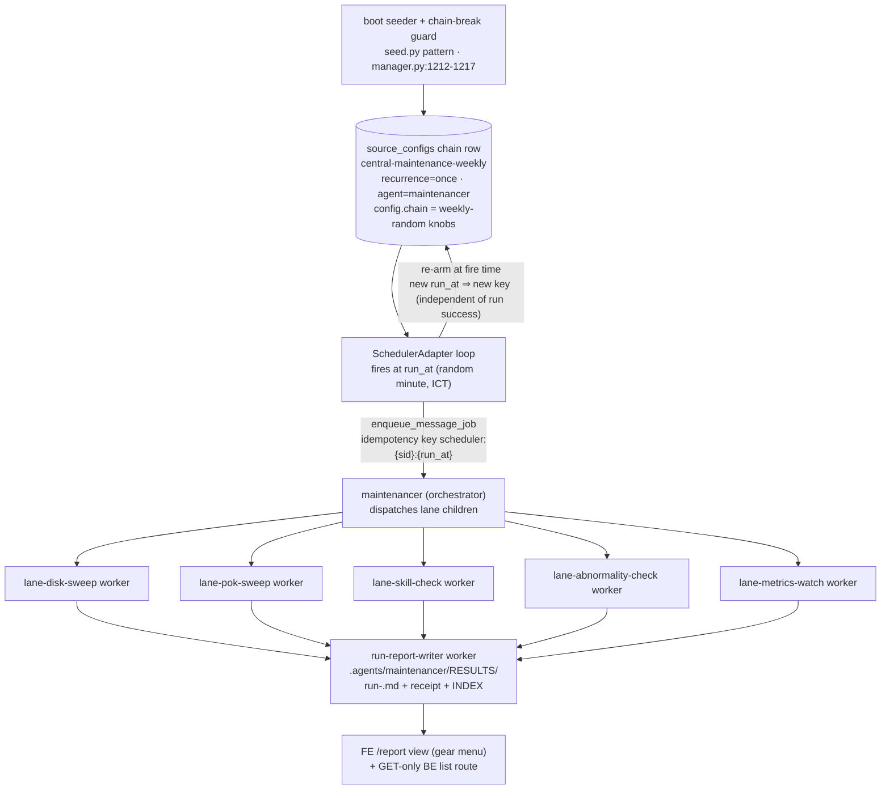

# Central Maintenance System — Implementation Plan (Overview)

**Board:** wi-73d81a32 · **PM ledger:** ENSEMBLE-35 · **Status:** PLANNED
**Worktree:** `/home/nea/ensemble-src-wt-maintsys` · branch `feature/central-maintenance-system` · base `origin/latest @ 1b9797ab7` (staged v0.31.26 source tree)
**Planned:** 2026-11-22 (planner lane; research: 3 explorers, planning: 2 workers, synthesis: planner)
**Nominal release slot:** v0.31.27 (RE-CHECK at tag time — R7 / BR-20)

---

## 1. Objectives

A weekly, self-starting, extensible maintenance system for the ensemble daemon:

1. **Random-time trigger** — fires at a uniform-random minute inside a configurable ICT window (default 01:00–05:00 Asia/Ho_Chi_Minh), re-rolled every week; window/weekday/timezone are knobs, not constants. **No idle/busyness gating anywhere** on trigger or dispatch (the old tier's idle-starvation class is regression-pinned by test).
2. **Maintenancer as orchestrator** — upgraded in-repo with per-lane worker children and per-lane skills; scheduler dispatch goes DIRECTLY to `maintenancer`, not via Ari.
3. **Five lanes** — (1) disk cleanup incl. /tmp test-scratch and ALL `ensemble-hbk-*` classes (populated `-verify` = retention, never blind-delete), (2) POK compact/optimize/sweep (consuming the committed pok-sweep census artifacts), (3) skill-system evolution check, (4) abnormality/critical checks (anomaly clusters, wedges, stuck lanes, old-tier health), (5) metrics watch.
4. **Report ALWAYS written** — file-based run report + receipt + index with per-lane status (ok/degraded/failed) and recommendations in three classes: auto-fix-now / needs-Emperor-word / route-to-lane. A failing lane never kills the report.
5. **One canonical manual-trigger path** with a receipt whose `trigger_type=manual` is provable.
6. **FE 'report' surface** wired per house precedent (evidence-based — see decisions.md PD-2).

## 2. Architecture summary

- **Trigger chain (P1):** one `recurrence="once"` scheduler row whose `run_at` is rewritten at each fire (self-rescheduling one-shot — R1). Knobs are env-first, resolved at each arm/re-arm; the row's `config.chain` block records resolved values. A boot-time archive-aware get-or-recreate guard keeps the chain alive across reboot, source-GC archiving, and crashes; a past-due `run_at` auto-fires at boot. The chain avoids the cron path entirely (no croniter DST exposure; ICT is fixed UTC+7).
- **Orchestrator (P2):** `agents/maintenancer/meta.json` allow list gains the FOUR LITERAL tool names `spawn_instance`, `send_message`, `subtree_messages`, `subtree_status` (BR-8 — NOT the whole `"instance"` category; deny list byte-unchanged, the seat stays non-mutating); rule/workflow extensions encode the weekly dispatch flow, failure isolation, and the report-ALWAYS contract; six new skills (`lane-disk-sweep`, `lane-pok-sweep`, `lane-skill-check`, `lane-abnormality-check`, `lane-metrics-watch`, `run-report-writer`) under `skills-template/` + `skill-set.yaml`. In-repo prompt changes stage via the release; **live DB prompt adoption is a post-promote operator step (out of lane scope)**.
- **Lanes (P3):** common measure→act→report loop; each lane emits a structured result block — the **PD-4a canonical block, frozen in decisions.md PD-4/PD-4a** (cited by reference everywhere) — consumed by the receipt. Lane 1 is governed by the salvaged baseline's deletion-fence recipe (never operate from canonical; mktemp-fenced dry-runs; never delete files held open by live processes; explicit-class pathspecs; measure bytes AND inodes) plus the hbk class rules and the protected set; worktrees are REPORT-ONLY (never deleted by the sweeper). All lanes are read-only against daemon bookkeeping tables.
- **Report/receipt/manual/FE (P4):** artifacts at `.agents/maintenancer/RESULTS/` (`run-<run_id>.md`, `receipt-<run_id>.md`, `INDEX.md`), `run_id` single-sourced from `new_maintenance_run_id()`; manual trigger = `task_schedule` one-shot at now → `maintenancer` (same dispatch path as the weekly chain); FE wires the gear-menu 'Report' entry + lazy `/report` route + a GET-only BE list route (live_views has no list endpoint).
- **Tests/verification/staging (P5):** mutation-proven R2 no-idle pin (behavioral + structural legs), picker/re-arm/guard/seed pins, P2–P4 acceptance→check map, mandatory test fencing, staging-only release per R7 (NO promote, NO ceremony — handoff to leader).

## 3. Phase map — shared-context grouping & instance reuse

| Phase | File | Objective | Context group | Parallelizable with |
|---|---|---|---|---|
| P1 | `phase1-plan.md` | Trigger chain, arming, re-arm guard | daemon-scheduler | P2, P3 (disjoint files/contracts; P1 fixes the row name/agent/chain-block shape) |
| P2 | `phase2-plan.md` | Orchestrator upgrade + lane skills | agent-side | P1; P3 starts on its skeleton (schema shared input = PD-4a) |
| P3 | `phase3-plan.md` | Lanes 1–5 implementation | agent-side | P4 (report schema fixed by contract) |
| P4 | `phase4-plan.md` | Report + receipt + manual trigger + FE surface | cross (agent + FE + trigger) | P3 |
| P5 | `phase5-plan.md` | Tests, verification, staging | daemon-test + release | nothing — terminal gate |

**Instance-reuse cut:** two implementation lanes cover the tree — a **daemon-side** instance (P1, then joins P5's trigger-test authoring) and an **agent-side** instance (P2 → P3 → P4). P5 runs last as the terminal verification/staging gate and owns the full test matrix. P1 and P2 are the natural parallel wave; P3/P4 follow on the agent side; the FE tasks inside P4 can run as a third, FE-context sub-lane if staffing allows (they touch only `frontend/` + one BE route).

## 4. Decision index

All rulings and decisions are recorded with evidence in **`decisions.md`** (same directory): LEADER-RULING rows (Emperor design changes 1–3, R1–R9, DP-1, OQ3, AMENDMENT-1 — fixed) and PLANNER-DECISION rows PD-1…PD-11 (phase cut, FE wire-vs-seam, manual path, report schema, DB-vs-files, report authorship, knobs home, chain identity/re-arm seam, run_id minting, open-question adjudications, hbk scope encoding).

**Binding-requirements layer (BR-1..20 + DP-1)** — folded into the carrying phase docs as labeled `BR-N` blocks (single source of truth; the architect's `architecture-recommendation.md`, commit `28e3b7590`, remains the verdict record). BR-20 (staging re-check discipline) rides P5 T5.7 and this overview's release line. Supersessions of planner decisions are recorded in `decisions.md` §D.

## 5. Risks (top set, deduplicated across phases — full tables in each phase file)

> **Package convention:** the §5 ledger is regenerated after every fold.

| Risk | Sev | Mitigation |
|---|---|---|
| Idle/busy gate reintroduced on the trigger path (the killed failure class) | high | R2 two-legged mutation-proven pin (behavioral busy-fires-anyway + structural no-`JOB_IDLE_POLICIES`/`_is_idle` reference) — P5 T5.1 |
| Source-GC archives the chain row ⇒ chain silently dies | high | Boot guard recreates ARCHIVE-AWARE (BR-3: `cancelled` archive ⇒ never revive; `stopped` ⇒ revive IFF the archived config carries a `chain` block; no archive row ⇒ create; never re-archive over a stale snapshot); guard tests = P5 T5.4 legs (c)/(d)/(e) |
| Report-writer child fails ⇒ "report ALWAYS written" broken | med | BR-13 L0→L3 writer ladder (L0 dispatch, write order run→receipt→INDEX last; L1 one minimal-stub writer; L2 one bare worker child = the pre-decided scoped-write fallback, seat still never writes; L3 accepted surfaced reportless terminal per DP-1); BR-15 detector + orphan listing; INDEX dedup |
| `schedule_executions` lacks an explicit manual-vs-scheduled marker | med | `trigger_type` TRANSPORTED via the message-body trigger token (P4 T4.6: `trigger: scheduled` in the chain literal / `trigger: manual` in the manual invocation; orchestrator parses → writer envelope; no DB field, no DB read by the writer); P5 T5.6 proves the token round-trip |
| POK merges hit the now-live family cap (`pok_family_full`) | med | Same-slug supersede only; cap-aware merge rules encoded in P3 lane 2 |
| FE ordering-pin specs break on menu append | low | Spec updates listed as P4 tasks (gear-menu tail-append convention honored) |
| Release-slot collision (sibling hbk lane stages first) / base drift | med | R7: re-check tags at tag time, next free slot, rebase onto staged source_commit; the deferred-delivery pin test SURVIVES upstream (present at `86e196576` and at current tip `8894f86a` — earlier "deleted" claim was false) — obligation = unconditional keep-green; BR-20 covers the tag-time re-check |
| Upstream test deletions vs our new scheduler tests | low | P5 rebase discipline + interaction note |
| Wedged lane / wedged re-dispatch parks the run forever (no time bound) | high | BR-11 event-driven lane deadline via EXISTING watchdogs (WAITING_CHILDREN hang watchdog ≤3600s; long-tool nudge) — valve → `[incomplete]` → proceed; covers initial dispatch + single re-dispatch; no polling |
| Reportless week (orchestrator dies mid-run; both writer rungs fail) | med | BR-13 L0→L3 writer ladder + DP-1 (ACCEPTED — surfaced, documented terminal); BR-15 boot-guard detector + lane-4 orphan listing — never silent |
| >24h outage ⇒ idempotency-key TTL expiry ⇒ real second run | low | BR-2 documented at-least-once semantics (two run_ids/reports tolerated by design); TTL deliberately NOT widened |
| tz-knob gap shift lands the instant outside the window (non-ICT zones) | low | BR-5 picker consumes the `anchor_local_to_utc` warning and fails closed outside `[start,end)`; P5 DST-zone test leg (America/New_York gap+fold) |
| Deliberately cancelled chain resurrected by the guard | med | BR-3 archive-aware recreate: `cancelled` ⇒ never revive; `stopped` ⇒ revive IFF the archived config snapshot carries a `chain` block; never re-archive over a stale snapshot |
| P2 seat-grant blast radius (residual, same shape leader/ari carry) | high | BR-8 literal-four grant (no category); `send_message` is type-scoped NOT ownership-scoped — the BR-9 run-containment rule lands in the SAME change as the grant (P2 T2.3); the BR-10 pins are P5-OWNED (T5.5) — phase2 risk R-P2-1 |
| Disk-sweep deletion of a live/evidence file (lane 1) | high | R9 four-fence recipe (recency, open-by-process, evidence-pointer protect-list, explicit-class pathspecs) + mktemp-fenced dry-runs + protected set NEVER; measure before/after bytes AND inodes (phase3 lane 1) |
| One-shot consumption permanently disables the chain row | high | Chain-aware re-arm skips the disable callback; boot guard backstops (phase1 R-P1-1) |
| Re-arm write drops `agent`/`message`/`timezone`/`recurrence` (config full-replaces) | high | BR-4 complete-config read-modify-write + P5 T5.3 persistence assertion (phase1 R-P1-10) |
| R2 pin written bookkeeping-only ⇒ idle gate reintroduced undetected | high | Behavioral leg FIRST, structural leg second; both mutation-proven (phase5 R-P5-1) |
| Test resolves live-shaped HOME / prod DB | high | Temp DBs + FAKE_HOME fence + per-var env scrub + dev fence (phase5 R-P5-2) |

**Artifact root (BR-16):** all run artifacts live at the LIVE-INSTALL daemon project root `.agents/maintenancer/RESULTS/` — **never a worktree** (worktrees are report-only per R8/R9); the dir is created by P1's seeder at first boot (resolved against the live-install project root); the writer skill, FE list route, and live_views root all read THE SAME root.

## 6. Out of scope

- **Live promote / release ceremony** — staging only; handoff note to leader (R7).
- **The post-promote MANUAL RUN itself** (Emperor deliverable E-3) — Ari executes it after promote per the P4 T4.6 canonical invocation; this lane plans and stages the capability only.
- **Live DB prompt-artifact adoption** — in-repo prompt files stage via the release; DB adoption is the standard post-promote operator step (R3; flagged in P2 + P5).
- **Worktree deletion** — lane 1 REPORTS worktree drift; removal policy owned by leader/giter lanes.
- **Structural /tmp fixes** (full-repo extraction per gate run, pytest-of-nea retention, shakedown TTLs, journal .bak rotation) — emitted as route-to-lane recommendations; owner lanes fix producers.
- **Crossing-midnight window definitions** — v1 requires `start < end` on the same day (flagged; knob validation).
- **New DB tables / migrations** — none (decisions.md PD-5 justification).
- **Stopping the hbk mint** — sibling fix lane owns the root cause; this lane sweeps accumulated + recurring stock.

## 7. Deliverable inventory (this directory)

| File | Author | Content |
|---|---|---|
| `disk-lane-baseline-2026-11-18.md` | salvaged (commit fd782b70d) | lane-1 design substrate: /tmp consumer classes, fences, worktree disposition |
| `phase1-plan.md` | worker (plan-creation) | trigger chain + arming + re-arm guard + architecture diagram |
| `phase2-plan.md` | worker (plan-creation) | orchestrator upgrade + lane skills |
| `phase3-plan.md` | worker (plan-creation) | lanes 1–5 |
| `phase4-plan.md` | worker (plan-creation) | report/receipt/manual trigger/FE |
| `phase5-plan.md` | worker (plan-creation) | tests, verification map, staging |
| `plan-overview.md` | planner (synthesis) | this file |
| `decisions.md` | planner (adjudication log) | LEADER-RULING vs PLANNER-DECISION with evidence |
| `architecture-recommendation.md` | architect (validation lane, commit `28e3b7590`) | verdict record: BR-1..20 binding requirements, focus evidence, §9 architect rulings, DP-1 |

## 8. Verification & staging

P5 owns the terminal gate: full test matrix (fenced — temp DBs, dev env fence `POSTGRES_DB=ensemble_dev`/`DAEMON_PORT=8079`, `ENSEMBLE_BOOT_SWEEP_STALE_SUBPROCESSES=0`, no live-shaped HOME paths), P2/P3/P4 acceptance→check map, manual-trigger receipt provenance (downstream tester gate), and the staging-only release per R7. Boot SLO context: Emperor-set boot wall-clock ≤ 120s applies to any boot-touching verification.
