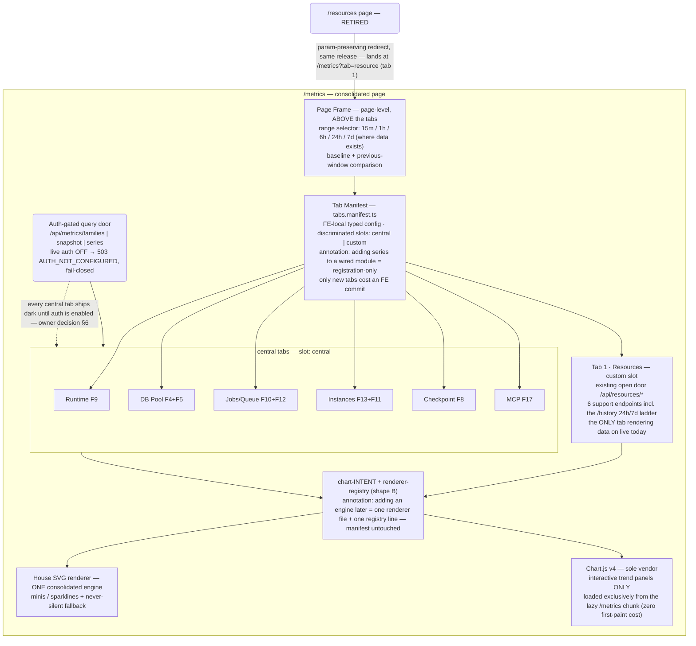

# FE Audit + Resource-Tab Refactor Proposal (2026-11-03)

Final user-facing report for the FE-metrics + resource-tab audit commission. Covers Deliverable 1 (honest UI/chart quality assessment, §1) and Deliverable 2 (resource-tab diagnosis §2 + scoped refactor proposal §3). All verdicts below are adjudicated — this document assembles them; it does not re-derive them. All evidence paths are relative to `.agents/shared/planning/metrics-unification/`. Planning doc, untracked by house convention; no code changed, nothing committed.

## 0. TL;DR

- **"Do we have good UI/charts yet?" — GOOD BONES, NOT YET A GOOD UI.** And today the new `/metrics` page shows **no data to anyone** in production, because live auth is off (503 fail-closed) — the OLD `/resources` page is the only one serving live charts (→ live-capture-log.md §0, §2).
- **Resource tab needs refactor: YES** — verdicts (a)+(c)+(d) confirmed, (b) partial (§2).
- **Recommended refactor:** consolidate BOTH pages into one `/metrics` module with a tab manifest; resource becomes tab 1 on its existing endpoints; retire the standalone route (§3).
- **Charting:** reduced set behind the owner's seam instinct — Chart.js v4 as sole vendor for interactive panels (lazy-chunk-only), one consolidated house-SVG renderer for minis/fallback; ECharts/ApexCharts deferred with written triggers; Gridster2 dropped (§3e).
- **The owner's decisions are ANSWERED (2026-11-03)** — the three rulings are recorded in **§8**, which supersedes §6 (**D-1** charting posture · **D-2** live auth posture · **D-3** route fate).

## 1. Honest UI/chart quality assessment (Deliverable 1)

### 1.1 What shipped

(→ fe-metrics-source-audit.md §1–§4)

- `/metrics` at route `app.routes.ts:58`; gear-menu-only discoverability (`app.ts:597`, 7th entry of 9) — no top-nav presence.
- Three tabs: **Overview** (`/api/metrics/snapshot`, 10 s poll) · **Charts** (`/api/metrics/series`, 15 s poll, window HARDCODED 3600 s) · **Families** (catalog).
- One hand-rolled SVG primitive (`charts/svg-line-chart.component.ts`): STEP/LINEAR + area, shape-only by design.
- Zero charting dependencies — 33 deps total, none chart libs; d3 appears only transitively via mermaid (→ fe-metrics-source-audit.md §4).
- Provenance trap (stated up front): the shared checkout `/home/nea/ensemble-src` does NOT contain the `/metrics` page (v0.27.8-era HEAD, ~300 commits behind) — all FE source facts were read from the v0.28.9 payload tree (`7fcf1bd71`), sha-verified against `origin/latest`, and cross-checked against the rendered DOM. Any audit run against the main checkout alone would wrongly conclude "the page does not exist" (→ fe-metrics-source-audit.md §0; live-capture-log.md §1).

### 1.2 The live truth

Captured read-only against live `:9797`, 2026-11-03 15:56–16:20 UTC, then judged on the leader's own screen review. Capture posture: browser traffic 100 % GET (566 + 81 requests swept, 0 non-GET; livez uptime monotone throughout — no live contact beyond reads) (→ live-capture-log.md §3, §6). Environment at capture: livez 200; `/readyz` 503 degraded (checkpoint_saver sentinel timeout, grace active) — pre-existing, NOT caused by the probe, and itself invisible on the pages in question (→ live-capture-log.md §1).

**The two developer questions this UI exists to answer, scored** (→ live-capture-log.md §0, §7.1):

| Question | Verdict | Why |
|---|---|---|
| "Why is this instance slow right now?" | **PARTIALLY — shape yes, cause no** | Live tab rules out throttling at a glance and 68.9 % CPU is provably chronic — but the page is daemon-scoped, and the attribution panel designed to name a culprit renders zero per-instance rows |
| "What changed overnight?" | **NO — the data exists, the presentation wastes it** | 24 h/7 d history is real (probe-proven), but no y-axis, unlabeled events, mortal markers; the promote collapse is visible yet unannotated |

**Live release correction.** Live is **v0.28.9** (livez 200, epoch 2026-11-03T15:43:16Z). This CORRECTS the project record: the v0.28.9 composition metadata still said "promote NOT performed"; the authoritative key `promote_state_2026_11_03` now exists (→ live-capture-log.md §1; §4 below).

**Auth posture — the headline.** Auth is OFF on live (`auth.enabled=false`, zero `ENSEMBLE_AUTH_*` in `.env`, `/api/auth/*` → 404). Therefore `/api/metrics/*` = **503 AUTH_NOT_CONFIGURED, fail-closed FOR EVERYONE** — proven unfixable by any credential (dummy bearer still 503) — while `/api/resources/*` = **200 open** with live data. The entire central-metrics FE is **DARK in production today** (→ live-capture-log.md §2, §4).

**The `/metrics` empty state** — honest about the cause, dishonest about the consequence (screenshots/01–04b; → live-capture-log.md §7.2–§7.4):

- two identical banners, one self-contradictory ("serves no metrics. — the last known values are kept", no values rendered);
- TWO Retry buttons that can never succeed (this is daemon config, not a transient);
- three tabs left enabled that all fail identically;
- no HTTP status surfaced, no runbook link, no names-only family catalog;
- header shows a green health dot while the body reports hard failure;
- and Metrics is not in the top nav at all (gear-menu only).

**The `/resources` Timeline with real data** (screenshots/05b) — it CONTAINS the answer to "what changed overnight": the ~15:42 V-collapse aligns exactly with the v0.28.9 boot epoch. But it WITHHOLDS the interpretation — the restart is unlabeled; reading it required cross-referencing project records, not the pixels (→ live-capture-log.md §7.1, §7.5). Pixel-level defects:

- NO y-axis at all; three series with two units (MB and %) on one unlabeled axis, each independently min-max normalized, so the area fills visually read as a stacked-area chart — nonsense across units (a 105 % CPU peak draws no higher than an RSS plateau);
- legend advertises 5 series, plot draws 3;
- four event dots unlabeled, unmoored (the blue dot does NOT align with the actual collapse), evenly spaced so they read as tick marks;
- no date; 1 h default window so "overnight" is unframeable despite 24 h/7 d chips existing;
- no last-updated stamp; the chart occupies a thin band with the bottom ~40 % of the viewport empty;
- at Discord-thumbnail size only the collapse shape survives — meaning does not.

**The `/resources` Live tab** (screenshots/05): the subtitle promises "per-instance attribution" and NOTHING names a single instance — no list, no top-N table. The arithmetic does not cohere (→ live-capture-log.md §7.1):

| Displayed | Value | Coherence problem |
|---|---|---|
| attributed / unattributed | 71 MB / 1,119 MB | sum = 1,190 MB implied total |
| daemon RSS | 633 MB | matches NO relation to 1,190 MB |
| cgroup current | 6,178 MB | best-fit basis (anon 901 + slab 291 = 1,192 MB) never stated |
| Coverage | 0 % | incompatible with 71/1,190 ≈ 6 % under any reading |

And the sharpest inference the page itself never makes: daemon RSS (633) < cgroup anon (901) → 268+ MB of anonymous memory belongs to something the page cannot identify — exactly the question it exists to answer.

**Anomaly markers are process-local** — in-RAM `deque(maxlen=256)`, reset per restart, ~3.2 h cold-boot replay cap — they can never span overnight BY CONSTRUCTION. The 24 h/7 d history is real (2,723 raw-30 s points / 13,387 minute-tier points probed live), but the marker layer cannot annotate it (→ live-capture-log.md §7.7).

**Ranked top-5 developer-user frictions** (→ live-capture-log.md §7.6):

1. 🔴 `/metrics` dark by install posture — auth OFF means the surface built to answer these questions serves nothing.
2. 🔴 Attribution panel: cannot name a culprit + non-reconciling math.
3. 🔴 Timeline has no y-axis — shape, never levels.
4. 🟠 Events anonymous and mortal — the journal dies at restart; the loudest event (the promote itself) carries no annotation.
5. 🟠 Zero-state UX + discoverability — Retry offered for a config error; gear-menu 5th/7th of 9; 900 px CSS collision (banner text vs Retry); enabled-but-empty chips; em-dash ring-drain transients.

### 1.3 Chart-capability table

(→ fe-metrics-source-audit.md §3, as audited)

| Capability | State | Note |
|---|---|---|
| Time-range selection | ABSENT | window hardcoded 3600 s (`charts-tab.component.ts:195`) |
| Comparison-to-baseline | ABSENT | — |
| Multi-series overlay | PARTIAL | primitive takes an array but only consumer passes `[chart]`; per-series y-normalization makes overlay meaningless |
| Drill-down | ABSENT | zero click handlers |
| Anomaly spotting | ABSENT on /metrics | present on /resources svg-timeline |
| Export | ABSENT | — |
| Zoom/pan | ABSENT | — |
| Tooltips | PARTIAL | native `<title>` "HH:MM UTC · value" — no units, no y-axis labels |

**Critical context:** the app's MOST capable chart engine is the OLDER page-local svg-timeline (538 lines, v0.25.0) — window picker 15m/1h/24h/7d, series toggles, anomaly markers, click → drill-down to evidence + traceback. Two engines, ~1,061 lines, duplicated scale/path helpers, no shared abstraction — and the NEWER one is strictly LESS capable than the older (→ fe-metrics-source-audit.md §7.1; fe-metrics-source-audit.excerpts.md §4).

Related finding: the anomaly findings DO exist server-side (`/api/resources/anomalies` returns rows — cpu peak 75.55 medium, fds ramp, …) but the FE renders no anomalies list on either page; they surface only as the anonymous Timeline dots, unexplained (→ live-capture-log.md §4, §7.2; screenshots/05d).

### 1.4 Two concerns separated

**(a) Rendering/UX.** Structurally sound substrate — polling hygiene, 5-class error taxonomy, never-blank degradation, STEP-vs-LINEAR data honesty, UTC everywhere, 1,645 spec lines + Playwright gate — but capability-thin (table above), and the mixed-unit normalization is actively misleading (→ fe-metrics-source-audit.md §5, §7.6).

**(b) Metric selection.** The page mirrors the REGISTRY's shape (16 families, a catalog tab) rather than user questions. Nothing on either page answers "which instance" or "what changed": the per-instance dimension is absent on `/metrics` (families are aggregate) and promised-but-undelivered on `/resources`. The selection is not wrong; it is INCOMPLETE — the families developers need for attribution (per-instance CPU/mem series) are exactly the ones the central registry excludes today (→ §3f; resource-refactor-architecture.md §6.1).

### 1.5 What is genuinely good (credit where due)

(→ fe-metrics-source-audit.md §7.6; live-capture-log.md §7, §7.7)

- Polling hygiene with supersede tokens + tab-hide stop.
- Never-blank stale-degradation (last-good kept, STALE surfaced).
- STEP rendering for counters — data honesty.
- UTC-everywhere; strong test pinning.
- The resource svg-timeline's window ladder (48 h/14 d/180 d retention tiers) is REAL, and the `/history` API serves 24 h/7 d truthfully (probe-proven).
- The fail-closed banner copy names the real root cause — the best dark-state copy on either page.

## 2. Resource-tab diagnosis (Deliverable 2, part 1)

Verdict per suspicion, each with its single strongest evidence (→ resource-tab-forensics.md, Parts A–D):

| # | Suspicion | Verdict | Strongest evidence |
|---|---|---|---|
| (a) | Reads pre-central endpoints, duplicating central logic | **YES** | 8 endpoints under `/api/resources/*`, ALL own-path, zero coupling both directions (grep-proven); FE consumes 6; own SQL over `resource_daemon_bucket` + `resource_instance_sample` with its own tier/resolution ladder (→ resource-tab-forensics.md Part B) |
| (b) | Missing charts/visualization | **PARTIAL** | One real hand-rolled chart exists (svg-timeline — the app's most capable). The defect is DUPLICATION: the metrics lane shipped a second shared primitive declaring "ONE shared primitive — never a per-page copy" while the page-local copy persists; plus `instances[]`/`children[]` fetched every 8 s and NEVER rendered despite the subtitle promising per-instance attribution (→ resource-tab-forensics.md Part C (b), A4) |
| (c) | Missing metrics | **YES** | LLM tokens (F14 excluded, "zero consumers ref-wide"), LLM request latency (F15 excluded), source circuit-breakers (uncatalogued) — absent from the page AND from central; all 16 central families unsurfaced on the resource page; central = 10 live / 6 dark (→ resource-tab-forensics.md Part C (c)) |
| (d) | Stale / inconsistent with the /metrics vocabulary | **YES** | Window vocabularies irreconcilable (15m\|1h\|24h\|7d vs window_s ≤ 7200 in-RAM); auth postures OPPOSITE by design (resources open fail-empty scope manifest `*` vs metrics 503 fail-closed); zero cross-references between the runbooks and central metrics (→ resource-tab-forensics.md Part C (d)) |

**(e) Bottom line — not "all of the above":** (a)+(c)+(d) confirmed, (b) partial. ROOT DRIVER: **two parallel observability stacks** — two chart codebases, two vocabularies, two auth postures — neither able to serve the other's data (central cannot reconstruct `/live`'s in-process ring; its 2 h window cannot back a 7 d timeline) (→ resource-tab-forensics.md Part C (e), Part D).

**Why the split exists (context, not an excuse):** it is ratified architecture, not neglect — the house split (leader-ratified decision 4) assigns durable time-series to the resource_monitor PG tier and per-instance attribution is PG-only by cardinality rule; the timeline is explicit (`/resources` = v0.25.0, 2026-10-19 → central metrics = v0.28.6, 2026-11-02 → agent tools = v0.28.9, 2026-11-03). The page could not have used a door that did not exist; the door then deliberately did not absorb it (→ resource-tab-forensics.md D9).

**Scatter quantified** (→ resource-tab-forensics.md D8): 8 endpoints · 11 tables (4 resource + 7 platform via the traceback join) · 3 in-process seams · 5 backend modules + 1 FE service + 4 components.

**Incidental defects found and ROUTED** (do not fold into the refactor; → resource-tab-forensics.md "Incidental findings"):

- Resource-facade spine-health gauge `TypeError` — `@property` counters called with parens (`facade.py:71-77`); the gauge always reads "not accepting" in production, masked by a `_FakeMonitor` encoding the wrong contract.
- F1/F3/F6 central families false-dark in production (routed R-i/R-ii).
- `/control-capabilities` reads `resource_limit_policy`, which has NO WRITER (empty by v1 design — FE-orphaned).
- `POST /profile` has no profiler (FE-orphaned).
- `/api/resources/*` serves live daemon internals unauthenticated whenever auth is off (pids, per-instance memory, thread counts) — fail-open by design. A refactor that merges the two surfaces must pick one posture consciously; this feeds §6 decision 2 (→ resource-tab-forensics.md "Incidental findings").

## 3. The scoped refactor proposal (Deliverable 2, part 2 — per the RATIFIED direction)

Ratified direction, restated in four lines: own Angular FE; predefined tabs, one per module; resource = tab 1; Prometheus-text export = optional power-user escape hatch; we do not author Grafana dashboards.

### (a) Tab contract

(→ resource-refactor-architecture.md §1)

FE-local typed config for T1–T2 (`tabs.manifest.ts`, discriminated `central | custom` slots). Adding SERIES to a wired module is already registration-only (the families payload carries role/chart_role/labels); only new TABS cost an FE commit. A BE-served manifest was designed but deferred — a new route would break the machine-pinned query-routes fence. Tab 1 rides the `custom` escape hatch for its 6 support endpoints: the "config not code" promise covers `central` tabs only — stated plainly. Full TS sketch lives in resource-refactor-architecture.md §1 (cited, not duplicated here).

### (b) Ship-only-live-tabs

(→ resource-refactor-architecture.md §2)

T1 = **7 tabs, all verifiably live**:

| # | Tab | Slot | Source (family) | Renders data on live today? |
|---|---|---|---|---|
| 1 | Resources | `custom` | own 6 endpoints under `/api/resources/*` (open door) | **YES — the only one** |
| 2 | Runtime | `central` | F9 | dark until auth (§3b caveat) |
| 3 | DB Pool | `central` | F4 + F5 | dark until auth |
| 4 | Jobs/Queue | `central` | F10 + F12 | dark until auth |
| 5 | Instances | `central` | F13 + F11 | dark until auth |
| 6 | Checkpoint | `central` | F8 | dark until auth |
| 7 | MCP | `central` | F17 | dark until auth |

Held back: Loop/Wedge (F1/F3) + PG census (F6), blocked by the false-dark production defects (routed, §2). No-source modules (LLM tokens, LLM latency, source breakers) are HIDDEN ENTIRELY — no dark shells, no placeholder rows — tracked as `planned` manifest entries.

**CRITICAL LIVE-POSTURE CAVEAT** (new evidence; must stay prominent): "live" means producers live, NOT door reachable. Live auth is OFF, so every CENTRAL tab ships dark in production until auth is enabled — only tab 1 (open door) renders data today. This is a deployment decision owned by the user (→ §6).

### (c) Page-level cross-cutting

(→ resource-refactor-architecture.md §3)

Range selector (15m/1h/6h/24h/7d where data exists) + baseline/previous-window comparison live in the page frame ABOVE the tabs. Constraint: central windows > 2 h are ring-growth major work (not recommended now) — so universal ranges are 15m/1h(/2h); 24h/7d are tab-1-only via its own `/history` ladder. First-class baseline needs an optional additive `end_offset_s`/`compare` param (T1.5, no schema/vocab bumps). The honest zoom is the already-shipped "narrow the window" re-fetch, not brush.

### (d) Drill-down

(→ resource-refactor-architecture.md §4)

Chart → instance/job detail. Generic drill-down is FE-only feasible via series metadata + the two-step flow (timestamp+series → resolve entity), BUT per-instance series do not exist centrally today (see (f)) — so T1 drill-down lands ONLY on tab 1 (its svg-timeline already click→drills to evidence+traceback) and on aggregate central tabs as chart→family detail. Full per-instance drill-down is gated on (f).

### (e) The charting decision — leader's adjudication (final unless the owner overrides in §6)

(→ charting-engine-decision.md; charting-engine-decision-independent.md; resource-refactor-architecture.md §10)

**The 4-engine proposal AS-IS: REJECTED on measured evidence** (both independent evaluations agree):

- **ECharts — the tier is EMPTY at our volumes.** Query-door clamps: 240 pts/series, 12,000 pts/response, 7,200 s window; the heaviest real panel (resource 7 d = 50,400 pts) is SVG-rendered today; thousands-of-series panels cannot exist (per-instance exclusion + 2,000-series cap).
- **ApexCharts — no surface.** No report page exists for it to serve.
- **Gridster2 — a different product; DROPPED.** It is drag/resize composable dashboards, not the ratified fixed-tab direction; revisit only on a committed composable-dashboards roadmap item, at an Angular-major boundary (its real risks: bus-factor 1, peer pin mismatch ^NG22 vs our 21.2.5; NOTE the angular2-d3 premise was FALSE — package 404s, no d3 dependency anywhere).
- **Chart.js in the MINI role (as the proposal assigned it) — its measured WORST fit.** SVG already wins minis (~30 lines).

**ADOPTED — reduced set behind the owner's seam instinct:**

- **Chart.js v4 as the SOLE vendor engine, interactive trend-panel role ONLY**, imported exclusively from the lazy /metrics chunk.
- The two existing SVG engines **consolidated into ONE house renderer** for minis/sparklines + the never-silent fallback.
- Both behind a **chart-INTENT + renderer-registry contract (shape B)** so adding an engine later is one renderer file + one registry line, manifest untouched.

**Measured costs** (→ charting-engine-decision-independent.md §1): Chart.js 6.2 MB unpacked, 1 dep (`@kurkle/color`), +2 lockfile entries, MIT, ~65–68 kB gz — in a lazy chunk → ZERO budget bytes, ZERO first-paint cost (metrics chunk today 27.7 kB; the initial budget has 89,982 B headroom and covers entry-points + static imports only — dynamic imports are never followed; NO total budget, NO CI per-chunk gate exists).

**The flip condition:** if T1 ships single-series shape views with interaction deferred, DROP Chart.js too and ship pure SVG; register it when interaction lands.

**The honest counter-option:** ratify zero-npm-deps as a STANDING FE position → the panel role goes to the extended house-SVG renderer at ~+400–700 LOC (vs ~250–450 LOC of Chart.js wrapper), keeping the test-enforced posture (`metrics.bindings.pins.spec.ts` bans chart libs) and avoiding the governance amendment (pack Leg 7 hard-fails any package.json diff + 5 doc/checklist sites same-commit). Both architects' evaluations agree the seam is the durable part; the engine fill is reversible either way.

**Key insight, stated plainly:** a charting library would NOT have fixed what the live capture condemned — auth posture, attribution math, unlabeled events, contradictory copy are data/backend/deployment problems. The renderer genuinely owes: a y-axis with units, a crosshair, shared-scale multi-series semantics. That is the whole charting delta.

**Incidental bundle finding (surfaced):** the real initial-bundle elephant is MERMAID — 3.56 MB raw / 972 kB gz, ~80 % of the initial set, loaded on EVERY page; larger than all four proposed engines combined. If bundle size ever matters, that is the target, not chart libs.

### (f) Backend-touching flags — the consolidated FE-only vs metrics-lane split

(→ resource-refactor-architecture.md §6, §8)

**FE-ONLY (the T1 refactor itself):** tab manifest, page frame, route retirement + redirect, Chart.js/SVG renderer consolidation, copy/empty-state fixes, endpoint retirement (`/control-capabilities` + `POST /profile` — dead code, small pin churn).

**METRICS-LANE (backend, separate commissions):**

1. Per-instance CPU/mem through the central door = rule + budget + retention collision (per-instance exclusion + closed-cardinality guard + 6.3k instances vs 2,000-series cap + 6.3k×240 pts ring growth). Tab 1 stays on `/api/resources/*`, zero BE work now; true central onboarding is a later deliberate decision.
2. F14 LLM tokens + F15 LLM latency + source-breakers = NEW families + instrumentation (not FE).
3. Optional additive `end_offset_s`/`compare` for first-class baseline (T1.5).
4. Central windows > 2 h = ring-growth major work.
5. Durable anomaly events — today process-local and mortal; a persisted findings store would be its own small commission (flagged, not scoped).

**DEPLOYMENT (user-owned):** enabling auth on live (IdP + operator token with `maintenance:read` + restart), or a deliberate door-posture change — without one of these, every central tab ships dark in production. Note the two current postures are opposite BY DESIGN (resources fail-open with a `*` scope manifest; metrics fail-closed) — merging the surfaces forces a conscious choice between them (→ resource-tab-forensics.md Part C (d), "Incidental findings").

### (g) Route fate

(→ resource-refactor-architecture.md §7)

**RETIRE `/resources` + param-preserving redirect to `/metrics?tab=resource` IN THE SAME RELEASE.** The standalone page has no unique capability once tab 1 mounts the full tree (including the Live tab's in-process ring and the traceback/evidence drill-down). `?tab=` deep links are NEW FE work (no mat-tab page reads query params today). Both gear-menu ordering spec pins + component spec edits are enumerated in resource-refactor-architecture.md §7 (cited).

## 4. Corrections to the record

| Record line | Correction | Why it matters |
|---|---|---|
| `staged_release_v0289_composition.promote` = "NOT performed" | **STALE — v0.28.9 IS live** since 2026-11-03 ~15:43Z; authoritative key `promote_state_2026_11_03` | The promote is the unlabeled ~15:42Z V-collapse on the resource Timeline (→ live-capture-log.md §1, §7.1) |
| Earlier audit line: delta_change on the REST series door | **Misattributed** — delta_change lives on the AGENT TOOL (`daemon/tools/metrics_read.py:1151-1158`), NOT the REST series door | Acting on the earlier line as written would have commissioned wrong backend work |
| angular2-d3 peer premise (Gridster2 d3 dependency) | **FALSE** — package 404s; Gridster2 has no d3 dependency | Removes a phantom risk from the charting decision (→ charting-engine-decision-independent.md §5) |
| "10/16 families live" | Describes **PRODUCERS**, not door reachability | The door is dark for everyone on live today (§1.2) |

## 5. Evidence index

All paths relative to `.agents/shared/planning/metrics-unification/`. Suggested reading order for a time-boxed pass: this report → `live-capture-log.md` §7 (the judgment) → `resource-refactor-architecture.md` §0 + §10 (the proposal) → the two charting evaluations.

| File | What it contains |
|---|---|
| `fe-metrics-source-audit.md` | The `/metrics` FE source walk: route/page structure, chart primitive, capability audit (§3), dependency census, degradation paths, honest critique |
| `fe-metrics-source-audit.excerpts.md` | Line-anchored source excerpts of the SVG primitive, the hardcoded-window Charts tab, and the older svg-timeline contrast |
| `resource-tab-forensics.md` | The `/resources` page forensics: Parts A–D (locate, data-dependency map, diagnosis (a)–(e), context/scatter), incidental routed defects |
| `live-capture-log.md` | Live capture method + developer-user judgment: auth discovery, HTTP census, capture manifest, ranked frictions §7.6, retention probe §7.7 |
| `screenshots/` (12 PNG + JSON sidecars) | See listing below |
| `resource-refactor-architecture.md` | The architecture proposal §0–§9 (tab contract, ship-only-live, cross-cutting, drill-down, charting, backend flags, route fate, flag split, open decisions) + §10 charting addendum |
| `charting-engine-decision.md` | Context-rich charting digest (numbers, workload fit, manifest shape, the one decision) |
| `charting-engine-decision-independent.md` | Independent blind charting evaluation (measured bundle/build reality, workload fit, shape-B recommendation, Gridster2) |
| `metrics-inventory-backend-producers.md` | Earlier inventory: backend metric producers, storage, gaps/scatter, seam assessment |
| `metrics-inventory-surfaces-fe-deps.md` | Earlier inventory: exposed surfaces, agent-tool consumers, FE/dependency landscape |

**screenshots/ listing** (one-liners from live-capture-log.md §5; each PNG has a same-name JSON sidecar with URL, viewport, auth state, per-capture API responses):

| PNG | One line |
|---|---|
| `01-metrics-unauth.png` | Fail-closed banner ×2 (page + tab), Overview active, no data anywhere |
| `01b-metrics-unauth-narrow.png` | 900 px: shell holds; banner-2 text collides with its Retry button |
| `02-metrics-overview.png` | Landing state + verbatim banner copy (deep lane) |
| `03-metrics-charts-tab.png` | Charts tab: hint only — "Waiting for the family catalog…"; 0 `<svg>` page-wide |
| `04-metrics-families-tab.png` | Families tab: headers present, 0 rows, "No families are registered." |
| `04b-metrics-banner-closeup.png` | Banner legibility close-up |
| `05-resources.png` | Live tab, real data: CPU 68.9 %, RSS 633 MB, 74 thr, cgroup 6178/6829 MB, attribution 71 MB vs 1,119 MB unattributed, 0 % coverage |
| `05b-resources-timeline.png` | Timeline: 3 plotted series (RSS 348.9–874.7, Group 581–6,784, CPU 7.4–105.4), 15:16→16:15 UTC, 4 unlabelled event dots, 1 h chip active |
| `05c-resources-timeline-tooltip.png` | No tooltip exists — 8-position hover sweep, zero overlays |
| `05d-resources-anomalies.png` | No Anomalies section exists in the FE — API rows exist, UI shows none; ring-drain em-dash transient |
| `06-app-shell.png` | App root + header nav; `v0.28.9` badge |
| `06b-nav-gear-menu.png` | Gear menu open, 9 entries: Resources = 5th, Metrics = 7th |

All 12 are also persisted to the daemon tmp-image substrate: `feature=fe-ui-audit`, `version=v0.28.9`, per-route `page` tags — the 12 image_ids are tabulated in live-capture-log.md §5.

## 6. Decisions needed from the owner — ANSWERED 2026-11-03 (the rulings are recorded in §8)

Everything else in §3 is adjudicated and proceeds on ratification; only these need a ruling.

**ANSWERED 2026-11-03 — the three rulings (D-1, D-2, D-3) are recorded in §8, which supersedes this section; the three questions below stand VERBATIM as the record of what was asked.**

1. **CHARTING POSTURE (§3e).**
   - (i) Ratify Chart.js-as-sole-vendor + the same-commit governance amendment (pins spec + pack Leg 7 + the doc sites) — **LEADER RECOMMENDS**.
   - (ii) Ratify zero-npm-deps as a standing FE position (SVG-extended, +400–700 LOC).
   - Either way the intent+renderer seam ships; the choice is reversible later.
2. **AUTH POSTURE (§3f / deployment).** Central tabs are dark in production until one of:
   - (i) Auth is enabled on live (IdP + `maintenance:read` token + restart) — **LEADER RECOMMENDS**; it is the designed posture.
   - (ii) A deliberate door-posture change for the metrics door when auth is unconfigured.
   - Without a ruling here, T1 ships with 6 of 7 tabs dark on this install.
3. **(Minor, confirm-or-veto) Route fate (§3g) + Gridster2.**
   - Retire `/resources` + redirect to `/metrics?tab=resource` same-release — **LEADER RECOMMENDS**.
   - Confirm "predefined tabs now" so the composable-dashboards door stays closed until a real roadmap item exists.

## 7. Suggested next step

If the owner ratifies §6, the natural next commission is the **T1 build lane**: tab manifest + page frame + tab-1 consolidation + renderer seam with Chart.js-in-lazy-chunk (or SVG-only per §6.1) + copy/empty-state fixes + route retirement — FE-only, no migration delta, one staged release. The metrics-lane items (per-instance series decision, Tier-3 families, durable events) stay separate commissions in dependency order.

## 8. What changed and why (2026-11-03 — post-audit rulings)

The document's §6 decisions were **answered by the owner on 2026-11-03**, and **this
section (§8) supersedes §6**. It records the three rulings it settles — **D-1** (the
charting posture), **D-2** (the live auth posture) and **D-3** (the route fate) — together
with the supersession chain that produced D-1 and the counter-option that was considered
and rejected. §6's three questions remain above, verbatim, as the record of what was
asked.

### 8.1 D-1 — the charting supersession chain

The chain, leg by leg — **not** a summary:

**(i) The original 4-engine proposal** (§3e): ECharts + ApexCharts + Gridster2 +
Chart.js, with Chart.js assigned the MINI role and a separate engine per role.

**(ii) The two independent measured evaluations** — `charting-engine-decision.md` and
`charting-engine-decision-independent.md` — measured that proposal against our real
workload and found: the **ECharts tier is EMPTY at our volumes** (the query door's clamps
— 240 pts/series, 12,000 pts/response, 7,200 s window — make the thousands-of-series
panels the proposal assumed impossible); **no ApexCharts surface exists** for it to
serve; and **Gridster2 is a different product** (drag/resize composable dashboards, not
the ratified fixed-tab direction). Chart.js in the MINI role measured as its **worst**
fit — SVG already wins minis at ~30 lines.

**(iii) The adoption** — **Chart.js v4 as the SOLE vendor** for the interactive-panel role
(imported exclusively from the lazy `/metrics` chunk), plus **ONE consolidated house SVG
renderer** for minis/fallback, both behind the chart-INTENT + renderer-registry seam.

**(iv) The owner's D-1 ruling (2026-11-03)** — which:

- **(a) fixes the vendor set** — Chart.js v4 (sole vendor, interactive trend panels only)
  + the one house SVG renderer (minis + never-silent fallback). ECharts and ApexCharts
  stay deferred with their written triggers; Gridster2 stays dropped;
- **(b) VOIDS the flip-condition** — §3e's *"if T1 ships single-series shape views with
  interaction deferred, DROP Chart.js too and ship pure SVG; register it when interaction
  lands"* is **VOID** as of 2026-11-03. **Reason: interaction IS in scope**, so the
  condition's antecedent never fires — the condition is unreachable, not merely
  unfavourable. Chart.js is therefore **not** droppable under this lane;
- **(c) requires the governance amendment in the SAME COMMIT as the dependency** — the
  pins-spec ban (`metrics.bindings.pins.spec.ts:94`), the pack Leg-7 guard and the 5
  doc/checklist sites move together with the `package.json` diff. The seam ships either
  way; the engine fill is reversible later.

### 8.2 The zero-dep counter-option — NOT CHOSEN (2026-11-03)

**Considered and NOT CHOSEN on 2026-11-03.** It is on the record so that a future lane
does not re-litigate it as if it had been overlooked.

**The counter-option.** Ratify zero-npm-deps as a **standing FE product position** ⇒ the
**panel role goes to the extended house-SVG renderer** at ~**+400–700 L** (the crosshair
+ nearest-snap is the expensive item) ⇒ the `metrics.bindings.pins.spec.ts:94` ban and
the **pack Leg-7 guard stay untouched**, and the test-enforced zero-dep posture is
preserved ⇒ the governance amendment is **avoided** (pack Leg 7 hard-fails ANY
`package.json` diff, plus the 5 doc/checklist sites that would otherwise have to move
same-commit).

**Its COST:** the interactive panel role must be hand-built (crosshair + nearest-snap +
multi-series semantics) at roughly twice the wrapper effort of the vendor path, and the
house renderer carries a capability burden the vendor would have supplied.

**Its PRESERVED BENEFIT:** the zero-npm-deps posture, the untouched pins-spec ban, the
untouched Leg-7 guard, and no governance amendment — no `package.json` diff to defend and
no 5-site same-commit edit to land.

**NOT CHOSEN** because the owner adopted D-1: the seam is the durable part, and the
vendor's cost is confined to a lazy chunk.

### 8.3 D-2 — the auth posture: the fail-closed door STAYS

The central door's **fail-closed posture STAYS — there is no weakening.** `/api/metrics/*`
continues to answer **503 `AUTH_NOT_CONFIGURED`** for everyone while auth is
unconfigured; the door is NOT opened, and the lane's own verification does not weaken it.

**Consequences:**

- The FE gains a **distinct, actionable `AUTH_NOT_CONFIGURED` empty state** on the
  **central surfaces only** (the catalog drawer + the 6 central tab bodies) — the real
  cause, the runbook pointer, and **no dead Retry button**. Tab 1 (Resources) keeps its
  own fail-open door and stays lit; the two doors keep their opposite postures by design
  (§3f).
- **Enabling auth is a USER MORNING ITEM**, with the **operator recipe handed over and
  never executed by the lane**: `plan-overview.md` §9 of the T1 plan is the canonical
  operator-recipe source, and the lane records **0 live config writes** and **0 live
  daemon requests**.

### 8.4 D-3 — the route fate: `/resources` retires, same release

**Consequences:**

- **Retire `/resources`** with a **SAME-RELEASE, param-preserving redirect** to
  `/metrics?tab=resource` — every non-`tab` query param is preserved; `tab` is
  overridden by the redirect.
- The **predefined-tab direction stands** — the composable-dashboards door stays closed.
- The **Gridster2 door stays closed** (no committed composable-dashboards roadmap item
  exists; revisit only at an Angular-major boundary).
