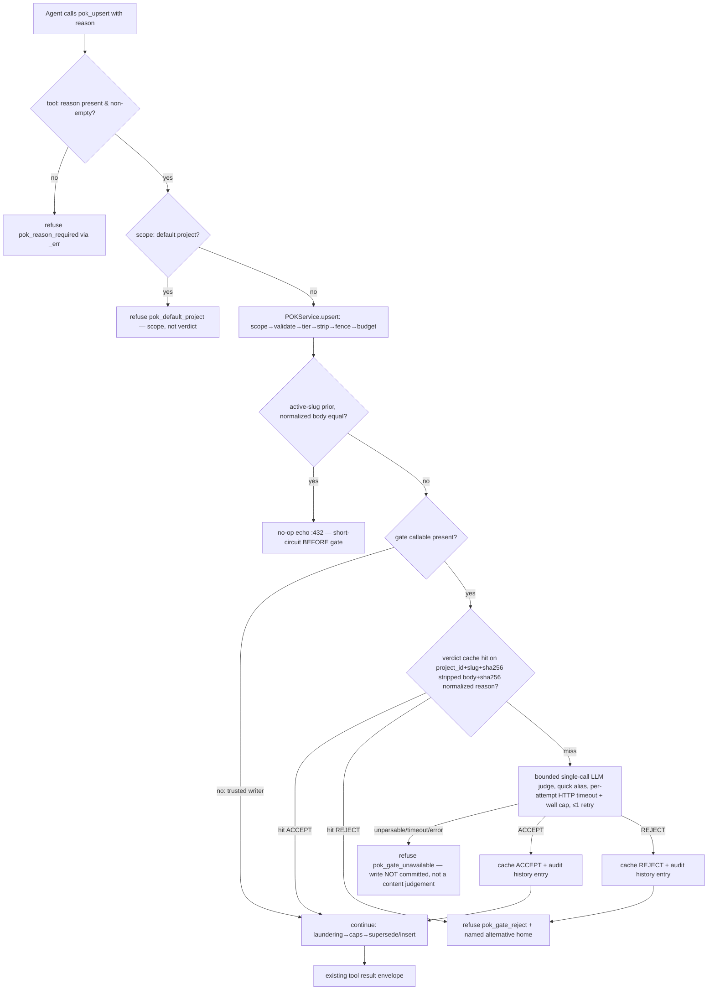

# Technical Analysis: POK Write Gate

Date: 2026-11-23
Author: planner[v2] via technical-analysis worker
Analysis depth: deep-dive
Status: Ready for Review

## Question

Produce the architecture/design analysis for the **POK write gate** feature of agents-ensemble: `pok_upsert` gains a required `reason` param; a functional LLM gate judges every write on the canonical `quick` alias (ACCEPT/REJECT + reason); rejections are actionable and name the alternative home; the gate judges five criteria (boundary, reason, durability, intra-store redundancy, scope). This document is the artifact the execution plan is built from. Analysis only — no code, no builds, no DB/LLM contact.

## Context Summary

The Emperor ruled (2026-11-23) that POK = operational how-to (DevOps kind) for THIS project only, and RAG = the knowledge store. The leader ratified binding forks D1–D7 (sync blocking gate, fail-closed `pok_gate_unavailable`, zero migrations with audit to project-history, in-process non-resident judge, verdict cache with no-op short-circuit, no `pok_curate` gating, tool-layer gate with trusted-writer bypass) plus a gate-rule refinement (redundancy = intra-store only; a RAG twin is NOT a rejection basis). The leader addendum (shared_meta_kv `pok-write-gate.addendum-leader-1`) adds a caller-side rider (remove `pok` from kb-writer's grant) and measured overlap classes.

Measured state at base `a1130e257`: 512 active POK rows; 12,968-doc RAG corpus; overlap classes BOTH-USEFUL 337 (65.8%) / RAG-DUPLICATE 81 (15.8%) / POK-ONLY 78 (15.2%) / NEITHER 16 (3.1%). The write path today enforces FORM only (`daemon/services/pok_service.py:296-561`) — no value/boundary judgment; the guideline draft `docs/guidelines/guideline-pok-durable-vs-rolling-state.md` already specifies a WRITE-TIME BAR (TEST 1 durability :35-40, TEST 2 decision-relevance :42-46, TEST 3 redundancy :48-53) that the gate would mechanically enforce, and a per-class routing table (:60-90) that supplies the canonical alternative homes.

**Two research-digest corrections surfaced during verification (both material to the plan):**
1. **A grant-set pin test EXISTS and is tracked.** `tests/unit/test_pok_grant_pins.py` pins `EXPECTED_EXPLICIT = 54`, `EXPECTED_TOTAL_META = 55`, a completeness walk ("every non-empty `tools.allow` carries `pok`"), ordering discipline, once-per-agent, and `VOCABULARY_VERSION == 11` / artifact 66 categories, with mutation legs M-POK-1/2/3. The digest's claim "no test pins the grant set today" is **FALSE**. The kb-writer rider will RED this file in two distinct ways (see §8).
2. **`meta.json` is NOT in the sealed prompt-artifact baseline.** `VERSIONED_PROMPT_ARTIFACTS` (`daemon/tools/prompt_artifacts.py:119-140`) = {soul, rule, workflow, tools_note, tools, skill, memory, growth}.`md`; `agents/.prompt-artifacts.sha256` has 217 lines, **zero** containing `meta.json`. The rider's `meta.json` edit therefore needs **no baseline regen** (contra any plan that assumes otherwise).

## Architecture

### Current Patterns

- **Typed never-raise refusal envelope** — `POKError(code, message, **details)` (`daemon/services/pok_service.py:136-147`) raised service-side; `_err(code, message, **details)` (`daemon/tools/pok.py:117-120`) renders `{"error", "code", ...}` at the tool edge. New gate outcomes (`pok_reason_required`, `pok_gate_reject`, `pok_gate_unavailable`) extend this taxonomy through the SAME `_err` path.
- **Write-path ordering is load-bearing** — `PokService.upsert` (`pok_service.py:296-561`): scope predicate :327 → slug/domain/provenance/audience validation :334-369 → trust-tier authority gate :370-389 → strip-then-fence :394-395 → escape-aware budget :403-410 → active-slug prior + **pure no-op echo** :417-432 → supersede :433 → dispute-laundering :446 → caps :457/:470 → insert :550. The no-op echo short-circuits at :432 BEFORE any mutation.
- **Docstring substitution before `@tool` baking** — `_substitute_active_cap` (`daemon/tools/pok.py:173-194`) mutates the plain function's `__doc__`; decorator order is `@register_tool_category` → `@tool` → `@_substitute_active_cap` → `def pok_upsert` (:196-199). A required `reason` param (no default) must be added to the typed signature :199-206 and documented in the docstring :207-239; the substitution ordering must be preserved.
- **Purpose-bound model alias** — `config.llm.model_quick` default `"quick"`, env `OPENAI_MODEL_QUICK` (`daemon/config.py:190-199`); purpose-bound lanes bypass `allowed_models` (:181-185). Precedents: `room_naming._model_for_naming` (`daemon/services/room_naming.py:115-123`), `resolve_judge_model` (`daemon/services/attestation_report_judge.py:150-173`). The daemon passes the alias verbatim to the proxy; it never resolves it.
- **Sync in-process LLM call** — `invoke_raw_with_failover(factory, llm_config, *, transient_max, timeout_max, wall_clock_cap_s)` (`daemon/services/llm_failover.py:700-707`) is synchronous, no event loop. Canonical service call site: `memoir_persona_gate._house_llm_call` (`daemon/services/memoir_persona_gate.py:1076-1125`) — factory re-reads `current_failover_url()` per attempt, `openai.OpenAI(..., timeout=httpx_timeout(timeout_s), max_retries=0)`. `current_failover_url` is thread-local (`llm_failover.py:352-388`); nesting unsupported. `wall_clock_cap_s` fires BETWEEN attempts (`llm_failover.py:136-162`) — a hung single request needs a per-request HTTP timeout.
- **Strict judge parser** — `_parse_fused_judge_response` (`daemon/services/attestation_report_judge.py:629-700`): tolerate ONE code fence, `json.loads`, ONE regex substring fallback, `verdict` must be EXACTLY a closed-set string else `None` (= unparsable = conservative), capped/redacted excerpt for forensics.
- **Pattern-C env resolver** — cached global, one-shot WARN, min clamp, restart-read: `attestation_judge_timeout_resolver.py:115-180`; mode resolver with loud `ValueError` on unknown token: `resolve_mission_records_mode` (`daemon/services/mission_record_service.py:212-240`).
- **Envelope + content-free logging** — `daemon/services/decision/` (typed exactly-one-of outcome, status-only error classification, `logging_safe.log_exception` logs exception TYPE only at `logging_safe.py`, kill channel = daemon-settings surface at `kill.py`). NOTE polarity: decision-P1 kill is FAIL-CLOSED-OFF; our gate is FAIL-CLOSED-REJECT — transfer envelope shape/logging rule/kill mechanics, NOT polarity.
- **Gate naming family** — `attestation_gate.py`, `critical_note_gate.py`, `execution_gate.py`, `memoir_persona_gate.py`, `metrics_gate.py` already live under `daemon/services/`; `pok_gate.py` slots in with no namespace collision (zero `pok_gate*` files today).

### Module Boundaries

```
[pok_upsert TOOL]  ── reason (required) ──▶  [pok_gate service]  ── quick alias ──▶  [proxy LLM]
        │                                          │  verdict+family+explanation+alternative
        │                                          ▼
        └──────────────▶  [POKService.upsert]  ◀── ACCEPT / (REJECT: refuse before write)
                                  │
                                  ├──▶ [POK repo]   (no-op / supersede / insert — UNCHANGED)
                                  └──▶ [project repo.add_history_entry]  (audit, entry_type "pok_gate")
```

The gate is a **callable injected into `POKService.upsert`** (dependency injection keeps the service LLM-free and unit-testable). The service remains the single owner of dedup/supersede/caps/insert; the gate only decides whether NEW content is admissible.

### Architecture Diagram



## Integration Points

| # | Integration | Type | Contract | Auth | Failure Mode | File:Line |
|---|-------------|------|----------|------|--------------|-----------|
| 1 | Tool → gate (reason validation) | sync in-process | `reason: str` required, non-empty | factory-captured `agent_id` | `pok_reason_required` via `_err` | `daemon/tools/pok.py:117-120,196-206` |
| 2 | Gate → proxy LLM | sync HTTP | `quick` alias verbatim; JSON verdict | daemon LLM config (`model_quick`) | timeout/unparsable → `pok_gate_unavailable` (fail-closed) | `daemon/services/llm_failover.py:700-707`, `daemon/config.py:190-199` |
| 3 | Gate → POKService (verdict) | sync callable | injected `gate_fn` returns typed outcome | n/a (in-process DI) | absent callable = trusted bypass | `daemon/services/pok_service.py:296-561` |
| 4 | Gate → project history (audit) | sync DB | `add_history_entry(entry_type="pok_gate")` | service-level (no tool-edge validation) | best-effort; never blocks the write verdict | `daemon/repositories/project/repository.py:1599-1639` |
| 5 | Judge → active-row digest | in-memory | bounded slug + one-line body | n/a | digest over budget → truncate, never omit boundary clause | `daemon/services/pok_service.py` (list_entries), proposed gate module |

### Integration Details

**Integration 4 (audit) — the novelty.** `SQLModelProjectRepository.add_history_entry` (`repository.py:1599-1639`) does NO `entry_type` validation; the DB column is unconstrained `Field()` TEXT (`daemon/repositories/project/models.py:487`); the 9-value `HistoryEntryType` enum (`models.py:135-144`) is enforced ONLY at the agent-tool edge (`daemon/tools/project_history.py:249-251`) and the HTTP edge (`daemon/routers/projects.py:755-763`). Therefore `entry_type="pok_gate"` needs **zero migration**. It also does NOT trip the C8 blueprint hook (`_PENDING_QUEUE_ENTRY_TYPES = {"feature","milestone"}` at `project_history.py:215`) because the gate calls the repository directly, bypassing the tool. **The gate would be the FIRST service→service caller of `add_history_entry`** — no such caller exists in-tree today (flag as novelty, D3-compatible). The existing POK tool already performs sync DB writes (`repo.insert` opens its own Session), so the threading precedent is established; no new event-loop concern.

## Trade-offs

### The D5×D7 Seam Tension (architect-visible — analyze explicitly)

D7 puts the gate at the **tool layer** (agent-facing; trusted internal writers like the dev seeder keep the service path, ungated). But D5 requires **pure no-op writes to short-circuit BEFORE the gate**, and that no-op echo lives **service-side** (`pok_service.py:417-432`), as does body stripping (:394) — so the judge should see the stripped body that will actually be stored. Three options:

1. **Option A — tool-layer gate + tool-side no-op pre-check.** Tool queries the active row itself (extra query), mirrors the no-op logic, strips the body itself, then gates. Gate is literally at the tool layer (D7 verbatim); service path is ungated automatically.
2. **Option B — service-layer gate slot after the no-op echo (:432), with an explicit trusted-writer bypass.** Add `reason: str` + injected `gate_fn` to `PokService.upsert`; the tool supplies both, the dev seeder omits `gate_fn` (ungated). Gate runs once, sees the stripped/fenced body, and the no-op return at :432 already precedes it.
3. **Option C — hybrid.** Tool strips + pre-checks + gates, then calls a service that assumes the gate already ran. Two sources of truth for dedup/strip.

| Criterion | A (tool + pre-check) | B (service slot + bypass) | C (hybrid) |
|-----------|----------------------|---------------------------|------------|
| D5 no-op short-circuit | extra active-row query + duplicated logic (drift risk) | native — :432 precedes gate | duplicated logic |
| Judge sees stripped body | only if tool re-strips (must mirror :394) | yes, exact stored string | yes but two strippers |
| Single call site | yes | yes | no (split) |
| D7 "tool layer" literal | ✅ exact | ⚠ service layer (intent preserved via explicit bypass) | partial |
| Trusted-writer bypass | implicit (service path ungated) | explicit, auditable `gate_fn=None` | implicit |
| Signature surface | tool gains `reason`; service unchanged | tool + service gain `reason`; service gains `gate_fn` | both widen |
| Test sweep width | tool-level only (~18 `tools[0].invoke` sites in `test_pok_tools_unit.py` + 9 `.invoke` in `test_pok_trust_tier_unit.py`) | service signature widens, but `gate_fn=None` default keeps direct `svc.upsert` call sites unchanged; tool sweep same as A | widest |

**Recommendation: Pick Option B.** Evidence: it is the only option satisfying D5 without an extra query or duplicated no-op/strip logic, and the only one that guarantees the judge evaluates the exact stripped body that will be stored (the strip at :394 reassigns `body`, so `content_hash(body)` at :548 already hashes the stripped string — the cache key can reuse it). D7's *intent* (dev seeder ungated) is better served by an **explicit** `gate_fn=None` bypass than by an implicit "tool vs service" distinction — the bypass becomes greppable and auditable. The cost is a wider service signature (`reason`, `gate_fn`), mitigated by defaults that leave all existing direct `svc.upsert` test call sites byte-unchanged. **This is the #2 architect decision** — overturn to A only if the architect requires the gate to be literally tool-resident for visibility reasons and accepts the extra query + mirroring.

### Comparison — gate placement alternatives (summary)

| Criterion | A | B (recommended) | C | Winner |
|-----------|---|---|---|--------|
| Correctness (D5/D7) | good | best | fair | B |
| Complexity | medium | low | high | B |
| Maintainability | fair (dup logic) | good | poor | B |
| Latency cost per write | +1 query | none | +1 query | B |
| Bypass auditability | weak | strong | weak | B |

**Assumptions:** the dev seeder calls `POKService.upsert` (not `pok_upsert`); injecting a callable keeps the service importable without an LLM dependency; the tool remains the only agent-facing entry point. **Reversibility:** moderate — moving the gate from service to tool later requires the no-op pre-check machinery, so decide now.

## Judge Prompt Design

Fixed persona: *"You are the POK write gate for project <PROJECT_NAME>. POK is durable operational how-to (DevOps kind) for THIS project only; RAG is the knowledge store."*

**Boundary-not-exclusivity clause (VERBATIM requirement — leader addendum Item 2):** the prompt must state that redundancy means **intra-store duplication only** — an ACTIVE POK row already carrying the fact. A RAG twin is explicitly NOT a rejection basis. The BOTH-USEFUL class (an operational invariant that ALSO has a RAG twin — injection-time invariant vs on-demand recall) is exactly what the gate must ADMIT; 65.8% of rows are in this class. The judge must judge the BOUNDARY (operational how-to vs general knowledge), never store exclusivity. An over-eager judge that rejects a row because "this is in RAG too" must be prevented by this clause.

Five criteria, each mapped to a `family` token:
- (a) `boundary` — operational how-to vs general knowledge (RAG's domain).
- (b) `reason` — caller's reason coherent and specific (not "because", not empty boilerplate).
- (c) `durability` — not a snapshot/episode (guideline TEST 1 + TEST 2).
- (d) `redundancy` — an ACTIVE POK row already carries it (intra-store only; clause above).
- (e) `scope` — belongs to THIS project.

**Project-scoped ACTIVE-row digest (bounded format proposal):** 512 active rows × (≤44 slug + ≤240 body) ≈ 150K chars — far too large. Pre-filter to the top **K=32** rows by distinctive-token overlap with the candidate body (reuse the guideline TEST 3 "distinctive tokens" idea, `guideline...md:50-53`), then render `slug: first-80-chars-of-one-line-body` with a hard `POK_GATE_DIGEST_MAX_CHARS = 8000` ceiling; fall back to slug order when overlap is zero. Never omit the boundary-not-exclusivity clause to save chars. Include the caller's reason verbatim (capped, e.g. 500 chars) for coherence judging.

**JSON output contract:** `{"verdict": "accept"|"reject", "family": "boundary"|"reason"|"durability"|"redundancy"|"scope", "explanation": str, "alternative": str}`. Parse with the attestation pattern (`:629-700`): one code fence tolerated, `json.loads`, one substring fallback, `verdict` EXACTLY in closed set, `family` EXACTLY in closed set else unparsable, cap explanation/alternative. Garbage → fail-closed `pok_gate_unavailable`, never accept-by-accident. The judge makes **no tool calls** (it sees the digest, not a live store).

## Cache + Idempotence (D5)

- **Key:** `(project_id, slug, sha256(stripped body), sha256(normalized reason))`. `stripped body` = the post-`:394` string (same input as `content_hash` at `:548`) — using verbatim-with-whitespace would cause spurious misses; using `normalize_body` (lowercase+collapse, `:156-160`) would alias meaningful case differences (e.g. a refusal code), so neither: hash the stripped string.
- **Reason normalization (define explicitly):** `normalize_reason(r) = " ".join((r or "").lower().split())` — lowercase + whitespace collapse, mirroring `normalize_body`; do NOT strip punctuation or tokenize (a "not" could flip meaning). Cap reason at `REASON_MAX_CHARS = 500` at validation.
- **Replay:** BOTH verdicts cached and replayed (ACCEPT skips the LLM; REJECT replays the same template + alternative). Cache stores the full typed outcome (verdict/family/explanation/alternative) so replay is byte-identical to a fresh verdict.
- **Bounded process-local LRU**, daemon lifetime, no persistence — use `OrderedDict` + `move_to_end` + cap-eviction (precedent: `daemon/services/blueprint_rate_limiter.py:65-82`). Cap e.g. `POK_GATE_CACHE_MAX = 512`. Project history is the durable record.
- **Interaction with supersede/no-op:** the no-op echo (`:417-432`) short-circuits BEFORE the gate (D5) — no cache lookup, no audit. A supersede (changed body) produces a new body hash → new cache entry. Cache is keyed per body+reason, so a re-attempt with identical inputs replays; a corrected reason gets a fresh judgment.

## Audit Trail (D3)

**Fields** (caller agent, slug, verdict, bounded reason excerpt, gate explanation, model alias, latency, timestamp) → one `add_history_entry` call:

```python
project_repo.add_history_entry(
    project_id=project_id,
    entry_type="pok_gate",                      # free TEXT at repo/DB — zero migration
    summary=f"pok_gate {verdict} {slug} by {agent_id}",   # [:300] at repo
    details=json.dumps({                        # [:5000] at repo
        "verdict": verdict, "family": family, "slug": slug,
        "reason_excerpt": reason[:200],         # AUDIT_REASON_EXCERPT = 200
        "explanation": explanation[:400],       # bounded gate explanation
        "alternative": alternative,
        "model_alias": model_quick,             # "quick" — alias, never internal id
        "latency_ms": latency_ms, "ts": utc_now_iso(),
    }),
    source_agent=agent_id,
    source_instance_id=current_instance_id,
    entry_metadata={"cache_hit": bool, "attempts": int},
)
```

Best-effort: an audit-write failure logs at WARNING (exception TYPE only per `decision/logging_safe.py`) and never changes the write verdict. **Critical notes are for gate INCIDENTS only** (e.g. a sustained fail-closed streak), never per-write. Tool-result envelope gains `gate: {verdict, family, explanation, alternative, model_alias, latency_ms, cache_hit}` on ACCEPT; REJECT/REASON_REQUIRED/UNAVAILABLE flow through `_err` with the canonical template + named alternative home.

## Test Architecture

- **Validation-layer unit tests WITHOUT LLM** (scratch in-memory sqlite, `create_all` on the two POK tables — `test_pok_service_unit.py:36-46`, `StaticPool` variant `test_pok_tools_unit.py:35-73`): reason presence/shape (`pok_reason_required`), cache key exactness (verbatim vs stripped vs normalized-reason distinctions), verdict parsing (closed-set `verdict`+`family`, one-fence tolerance, garbage→unavailable), family→message templates.
- **CONTRACT test per family** — five tests, each asserting the canonical rejection template NAMES its alternative home: boundary→`experience()`/RAG; reason→sharpen the reason; durability→release tree/KV/board (per guideline routing table :75-90); redundancy→supersede the named active slug; scope→do not write to this project. A template missing its alternative home REDs.
- **Deterministic stub tests** — `POK_GATE_MODE=llm|stub`; stub is a rule-based judge that still enforces reason presence + boundary heuristics (e.g. reject bodies with version/date/count smells, accept clean invariants) and emits a valid JSON verdict. **Never a silent pass-through** — a stub that always accepts is a defect; pin that stub rejects a known-bad fixture.
- **LLM judgement path MARKED** — integration/e2e gate tests marked and excluded from default runs; no real LLM in default gate runs (fence: no live DB/LLM contact).
- **Mutation legs** (throwaway `git archive` extract, never the live worktree): removing the gate call → RED; removing reason validation → RED; flipping fail-closed to fail-open → RED; a judge that returns a RAG-twin rejection → RED (boundary-not-exclusivity guard).
- **Tool-level sweep** — depends on seam choice: under Option B (recommended) the tool sweep stays ~18 `tools[0].invoke` sites in `test_pok_tools_unit.py` + 9 `.invoke` in `test_pok_trust_tier_unit.py`; because `gate_fn`/`reason` have service defaults, direct `svc.upsert` call sites need NO edit. Under Option A the sweep is the same tool sites but the service is untouched. (The digest's "~23" is approximate; measured 18+9 `.invoke` matches.)
- **Pack registration** — new unit pack registered in `.agents/tester/PACKS.md` using the established HTML-comment marker + table shape (Pack/leg, Invocation with per-variable `POSTGRES_*` scrub + `ENSEMBLE_BOOT_SWEEP_STALE_SUBPROCESSES=0` pinned, Scope, Last run, Status), e.g. `pok_write_gate_unit_test`.

## Caller-Side Mechanics (leader addendum Item 1 rider)

- **Docstring/schema path:** add `reason` to the typed `pok_upsert` signature (`pok.py:199-206`, no default → required via `_schema_registry` memoised `args_schema`) and document it in the docstring (:207-239); `_substitute_active_cap` ordering (:173-194) unchanged. `tool-categories.json` encodes the category VOCABULARY (66 categories, `VOCABULARY_VERSION=11`), NOT per-agent grants — a reason param changes neither (no regen, no version bump).
- **Guidance-update targets:** only 6 `.md` files mention POK discipline today; ZERO write-discipline guidance exists for the 7 heavy writers (leader, project-manager, developer, developer[v2], ari, wanderer, devops). Update those 7 — not all ~54 granted agents.
- **kb-writer rider mechanics:** (a) VERIFIED — `grep -rin pok agents/kb-writer/ --include=*.md --include=*.yaml` returns ZERO pok mentions; its POK writes ride the grant, not an instruction. (b) edit `agents/kb-writer/meta.json` `tools.allow` to remove `"pok"` (leaving `["rag_insert_text","tool_help","time","nest-report"]`). (c) **CRITICAL — update `tests/unit/test_pok_grant_pins.py`:** `EXPECTED_EXPLICIT` 54→53, and add `kb-writer` to an exception set for `test_every_non_empty_allow_carries_the_grant` (analogous to `INHERITANCE_EXCEPTIONS`/`APPEND_END_EXCEPTIONS`/`MID_ARRAY_EXCEPTIONS`); keep mutation leg M-POK-1 (removing a grant must RED). The file's top docstring is already stale ("45 explicit / 46 meta" vs constants 54/55) — refresh it. (d) **NO baseline regen** — meta.json is unsealed (verified §Context). Add a NEW pin asserting kb-writer does NOT hold the `pok` category with a mutation leg (re-adding the grant must RED).
- **Grant-census reconciliation:** worktree-read = **54** agents with `"pok"` in `tools.allow` (list includes `_baby_template`, `_mother`, `wanderer:12`, and all four video-* agents). This MATCHES `test_pok_grant_pins.py`'s `EXPECTED_EXPLICIT = 54`; the stale "53" grep count is wrong. Total meta-bearing dirs = 55 (the 55th, `watcher`, has empty allow = inherits-all, never granted). The pin is the authority: 54→53 after the rider.

## Scalability

- **Growth assumptions:** POK active rows 512→1024 (cap); gate called on every non-no-op write; ~54 granted agents, 7 heavy writers.
- **Current bottlenecks:** (1) quick-model tail latency (see Risks R1); (2) digest size at 512 rows (mitigated by top-K pre-filter + char budget); (3) one LLM call per non-no-op write — no-op short-circuit (D5) and verdict cache (D5) are the two load-bearing dampers.
- **Scaling characteristics:** gate is sync, in-process, stateless except the bounded LRU; horizontally safe (process-local cache means each daemon instance caches independently — acceptable, project history is the record). No new stateful service.

## Technical Debt

### Items Affecting This Analysis

| # | Debt Item | Impact on Recommendation | Severity | File:Line |
|---|-----------|--------------------------|----------|-----------|
| 1 | Guideline §4 claim "no durability/decision-relevance/redundancy test at write time" becomes FALSE once the gate lands | MUST rewrite §4 (and §2's "the store itself never judges class"), not append | High | `docs/guidelines/guideline-pok-durable-vs-rolling-state.md:88-94` |
| 2 | `test_pok_grant_pins.py` pin + stale docstring | Rider REDs it; plan must update count + completeness exception + docstring | High | `tests/unit/test_pok_grant_pins.py` |
| 3 | Quick-model latency vs fixed 12s budget | Gate would fail-close a large fraction of writes; Pattern-C knob required | High | `attestation_judge_timeout_resolver.py:30-53` |
| 4 | First service→service audit caller (novelty) | Verify project repo reachable from gate service via engine; no circular import | Medium | `repository.py:1599-1639` |
| 5 | Thread-local `current_failover_url` single-depth | No nesting; gate must not be called from inside another failover factory | Low | `llm_failover.py:352-388` |

### Items NOT Affecting This Analysis

- `tool-categories.json` vocabulary (66 / V11) — unchanged by a reason param.
- Prompt-artifact baseline — meta.json unsealed; the rider touches no sealed file.
- C8 blueprint hook — `pok_gate` entry_type doesn't trip it.

### Recommended Paydown

Rewrite guideline §2/§4 to reflect that the gate NOW enforces the write-time bar; update the grant pin; expose the timeout knobs (R1).

## D1–D7 Verification Table

| Fork | Codebase evidence (re-verified in worktree) | Verdict |
|------|----------------------------------------------|---------|
| **D1** sync gate, single quick call, ~12s/attempt, ≤1 retry, ≤25s total | `invoke_raw_with_failover` sync (`llm_failover.py:700-707`); `model_quick` alias (`config.py:190-199`); wall cap between attempts (:136-162) | **TENSION (leader-flagged, confirmed).** Measured quick latency 2.6–13.6s, 4/8 >15s; attestation judge timeout went 10→25→180s (`attestation_judge_timeout_resolver.py:30-53,95`). A hard 12s/25s will fail-close a large fraction. Keep 12s/25s as DEFAULTS but make them Pattern-C env-resolvable (`:84-108` module resolver + cached global + one-shot WARN + min clamp + restart-read). **#1 architect question.** |
| **D2** fail-closed distinct `pok_gate_unavailable` | `_err` envelope (`pok.py:117-120`); typed taxonomy precedent; decision module typed outcomes | **CONFIRMED**, add nuance: message must state "write NOT committed; not a judgement of your content; retry shortly" — never conflated with `pok_gate_reject`. |
| **D3** zero migrations; audit to project-history `entry_type="pok_gate"` | `add_history_entry` no entry_type validation (`repository.py:1599-1639`); column free TEXT (`models.py:487`); enum enforced only at tool/HTTP edges; C8 set `{"feature","milestone"}` (`project_history.py:215`) | **CONFIRMED**, novelty flag: first service→service audit caller in-tree. |
| **D4** in-process functional gate under services/, bounded single-call, fixed persona, non-resident, digest in prompt | gate naming family exists; `memoir_persona_gate._house_llm_call` precedent (`memoir_persona_gate.py:1076-1125`); digest design §Judge Prompt | **CONFIRMED**. No spawned instance, no resident agent; digest must include boundary-not-exclusivity clause. |
| **D5** verdict cache + no-op short-circuit before gate | no-op echo at `pok_service.py:417-432`; `normalize_body` :156; `content_hash` :163; LRU precedent `blueprint_rate_limiter.py:65-82` | **CONFIRMED** — but see D5×D7 seam tension; no-op is SERVICE-side, driving the Option B recommendation. |
| **D6** `pok_curate` not gated | curator authority leader/PM-only (`pok.py:409-410`; guideline :64) | **CONFIRMED** — document in guideline, no code. |
| **D7** gate at tool layer; trusted writers ungated | tool signature `pok.py:199-206`; dev seeder uses service path | **TENSION (leader-flagged, confirmed)** — literal tool-layer placement conflicts with D5's service-side no-op. Recommend Option B (service slot + explicit bypass); overturn only with evidence. |

## Risks + Open Questions for the Architect (numbered, reach architect verbatim)

1. **R1 — D1 budget vs measured quick latency.** Measured quick-model successes 2.6–13.6s, 4/8 calls >15s; the attestation judge timeout was raised 10→25→180s on similar evidence. A hard 12s/attempt / 25s total will fail-close a large fraction of gate calls. **Recommendation:** keep 12s/25s as defaults but make them Pattern-C env-resolvable so operators tune without a code change; fail-closed stays safe per D2. Approve the knob or set different defaults?
2. **R2 — D5×D7 seam choice.** Tool-layer gate (D7 literal) conflicts with service-side no-op (D5). **Recommendation:** Option B (service-layer gate slot after :432 with explicit `gate_fn=None` trusted-writer bypass). Approve B, or require literal tool residency (Option A) and accept the extra active-row query + strip/dedup mirroring?
3. **R3 — first service→service audit caller.** The gate would be the first service to call `add_history_entry` directly. Verify the project repository is reachable from the gate service via the engine with no circular import; confirm audit-write failure is non-blocking. Any objection to a service-level history caller, or prefer a thin service wrapper?
4. **R4 — digest size vs 512 rows.** Full active-row digest ≈150K chars. **Recommendation:** top-K=32 pre-filter by distinctive-token overlap + 80-char one-line bodies + 8,000-char ceiling; never drop the boundary-not-exclusivity clause. Accept this bounded digest, or specify a different K/budget?
5. **R5 — grant-pin rider fallout.** The kb-writer rider REDs `test_pok_grant_pins.py` (54→53 count + completeness walk). Plan must update the pin and add a kb-writer-absence pin with mutation leg. Confirm the plan worker owns this (per addendum Item 1) and that no other pin asserts the grant set.
6. **R6 — stub-mode semantics.** `POK_GATE_MODE=stub` must be a rule-based judge that still enforces reason + boundary (never silent pass-through). Confirm stub is test/dev-only and `llm` is the code default with no production off-switch.

## Explicit Non-Goals

- No migrations on the POK store (audit uses existing free-TEXT `entry_type`).
- No `pok_curate` gating (curator authority already gates it).
- No production off-switch (`POK_GATE_MODE=llm` is the code default; stub is test/dev-only).
- No live-store contact, no live LLM calls in default gate runs, no daemon config changes in this analysis lane.
- No RAG-side changes; no change to store exclusivity — the gate judges the boundary, never whether a RAG twin exists.

## References

- `daemon/services/pok_service.py:296-561` — write path; no-op echo :417-432; strip :394; content_hash :163.
- `daemon/tools/pok.py:117-120,173-194,196-206,207-239,240-268` — `_err`, docstring substitution, tool signature, result envelope.
- `daemon/config.py:190-199`; `daemon/services/room_naming.py:115-123`; `daemon/services/attestation_report_judge.py:150-173,629-700` — alias + parser precedents.
- `daemon/services/llm_failover.py:136-162,352-388,700-707`; `daemon/services/memoir_persona_gate.py:1076-1125` — sync LLM seam.
- `daemon/services/attestation_judge_timeout_resolver.py:30-53,84-108,115-180`; `daemon/services/mission_record_service.py:212-240` — Pattern-C knobs (D1 counter-evidence).
- `daemon/services/decision/` (kill.py, logging_safe.py) — envelope/logging mechanics.
- `daemon/repositories/project/repository.py:1599-1639`; `daemon/repositories/project/models.py:135-144,487`; `daemon/tools/project_history.py:215,249-251`; `daemon/routers/projects.py:755-763` — audit sink.
- `daemon/tools/prompt_artifacts.py:119-140`; `agents/.prompt-artifacts.sha256` (217 lines, 0 meta.json) — sealing verification.
- `tests/unit/test_pok_grant_pins.py` — grant-set pin (54/55, V11/66, mutation legs) — RESEARCH CORRECTION.
- `tests/unit/tools/test_pok_tools_unit.py:35-73`; `tests/unit/services/test_pok_service_unit.py:36-46`; `tests/unit/services/test_pok_trust_tier_unit.py` — fixtures + sweep scope.
- `docs/guidelines/guideline-pok-durable-vs-rolling-state.md:35-53,60-90,88-94` — write-time bar + routing table + section to rewrite.
- `daemon/services/blueprint_rate_limiter.py:65-82` — bounded OrderedDict LRU precedent.
- `.agents/tester/PACKS.md` — pack registration format.
