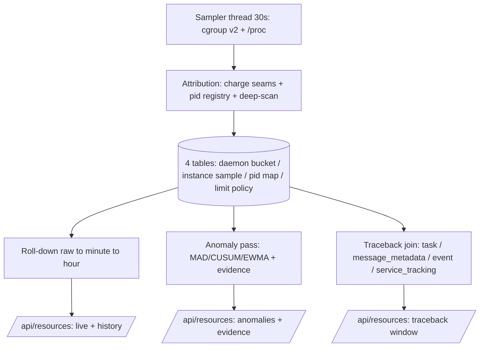

# Architecture Recommendation — resource-cost-control

**Commission:** resource-cost-control (CPU/RAM observability + traceback + anomaly layer + FE menu)
**Branch / worktree:** `feature/resource-cost-control` @ `/home/nea/ensemble-src-wt-resource-cost-control` (base `1e4507ae2`, `latest`)
**Author:** Architect (controller). **Method:** 1 council (governor `362d45e2`, 2/2 councilors — models `agentic`+`coding`, skill `data-flow-design`) + 3 skill-equipped workers (`68cf5c36` trade-off-analysis, `8c06fc6d` structural-design, `1aca952b` data-flow-design). All read-only.
**Status:** Complete. All four fan-in nodes done; every load-bearing claim re-verified against `/home/nea/ensemble-src` by the architect at aggregation.

> **Scope authority:** This document designs the API the FE consumes and the storage/attribution/join model. FE surface is **fixed by the user** (gear-menu entry, `/resources` page, Maintenance-shell tabs, dependency-free inline SVG, 8s gated polling). No code changes were made by this commission.

---

## 1. Verdict frame

**The daemon is architecture-normal, fat, and NOT leaking. The problem is measurement visibility, not a leak.** This subsystem's core job is to make cost *attributable* — historically, per instance, per subprocess — and to explain anomalies with evidence.

Ground-truth numbers (live v0.21.0, restarted 17:20Z today — peak accounting was reset by that restart):

| Signal | Value | Reading |
|---|---|---|
| Daemon process | **ONE** PyInstaller Python 3.14 process, RSS **1.68–1.72 GB**, FLAT | PSS ≈ RSS ⇒ private anon; no growth fingerprint |
| Threads / FDs | 44 / 34 | Stable baseline; no leak signature |
| cgroup `memory.current` | **5.3–6.0 GB** oscillating | ≈ **3.2–3.5 GB reclaimable page cache** + **~1.8–2.1 GB anon** + **~0.35 GB kernel/slab** |
| Box | 9,939 MB / 8 cores / **swap 0** | MemAvailable ≥ 6.1 GB; `oom_kill=0`; PSI 0.00; CPU ~1/8 cores |
| Tripwire | `/system.slice` `memory.peak` **9,636 MB ≈ 97 % of box** since the Sep-26 boot | The box **did** near-full once — consistent with the user's 8.3 GB / 85 % event. Composition is **unrecoverable**: no signal existed. |

**Consequences that bind the design:**
1. **All agent instances share the one process** ⇒ per-instance attribution cannot be done from outside. It must be done **in-process**, and it is **partial by physics** (see §2.2). Honesty about the residual is a design requirement, not a nicety.
2. **The 8.3 GB event is not reproducible retroactively** — this subsystem is forward-looking from day one. Retention defaults must be wide enough that *today's* equivalent survives long enough for a human to look (see §2.4).
3. **The monitor must not become the problem.** The self-cost budget (§2.8) is an acceptance criterion enforced by a regression test.

---

## 2. Observability subsystem

### 2.0 Data flow (overview)



### 2.1 Sampler design

| Aspect | Decision | Rationale / evidence |
|---|---|---|
| **Thread model** | **ONE `threading.Thread(daemon=True)` for sampling + ONE flusher thread.** NOT an asyncio task. | (a) tick is blocking file IO over hundreds of `/proc/<pid>/*` + cgroupfs reads — on the loop it injects latency spikes into LLM streaming; (b) **self-observation independence**: a stalled loop is an anomaly class we must capture — an asyncio task goes silent *with* the loop it measures; a plain thread samples *through* the stall, turning "gap" into evidence; (c) boot failure degrades the subsystem, not the lifespan. |
| **Sources (hot path = cgroup + /proc ONLY)** | cgroup v2 via `/proc/self/cgroup`: `memory.current`, `memory.stat` (anon/file/slab), `cpu.stat` (usage/throttled), `memory.peak` (high-water ⇒ covers skipped ticks). `/proc/self/{stat,statm,status}`; `/proc/<child_pid>/{stat,status}` for every live registry child. `smaps_rollup` (PSS) at 1/10 cadence, env-gated. | Zero `psutil` exists in `daemon/` today — keep readers raw (`/proc` + cgroup). *(W3's diagram named psutil as a source; **rejected** — no such dependency exists and none is to be added.)* |
| **Cadence** | default **30 s**, clamped **15–60 s** (`RESOURCE_MONITOR_SAMPLE_SECONDS`, `Field(ge=15, le=60)`). NOT streaming. | Constraint B. |
| **Skip-on-overrun** | measure tick duration with `time.monotonic`; if `tick_t > interval` ⇒ skip the next tick, `missed_samples++`, **demote one ladder level**; re-promote after N clean ticks (hysteresis). | Graceful degradation; no backlog queue. |
| **Bounded memory** | `deque(maxlen=…)` per tier (raw/minute/hour), sized at construction. Primary store is the ring; DB is durability. | Bounded-buffer precedent `daemon/tools/system_log_tools.py:512`. |
| **Cheap writes** | sampler thread never touches DB; the **flusher** thread batches `executemany` on its own session at `flush_batch_seconds` (default 60). Bounded drop-oldest RAM buffer (~512 rows / ~64 KB). | No per-sample transaction storm. |
| **Lifespan wiring** | construct beside the stream-watchdog block (`daemon/api.py:1799-1819`) → `app.state.resource_monitor` + stop `Event` → thread start in try/except that **degrades to disabled**; shutdown sets the Event and joins with timeout on a detached thread (`daemon/services/file_change_monitor.py:180-196` — never block the loop). | |

### 2.2 In-process per-instance attribution model

**Three-layer model: cheap charge seams (always-on) + per-pid exact reads for subprocesses + one deep-scan reconcile per tick.** Every sampled row carries `estimated` and every daemon row carries `unattributed_kb` + `coverage_pct`.

**(a) Charge seams — cheap, always-on, no hot-path hooks:**
- message append/replace at `daemon/services/instance_messaging.py:~4971-4979` — charge deep-size on append, **delta** on replace (never re-charge full history).
- checkpoint-decode blob size on `aget` (`daemon/checkpoint_adapter.py:~292-295` → `site-packages/langgraph/checkpoint/postgres/aio.py:181-230`, LIMIT-1 verified; module `langgraph.checkpoint.postgres.aio`).

**(b) Deep-scan reconcile — bounded, 1 instance/tick:** `sys.getsizeof` walk with id-memoisation + node cap + `partial_walk` flag over the graph cache `InstanceManager.instances` (`daemon/manager.py:592` — **verified**: `dict[str, tuple[CompiledStateGraph, str]]`; the `str` is the instance's `agent_dir`, so in-process **agent identity is available for free**). The walk corrects charge-counter drift; it is a *reconcile*, never the primary source.

**(c) Cheap count columns:** `graph_cache_present` (`:592`), `in_flight_tasks` (`_graph_tasks` `daemon/manager.py:538` — **count only**; `getsizeof(Task)≈0`), `all_state_messages_len`.

**(d) Subprocess RAM/CPU — EXACT:** per-pid `/proc` reads charged to the owning instance (bash/proc, MCP children, chart chromium). These are the only exactly-attributable numbers.

**🔴 Attribution is partial by physics (do NOT paper over — both councilors flagged independently):**
1. **Per-byte in-process RAM attribution is impossible.** Counters measure Python-object bytes, typically **40–80 %** of anon RSS (glibc arenas, shared objects, interpreter). Model: daemon row reports `attributed_bytes` **and** `unattributed_kb` **and** `coverage_pct`.
2. **Per-instance in-process CPU is not measurable.** CPython has no per-coroutine accounting. Only children are exact; `cpu_share_usec_est` is an estimate and must be labelled such in the API.
3. **MCP RAM is server-scoped**, not per-instance (pools are shared; `DEFAULT_POOL_SIZE=1`).
4. **Pre-subsystem events cannot be retro-explained** (no signal existed).

### 2.3 pid → instance mapping (generalize `service_tracking`)

Generalize the A11 pattern from `daemon/repositories/service_tool/models.py` (SQLModel table; dual-dialect partial UNIQUE index via `sqlite_where`/`postgresql_where`; `idx_service_tracking_pid`) into a **spawn-time registry**: a live RAM dict (read every tick) + `resource_pid_map` for history.

**Stamp seams (record pid + pgid + start_time at spawn):**
| Kind | Seam | Note |
|---|---|---|
| `bash` | `daemon/tools/bash.py:320` (register after spawn, already present) | **Add exit-mark on the SUCCESS path too** — today only the timeout-kill arm unregisters (`bash.py:327-333`, verified). The registry's monotonic leak then fixes for free. |
| `chart_render` | charter lane Popen (MCP `/chart` subprocess) | **Pin the exact Popen line at implementation.** The uncapped-N policy is verified: the busy-guard is per-charter-id only (`daemon/tools/chart_tools.py:24-28`) and `fresh=True` spawns parallel — this is the **8.3 GB suspect**. |
| `mcp_child` | **REAL seam:** `daemon/mcp/stdio_wrapper.py:258` (`factory=lambda: mcp.stdio_client(server_params)`) + `daemon/mcp/connection_manager.py:56` (`self._connections`). `daemon/mcp/warmup_pool.py` has **NO Popen of its own** — it spawns via the stdio wrapper (an earlier `warmup_pool.py` Popen cite was WRONG). | instance best-effort; **server-scoped bucket** (shared pools). **The implementer must re-derive off this seam.** |

**PID-recycle defense:** match `/proc/<pid>/stat` field 22 (starttime jiffies) before trusting pid→instance (exactly as `service_tracking` already does); `pgid` (field 5) as a fallback for seam escapes. `parent_pid` recorded to reconstruct the tree.

### 2.4 Storage schema

**PROJECT RULE (binding):** every new SQLModel table requires **its own** `.sql` file under `daemon/migrations/versions/`. Council divergence adjudicated ⇒ **4 per-table `.sql` files at one timestamp**, not one family file. `RESOLVED: per-table files` (requester's brief + blueprint both state per-table). Naming `<YYYYMMDD>_<HHMMSS>_<slug>.sql`; DUAL-DIALECT (must apply on PostgreSQL **and** SQLite), additive, **no PG-only DDL** (no `now()`, no native enums, no `USING`).

> ⚠️ **Runtime-verify at implementation:** the `.sql` runner is comment-documented as a **NO-OP on PostgreSQL** (`daemon/repositories/task/models.py:~188`, comment-sourced — confirmed comment-only). PG gets tables via SQLModel metadata at boot (the existing convention). Confirm before relying on either path.
> ⚠️ **3-site convention** (`task/models.py.__table_args__` precedent): SQLModel `__table_args__` + `.sql` + index names **byte-identical**. Brand-new tables need no `_ensure_postgres_columns` mirror.

**T1 `resource_daemon_bucket`** — 1 row / tick.
`id` INT PK autoincrement · `bucket_ts` TIMESTAMP **naive-UTC** (UNIQUE) · `interval_s` INT · `rss_kb`,`pss_kb`(NULL unless sampled),`anon_kb`,`swap_kb`,`vsize_kb`,`hw_peak_kb` INT · `threads`,`fds` INT · `cpu_user_usec`,`cpu_sys_usec` BIGINT (cumulative) · `cg_current_kb`,`cg_anon_kb`,`cg_file_kb`,`cg_slab_kb`,`cg_peak_kb` INT · `child_rss_total_kb` INT · `attributed_bytes` BIGINT · `unattributed_kb` INT · `coverage_pct` REAL · `sample_cost_ms`,`sampler_lag_ms` REAL · `missed_samples` INT.
Indexes: `UNIQUE(bucket_ts)`.

**T2 `resource_instance_sample`** — ≤ 1 row / (instance, tick).
`id` INT PK · `bucket_ts` TIMESTAMP · `instance_id` TEXT · `agent_id` TEXT · `status` TEXT (**sample-time snapshot**) · `scan_kind` TEXT (`counter`|`deep`) · `charged_bytes` BIGINT · `deep_bytes` BIGINT NULL · `graph_cache_present` BOOL · `in_flight_tasks` INT · `all_state_messages_len` INT · `child_rss_kb` INT · `child_cpu_user_usec` BIGINT · `cpu_share_usec_est` BIGINT NULL · **`estimated` BOOL NOT NULL**.
Indexes: `(instance_id, bucket_ts)`, `(bucket_ts)`.
**Cardinality cap ≤ 64 instance-rows/tick** (top-N by `charged_bytes` ∪ in-flight; overflow → single `__overflow__` sentinel row), `RESOURCE_MONITOR_INSTANCE_CAP` tunable.

**T3 `resource_pid_map`** — subprocess registry (the generalized `service_tracking`).
`id` INT PK · `pid` INT · `pgid` INT · `start_time` BIGINT (jiffies, field 22) · `instance_id` TEXT · `agent_id` TEXT · `kind` TEXT (`bash`|`chart_render`|`mcp_child`|`service`|`proc`) · `command` TEXT · `detail` TEXT · `parent_pid` INT · `spawned_at` TIMESTAMP · `exited_at` TIMESTAMP NULL · `exit_code` INT NULL · `exit_kind` TEXT NULL · `peak_rss_kb` INT NULL (VmHWM at exit) · `cpu_user_usec` BIGINT · **dormant v2 columns** `action` TEXT NULL, `action_by` TEXT NULL, `acted_at` TIMESTAMP NULL.
Indexes: partial **UNIQUE `(pid)` WHERE `exited_at IS NULL`** (dual-dialect WHERE — A11 precedent), `(instance_id, spawned_at)`, `(kind, spawned_at)`, `(pid)`.

**T4 `resource_limit_policy`** — control seam (EMPTY in v1).
`id` INT PK · `scope` TEXT (`daemon`|`agent`|`child_kind`) · `target` TEXT · `metric` TEXT · `op` TEXT (`alert`|`throttle`|`kill`) · `threshold` REAL · `window_s` INT · `enabled` BOOL default **false** · **`user_gated` BOOL NOT NULL default true** · `created_at`,`updated_at`.
Index: `(scope, target, metric)`. Empty in v1 — the chromium concurrency cap (O2) lands later as a `child_kind='chart_render'` policy consumed at the spawn seam.

### 2.5 Roll-down + retention — the arithmetic

Sampling 30 s ⇒ **2,880 ticks/day**. Assume **N = 50** active instances (conservative for this box).

| Resolution | Rows/day | Bytes/day @120 B | Bytes/day @250 B | Window (adopted) | Steady-state size |
|---|---|---|---|---|---|
| raw 30 s | 146,880 (144 k inst + 2.9 k daemon) | 17.6 MB | 36.7 MB | **48 h** (floor 24 h) | ~35–73 MB |
| minute | 73,440 | 8.8 MB | 18.4 MB | **14 d** (floor 7 d) | ~123–258 MB |
| hour | 1,224 | 0.15 MB | 0.31 MB | **180 d** (floor 90 d) | ~27–56 MB |

**Steady state ≈ 185–193 MB, worst-case ~390 MB** — trivially bounded, and *smaller than the ~1 GB of existing `ensemble_blob_prune_*` test-DB sprawl* (see O7). Roll-down + prune ride the flusher thread post-window.

**Adopted defaults `48h / 14d / 180d`** (council's `agentic` position): the 8.3 GB event was "yesterday's" — a 24 h raw window would erase full-fidelity forensics before a human looks. Conservative floors `24h / 7d / 90d` remain env-tunable.

### 2.6 Join model (R2 — "why was RAM high at 14:07")

The metrics store holds **only** the resource signal, keyed by EXISTING ids + time bucket (**Constraint A** — no lineage duplication, no message bodies/prompts/checkpoints).

| Question | Join | Key / index | Cost |
|---|---|---|---|
| Alive-at-T | `event` `kind='instance_lifecycle'` ∪ sample-time status snapshots | `idx_event_instance_created` | cheap |
| In-flight-at-T | `task` `created_at ≤ T AND (completed_at IS NULL OR > T)` | `idx_task_status_created` (`task/models.py:173`) | cheap |
| Owning agent / work | `task.work_id` (UNIQUE, `:202`), `task.instance_id` (indexed) | | cheap |
| Wallclock bridge | `task.message_id → message_metadata(thread_id, message_id)` | composite PK | cheap |
| Resource-at-T | nearest `resource_instance_sample` `bucket_ts ≤ T` (30 s blur) | `(instance_id, bucket_ts)` | cheap |
| Children-at-T | `resource_pid_map` `spawned_at ≤ T < exited_at` | `(kind, spawned_at)` | cheap — **`kind='chart_render'` IS the 8.3 GB-class query** |
| pid → instance (historical) | `resource_pid_map`; live `service_tracking` | `idx_service_tracking_pid` | cheap |

**🔴 TZ hazard (both councilors):** `event.created_at` is **tz-aware** (`datetime.now(timezone.utc)`, verified) while `task.created_at` and the new `bucket_ts` are **naive-UTC**. Normalize at the read seam via `coerce_to_aware_utc` (assume-UTC policy, per `task/models.py` comment) or tracebacks skew by the session TZ offset (up to ±h).

**Excluded by design (never a join spine):**
- `message_queue` — **BOOT-WIPED** (`daemon/manager.py:~962`).
- checkpoints — **zero time columns**, 168 h TTL (`daemon/constants.py:147`).

**Seven known missing keys** (surfaced, not solved here): (1) pid→instance for bash/proc [anchor `service_tracking`]; (2) per-instance cost bucket [anchor `skill_usage_records` — usage events, NOT bytes]; (3) message↔tool-call link [anchor `task.message_id`/`work_id`]; (4) time-series table template [anchor `maintenance_runs`]; (5) `agent_id` denorm on `task` [one extra hop via sample snapshot]; (6) `work_id` into tool exec [stamp seam — locate the tool-dispatch site at implementation; `service_tools.py:37-39` verified to be **docstring text only**, so the seam must be pinned, not assumed]; (7) checkpoint-derived joins age out at 168 h.

### 2.7 Anomaly layer (R3 — explainable smart history)

- **Algorithms:** change-point detection + robust z / **MAD** + **EWMA / CUSUM**. Shape classification: `spike | ramp | leak | step`.
- **Normal-load vs pathology (critical):** the baseline **conditions on `(n_active_workers, day-of-week, hour-of-day)`**. 5 workers ⇒ higher RSS is **NOT** an anomaly; without conditioning, every morning GC spike becomes a false positive.
- **Where it runs:** **in-daemon background pass** every 5–15 min, consuming only the *time-bucketed* table (never raw rows). Findings are append-only; on restart, recompute from the series (no data loss).
- **Bounded state (arithmetic):** per series, keep last 4 h @ 5 min = 48 buckets × {value, baseline, ewma, cusum⁺, cusum⁻, mad} × 8 B = **~2.3 KB/series**. Cardinality ≈ 6 process metrics + MCP pools + ≤100 instances × 2 ≈ **~211 series ⇒ ~485 KB**; daily DoW×hour baseline adds `7×24×211×8 B ≈ 284 KB`. **Total < 1 MB. Bounded.**
- **Explainability payload (no black-box scores):**
```
finding_id, time_bucket, series_key
shape: "spike"|"ramp"|"leak"|"step"
baseline:  {method:"rolling_median"|"dow_hour_mean", value, n}
observed:  <float>
deviation: {metric:"mad_z"|"cusum_k", value, threshold}
contributors:[{instance_id, agent_id, work_id?,
               share_pct,
               evidence:{samples, first_seen, task_status:{status, worker_id}}}]
```
Every flag carries `{baseline, observed, deviation, contributors}`.
- **Attribution ranking:** contributors ranked by share of the deviation, resolved through the §2.6 join (instance → subtree → tool/subsystem).

### 2.8 API surface + self-cost

Router `daemon/routers/resources.py` (`APIRouter(prefix="/api/resources", tags=["resources"])`), re-exported in `daemon/routers/__init__.py`, mounted beside `snapshots_router` (`daemon/api.py:3894`). DI per `daemon/routers/snapshots.py:16-31` (`request.app.state.manager`; sync repo calls bridged via `asyncio.to_thread`; **degrade to an empty shape, never 503**). Same-origin, **no auth** (house posture).

| Endpoint | Payload (shape) |
|---|---|
| `GET /api/resources/live` | `{ts, sample_level, daemon:{pid,cpu_pct,rss_mb,threads,fds,uptime_s}, cgroup:{memory:{current_mb,peak_mb,anon_mb,file_mb,slab_mb}, cpu:{usage_usec,throttled_usec,nr_throttled}}, children:[{pid,kind,name,cpu_pct,rss_mb} ≤50], instances:[{instance_id,agent,estimated,charged_mb,child_rss_mb,children_n,in_flight_tasks} ≤50], attribution:{attributed_mb,unattributed_mb,coverage_pct}, overruns:{count,last_ts}, self_cost:{…}}` |
| `GET /api/resources/history?window=15m\|1h\|24h\|7d&resolution=auto\|raw\|minute\|hour` | `{points:[{t,daemon_cpu,daemon_rss_mb,cgroup_mem_mb,threads,instances_active}], resolution_used, rollup, truncated}` — window > raw-retention auto-falls to minute/hour |
| `GET /api/resources/anomalies?window=&limit=` | `{anomalies:[{id,kind,t_start,t_end,peak,baseline,severity,series_key,shape,instance_id?}]}` |
| `GET /api/resources/anomalies/{id}/evidence` | `{anomaly, samples:[…], top_pids_per_bucket, children_delta, contributors:[…]}` |
| `GET /api/resources/traceback?t0=&t1=` | joined window view (§2.6): `{window, instances_alive[], in_flight_tasks[], spawned_children[], structural:{queue_depth,workers,checkpoints,gc_events}, findings[]}` |
| `GET /api/resources/self-cost` | `{cpu_pct, cumulative_cpu_s, buffers_bytes, rss_budget_mb, threads, samples, ticks_skipped, flush:{batches,bytes,errors}, profiling:{active,capabilities}}` |
| `GET /api/resources/control-capabilities` | `{enforcement:"observe-only", actions:[{name,user_gated,available:false}]}` |
| `POST /api/resources/profile` | body `{scope:"daemon"\|"instance:<id>", kind, seconds}` → 409 if a profile is active; refuses when `profiling_enabled:false`; clamps `seconds ≤ profile_timebox_s`. **Seam only** (capability-probed). |

**Self-cost discipline:** tick target **< 5 ms**, hard gate **50 ms**; `sample_cost_ms`/`sampler_lag_ms`/`missed_samples` **stored** (alarmable); EMA > 1 % of interval ⇒ **self-throttle** (double interval, deep-scan off); memory floor **< 20 MB** fixed. Never touches the asyncio loop or the request path.

### 2.9 Config knobs

`resource_monitor:` top-level block in `config.yaml` (peer of `limits:` `:189`), bound to `ResourceMonitorConfig(BaseSettings)` in `daemon/config.py` with `SettingsConfigDict(env_prefix="RESOURCE_MONITOR_")` (exact precedent `LimitsConfig`, `daemon/config.py:~585`). Restart-to-flip (matches `LIMITS_*`).

| Key | Default | Env |
|---|---|---|
| `enabled` | `true` (kill-switch + one-shot boot log) | `RESOURCE_MONITOR_ENABLED` |
| `sample_seconds` | `30` (`ge=15, le=60`) | `RESOURCE_MONITOR_SAMPLE_SECONDS` |
| `retention_raw_minutes` | `2880` (48 h) | `RESOURCE_MONITOR_RETENTION_RAW_MINUTES` |
| `retention_minute_hours` | `336` (14 d) | `RESOURCE_MONITOR_RETENTION_MINUTE_HOURS` |
| `retention_hour_days` | `180` | `RESOURCE_MONITOR_RETENTION_HOUR_DAYS` |
| `detail_level` | `auto` (`full\|reduced\|minimal`) | `RESOURCE_MONITOR_DETAIL_LEVEL` |
| `instance_cap` | `50` (`RESOURCE_MONITOR_INSTANCE_CAP` ≤64/tick) | `RESOURCE_MONITOR_INSTANCE_CAP` (the cap-name is `INSTANCE_CAP`; unified — no `INSTANCE_TOP_N` spelling) |
| `self_cpu_budget_pct` | `1.0` | `RESOURCE_MONITOR_SELF_CPU_BUDGET_PCT` |
| `self_rss_budget_mb` | `50` | `RESOURCE_MONITOR_SELF_RSS_BUDGET_MB` |
| `profiling_enabled` | `false` | `RESOURCE_MONITOR_PROFILING_ENABLED` |
| `profile_timebox_s` | `30` (`ge=10, le=120`) | `RESOURCE_MONITOR_PROFILE_TIMEBOX_S` |
| `flush_batch_seconds` | `60` | `RESOURCE_MONITOR_FLUSH_BATCH_SECONDS` |

*(The council draft used a `RESOURCE_OBS_` prefix; unified to `RESOURCE_MONITOR_` to match the module name. One prefix, one spelling.)*

---

## 3. Optimization plan (validated)

Every candidate re-verified against source at aggregation. Two of the leader's citations were **refuted** and corrected.

### SHIP — lands on `latest`, live effect at next promote

| # | Change | Mechanism (verified) | Expected saving | Risk | Effort |
|---|---|---|---|---|---|
| **O1** | `MALLOC_ARENA_MAX=2` env (+ optional 60-min `malloc_trim(0)` thread, `gc.freeze()`) | glibc ~16 arenas on 8 cores inflate peak RSS. **Verified ZERO tuning exists** (`scripts/systemd/ensemble-daemon.service`, `launcher.sh`, `daemon/__main__.py`, `adopt-unit.sh` all empty). Insert at systemd `Environment=` / `adopt-unit.sh:~308` / launcher pre-exec. | **~170–400 MB (−10–25 % anon)**; 1.68–1.72 GB → ~1.3–1.5 GB projected | 🟢 config-only, one-line revert | 0.5–1 d |
| **O3** | Instance graph-cache TTL knob, **default 6 h + LRU 64** (LEADER-RULED 2026-10-18, iteration-002) | `INSTANCE_CACHE_TTL_HOURS = 6` (`daemon/manager.py:199 post-60f382bd1`); eviction `_cleanup_cached_instances` (`:6216`) + `_release_cached_instance` (`:5808`) — **verified** (re-pinned at HEAD `4d572f561`; consistent with `decisions §F.2` + `phase7-plan.md`). Config knob only. | **~20–50 MB × N dormant (5–20) = 100 MB–1 GB peak** (entry = compiled graph + aux) | 🟢 shorter TTL ⇒ more recompile; bounded, metric-visible | 0.5 d |
| **O4** | **Backoff-reset fix** + MCP pool idle reap + DependencyBus lock reap | 🔴 **LEADER CITATION REFUTED.** `daemon/sources/registry.py:705-718` is **`def stop_adapter`** at `daemon/sources/registry.py:621` (adapter eviction, unrelated). The bug is a **start-coupled unconditional** reset at `daemon/sources/registry.py:781-782`: `last_success_time = time.monotonic()` + `backoff = 2.0` execute **immediately after a successful `adapter.start()` and BEFORE the health-check inner loop**, every cycle. An adapter that starts but then immediately fails its health check still zeroes backoff to 2.0 on every cycle ⇒ during a sustained outage backoff is pinned at ~2–5 s ⇒ the observed plane/computer-use 60 s retry storm. The crash-arm conditional guard at `daemon/sources/registry.py:839-846` (`if last_success_time > 0: elapsed = monotonic() - last_success_time; if elapsed >= success_threshold: backoff = 2.0`) has **correct content** but its **role is masked** — `:781-782` already zeroed backoff and stamped `last_success_time = now`, so the threshold can never fire. `daemon/sources/registry.py:_handle_message` (def `:858`) contains **ZERO** `last_success_time` references — the "message-coupled reset" model is the mis-modelling. **Fix site: `daemon/sources/registry.py:781-782`** — gate the start-success reset on the crashed run having actually lived ≥ `success_threshold` (60 s), so start-then-immediate-death does NOT zero backoff. Leave `:839-846` content as the verified-correct conditional crash guard (it becomes meaningful once `:781-782` is gated). `def stop_adapter` (`:621`) **untouched** (source-range regression pin). Expected path: backoff GROWS across cycles during a sustained outage (2 → 5 → 12.5 → … capped at `max_backoff`) instead of pinning ~2–5 s. | CPU/FD churn stabilization (30–60 % of MCP-retry CPU during outage); lock dict `dependency_bus.py:416,428` ≤200 KB | 🟢 small; observable in MCP metrics | 1–1.5 d |
| **O7** | Test-DB cleanup script | `find … -name 'ensemble_blob_prune_*' -mtime +7 -delete` in a maintenance script. | **~1 GB disk** | 🟢 own-managed fixtures | 0.25 d |

### NEEDS-CEREMONY — user-gated (explicit nonce)

| # | Change | Mechanism (verified) | Expected saving | Risk | Effort |
|---|---|---|---|---|---|
| **O2** | Charter chromium render concurrency **semaphore ≤ 2 + hard timeout** | **Verified uncapped:** the only guard is per-charter-id (`chart_tools.py:24-28`); `fresh=True` spawns parallel; `_RENDER_TIMEOUT_S=1200`. Pack one commit with `RESOURCE_MONITOR`-style knob (default 1–2) + `render_e2e` re-certification. | **Peak-spike suppression** — the 8.3 GB class becomes ≤ 2 × 150–400 MB ≈ 800 MB worst case. Steady-state impact small. | 🟡 a waiting queue could push callers past 1200 s under chart bursts | 2–3 d |

### DEFER

| # | Change | Why |
|---|---|---|
| **O5** | BashProcessRegistry normal-exit unregister | **Verified (currency-cite 2026-10-18):** register at `bash.py:413`; unregister in the timeout arm (`:427`) AND the cancellation arm (`:483`); success path falls through `:429-458` **with no unregister** (the leak is at the missing third unregister, NOT at which existing arms fire — none of the existing arms covers `await proc.wait()` success). Entry ≈24 B and `cleanup_instance` (`:54-69`) reaps at instance-terminate ⇒ **≤5 MB**. **Bundle with O4's hygiene commit** (the O4 fix incidentally normalizes it); do not promote alone — adding unregister on the success path must not race the PGID-recycle window. |
| **O6** | Per-turn streaming projection | 🔴 **LEADER MECHANISM REFUTED.** `instance_messaging.py:4888` is `async for event in graph.astream(... stream_mode=["updates"])` inside `_llm_semaphore` (`:4887`); `_graph_tasks[instance_id] = current_task` (`:4883`) is a **single assignment**, not unbounded. The "full history live objects" claim is **unverified at that line**. Hot-path surgery with a broken-messages failure mode. **Needs a `tracemalloc` snapshot per turn first.** |

### NO-OP (verified, no action)
`PYTHONASYNCIODEBUG` (default off); `CompletionRegistry` (already pop-on-completion + sweeper, bounded); the three tiny monotonic dicts (≤200 KB total); the 21 poll loops (CPU < 1/8 core — cannot tune away the latency cost).

### Additions adopted
glibc idle `malloc_trim` → **bundle with O1**. DependencyBus lock reap → **bundle with O4**.

> **Confidence:** High on the SHIP set apart from **O1's saving estimate** (softest — bounded by the assumption that glibc-default arena retention explains ~170–400 MB of the flat 1.7 GB). If O1's real reduction is < 5 %, the flat RSS is dominated by constant-state dynamic graphs, and O1/O3 dominate the stack while O4 is unchanged.

---

## 4. FE contract (consumer-facing — do not redesign FE)

FE surface is **fixed**: gear-menu entry appended to `settingsMenuItems` (`frontend/src/app/app.ts:~566`) → lazy `/resources` route → Maintenance-shell tabbed page (`frontend/src/app/pages/maintenance/maintenance.component.ts`, `ngComponentOutlet` tabs) → dependency-free inline SVG timeline with anomaly markers + click→window drill-down → gated `setInterval` 8 s live tick (precedent `job-queue-indicator.component.ts`). **No chart library exists and v1 adds none.**

FE consumes exactly the endpoints in §2.8 — **as-is**:
- **Live tab** ← `GET /api/resources/live` (8 s gated poll; first-fetch skeleton + retain-last-data + single error branch, per `jobs.component.html:355-395` template).
- **Timeline tab** ← `GET /api/resources/history` (SVG line/area + time axis from `points`); anomaly markers ← `GET /api/resources/anomalies`; click a marker → `GET /api/resources/anomalies/{id}/evidence` + `GET /api/resources/traceback?t0=&t1=` for the drill-down window.
- **Self-cost chip** ← `GET /api/resources/self-cost`.
- **Lazy-route bundle budget:** the `/resources` route is lazy ⇒ keeps cost off the 1 MB initial bundle.

---

## 5. Staging split, risks, open questions

### Staging (suggested slice order for the planner)
1. **Slice 1 — Sampler + storage + roll-down** (§2.1, §2.4, §2.5) + 4 `.sql` migrations + config (§2.9). Deliverable: durable series, `GET /live` + `/history`.
2. **Slice 2 — Attribution + pid registry** (§2.2, §2.3) + bash success-path exit-mark. Deliverable: per-instance table, `coverage_pct`/`unattributed` honesty columns.
3. **Slice 3 — Join + traceback** (§2.6) with TZ normalization. Deliverable: `GET /traceback`.
4. **Slice 4 — Anomaly layer + evidence** (§2.7). Deliverable: `/anomalies`, `/anomalies/{id}/evidence`.
5. **Slice 5 — FE page** (§4) + self-cost regression test (§2.8).
6. **Slice 6 — Control seam** (§2.3 dormant columns + §2.4 T4 + `/control-capabilities`), observe-only.
7. **Optimizations ride alongside**, not blocking: O1/O3/O4/O7 ship in the promote train; O2 is a separate gated ceremony.

### Risks
- 🔴 **Self-cost overrun / monitor becomes the problem** — enforced by design (thread, skip-on-overrun, self-throttle) + the regression test (§2.8). ⚠️ Test must **fence paths** (`tmp_path`, injectable `proc_root`/`cgroup_root`, **never** live `/proc`-shaped or HOME-derived paths — incident class 2026-10-12).
- 🔴 **PID-recycle misattribution** — starttime field-22 guard (as `service_tracking`).
- 🔴 **TZ skew in traceback** — `event.created_at` aware vs `task` naive; normalize once at the read seam; tests assert.
- 🟡 **Attribution over-claim** — in-process CPU is estimated, in-process RAM is partial; `estimated` + `unattributed_kb` + `coverage_pct` must be surfaced in the API, not buried.
- 🟡 **O2 throughput regression** under chart bursts — knob + `render_e2e`.
- 🟡 **O4 mis-targeted fix** — if the reset becomes too aggressive it resuscitates the storm; gate behind MCP-pool metrics.
- 🟡 **cgroup v1 / absent** — Strategy degrades to daemon-only sampling (v2 verified on this host).
- 🟢 **Migration runner PG no-op** — confirm at implementation (§2.4 warning).

### Open questions for the leader
1. **Retention defaults** — adopt council's `48h/14d/180d` (forensics fidelity) or the conservative floor `24h/7d/90d`? (Recommend 48 h/14 d/180 d.)
2. **Migration granularity** — per-table files (adopted here per the explicit project rule) vs one family file (the corrected `agent-secrets` note leans event-file). One-line ruling requested.
3. **`O2` default concurrency** — 1 or 2? Needs a heavy-chart-user read before promoting a low default.
4. **Profile-flag default** — ship `profiling_enabled:false` and require an operator flip, or a time-boxed safe default?
5. **Hygiene ownership** — orphaned `context7-mcp` (97 MB, user-owned, 4.2 d), demo daemon (395 MB): user decisions, out of scope pending a yes/no.

### Dispatch ledger (audit)
| Node | Instance | Skill confirmation | Status |
|---|---|---|---|
| Council | gov `362d45e2` | 2/2 councilors, uniform `data-flow-design` | ✅ |
| W1 opt | `68cf5c36` | ⚠️ first-line confirmation **absent**; report structure matches `trade-off-analysis` (5-axis weighted matrix). Accepted; output on-target. | ✅ |
| W2 api | `8c06fc6d` | `Skill loaded: [structural-design]` | ✅ |
| W3 anomaly | `1aca952b` | `Skill loaded: data-flow-design` | ✅ |

**No degraded nodes.** One discrepancy reconciled: W3's sampler diagram named `psutil` — **rejected** (zero `psutil` in the tree; `/proc`+cgroup raw is the design).

---

## 6. What we deliberately did NOT build

Locks the lightweight contract:

- **No streaming / no per-event hooks.** Sampling is 15–60 s periodic; there are **no** per-message, per-tool-call, or per-event instrumentation hooks on the hot path. Hot-path sources are cgroup + `/proc` only.
- **No always-on profiling.** py-spy / tracemalloc / gc-dumps are **on-demand, opt-in, time-boxed, capability-probed, self-reverting** — never resident.
- **No lineage duplication.** The store holds the resource signal + id references only — no message bodies, no prompts, no checkpoints, no duplicated `task`/`event` rows. `message_queue` and checkpoints are explicitly *not* join spines.
- **No fabricated per-instance truth.** We publish `unattributed_kb` + `estimated` + `coverage_pct` instead of inventing per-byte per-instance RAM/CPU that a shared process cannot provide.
- **No FE redesign and no new chart dependency.** Inline SVG only.
- **No control implementation in v1.** Seams and a dormant `resource_limit_policy` table ship; enforcement is observe-only, `user_gated=true`, zero rework later.
- **No retroactive explanation of the 8.3 GB event.** No signal existed; the subsystem is forward-looking by construction.
- **No new runtime dependency.** No `psutil`, no install; raw `/proc` + cgroup readers.
