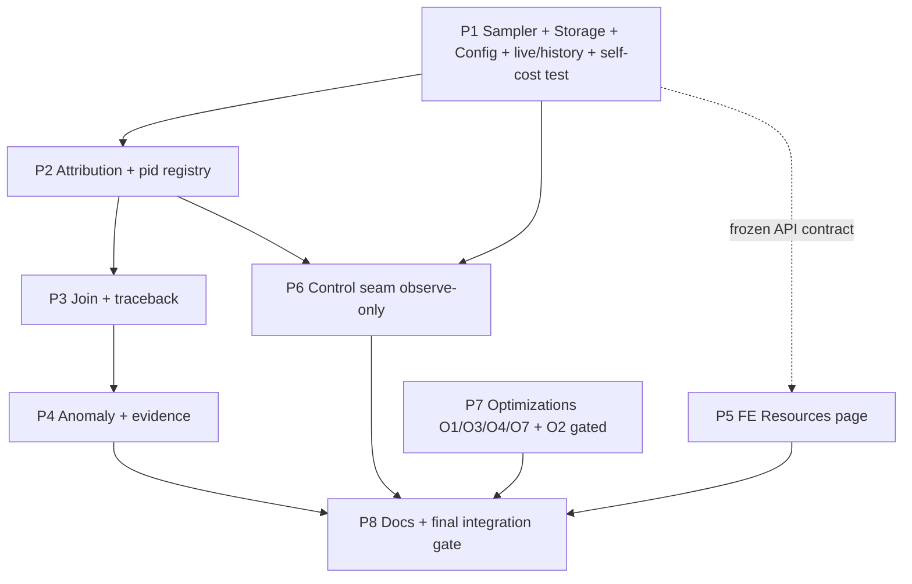

# Plan Overview — resource-cost-control

**Commission:** resource-cost-control (CPU/RAM observability + traceback + anomaly layer + FE menu + optimizations)
**Branch / worktree:** `feature/resource-cost-control` @ `/home/nea/ensemble-src-wt-resource-cost-control` (base `1e4507ae2`, `latest`)
**Status:** Plan set COMPLETE — implementer-ready. Architecture ADJUDICATED (no redesign). 8 phases + decisions record.
**Delta 2026-10-18:** currency pass (4 commits @ `latest`, observed HEAD `8b8b32dcc`) + **NEW O8** + demonstrated-OOM evidence folded in — targeted edits only, no rewrite. See `decisions.md` §F for the authoritative delta record.
**ANCHOR ADVISORY (read this before trusting any `file:line`):** the worktree is **LIVE** — P1/P5 code is landing *during* this commission (HEAD advanced `4d572f561 → a023a7ddb → 2f4adb19a` while this doc pass ran). Every line anchor below is **advisory**, verified at the HEAD named beside it; numbers **drift by design**. The standing **re-pin-at-implementation** mandate governs — implementers must re-grep anchors at their own HEAD rather than trusting these numbers.
**Basis:** `architecture-recommendation.md` (313 lines, adjudicated) + `approach-comparison.md` (120 lines). Leader rulings `LR1–LR6` binding.
**Authorship:** phase files by 3 skill-equipped `plan-creation` workers + 1 ops/docs worker (dispatcher: planner). This overview is the planner's synthesis of those worker outputs — it cites them, it does not re-derive them.

---

## 0. Deliverable index (the plan set)

| File | Slice | Content |
|---|---|---|
| `architecture-recommendation.md` | — | Input spec (adjudicated) |
| `approach-comparison.md` | — | Fan-out comparison + refuted-recon table |
| `decisions.md` | — | Durable record: **LR1–LR6** (leader-binding) · **AD1–AD16** (adopted; AD14–AD16 = delta) · **XC1–XC5** (refutation/currency corrections) · **§F delta currency** (per-commit verdicts + anchor re-pin table) · resolved Q1–Q5 · §6 scope lock |
| `phase1-plan.md` | 1 | Sampler + storage + roll-down + 4 per-table migrations + config + `/live` + `/history` + self-cost regression test |
| `phase2-plan.md` | 2 | Hybrid attribution + pid registry + bash success-path exit-mark + honesty columns |
| `phase3-plan.md` | 3 | Join + traceback (legal spines, TZ single-seam) |
| `phase4-plan.md` | 4 | Explainable anomaly layer + evidence |
| `phase5-plan.md` | 5 | FE `/resources` page + daemon-free e2e gate |
| `phase6-plan.md` | 6 | Control seam (observe-only, zero DDL) |
| `phase7-plan.md` | 7 | Optimizations O1/O3/O4/O7 + O2 ceremony-gated (O5/O6 DEFER) |
| `phase8-plan.md` | 8 | Runbook + O7 checklist surface + CHANGELOG + final integration gate |

---

## 1. Verdict frame (arch §1 — binds the design)

The daemon is **architecture-normal, fat, and NOT leaking**. The problem is **measurement visibility**, not a leak. Ground truth (live v0.21.0): one PyInstaller process, RSS **1.68–1.72 GB FLAT**, 44 threads / 34 fds, no growth fingerprint; cgroup `memory.current` 5.3–6.0 GB (≈3.2–3.5 GB reclaimable cache + ~1.8–2.1 GB anon); tripwire `/system.slice` peak 9,636 MB ≈ 97 % of box since Sep-26 boot.

Three consequences that every phase honors:
1. All agent instances share ONE process ⇒ per-instance attribution must be **in-process** and is **partial by physics** — honesty (`estimated`, `unattributed_kb`, `coverage_pct`) is a design requirement.
2. The 8.3 GB event is not retro-explainable ⇒ the subsystem is **forward-looking**; retention is wide enough for a human to look (48 h raw).
3. The monitor must not become the problem ⇒ the **self-cost budget is an acceptance criterion** enforced by a fenced regression test.

---

## 2. Phase map

| # | Phase | Owner (planning) | Key deliverables | Depends on |
|---|-------|------------------|------------------|-----------|
| 1 | Sampler + Storage + Roll-down + Config + `/live` + `/history` + `/self-cost` | plan-worker-core | `ResourceMonitor` package (sampler/flusher/ring/rollup/proc_readers), `ResourceMonitorConfig` + `config.yaml` block (12 knobs), 4 SQLModel tables + **4 per-table `.sql`**, lifespan wiring, `daemon/routers/resources.py` (**first 3 endpoints** — `/live`, `/history`, **`/self-cost`** assigned P1 in iteration-003; §2.8 ownership: P1×3 · P3×1 · P4×2 · P6×2), **self-cost regression test** (fenced) | — |
| 2 | Attribution + PID registry | plan-worker-core | `charge.py`, `deep_scan.py`, `pid_registry.py`; charge seams (re-pinned 2026-10-18: `instance_messaging.py` — `_prepare_enqueued_message` @ `:1997`; `checkpoint_adapter.py` — hook `_SaverRetryProxy:169` READ `aget:318`/`aget_tuple:321`, write-scrub `:324-328` OFF-LIMITS); **bash exit-mark fix** (register `:413`/unregister `:427` — success-path claim flagged for impl re-verify, XC5); spawn seams (chart_render pinned at impl, mcp_child server-scoped); PID-recycle defense; honesty columns; **no-raw-args guard (AD15)** | P1 |
| 3 | Join + Traceback | plan-worker-analytics | `resource_traceback.py`; legal-spine join (task/message_metadata/event/instances/service_tracking/resource_*); **TZ single-seam** (`coerce_to_aware_utc` — already exists at `daemon/services/timestamps.py`, reuse); `GET /traceback` | P1, P2 |
| 4 | Anomaly + Evidence | plan-worker-analytics | in-daemon background pass (5–15 min, bucketed series only); MAD/EWMA/CUSUM + change-point; shapes `spike\|ramp\|leak\|step`; baselines conditioned on `(n_active_workers, dow, hour)`; < 1 MB bounded state; `/anomalies` + `/anomalies/{id}/evidence`; wires `findings[]` into P3 traceback | P1, P2 (P3 for findings wiring) |
| 5 | FE Resources page | plan-worker-fe | gear-menu entry (`app.ts:566-576`) → lazy `/resources` → Maintenance-shell tabbed page; dependency-free inline SVG timeline + markers + drill-down; gated 8 s poll; colocated jest specs; `e2e/resources-gate.spec.ts` (daemon-free, port 14202) | **nothing — parallel with P1–P4 against the frozen §2.8 contract** |
| 6 | Control seam (observe-only) | plan-worker-core | dormancy contract test (T3 `action`/`action_by`/`acted_at` NULL-only); T4 EMPTY (`user_gated=true`, `enabled=false`); `GET /control-capabilities`; anti-enforcement grep fence. **Zero DDL** | P1 (schema), P2 |
| 7 | Optimizations | plan-worker-ops (delta: plan-worker-delta-be) | O1 `MALLOC_ARENA_MAX=2` (4 sites) + runtime knobs; O3 cache-TTL knob; **O4 backoff-reset fix at `daemon/sources/registry.py:781-782`** (gate the unconditional start-success reset on ≥60 s run; `:839-846` is the verified-correct conditional crash guard) + pool/lock reaps; O7 operator checklist (**document only**); O2 ceremony-gated commit; **NEW O8 (delta 2026-10-18)**: O8a boot-time stale-subprocess sweep + O8b `KillMode=cgroup` audit — **investigate-read-only-first**, fix only if well-scoped. O5→P2, O6 DEFER | Independent (O4 canary pairs with P1/P2 MCP-pool metrics; O8 rides with P7 — off the critical path) |
| 8 | Docs + Final integration gate | plan-worker-ops | `docs/runbooks/resource-cost-control.md`; O7 checklist surface; CHANGELOG `[Unreleased]`; whole-commission gate (pytest + 3 FE gates); self-cost budget restated as commission criterion. **Docs-only** | P1–P7 |

---

## 3. Sequencing

**Blocking chain:** `P1 → P2 → P3 → P4 → P8`, with `P6` riding on P1/P2 schema, and `P5` (FE) **independent of the BE chain** (frozen contract + stub-driven e2e). `P7` is independent of observability (O4's live canary soft-depends on P1/P2 metrics).

**Rule at every boundary:** worktree stays GREEN — `python -m pytest tests/ -q` (no new skips/xfail) + the three FE gates when FE files change; each phase independently mergeable; rollback = `RESOURCE_MONITOR_ENABLED=false` kill-switch / additive revertible commits.

---

## 4. Parallelism plan (3-concurrent-instance budget)

| Wave | Instances | Why grouped |
|---|---|---|
| 1 | `plan-worker-core` (P1+P2+P6+decisions) · `plan-worker-analytics` (P3+P4) · `plan-worker-fe` (P5) | Shared context: core = schema/sampler/attribution; analytics = query/analytics; FE = the frozen contract |
| 2 | `plan-worker-ops` (P7+P8) | Independent ops/docs tail; dispatched when a wave-1 slot freed |

**For implementation** (same grouping applies for instance reuse): core (P1→P2→P6) is one BE-data context; analytics (P3→P4) is one BE-analytics context; FE (P5) can run **in parallel** with the BE chain; ops (P7→P8) rides alongside. Max 3 concurrent.

---

## 5. Cross-cutting invariants (every phase honors)

1. **Self-cost budget** — tick target < 5 ms / hard gate 50 ms; EMA > 1 % of interval ⇒ self-throttle (double interval, deep-scan off); memory floor < 20 MB fixed — **the < 20 MB is the sampler's own RSS-delta floor asserted by the P1 regression test; the runtime alarm/throttle knob is `RESOURCE_MONITOR_SELF_RSS_BUDGET_MB` (default 50) — two different quantities** (same clarification propagated to P1 AC7). **Enforced by the P1 regression test, restated in P8.**
2. **Fenced paths** — the self-cost (and any path-resolving) test MUST use `mktemp` FAKE_HOME + escape guard, injectable `proc_root`/`cgroup_root`; **never** resolve live `/proc`-shaped or HOME-derived paths (2026-10-12 incident convention).
3. **Migrations** — every new table gets its **own** `.sql` (4 per-table files, one timestamp); dual-dialect (PG **and** SQLite), additive, no PG-only DDL; PG runtime schema ensured by the SQLModel/column-ensure boot path — **never** design boot-time PG migration execution.
4. **No psutil / no new runtime dependency** — raw `/proc` + cgroup readers only.
5. **Honesty over false precision** — publish `estimated` / `unattributed_kb` / `coverage_pct`; never present partial attribution as ground truth. **(delta AD15)** Attribution rows carry **ids/counters/durations only** — never raw tool-call args, message content, or secret plaintext (aligns with agent-secrets P2 both-sides scrub).
6. **No auth** (same-origin `/api`, house posture); every endpoint **degrades to an empty shape, never 503**; uniform house error envelope.
7. **ZERO live-host mutations** — O7 hygiene is a document; O2 is ceremony-gated (no promote in this commission).
8. **FE has NO lint** — never claim a lint step. FE gate = `cd frontend && ./node_modules/.bin/tsc --noEmit -p tsconfig.app.json`; `npm test`; `npm run build`.

---

## 6. Consolidated risk register

| Sev | Risk | Where handled |
|---|---|---|
| 🔴 **DEMONSTRATED** | **The box OOM-killed the daemon** — 3 deaths the night of Oct 17 (daemon killed 23:19:14Z); unit peak 8.4 GB; `MemoryMax=infinity`; zero swap; **agent test-farm children leaking ACROSS restarts**; box at 6.7 GB at recovery. The commission's own tripwire finding (`/system.slice` peak 9,636 MB ≈ 97 % of box since Sep-26 boot) is now a **proven kill mechanism**, not a hypothesis | **P7 O8** (O8a boot-time stale-subprocess sweep + O8b `KillMode=cgroup` audit, investigate-first); **P8** operator checklist (`MemoryHigh=7G`/`MemoryMax=8G` systemd drop-in, swap = USER decision); this row = AD16 evidence record. **Bound derivation (leader ruling):** 7G throttle = 1G headroom over the 5.3–6.0G steady band; 8G hard cap converts box-death into unit-scoped kill (8G + PG 0.28 + demo 0.4 + OD 0.17 + OS ≈ 9.94G box) |
| 🔴 | Self-cost overrun / monitor becomes the problem | P1 test + design (P8 restates); fenced paths |
| 🔴 | PID-recycle misattribution | P2 starttime field-22 + pgid guard |
| 🔴 | TZ skew in traceback (`event` aware vs `task` naive-UTC) | P3 single read-seam normalization (`coerce_to_aware_utc`) + equivalence test |
| 🟡 | Attribution over-claim | P2 honesty columns surfaced (not buried) |
| 🟡 | O4 mis-targeted fix (wrong site / over-aggressive reset) | P7 fix at **`daemon/sources/registry.py:781-782`** (gate the start-success reset on ≥60 s run; `:839-846` = verified-correct conditional crash guard, masked today by `:782`); storm-reproducer test asserts **GROWING** backoff across cycles; `stop_adapter` (`:621`) source-range pin; storm risk gated behind MCP-pool metrics |
| 🟡 | O1 saving is soft (~170–400 MB) | P7 D2 confidence caveat + **post-promote T+24 h/T+72 h measurement; flip rule: < 5 % ⇒ O3 becomes the dominant lever** |
| 🟡 | O2 throughput regression under chart bursts | P7 ceremony-gated + `render_e2e` re-cert |
| 🟡 | cgroup v1 / absent | P1 degrades to daemon-only sampling (v2 verified on this host) |
| 🟢 | Migration runner PG no-op | P1 runtime-verify (arch §2.4 warning) |

---

## 7. Open questions

**Resolved by the leader (do not re-open):** Q1 retention → 48 h/14 d/180 d; Q2 migration granularity → per-table files; Q5 hygiene ownership → operator checklist, user-decision items marked. **Open (flagged for the reviewer, non-blocking):**
- **Q3** O2 default concurrency 1 vs 2 — plan ships `CHART_RENDER_MAX_CONCURRENCY` default **2** (configurable 1–4) per LR3; needs a heavy-chart-user read before a low default is promoted. *(Deferred to the ceremony.)*
- **Q4** profiling default — plan ships `profiling_enabled=false` (LR4, operator flip required). *(Confirm the flip is acceptable vs a time-boxed safe default.)*
- **Q1 (FE)** `/anomalies?window=` enum shape; **Q2 (FE)** truncated-banner treatment (phase5 §open questions).

**Planner-flagged consistency items (from the cross-writer sweep):**
- New-table module home is `daemon/models/resource_monitor.py` (follows the `daemon/models/tmp_image.py` precedent) rather than the per-repository `daemon/repositories/<domain>/models.py` pattern used by `task`/`service_tool` — **both patterns exist in-house**; reviewer to confirm placement is intentional.
- P7 targets `daemon/services/dependency_bus.py` for the lock reap; a `daemon/repositories/dependency_bus/` package also exists — implementer should confirm the module path at implementation (recon cited `services`).
- P4 adds 4 `RESOURCE_MONITOR_ANOMALY_*` config keys as a **documented extension** of arch §2.9 (implements the 5–15 min window) — flagged in-file, no ruling re-opened.

**Delta currency (2026-10-18, observed HEAD `8b8b32dcc`)** — per-commit overlap verdicts (full table + anchor re-pin table: `decisions.md` §F):
- **d0b475466 app_settings** = **DIRECT** → P1 config rides the managed-key ladder *semantics*; **the yaml-literal-beats-env trap is avoided** (the `resource_monitor:` yaml block ships defaults-free so `RESOURCE_MONITOR_*` env vars stay live — `load_config` pydantic init kwargs would otherwise shadow them); managed-key registration recorded-not-implemented (AD14, one entry per knob, zero rework). P4 splits **configured limit** (managed `limits.llm_concurrency` = baseline dimension) from **observed** `n_active_workers`; a configured-limit change re-baselines, never flags (FP-test Variant C).
- **e0e826866 purpose-based model defaults** = **NO overlap** (LLMConfig allow-list only).
- **7c7280926 agent-secrets P2** = **DIRECT** → P2 **no-raw-args guard** (AD15 + AC11); all 7 colliding seam files re-pinned (`checkpoint_adapter.py` `_SaverRetryProxy:169`, `instance_messaging.py:1997`, `bash.py:413/:427`, `proc_tools.py`, `warmup_pool.py`, `connection_manager.py:56`, `manager.py:541/:545`); the **bash success-path leak claim is flagged for implementation-time re-verify** — an M2 cancellation-path unregister landed at `bash.py:469` (XC5).
- **09d4c9490 live-view passcode** = **NO FE collision** (verified: no `resources`/`passcode` route or menu entry; `settingsMenuItems` anchor unshifted at `app.ts:566-576`; `/settings` lazy route at `app.routes.ts:50` distinct from `/resources`).
- Standing mandate: every phase plan carries **re-pin-at-implementation** (the branch moves again).

**Iteration-002 approver fixes (2026-10-18)** — narrow fix pass, no redesign:
- **(BLOCKING #1) O4 mechanism corrected at source** (@ worktree HEAD `60f382bd1`, `daemon/sources/registry.py`): the broken lever is the **UNCONDITIONAL** `last_success_time = monotonic()` + `backoff = 2.0` at **`:781-782`** — start-coupled, fires immediately after `start()` returns and **before** the health-check loop, so a start-then-immediate-death zeroes backoff every cycle. `:839-846` is the **already-correct conditional crash guard** (`if last_success_time > 0 … elapsed >= success_threshold`), merely **masked** by `:782`. `_handle_message` (`:858`) has **zero** `last_success_time` references. Fix re-targeted to **`:781-782`** (gate on ≥60 s run). Full path always cited (`daemon/sources/registry.py` — 4 candidates in-tree).
- **(BLOCKING #2) `MemoryHigh` 6G → 7G** (leader ruling): 6G sat inside the plan's own 5.3–6.0G steady band → recurring throttle pressure on a healthy unit. 7G = 1G headroom; 8G hard cap = unit-scoped kill instead of box-death.
- **(Non-blocking)** P6 names `POST /api/resources/profile` stub ownership; `daemon/…/aio.py` re-pointed to `site-packages/langgraph/checkpoint/postgres/aio.py`; acceptance gates de-hardcoded from the main checkout's `.venv` to the worktree venv (`python -m pytest`); env name unified to `RESOURCE_MONITOR_INSTANCE_CAP`; XC5 hardened to **REQUIRED** (bash success-path leak **confirmed** — success path `:429-458` falls through with no unregister; the cancellation-arm unregister at `:483` does not cover it).

**Iteration-003 reconciliation (2026-10-18, code FROZEN at `4d572f561`)** — final pass before the approver's last check: (i) `GET /api/resources/self-cost` assigned to **P1** + a full §2.8 endpoint-ownership sweep (P1×3 · P3×1 · P4×2 · P6×2 — the twice-bitten unowned-row class closed); (ii) CHANGELOG premise fixed to **"create `[Unreleased]` if absent, else append"** (top section at HEAD is `[0.23.0]`); (iii) O3 knob spelling corrected to **`LIMITS_INSTANCE_CACHE_TTL_HOURS`/`LIMITS_INSTANCE_CACHE_MAX_ENTRIES`** (LimitsConfig, `ge=0`, LRU 64); (iv) F.2 anchors re-pinned at the freeze (`4d572f561`; **current HEAD `a023a7ddb`** — mount is now `api.py:4094` / app-include `:4157`; `chart_tools` constants `:58-59`; `_release_cached_instance:5808`, `_cleanup_cached_instances:6216`, `limits:` field `config.py:4252`, `raw_yaml_limits():5592`, `_handle_message:914`, `warmup_pool:82/:566/:574`, watchdog `api.py:1912-1940`; **anchor lines drift as P1/P5 code lands — the standing re-pin-at-implementation mandate governs**)`; (v) 20 MB test floor vs `SELF_RSS_BUDGET_MB=50` runtime knob clarified (different quantities); (vi) P5 control-UI → future FE work, owner TBD; (vii) npm-install precondition named in P5 T8/P8 T5; (viii) runbooks = 12; (ix) P7 D12 self-citation fixed; (x) P2 R1 → P1 AC7.

**LANDED-STATE RECONCILIATION (iteration-003, code FROZEN at worktree HEAD `4d572f561` — 9 commits on `8b8b32dcc`)** — P7's SHIP set has landed, with corrected semantics the plan now records exactly:
- **O1 LANDED `a64e82c2c`** — systemd **static** `Environment=` (`ensemble-daemon.service:106`); launcher **default-only** `: "${MALLOC_ARENA_MAX:=2}"` (`launcher.sh:1658` — staged/`.env` value WINS, setdefault semantics, **NOT export-precedence**); `daemon/__main__.py:48` module-level `setdefault`; **`daemon/services/malloc_tuner.py`** = never-raises `trim_malloc_heap` on the **EXISTING MaintenanceService loop** (hourly, idle-gated — no new thread). **Dropped-by-implementation** (not pending): `gc.freeze()`, `mallopt`, the dedicated 60-min trim thread. **Adopt-unit: inherit-VERIFIED, NO patch needed** (`adopt-unit.sh` `_resolve_template:364` → `_generate_unit:400` copies non-token lines verbatim); the installed live unit predates O1 ⇒ the line lands at the next adoption/regeneration (operator lane; drop-in works sooner).
- **O3 LANDED `60f382bd1` on `LimitsConfig` (`daemon/config.py:585`)** — `instance_cache_ttl_hours Field(6, ge=0)` (:616) + `instance_cache_max_entries Field(64, ge=1)` (:625); env **`LIMITS_INSTANCE_CACHE_TTL_HOURS`** / **`LIMITS_INSTANCE_CACHE_MAX_ENTRIES`**; 6 h is POST-TERMINAL (active never evicted), LRU by last ACCESS — rode the settings resolver (validates AD14). ✅ Leader-ruled in favor of the code (iteration-002, `decisions.md` §G(d)).
- **O4 LANDED — the corrected mechanism, mutation-proven** — `778a49cb2` (gate) + `8fb77a7b5` (measure crashed-run lifetime) + `9186cdd4a` (MCP warmup-pool idle reap) + W3 directive pin `b3cd5e5c1`.
- **O8 LANDED** — O8a `a94000ae5` (`daemon/services/boot_subprocess_sweep.py` + `__main__.py:328-349` + 22+ fenced tests), **lane-conditional default RATIFIED**: ON iff frozen/prod (`sys.frozen`), OFF dev/test/manual, env kill-switch `ENSEMBLE_BOOT_SWEEP_STALE_SUBPROCESSES` (both ways), grace knob `ENSEMBLE_BOOT_SWEEP_TERM_GRACE_SECONDS`; O8b `c86462dc3` audit: **no unit-file change warranted**; O8-r2 `4d572f561`.
- **REMAINING FORWARD — ∅ (EMPTY): all P7 code items have LANDED** at HEAD `a023a7ddb`: **O2** `0d0a67179` (`limits.chart_render_concurrency` ManagedKeySpec — default 2, clamp [1,4], double-bounded wait queue, awaited timeout-kill, M8-safe reuse lane; **ceremony-gated** — live effect still only at the user's nonce ceremony) + **DependencyBus reap** `d89843691` + remediation `a023a7ddb` (hourly idle-gated; terminal-or-gone + unheld + idle ≥ 3600 s + not-pending; pop-time idle re-check) + **seal re-pin** `87200c5b7` (registry.py 9th red pin closed, provenance `778a49cb2`+`8fb77a7b5`; pin dict lives at `tests/test_chart_image_delivery_e2e.py:1325` — the audit file only references it). The only P7/P8 work left is the **O7 checklist DOCS deliverable** (document, never executed — LR5). *Future-follow-up (recorded in P7): validate-only charters also spawn chromium — the semaphore is render-path-only; extend coverage on the same knob if OOM RCA implicates validation-lane renders.*
- **Consequence:** **P7's code work is FULLY LANDED except O2 + the DependencyBus lock reap.** The critical path is unaffected (`P1→P2→P3→P4→P8`; P7 was already off it).

---

## 8. Scope estimate

| Phase | Rough implementer effort |
|---|---|
| P1 | 3–5 d (biggest: sampler + 4 tables/migrations + 2 endpoints + config + self-cost test) |
| P2 | 2–3 d |
| P3 | 1.5–2 d |
| P4 | 2–3 d |
| P5 | 2–3 d (SVG ~0.5–1.0 d; **< 2 dev-day escalation threshold — no echarts**) |
| P6 | 0.5 d |
| P7 | **remaining ≈ 0.25–0.5 d (docs only)** — ALL P7 code LANDED at HEAD `a023a7ddb` (O1/O3/O4/O8 + O2 `0d0a67179` ceremony-gated + DependencyBus reap `d89843691`/`a023a7ddb` + seal re-pin `87200c5b7`); remaining = the O7 checklist DOCS deliverable only |
| P8 | 0.5–1 d |
| **Total** | **≈ 12–18 dev-days** (P1 3–5 · P2 2–3 · P3 1.5–2 · P4 2–3 · P5 2–3 parallel · P6 0.5 · P7-remaining 0.25–0.5 docs-only · P8 0.5–1). **Critical path `P1→P2→P3→P4→P8` ≈ 10–14 d — UNCHANGED**; ALL P7 code landed at `a023a7ddb` |

---

## 9. Provenance

| Worker | Slices | Skill | Report |
|---|---|---|---|
| plan-worker-core | P1, P2, P6, `decisions.md` | `plan-creation` | ✅ 4 files |
| plan-worker-analytics | P3, P4 | `plan-creation` | ✅ 2 files |
| plan-worker-fe | P5 | `plan-creation` | ✅ 1 file |
| plan-worker-ops | P7, P8 | `plan-creation` | ✅ 2 files |
| plan-worker-delta-be | P1, P2, P4, P7 + `decisions.md` §F/AD14–AD16/XC5 | `plan-creation` | ✅ delta 2026-10-18 |
| plan-worker-delta-fe-docs | P5, P8 | `plan-creation` | ✅ delta 2026-10-18 |

**Cross-writer consistency sweep (planner, read-only):** all 9 artifacts present and substantial; phase numbering P1–P8 coherent; P1 owns the router + schema home, P2/P3/P4/P6 extend it (no duplicate ownership); `git status` = only the untracked planning dir (scope fence honored, zero live-host mutations); `daemon/models/` and `docs/runbooks/` confirmed to exist. Discrepancies surfaced, none blocking (see §7).

**Delta sweep (planner, 2026-10-18):** the two delta workers edited disjoint file sets (BE: P1/P2/P4/P7 + decisions.md; FE/docs: P5/P8) — no double-writes; `decisions.md` was append-only (§F + AD14–AD16 + XC5); both workers verified anchors read-only against HEAD `8b8b32dcc` before writing; `plan-overview.md` delta edits made by the planner (aggregation boundary). `phase3-plan.md`/`phase6-plan.md` are **byte-identical** to the original delivery (no delta overlap).
