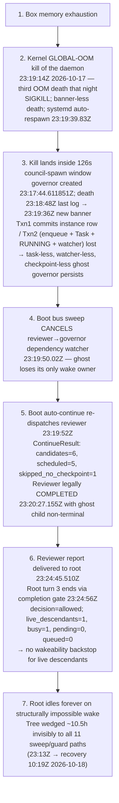

# RCA + Recovery — Wedged Governor Lineage (rcc mission 6b1630e7): kernel OOM × council-spawn transaction gap

**Provenance.** Forensic + recovery commission, 2026-10-18 (~09:50–10:35Z), dispatched by the operator over the wedged lineage. Evidence arms: maintenancer `9b0a4ccc` (log/DB), wanderer `c3ff34a1` (source code @ latest `8b8b32dcc`), devops `250c953b` (kernel journal). Project: agents-ensemble (`83da04de`).

> **Reader's 60-second summary.**
> A leader mission ("Ensemble RAM Profiling & Optimization", `6b1630e7`) and 8 of its 9 children completed normally between 23:13Z and 23:24:56Z on 2026-10-17, then went invisible for ~10.5 hours. The culprit is a **council-spawn transaction gap**: the kernel OOM-killed the daemon mid-council-spawn at 23:19:14Z (third OOM death that night) — between Txn1 (instance row committed, returned `idle/v1`) and Txn2 (enqueue + Task + RUNNING + watcher). The result is a **permanent task-less, watcher-less, checkpoint-less ghost governor** (`597ed23f`) that ALL 11 sweep/guard paths are blind to (every sweep is Task-/JobItem-/watcher-rooted). Boot auto-continue re-dispatched the reviewer parent (`b55b75da`), which legally completed at 23:20:27Z with the ghost still non-terminal; the reviewer report reached the root at 23:24:45Z; the root's completion gate fired `decision=allowed` with `pending=0` / `queued=0` — no wakeability backstop, compensating revival structurally unreachable for zero-execution children. The tree wedged until operator-led lifecycle reaping at ~10:19Z 2026-10-18. **No work was lost**, but two systemic defects are owed coder commissions: (1) spawn-without-dispatch gap, (2) completion gate without wakeability backstop.

## 1. Recovery Outcome

| Artifact | State | Action taken | Notes |
|---|---|---|---|
| Zombie governor `597ed23f-54d8-436d-9860-4d064d8e8692` (rcc-plan-review-council, parent reviewer `b55b75da`) | Non-terminal, 0 tasks, 0 checkpoints, 0 LLM invocations | REAPED ~10:19Z 2026-10-18 via sanctioned lifecycle lane (`terminate_instance`; cancellation stamped, events emitted) | Forensically confirmed zero execution (no `[LLM][597ed23f] Invoking` lines in logs); plan review never started; no work lost. Snapshot confirmed BEFORE any mutation. |
| Root mission `6b1630e7-b61e-40b8-838b-1b7f96992d61` (leader, "Ensemble RAM Profiling & Optimization") | HEALTHY — checkpoint step 65, turn 3 completed 23:24:56Z | No mutating action. Wake directive delivered via operator/messages-API relay (the only sanctioned path — agent-lane is authorization-blocked by design: leader→leader AND developer→leader both refuse; relay attempt `c80921fd` proved it empirically) | Directive content: currency check vs merges since plan authoring + fresh re-gate OR accept reviewer report + continue phased implementation (RAM input folded — see §6) |
| Job `55572c12-e49f-4963-8114-f9ea070c0ca5` | Terminal — `completed` 05:24:50Z (mission-live 6h expiry, `pattern_f`, event 30054) | None (already closed by `job_recovery_service.pattern_f`) | `admission_state='done'`, `failed_at` NULL — no error-finalize artifact |
| 8 other root children (wave-1 giter `f45ca77a`, developer `445a5d87`, wanderer `ab94b388`, explorer `243556eb`, wanderer FE-recon `a2bebbbe`, architect `f12ff0f0`, planner `e8458024`, reviewer `b55b75da`) | Terminal | None | Reports delivered |

## 2. Proven Composite Causal Chain

Numbered links, each evidenced:

1. **Box memory exhaustion → kernel GLOBAL-OOM kill.** Daemon killed SIGKILL at 23:19:14Z 2026-10-17 (banner-less death; systemd auto-respawn 23:19:39.83Z). Third of three OOM deaths that night.
2. **Kill landed inside the council-spawn window.** Governor created 23:17:44.611851Z; last log line 23:18:48Z → new banner 23:19:36Z. Window ~126s; council-spawn tool call in flight at the moment of death.
3. **Txn1-committed / Txn2-lost → permanent task-less ghost.** Council spawn is two transactions: Txn1 commits the instance row (idle/v1) and returns; Txn2 (enqueue + Task + idle→RUNNING + watcher) runs after. Death between them → ghost persists with 0 tasks, 0 checkpoints, 0 JobItems, 0 LLM invokes; message `5086e561` never queued.
4. **Boot bus sweep cancelled the only wake path.** Dependency watcher `3f535dd2` CANCELLED 23:19:50.02Z; the ghost lost its only wake owner.
5. **Boot auto-continue re-dispatched the reviewer.** Reviewer had a checkpoint → re-dispatched 23:19:52Z (ContinueResult: candidates=6, scheduled=5, skipped_no_checkpoint=1). Governor/root absent from candidates (task-anchored lane). Reviewer legally COMPLETED 23:20:27.155Z with the ghost still non-terminal.
6. **Root turn 3 closed via completion gate, no backstop.** Reviewer report delivered to root 23:24:45.510Z; root turn 3 ran 23:24:46–23:24:56Z and ended via completion gate: `decision=allowed` with `live_descendants=1`, `busy_descendants=1`, `pending_children=0`, `queued_or_expected_wakeups=0`. The gate has no wakeability backstop for live descendants.
7. **Net: invisible wedge of ~10.5h.** Every sweep/guard is Task/JobItem/watcher-rooted → excluded by the task-less, watcher-less, non-terminal ghost. Recovery only by operator intervention at 10:19Z 2026-10-18.

## 3. Root-Cause Verdict + Evidence Anchors

**Hypothesis verdict:** (a) restart trigger — CONFIRMED, cause PROVEN as kernel OOM; (b) taskless-spawn systemic gap — CONFIRMED (precise shape: Txn1-committed / Txn2-lost); (c) parent-completes-with-live-child — SPLIT: by design for ghosts, the defects are elsewhere (below); (d) sticky subtree-error family — REFUTED (§4).

### 3.1 OOM proof (devops `250c953b`, journal)

- **#1** 23:19:14Z — `Out of memory: Killed process 3393357 (ensemble-prod)` anon-rss 2.09GiB, `constraint=CONSTRAINT_NONE global_oom`, unit peak 8.4G — **the trigger**.
- **#2** 00:42:00Z — 4-victim cascade (ensemble-prod + user@1000 systemd + sd-pam + opendesign-daemon).
- **#3** 01:39:29Z — python child inside ensemble cgroup → `OOMPolicy=stop` full-unit teardown (8.7G peak), masquerading as graceful shutdown.
- **Box context.** One host boot since 2026-09-26 (no reboot); zero segfaults; no manual stop. Unit: `MemoryMax=infinity`, `MemoryHigh=infinity`, `OOMPolicy=stop`, `Restart=on-failure`. Host has **ZERO swap**; ~10G managed, ~95MB free at kill #1; box at 6.7G at report time.
- Agent-tool test-farm children (pytest + python workers) survive unit stops and **leak across restart epochs** — load on the OOM arithmetic.

### 3.2 Spawn path (wanderer `c3ff34a1` @ latest `8b8b32dcc`)

- Lane = `convene_council_with_skill` at `daemon/tools/instance.py:3345`.
- Txn1 = spawn-commit at `daemon/services/instance_lifecycle.py:5265-5373` (idle/v1).
- Txn2 = watcher at `daemon/tools/instance.py:3522` / `:3534` + enqueue Task + idle→RUNNING flip at `daemon/services/instance_messaging.py:1997` / `:2206` / `:2331` / `:2364-2375` / `:2478`.
- **Note:** the governor's own initiative text ("spawn_councilor…") is instructions forwarded TO the governor for its councilors — NOT the lane the reviewer used (`spawn_councilor` is governor-identity-guarded at `daemon/tools/instance.py:3006`).

### 3.3 Reaper blindness (wanderer)

All 11 sweep/guard paths are Task/JobItem/watcher-rooted:

- `boot-continue task` — `daemon/repositories/instance/repository.py:1066-1163`.
- `MissionStrandHealer` — `daemon/services/mission_strand_healer.py:252-259` (requires `waiting_children` root).
- Mission-live backstop — `daemon/services/mission_live_guard.py:118` (read-only verdict, **no recipient**).
- `JobRecoveryService` — `daemon/services/job_recovery_service.py:539`.
- Eligible-pending / stale-task / lock sweeps — all excluded.

The ghost set IS identified by `filter_never_dispatched_ids` at `daemon/repositories/instance/repository.py:720` — **but has no consumer.**

### 3.4 Gate / revival (wanderer)

- Root-only gate — `daemon/services/child_reports.py:2948` (root_completed branch `:4753` / `:4791`).
- Mid-tree parents use active-children guard `:3712-3815` with **GHOST carve-out** `:2715-2733` (design comment `:2718-2726` — parent must NOT wait for a child whose dispatch already failed).
- Publish-site terminal branch `:4970-4998`.
- **Compensating revival requires a `report_injection` obligation row** (minted only on actual child completion, `:4152-4159`; recovery paths `daemon/services/report_delivery_recovery.py:1210-1254` + `daemon/services/instance_messaging.py:2263-2272`) — **structurally unreachable for zero-execution children.**
- Resume semantics: `silent_resume` = status flipper, no dispatch (`daemon/manager.py:11560-11646`); `no_active_job` = no eligible Task row (`daemon/routers/instances.py:859-864`).

### 3.5 Log / row anchors (maintenancer `9b0a4ccc`)

- Spawn log line 15615.
- Event 29468 `message_received` 23:17:44.641113.
- Zero `[LLM][597ed23f] Invoking` (regex-verified).
- Checkpoints thread `597ed23f` = **0 rows**.
- Watcher `3f535dd2` CANCELLED 23:19:50.02Z.
- `boot-continue` `ContinueResult(candidates=6, scheduled=5, skipped_no_checkpoint=1)`.
- Reviewer completion event 29469.
- Injection `80f2f075` deferred → delivered 23:24:45.510.
- Gate decision log lines 16728-16729.
- Root checkpoints: **66 rows**, frozen after step 65 @ 23:24:56.06 (turn-complete).

### 3.6 Observability defect

`instances.last_activity_at` frozen at **23:13:04.197938Z** despite the 23:24 epoch activity — misled initial triage ("ZERO activity") and feeds 6h mission-guard math (`daemon/services/mission_resolver.py:872-876` `started_at` fallback; `daemon/services/work_status.py:67-83` idle→processing display artifact).

## 4. Refuted Family + Coordination Verdict

**Sticky subtree-error / finalize-classification family (job `6465391d` RCA, note `cf6f6146`): REFUTED for this incident.**

- No subtree-error markers in any log line or DB row.
- Job `55572c12` `admission_state='done'`, `failed_at` NULL, no error-finalize. Closed `completed` via `pattern_f` (6h expiry).
- The in-flight `fix/finalize-subtree-error-payload` commission (root leader `b53e30c5` prefix; developer `98c4e4de-6806-4206-bb4d-ebf76b8ea02c`) would **NOT** have changed this incident.

**Coordination verdict:**

- NO scope overlap, NO resequencing needed.
- Explicit guidance delivered via auto-injected critical notes (visible to that commission's next turn): **do NOT absorb the spawn-without-dispatch gap into finalize scope** — it is a separate owed commission.
- Direct messaging between this commission and the finalize-subtree-error commission blocked by the same team-membership gates that block the operator→leader delivery noted above.
- The auto-injected critical notes + this report are the coordination record of record.

## 5. Fixes Owed

**Family note `c0adede9-6b45-41bd-acdf-f88a0c95c4eb` (occ#2), scope SHARPENED — "spawned-but-never-dispatched instances must never persist non-terminal":**

- (i) **Make spawn+enqueue atomic** OR add **boot-time ghost reconciliation** that consumes `filter_never_dispatched_ids` at `daemon/repositories/instance/repository.py:720` — the set is already identified; no consumer exists.
- (ii) Add a **ghost janitor sweep** that reaps aged never-dispatched rows whose parent terminalized (extend `MissionStrandHealer` eligibility or new sweep).
- (iii) Review the **ghost carve-out × healer-precondition interaction**: carve-out `daemon/services/child_reports.py:2715-2733` vs healer's `waiting_children` requirement at `daemon/services/mission_strand_healer.py:252-259`.

**New defect note `6a435fe7-cbdd-4cdb-bbfb-8dfcdc5eaa25` — "completion gate lacks a wakeability backstop":**

- Completion gate allows on `pending=0` / `queued=0` → no backstop for live (non-terminal) descendants whose dispatch never started.
- Compensating revival structurally unreachable for zero-execution children (no `report_injection` obligation row is minted without an actual completion).
- Boot bus sweep **cancels dependency watchers without re-homing the wake** to the parent or any other candidate.
- `instances.last_activity_at` not restamped on epoch activity (root frozen at 23:13:04Z despite root activity at 23:24Z).

**Observability:** last_activity_at stamping (folded into new defect note above).

**Notes-cap pressure:** 50-entry cap forced displacement of an OAuth2 OOS-5 pointer note (content durable in `oauth2 plan §6 R3` + `decisions D15` + ticket `257488dc`). A **curation pass** is recommended as its own task.

## 6. Operator Direction — PENDING TEAM REVIEW (nothing executed by Ari)

Operator direction (verbatim intent): increase RAM + update deployment if needed — execution to be reviewed/owned by the team through the deployment pipeline, NOT executed ad hoc. No infra changes were made by Ari: no RAM resize (also blocked in-guest — DMI reports Maximum Capacity 10GB / 1 memory device, so a resize is hypervisor-side), no systemd unit edit (unit is a GENERATED artifact — header "REGENERATE, do not hand-edit"; pipeline `scripts/upgrade/adopt-unit.sh`, runbook `docs/runbooks/systemd-adoption.md`), no cgroup change (MemoryMax=infinity / MemoryHigh=infinity / OOMPolicy=stop unchanged).

**APPLIED (operator-approved after the fact):** in-box mitigation **L2 — swap**. An 8 GiB swapfile was created at `/swapfile`, persisted in `/etc/fstab`, `vm.swappiness=10` via `/etc/sysctl.d/99-ensemble-swap.conf`. Revertible: `sudo swapoff /swapfile && sudo rm /swapfile && sudo sed -i '/swapfile/d' /etc/fstab`. Verified live: `Swap: 8.0Gi` total, 0B used at apply time.

### Options for team review (not yet decided)

| Tier  | Lever                                                          | Current state                                               | Target                                          |
| ----- | -------------------------------------------------------------- | ----------------------------------------------------------- | ----------------------------------------------- |
| **L1** | Bound the ensemble daemon cgroup (systemd `MemoryMax` / `MemoryHigh`); review `OOMPolicy` so containment is deliberate | `MemoryMax=infinity`, `MemoryHigh=infinity`, `OOMPolicy=stop` | A sane limit + explicit containment policy      |
| **L2** | Add swap to the host | **8 GiB /swapfile applied**, 0B used at apply time; persisted in /etc/fstab; swappiness=10 via /etc/sysctl.d/99-ensemble-swap.conf | Maintain the 8 GiB swap cushion under memory pressure; revisit if L1 cgroup bound is adopted |
| **L3** | Agent-tool test-farm child hygiene                             | pytest / python workers survive unit stops and leak across restart epochs | Scope test runs; ensure child reaping on unit stop |

Only **L2** is currently applied. **L1 and L3** are OPTIONS — execution requires team review/ownership, not an ad-hoc Ari change.

## 7. Cross-Links

- **Project history:**
  - `c4cbfff4-3baa-4168-a0b4-fbb224612e6c` — RCA + recovery entry.
- **Critical notes:**
  - `c0adede9-6b45-41bd-acdf-f88a0c95c4eb` — spawn-without-dispatch family, occ#2.
  - `6a435fe7-cbdd-4cdb-bbfb-8dfcdc5eaa25` — gate wakeability backstop / revival unreachable / watcher boot-cancellation / `last_activity_at` freeze (new).
- **Evidence reports (commission arms):**
  - maintenancer `9b0a4ccc-e780-467a-abb8-df9084b5adcb` — log/DB capture.
  - wanderer `c3ff34a1-c79f-4259-acbe-b863be1b901e` — source-code diagnosis (C1–C5).
  - devops `250c953b-286a-45eb-9407-2a735e0a3b84` — kernel journal forensics.
- **Related mission planning docs:** `.agents/shared/planning/resource-cost-control/` — `plan-overview.md`, `decisions.md`, `phase1-8`, `architecture-recommendation.md`. Authored in worktree `/home/nea/ensemble-src-wt-resource-cost-control` (not the main checkout); readers should fetch them from the worktree, not the main checkout, when reopening this RCA in parallel context.
