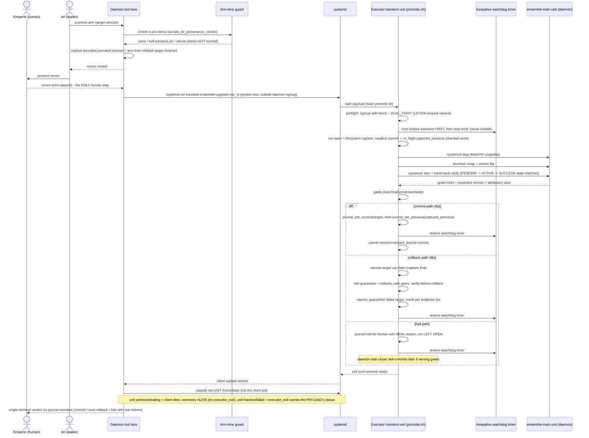

# Self-Service Promote Choreography — Architecture Recommendation

| | |
|---|---|
| **Commission** | board `wi-aa89581b` — "a live promote must complete with ZERO external operator steps" (Ari arms → Emperor echoes → flip) |
| **Status** | Complete (design only). Includes the multi-model council's adversarial review, adjudicated in §9. |
| **Base tree** | `43e8d8db6853d34ff3906bd65324133edc4be2c4` = `origin/latest` (branch `fix/self-service-promote`, worktree `/home/nea/ensemble-src-wt-selfservice-promote`) |
| **Method** | Competitive fan-out: 3 structural models (D1+D3), one worker each for D6 / D2 / D5 / D4 (one skill per worker), one council (2 models, `resilience-design`). All anchors re-grepped at use time; the two surviving executor payload logs were read directly. |
| **Hard constraints honored** | Tool-lane guard is the security boundary (never weakened — §2.7/§9.3); refusal vocabulary preserved, only extended; fail-closed on unknown; zero operator steps; **no live promote in this commission**. |

---

## 0. Corrections ledger — premises REFUTED or SHARPENED after the commission brief

The brief's evidence was corrected three times (host forensics ~14:15Z, worker re-derivation, council + payload logs). **Every recommendation below is built on the corrected premises.**

| # | Original premise | Verdict | Correction |
|---|---|---|---|
| C-1 | E1 "executor SIGKILLed at unit-cgroup teardown" (tonight's cause) | **REFUTED** | No `supervision_boot` event between 04:29:28Z and 04:47:13Z ⇒ no daemon alive ⇒ the 04:39:17Z `subprocess_wait_timeout` and 04:44:19Z `halt` rows were written **by the executor itself** — alive 73s and 326s after the 04:38:01Z flip. **The executor SURVIVED the flip's unit stop.** D3 is **prevention**, not tonight's cause. The proof that a cgroup-scoped caller is dangerous is the **2026-11-18 DOUBLE OUTAGE** (agent ran raw `systemctl restart` from inside the daemon's cgroup → stop half ran, caller killed with its cgroup before the start half, `Restart=on-failure` skipped after an explicit stop → down 67 min, then 4h32m, 503s). That outage is *why the host keepalive exists* — our own incident created the watchdog that now threatens the flip window. |
| C-2 | "no scripted promote has ever completed a flip" | **REFUTED** | Three daemon-spawned, nonce-armed scripted promotes reached `serving_green_commit`: 2026-11-18T04:21:57Z (v0.31.1), 04:38:30Z (v0.31.2), 2026-11-19T13:40:22Z (v0.31.10). **All three were rescued by the daemon-side closer ~9–10 min after a false-negative hand-back halt.** The executor's own commit path never fired. Correct statement: *"no ceremony has ever passed hand-back cleanly; the closer has been silently rescuing every one."* |
| C-3 | (new) — | **ADDED, RANKED FIRST** | **D6 false-negative hand-back is the dominant failure mode**: 6 occurrences (04:10:52Z, 04:28:54Z, 04:39:17Z, 06:20:19Z, **06:55:10Z**, 13:30:49Z — the sixth was missing from the brief and is recorded as *observed, provenance unexplained*, F18 discipline). See §2.1. |
| C-4 | E2 "the rollback target must be captured from the FILESYSTEM at flip-prep — the `OLD_CUR` pattern" | **SHARPENED, then CORRECTED AGAIN** | The *shape* is right; the *source named in the brief is wrong*. `promote.sh:511` reads `CUR` from the **journal's `"current":` field** (`_json_field_quoted "$CUR_JSON" '"current":'`), and `journal.current` is written **only** on commit/rollback/halt paths — the **complete census is 13 sites** (`journal_set_current` / `_js_journal_update "current"`): `lib.sh:8950/:9035` (adopt paths); `promote.sh:889` (commit), **`:980/:991/:1001/:1012` (the four HALT arms — no-previous / quarantined-previous / missing-previous / unsafe-previous, each `close_txn` → `set_current $VERSION` → halt, leaving the daemon resting on the unverified target)**, `:1087` (8b bookkeeping); `rollback.sh:286` (manual rollback — also missing from the earlier count); `launcher.sh:2703/:2806/:2889`; sweep closer `daemon/services/upgrade_journal_sweep.py:2680` — **none at flip time** (review cycle 2 corrected an under-count: the four halt arms and the manual-rollback site were omitted; the conclusion is unchanged and *strengthened* — even the halt arms update `current` before halting). So `journal.current` *lags the symlink* across the whole open-txn window, and `OLD_CUR` (`promote.sh:651`) / `PREV` (`:938`) / 8b's auto-rollback target are **the same stale class as `displaced_version`** — shipping "use `$OLD_CUR`" ships a green-looking no-op. The fix needs a **genuine** `readlink "$INSTALL_DIR/current"` capture. Verified: `promote.sh:511`, `:910 journal_set_previous "${OLD_CUR:-null}"`, `:938 PREV="$OLD_CUR"`, doctrine comment `:929-936`. |
| C-5 | E3 one refusal path | **CONFIRMED as TWO, plus a third root cause** | (i) Layer-1 argv nonmatch (13:31:24Z); (ii) DUAL_FIGHT `port-holder-outside-unit-lineage` (05:42:58Z); (iii) **census-scope defect** at `lib.sh:7835` — the broad `lsof -ti:"$PORT"` (no `-sTCP:LISTEN`) versus the correctly-scoped shared reader at `lib.sh:7059`, whose own comment at `:6972` documents *why* the broad census is wrong. The "unreadable `/proc/<pid>/cgroup` ⇒ fail-closed" sub-claim is **UNPROVEN** — the fail-closed default is kept, nothing is built on it. |
| C-6 | E4 watchdog caused the 06:25Z sweep | **REFUTED as stated** | The 06:19:04Z txn was a **manual rollback** to v0.31.8 (transient `manual-flip-v0318.service`, `rollback.sh live --to v0.31.8`); the sweep then performed a **rollback-of-a-rollback**, consuming a credit, against a release already proven to crash on boot (5× exit 3, `AttributeError: 'Config' object has no attribute 'wedge_notice_emission_enabled'`). No successful flip was swept away; the 13:29Z ceremony landed v0.31.10 with `rollbacks_24h` untouched at 0/3. **Causality UNPROVEN; the hazard is structural** (§2.3). No "foreign MainPID" verdict text exists anywhere — that phrasing belongs to the DUAL_FIGHT family. |
| C-7 | (new) — | **ADDED** | The observability hole: `journalctl` and `/var/log` are **not reachable from agent lanes**, and the daemon app log rotates at 10 MB (~15–20 min, keep-6) ⇒ the 04:00–08:00Z window is **gone**. Also `promote.sh:615-617` reads as if no watchdog ever restarts anything — **a category error, not a lie**: that comment correctly describes the **repo's** `scripts/watchdog-watcher.sh` (genuinely notify-only); the **host's** `/usr/local/bin/ensemble-keepalive.sh` is a *different, unreviewed artifact* that **does** start the unit (repo-side proof: `D3-append-receipt.md:48,62-64` — `14:02:57 failed … grace 180s` → `14:07:39 down 282s, pipeline idle, port dead -> STARTING` → `supervision_boot 14:08:17Z`, "No human was involved"). **Do not correct the correct comment — probe the host.** |
| C-8 | (new, from the surviving payload logs — read directly) | **ADDED** | **The executor payload logs survive and answer E1 partially.** `<install>/data/upgrade/<env>/<run_id>.payload.log` (`executor_run_log_paths`, `daemon/tools/upgrade_journal.py:3158/:3165`; a *different retention family* from the 10 MB app log). Both surviving runs — `r-20261119-043446-c8da` (the 04:38 flip / 04:39 timeout / 04:44 halt / 04:46 sweep-rollback run) and `r-20261119-132823-3a3c` (the 13:28 run) — are **11 lines and end at the hand-back verify budget line**: `budget effective=300s source=ceremony-clamped grace=60s total=360s ceremony-remaining=810s`. **No probe-level fail-fast `_warn`, no attribution refusal, no halt narrative appears in either**, despite both runs halting. Two consequences: (a) the two halt shapes map onto the two runs — the 04:44:19Z halt is **budget exhaustion** (flip 04:38:01 + 360s ≈ 04:44:01, halt +18s) while the 13:30:49Z halt is a **~36s verifier-path fast-fail** (the D1-attribution / version-absent / hard-red family at `lib.sh:6108-6135`); (b) the executor's verify-phase diagnostics are **not reaching its own payload log** — a new observability defect (F16). The 04:38 run also shows **12 port holders** at stop time with `ENSEMBLE_SUPERVISION_OUTCOME=conforming` ⇒ DUAL_FIGHT immunity of the fd leak confirmed at scale. |
| C-9 | "the hand-back must capture the failure reason" | **SHARPENED (structural)** | `HB_ERR`/`HANDBACK_LAST_ERROR` is written **only by the launchd resolver path** (`lib.sh:5651` launchctl-bootstrap, `:5737` plist-resolution); the **systemd path touches the channel nowhere** — verified: every `HANDBACK_LAST_ERROR` reference in the tree is inside a launchd block (the writes `lib.sh:5651`/`:5737` **and** the success-clear `:6575` all sit in the launchd branch; the systemd hand-back neither writes nor clears it — review cycle 2 corrected the earlier citation of `:6575`, which had been presented as if it were a systemd-path fact). So on Linux `hand-back error: none captured` (`promote.sh:698`) is **always** empty — it is not a missing capture, it is an unwritten channel. Its presence therefore **positively indicates a verifier-path failure** (attribution / version / hard-red), not a resolver failure. The fix is not "populate HB_ERR" on the systemd path but **thread `GATE_ATTRIBUTION_DETAIL` + the observed `/livez` version into the halt row itself**. |

---

## 1. Context and confirmed findings

### 1.1 What actually happened tonight (the corrected arc)

Every ceremony halted at hand-back and was rescued by the daemon-side closer; the executor's own commit path never fired. **Two halt shapes, now mapped to surviving evidence (C-8):**

- **Shape (a) — verifier-path fast-fail at 36–45s** (the 13:30:49Z halt). Origin: `_handback_serving_probe` (`lib.sh:6108-6135`) has **four instantaneous fail-fast arms** — attribution refusal (`_gate_serving_attribution` = **D1 Layer-1**), `/livez` version absent/unparseable, version ≠ expected, house-classifier RED. Per C-9, `none captured` is the *marker* of this family. **D1 is therefore a prerequisite of D6, not a sibling**: a D6-only fix is a narrative fix with zero outcome progress — the ceremony still halts, honestly labelled.
- **Shape (b) — verify-budget exhaustion at ~300–360s** (the 04:44:19Z halt ≈ flip + 378s). The executor polled the full budget and the daemon never came up in time — **the wedge**, not the probe.

The mislabeled row that misdirected triage for ~10 hours:

```
lib.sh:6371  isact="$(_run_bounded "$SYSTEMCTL_PROBE_BUDGET_S" -- "$SYSTEMCTL_BIN" is-active "$unit" 2>/dev/null)"
lib.sh:6373  if [ "$isact_rc" -ne 0 ]; then   # ANY non-zero rc
lib.sh:6376      journal_history_append subprocess_wait_timeout \
                  "site=handback_is_active kind=budget reason=child: timeout(SYSTEMCTL_PROBE_BUDGET_S=5) … rc=$isact_rc"
```

`_run_bounded` (`lib.sh:4873`) maps **only** `137|143 → 124`; rc=3 passes through unchanged — so **rc=3 is not a timeout**, yet it is journaled as one. **This site never decides anything**: it journals and **continues** (`lib.sh:6378` → `isact=""` → the start proceeds). At hand-back the unit was *deliberately stopped pre-flip*, so rc=3 (`inactive`) is the **expected** value; the state word *is* on stdout and is **discarded**. The "5/5 same signature" was non-discriminating — that event fires on **every booting unit**. The real defects are: (1) the label lies; (2) there is no PENDING state downstream; (3) a **second false-negative generator** — a `systemctl start` exceeding `HANDBACK_START_BUDGET_S=60` is treated as terminal (`lib.sh:6394-6406`) although systemd keeps activating the unit.

### 1.2 The binding constraint (not D6, not D1)

Measured post-flip boot → `serving_green_commit`: **11m05s / 9m36s / 9m33s**, against a 300s verify ceiling (`HANDBACK_VERIFY_BUDGET_S`, floor 180) and a 900s ceremony deadline (`PROMOTE_TOTAL_DEADLINE_S`, `lib.sh:174`). **On tonight's binary, no hand-back budget inside the ceremony can succeed** — shape (b) is arithmetic, not health. The post-flip CPU wedge is therefore a **prerequisite** for a zero-operator promote, not a sibling defect (Appendix A).

### 1.3 Attribution: three root causes, two refusal sites, mechanically separable

| # | Root cause | Site | Live signature | Discriminator |
|---|---|---|---|---|
| (a) | **O_CLOEXEC fd leak** — `daemon/services/bind_retry.py:413-415` mirrors uvicorn `sock.set_inheritable(True)`; the daemon's LISTEN fd leaks into every child (`npm exec @upstash/context7-mcp`, code-server, and transitively *any* descendant) | Attribution **Layer 1** (`lib.sh:8021`, `_gate_serving_attribution`; owners via `_supervision_owned_pids` `:6938-6967`; refusal literal `:8061`) | 13:31:24Z — `port-holder(s): 541020 541379 NOT in the supervision-owned pid set` | Offenders **multiple + long-lived**; `-sTCP:LISTEN` census returns more pids than listeners; each offender's fd inode **== the daemon's LISTEN inode** (live-verified: fd 6 → `socket:[36221263]`); **reappear after every restart**; at 04:38 there were **12 holders** and DUAL_FIGHT still passed |
| (b) | **Census-scope defect** — DUAL_FIGHT Check B uses the broad census | `lib.sh:7835` `for hpid in $(lsof -ti:"$PORT" 2>/dev/null)` — **no `-sTCP:LISTEN`**; the *only* census in the tree that duplicates the shared reader with a different scope (Layer-1 `:8024` and the launchd twin `:7739` both use `_supervision_port_holders` `:7059`; `:6972` documents why broad is wrong) | 05:42:58Z — `supervision DUAL_FIGHT (port-holder-outside-unit-lineage) … refusing PRE-TXN`; by 05:54Z the holder pid had **exited** | Holder **gone on next probe**; `lsof -a -p <pid> -i:<P>` shows **only ESTABLISHED, no LISTEN**; **transient — clears on retry** (attempt 3 at 06:17:30Z passed `conforming` with six fd-leak holders present); the detail string itself carries `cgroup='<unreadable>'` = a holder that **exited between census and cgroup read** (`pcg=""` → the `*)` branch → fault) — **the unreadable-holder hard-refuse** |
| (c) | **Layer-1-before-Layer-2 ordering** — Layer 2 (unit lineage, `lib.sh:8117-8151`) would admit same-cgroup holders but runs second | same as (a) | — | **Moot once (a) is fixed** — Layer 1 then passes unaided |

Live proof that (a) and (b) are independent: attempt 2 (05:42:10Z) failed on a **vanished holder** (`cgroup='<unreadable>'` → `ROLLBACK_SH_EXIT=78` at 05:42:58Z) while attempt 3 (06:17:30Z) **passed** the same check with **six** fd-leak holders present. **The fd leak is DUAL_FIGHT-immune (leaked children are cgroup-contained); an out-of-unit short-lived client is DUAL_FIGHT-lethal.** Two further census defects ride in the same Check-B block and are closed by the same fix: **substring containment** — the lineage test is `case "$pcg" in *"$cg"*)`, a *containment* match rather than equality, so any cgroup path merely *containing* the unit's path string passes; and **swallowed stderr** — the census runs `lsof -ti:"$PORT" 2>/dev/null`, so a failing `lsof` returns an empty holder set silently (rc is discarded into the `for` word-split), which today reads as "nothing to fight over" rather than "probe failed".

### 1.4 Watchdog: repo-side proof it acts (causality not needed)

`.agents/shared/planning/sonic-team/wi-a5ec5b3e/D3-append-receipt.md:48,62-64`: the keepalive saw the unit `failed` at 14:02:57, waited the grace (`down 150s (< 180s) waiting`), and issued `STARTING` at 14:07:39 ("down 282s, pipeline idle, port dead"), `start command OK`, `supervision_boot 14:08:17Z` — **"No human was involved."** Structural hazard (numbers): darkness ≈ **245s typical / 645s worst** vs watchdog earliest fire ≈ **140–260s** (grace + ≤80s timer lag) and latest-via-override ≈ **380s** — both bounds inside the window. Note the assigned 60s 'failed' grace vs the **observed 180s** — the design holds the timer regardless of the numbers.

### 1.5 Executor/reaper asymmetry (latent hazard)

The tool-lane executor **is** a systemd-run transient (`daemon/tools/upgrade_journal.py:3548 build_service_argv`; argv `:3599-3628` = `--unit=ensemble-upgrade-<run_id> --wait --collect`, `--setenv` per key; `spawn_executor :3742`; client `Popen :3873` with `start_new_session=False + close_fds=True`; sole production caller `daemon/manager.py:6759`, inner argv `:6669-6670` = `bash <scripts_dir>/promote.sh --version …`, extras re-injected `:6695-6699`). The **transient unit** is a `system.slice` sibling ⇒ survives the daemon unit's teardown **by construction** (tonight's 04:39/04:44 rows prove it). The **`--wait` client** is a cgroup child of `ensemble-main.service` ⇒ **dies with it**. The journal's `owner_pid` is the *payload's* shell (`journal_open_txn` stamps `owner_pid=$$`, `lib.sh:1993-1999`), and the reaper watches the **client** pid (`manager.py:6794-6801` → `daemon/services/upgrade_journal_sweep.py:3139-3148`, `_waitpid_blocking :3205`) ⇒ a unit teardown journals a **false `executor_exit` (128+SIGTERM)** for a live ceremony. **Mitigating fact**: the sweep's owner-liveness conjunct reads the *payload's* `in_flight.owner_pid` + heartbeat, so the false exit alone does not trigger a spurious rollback. No script self-detects its cgroup (`grep '/proc/self/' scripts/` → no match).

---

## 2. The six decisions

> House 5 axes throughout: **Complexity · Scalability · Maintainability · Risk · Cost** (Risk = residual risk; lower is better).

### 2.1 D6 (RANKED FIRST) — the false-negative hand-back

**The subject:** the hand-back has **no PENDING state**; every non-green observation collapses into one terminal verdict, the journal labels a non-timeout as a timeout, and the verifier-path failure reason never reaches the halt row (C-9).

**Proposed state machine** (replaces "one 5s probe + one verdict"). **Keyed on the state STRING, never on the rc** — so a genuine `failed` is never softened:

| State | Entry evidence (all bounded, all from this unit) | Terminal |
|---|---|---|
| **PENDING** | state word `activating` (or `deactivating`/`reloading`); or start issued with no terminal evidence; or `MainPID=0`/port not bound yet; or serving probe transient (curl 7/28, 503, boot-grace-suppressed) | no |
| **PROCEED** | state word `inactive` **before the start** — the expected pre-start value; issue the start | – |
| **ACTIVE** | `ActiveState=active` ∧ **new** MainPID (≠ prestop) ∧ port bound ∧ serving conjunct unsatisfied | no |
| **FAILED** | state word `failed`; or start rc ≠ 0 ∧ ≠ 124; or MainPID == prestop; or green `/livez` with version ≠ expected; or green with version **absent**; or attribution refusal; or house-classifier RED | **yes** → halt (B4 leave-txn-open) |
| **UNKNOWN** | probe unclassifiable: rc=124 (the *only* genuine timeout), rc ∉ {0,1,3,4}, `show` unavailable, lsof ∧ curl absent, unexpected state word | no (never success, never failure) |
| **BUDGET-EXHAUSTED** | effective verify budget expired while PENDING/ACTIVE/UNKNOWN | **yes** → halt with a **distinct** token naming last state + elapsed |

Note `_supervision_unit_serving` (`lib.sh:6187`) **already has the right concept** in its MainPID poll (`case "$mp" in ''|0) ;; # not up yet — keep polling`) — PENDING semantics exist; they were never applied to the is-active probe.

**Options**

| Opt | Changes | Guarantees | Risks | Cost |
|---|---|---|---|---|
| (i) PENDING + keep polling | `lib.sh:6334-6420` verdict machine | "not yet" never becomes a verdict | slower detection of a truly dead daemon (bounded) | low |
| (ii) read the **real** unit state | new bounded `systemctl show -p ActiveState -p SubState -p MainPID` probe + taxonomy | PENDING vs FAILED discriminable | new probe = new failure surface (must classify UNKNOWN) | low–med |
| (iii) stop mislabeling rc=3 | `lib.sh:6373-6378` — journal the rc **and the state word**; never call rc=3 a timeout | the journal stops lying | none (no verdict change) | trivial |
| (iv) **thread the real reason into the halt row** | populate the halt detail with `GATE_ATTRIBUTION_DETAIL` + the observed `/livez` version on every terminal path (C-9: HB_ERR is structurally empty on systemd — do not "fix" the channel, bypass it) | `none captured` can never recur; the shape-(a) class becomes diagnosable | none (no verdict change) | trivial |
| (v) measured budget | ceiling from the last observed serving-green latency — read from the journal's `history[]` `serving_green_commit` rows (writers: the daemon-side closer, `daemon/services/upgrade_journal_sweep.py`; and the executor's own commit row, `promote.sh:914`; the knob takes the most recent sample; no sample ⇒ 300) — clamped `[180,600]`, ≤ `min(ceremony_remaining − TAIL_RESERVE, EXECUTOR_STALENESS_WINDOW_S − 120 = 780)`; no measurement ⇒ 300 | covers a slow-but-healthy boot | **highest** — widens a halt-visible window; couples to ceremony clock, closer grace, sweep staleness | med |
| (vi) wedge / readiness flake | daemon boot path | removes the actual 9.5–11 min boot | none in the promote | high (own commission) |

**Matrix** (Complexity / Scalability / Maintainability / Risk / Cost): (i) Low / – / Med / Low–Med / Low · (ii) Med / – / Med / Low / Low · (iii) Trivial / – / High / ~0 / Trivial · (iv) Low / – / High / ~0 / Trivial · (v) Med / – / Low–Med / **High** / Med · (vi) High / Med / Med / Med / High.

**RECOMMENDATION — implement (i) *through* (ii)** (the PENDING/FAILED split is impossible to derive from an rc, so (ii) is the mechanism and (i) is the semantics), **ship (iii)+(iv) with it as independent must-dos** (they change no verdict; they make the journal truthful and the next arc diagnosable). **Land (v)'s mechanism but defer its inflation** to the wedge commission (§1.2 makes inflation alone useless). **(vi) = separate commission** (Appendix A). **Dominant axis: Risk** — a false SUCCESS ships a bad release silently; a false FAILURE costs an operator step and rollback credit; be maximally conservative about success and never convert a boot into a verdict.

**Interactions (both directions, load-bearing):** **D1 must land before or with D6** — the hand-back's four fail-fast arms include the attribution refusal, so D6 alone leaves the shape-(a) halt intact, honestly labelled; conversely D1 without D6 leaves every remaining halt misdiagnosed as a systemd-bus timeout. D6 must not extend the ceremony past `PROMOTE_TOTAL_DEADLINE_S` nor past `EXECUTOR_STALENESS_WINDOW_S=900` (`upgrade_journal_sweep.py:117`); `lock_heartbeat` each poll keeps the launcher's owner-liveness conjunct satisfied. Fewer halts ⇒ fewer sweeps ⇒ fewer rollback credits.

### 2.2 D1 — attribution false refusal (three root causes)

**Options** (from three competitive structural models + the council):

| Option | Mechanism | Cmplx | Scale | Maint | Risk | Cost | Verdict |
|---|---|---|---|---|---|---|---|
| **B4 census-scope fix** | replace the inline broad census at `lib.sh:7835` with the canonical reader `holders="$(_supervision_port_holders)"` (+ rc handling: 1 = no listener ⇒ nothing to fight over; 2 = unprobeable ⇒ skip, never evidence), mirroring the launchd arm `:7739` verbatim | Low | High | High | **Low** | ~5 LOC | **MUST SHIP** — closes the 05:42:58Z class |
| **B1 fd source fix** | `bind_retry.py:413-415`: `sock.set_inheritable(False)` (explicit, so a future default change cannot re-open it) + rewritten rationale comment | Low | High | High | **Low** | ~15 LOC | **MUST SHIP** — closes the 13:31:24Z class |
| A: Layer-1 lineage exemption (+ fd-identity confirm) | exempt holders proven descendants/MainPID/cgroup-contained in Layer 1 | Med | Med | Med | **Med–High** — adds an admission path; a true second master coincidentally inside the unit cgroup would be exempted | ~60 LOC | **not as primary** — adds an exemption where cause-removal is available |
| C2 / council variant: **fd-inheritance exemption keyed on the daemon's own socket inode** | admit a holder iff it holds the daemon's published LISTEN **inode** (identity, not kinship) + cgroup-containment fallback; unreadable cgroup stays fail-closed (`:8140-8151`) | Med | High | Med | Low (a true second master holds a **different** inode ⇒ still refused) | ~350–450 LOC | **the documented FALLBACK** — correct shape if B1 proves incomplete (bare-`fork()` children / unaudited `site-packages`); the exemption boundary is a leader call (§7) |
| B2 fd closure at spawn seams only | `os.set_inheritable(fd, False)` before each `Popen` | Med | **Low** | Low | Med | ~60 LOC | reject standalone — **live-proven insufficient**: the leak reaches *every* descendant (a tool-shell `head`/`grep` held the socket) |

**RECOMMENDATION: B4 + B1 as primary** (cause-removal; zero guard-text changes; ~20 LOC), **with the inode-keyed exemption held as the specified fallback** and the boundary left as an explicit leader call. Landing order: **B4 must land before or with any exemption** (an exemption over a mis-scoped census admits ESTABLISHED clients).

**⚠ Census-scoping rule (do not "unify" wrongly):** the *census* must be **LISTEN-scoped, not inode-scoped** — a true second master holds a **different** inode on the same port, so inode-scoping the census would blind the guard. Inode identity belongs in the *admission* predicate, never in the census.

**Guard preservation (B1+B4):** `lib.sh` refusal literals (`:8061`, `:8038`, `:8147`, `:8085/:8089`), `_gate_attr_unprobeable` (`:8016-8020`), DUAL_FIGHT fault tokens (`owned-pids-outside-unit-cgroup` `:7828`, `port-holder-outside-unit-lineage` `:7847`) and the exit-78 halt — **all byte-unchanged**; a true second master *is* a LISTEN holder and is still caught. The uvicorn-fidelity mirror was audited: the socket is handed **in-process** to uvicorn (`__main__.py:556` → `server.run(sockets=[sock])`); repo-wide there are **zero** `os.fork`/`multiprocessing`/`close_fds=False`/`pass_fds`/socket-activation paths — **the mirror protects nothing in this topology.** Flip-window delta: **0s**.

**Caveats carried:** a **bare `fork()`** child holds an inherited socket regardless of CLOEXEC, and `site-packages`/out-of-tree spawn sites were **not audited** — B1 is *probably* complete, not *proven* complete; that is precisely the residual condition under which the inode-keyed fallback stays live.

### 2.3 D2 — the host watchdog

**Options**

| Option | Verdict | Why |
|---|---|---|
| (a) pipeline-side HOLD + durable failsafe | **PRIMARY** | the executor (outside the unit cgroup) **stops** the candidate watchdog timer(s) — **never `disable`** — after minting a restore transient (`systemd-run --on-active=1800 --unit=ensemble-keepdog-restore-<run_id>`); a marker file records the held set + prior state. An *enabled* timer is re-armed by systemd at boot ⇒ the reboot path is covered |
| (b) shrink downtime below the grace | **REJECTED (arithmetic)** | the watchdog's earliest fire (~140s) already exceeds the grace (60s); darkness ≈245s typical vs override 300s leaves ~55s margin in the *best* case |
| (c) tolerate a watchdog start in hand-back verify | **containment (ship with a)** | extend the **existing** version fast-fail (`_handback_serving_probe`, `lib.sh:6101-6136`) to the paths that lack it + a bounded repair (dual-fight re-check → stop → start → re-verify inside the existing budget) |
| (c′) **bound the dark window below the 300s override** | fallback if (a) is disallowed by ruling | requires D1+D6 to make the hand-back fast; the arithmetic (§1.4) says this is tight even then |
| (d) repo-owned pipeline-aware keepalive + automated install | **deferred end-state** | no repo artifact exists; a root install path is **not** zero-operator today, and until installed there would be **two** watchdogs |
| (e) **(a)+(c)** | **RECOMMENDED** | (a) is *prevention*, (c) is *containment*; complementary |

**Matrix:** (a) Med / Med / Med / **Low** / Med · (b) Low / High / Low / **Very high** / High · (c) Low / High / **High** / Med / Low · (d) **High** / Med / Low / Med / High · **(e) Med / Med / Med / Lowest / Med**. **Dominant axis: Risk** (the two named failure classes: *wrong-version-accepted* and *watchdog-permanently-disabled*).

**⚖ Guard-scope adjudication (settles a council objection).** The council asserted the tool lane "cannot stop the keepalive timer" because `_systemctl_guard.py:686` `_UNIT_FAMILY_RE` classifies `ensemble-keepalive.timer` as ensemble-family ⇒ mutating verbs against it are refused. **That is true of the wrong lane**: the guard's own docstring scopes it to "**agent-issued** `systemctl` / kill shapes" (`daemon/tools/_systemctl_guard.py:1-3`, imported by `daemon/tools/bash.py` and `daemon/tools/proc_tools.py` — the agent bash/proc lanes). The **sanctioned executor is not an agent lane**: `promote.sh` → `stop-ensemble.sh` already runs `systemctl stop ensemble-main.service` — *itself* an ensemble-family unit — **every ceremony** (`stop-ensemble.sh:783`), ungated by design. ⇒ The D2 HOLD executed inside the executor's transient unit is within exactly the authority the pipeline already uses. **The agent lane remains refused — correct and unchanged; `_systemctl_guard.py` is untouched.** If the Emperor nonetheless rules the executor may not touch the keepalive timer, fall back to (c′).

**Host-probe contract (probe, don't assume):** bounded (`_run_bounded`, `SYSTEMCTL_PROBE_BUDGET_S`) reads of `systemctl list-unit-files --type=timer`, `show`/`cat` for the paired service and `ExecStart`, plus `is-active`/`is-failed` and `-p UnitFileState`/`is-enabled` (the F14 enable-state discriminator) on the *classified* daemon unit (never a hardcoded `ensemble-main`). Total ≤20s, charged to the 300s preflight. **Candidate predicate:** ExecStart references the resolved daemon unit with a start verb, **or** a `*keepalive*`/`*watchdog*` path, **or** unresolvable-ExecStart + family token ⇒ unknown-candidate (**treated as a watchdog**), **or** the configured timer name. **Fail-closed:** the systemctl probe unusable ⇒ **halt before any stop** (new reason `watchdog_probe_unreadable`, inside the existing `halt` + exit-78 class); a candidate's ExecStart unreadable ⇒ HOLD that timer only; **the restore cannot be armed ⇒ DO NOT HOLD** (loud `watchdog_hold_unavailable`, degrade to (c) — disclosed, never silent).

**Ordering:** P0 probe (unreadable ⇒ halt, nothing held) → **P0.5 arm the restore transient BEFORE any HOLD** (mint failure ⇒ no hold) → P1 HOLD (after the dual-fight check, before `stop_via_stop_script`) → P2 hand-back (own start; a slipped watcher's ALREADY-ACTIVE is rejected by the version fast-fail, now also on rollback/restart) → P3 gates (timer still held — the window closes only when the right version is serving **and** verified) → **P4 commit / P5 abort-pre-flip / P6 halt ⇒ RESTORE** (idempotent) + cancel the RT → **P7 executor death ⇒ the RT fires at TTL**: re-read the journal — open `in_flight` ⇒ **re-arm itself** (bounded, ≤20 iterations), else restore → **P8 host reboot ⇒ the timer was stopped, never disabled ⇒ systemd re-arms an enabled timer.**

**F2 — restore-transient edges (both are numbered residuals):**
- **(i) resume-vs-restart.** A naive ceremony re-run on a partially-flipped system can **double-flip**. A re-arm MUST **resume from state**: `in_flight.flipped=true` ⇒ gates/commit ONLY (no stop, no swap, no flip); `flipped=false` ⇒ flip-prep **with idempotency guards** (capture re-read; `launcher_swap` no-op if already pointing at target). **NEVER restart-from-arm.** (AC-CER-1.)
- **(ii) ~10h darkness on executor death.** The sweep lives inside `launcher.sh` — the **stopped unit's own ExecStart** — so a stopped unit never runs it; and while `in_flight` is open the keepalive is held ⇒ **nothing restarts the unit for up to ~10h** (the old 20-iteration RT bound). **The hold is bounded by daemon liveness**: restore when the unit is `inactive|failed` **and** there is no fresh executor heartbeat — or cap RT iterations at **2–3**. (F13, promoted to 🔴; AC-D2-10.)

**RC8 adjudication (privilege boundaries):** the hold **marker file** is root-written (the executor runs as root on the system bus) and **daemon-readable** (mode 0644, `<install>/data/upgrade/<env>/watchdog.hold.json`); the RT's re-arm MUST tolerate a root-owned marker (it re-arms by timer name, never by rewriting the marker). The daemon-side reaper's `systemctl show` on **system-bus transient units** is unprivileged-readable (`ActiveState`/`ExecMainStatus` are not credential-gated); on any read failure the classifier degrades to outcome-unobserved — **never a death verdict** (AC-D3-4).

**Blind pins found (D2):** 🔴 `rollback.sh`/`restart.sh` never set `PROMOTE_EXPECTED_VERSION` ⇒ the version fast-fail is **inactive on the rollback path** — a wrong-version daemon is accepted as *success*. 🟡 the pipeline never probes `is-failed` ⇒ never learns it entered the 'failed'-grace branch that `stop-ensemble.sh`'s `systemctl kill` escalation leaves. 🟢 the keepalive never consults `rollback.lock.d`.

**No conclusion depends on the unproven causal claim** (§0 C-6).

### 2.4 D3 — executor survival + reaper (PREVENTION)

| Option | Mechanism | Verdict |
|---|---|---|
| **E3 arm-lane unit identity (prerequisite)** | record `executor_unit`, `executor_unit_bus`, `executor_started_at` (+ `owner_pid_kind="client"`, `owner_payload_pid`) into `PendingOp` (`daemon/tools/upgrade_journal.py:1563-1598`) **before** the spawn returns, and pass the unit name into `enqueue_reaper` (`manager.py:6794-6802`). Today the name is derivable only from `run_id` + a kind-scoped prefix chosen at the call site (`manager.py:6766-6769`), and the reaper observation is **in-memory only** — a daemon death loses it | **required** |
| **E1/E2 reaper classifies via the UNIT** | on client waitpid: `systemctl show <unit> -p ActiveState -p SubState -p Result -p ExecMainStatus` → `active|activating` ⇒ **client died, ceremony ALIVE** (new event `executor_client_exit`; op stays pending; re-arm) → `inactive|failed` ⇒ `executor_exit` carrying the **payload's** status, not the client's 143 → unit gone (`--collect` GC'd) ⇒ fall back to the **journal's own truth**: `journal_heartbeat` (`lib.sh:2078-2120`, 30s cadence) already refreshes `in_flight.last_heartbeat`, and `journal_owner_heartbeat_fresh` (`daemon/tools/upgrade_journal.py:292-330`, `OWNER_HEARTBEAT_FRESH_S=60`) **already exists and is already read by the sweep's three-signal defence** — the reaper simply never consulted it. Heartbeat fresh ⇒ ALIVE; stale + terminal ceremony row ⇒ DEAD (the row says *how*); stale + no row ⇒ **AMBIGUOUS** ⇒ new halt-for-human token `executor_liveness_unverifiable`, arm NOT closed, lock NOT released — **bounded** by the unit's `RuntimeMaxSec` (~1320s) | **recommended (minimal re-subject — a root-owned dispatcher is over-engineering)** |
| E4 cgroup self-check + relocate | new `lib.sh` helper reading `/proc/self/cgroup`: inside the supervision unit's cgroup ⇒ refuse (new token `executor-inside-supervision-cgroup`, fail-closed) or re-exec under `systemd-run` with the **same** `lib.sh` (provenance-stamp-preserving), recursion-guarded. Converts the 2026-11-18 double-outage shape into a no-op | **recommended (prevention)** |
| C4 bus/cgroup assertion | after minting, assert the transient unit's `ControlGroup` is **not** under the supervision unit's; else refuse | optional hardening |

**Invariant:** *`executor_exit` may only be emitted from (a) a payload-observed terminal state or (b) the legacy no-unit path. A client death alone can never produce it.* A **probe failure is never evidence of death** — it classifies as outcome-unobserved.

**`--collect` caveat (load-bearing):** a terminated transient unit is **unloaded**, so `systemctl show` returns "could not be found" and the terminal status is **lost** — remedied by polling continuously, `--property=CollectMode=inactive-or-failed` (systemd ≥252), or dropping `--collect`. **Do not regress to `--scope`** — `daemon/tools/upgrade_journal.py:3272-3290` records that `--scope` was **rejected** (it shares the caller's pgroup/cgroup).

**Matrix:** E3 Low / High / High / **Low** / Low · E1 Med / High / High / **Low** / Med · E4 Med / High / Med / Low / Med · combined Med-High / High / Med / **Lowest** / Med-High. **Dominant axis: Risk.**

### 2.5 D5 — sweep/shell rollback target + credit

**Target-resolution chain** (per generation: **G0** = live immediately before *this* txn's flip; **G1** = before that; a G0-vs-G1 difference is *expected*, not a contradiction):

| Rung | Source | ABSENT | AMBIGUOUS/INVALID |
|---|---|---|---|
| **R0** | `in_flight.captured_previous` — **NEW** additive field, the **filesystem capture** (`readlink "$INSTALL_DIR/current"`) at flip-prep, persisted **before** the flip | old-format ⇒ fall through | not a string / == target / == live symlink / `releases/<v>` missing ⇒ **HALT (`capture_invalid`) — NEVER fall through** (F3) |
| **R1** | the `to=` field of the `rollback_requested` row for this `(target, run_id)` | `to=none` ⇒ fall through | present ∧ ≠ R0 ⇒ **`rollback_target_ambiguous` ⇒ halt**; **`to=` is itself subject to the VALID rule** (`releases/<v>` exists ∧ `to` ≠ target) — a `to=` failing VALID is treated as **absent**, never as a candidate (F5) |
| **R2** | `journal.current` (sweep-time) | `null` ⇒ fall through | == target ⇒ INVALID; extractor UNAVAILABLE ⇒ **halt** (existing "verdict UNKNOWN ⇒ txn left OPEN") |
| **R3** | `in_flight.displaced_version` (legacy; still stamped at `lib.sh:1993`) | `null` ⇒ fall through | present ∧ ≠ R2 while R2 valid ⇒ **halt** |
| **R4** | `journal.previous` — **G1 only** | `null` ⇒ **HALT** (existing token *"journal has no previous release"*, verbatim) | == target ⇒ HALT (same token) |

**The exact R0 predicate (F3, published so no implementer invents a weaker one):** `in_flight.captured_previous` is a JSON **string** ∧ non-empty ∧ ≠ the txn `target` ∧ ≠ the live symlink target ∧ `releases/<captured_previous>` exists — evaluated **in that order**, each conjunct failing loud. **R0 present ∧ INVALID ⇒ HALT (`capture_invalid`), never fall through** — a present-but-bogus capture is evidence of a corrupted txn, not of an absent field. Only R0 **absent** (old-format txn) falls through to R1..R3.

**Rule (testable):** VALID ⇔ non-empty ∧ ≠ txn target ∧ ≠ live symlink target ∧ `releases/<v>` exists. **Resolved target = the highest-ranked VALID G0 candidate.** Two VALID G0 candidates with different values ⇒ **halt, never a wrong rollback**. *(Clarified, review cycle 2: the cross-checks run **pairwise, as tabulated** — resolution short-circuits at the highest VALID rung, so a VALID R0 **resolves over** any stale-field disagreement between R2/R3/R4; `rollback_target_ambiguous` halts apply **only where the chain table’s AMBIGUOUS column says halt** — e.g. R1-vs-R0, or a both-valid R3-vs-R2 conflict reached because no higher rung resolved — never as a blanket “any two fields differ” rule. This is what AC-D5-3 (repoint-to-vD) and AC-D5-4 (halt) each express.)* *Both required cases resolve:* 04:46:07Z with the capture (R0=v0.31.2) ⇒ v0.31.2 ✔; without it, R2=v0.31.2 vs R3=v0.31.1 conflict ⇒ halt (strictly better than tonight's wrong rollback). Sibling-lane synthetic (previous=v0.31.1, displaced=v0.31.2, current=v0.31.2) ⇒ R2=R3 agree ⇒ v0.31.2 ✔. Applied at **every** rollback-target site — **both selectors**: the sweep chain's `prev` binding (`launcher.sh:3018` `prev="$(_js_json_field "$json" "previous")"`, consumed by `_js_sweep_rollback_chain` at `:2735`) and the adopt path (`lib.sh:8979` `prev="$(_json_field "$json" previous)"`), plus `promote.sh:938` (8b) and the sweep closer payload.

**Journal write ordering:** txn-open unchanged → **flip-prep (NEW)**: `readlink` → validate (halt, NO flip on failure) → **re-run the M4 quarantine + ADR-005 M5 `rollback_safe` guards on the CAPTURED target** (MINOR-7 — the in-ceremony twin of the arm-time invariant) → cross-check vs `journal.current` (**divergence journaled, continue** — see adjudication below) → **persist `captured_previous` (CHECKED; failure ⇒ halt, NO flip)** → **re-read the symlink** (integrity) → flip → **commit (8a)**: immediacy check → `journal_set_current(target)` → **`journal_set_previous(captured_previous)`** → close → history → **rollback (all paths)**: resolve → guards **on the resolved target** (M4 quarantine → dir-exists → ADR-005 M5 `rollback_safe`, order unchanged) → repoint → quarantine the failed target → `journal_set_current(TARGET)` → **normalize `previous`**: leave unchanged iff VALID for the new current, else `null` + history `previous_invalidated` → credit → history → clear `in_flight`. **This stops the compounding** (today `launcher.sh:2806` writes `current` only and never `previous`).

**⚖ Preflight symlink↔journal equality check — adjudicated (rejects a council proposal).** The council proposed a *fail-closed* `readlink current == journal.current` abort at preflight. **Rejected as specified**: `journal.current` lagging the symlink is the **normal, expected** state whenever a prior ceremony halted post-flip with the txn left open (B4 policy) — aborting on that divergence would refuse exactly the recovery promote tonight needs. The correct form is the one above: **journal the divergence, treat the symlink as truth, continue**, and validate the *capture itself* strictly (non-empty ∧ ≠ target ∧ `releases/<v>` exists ⇒ else halt). A daemon-side reader already exists (`_current_symlink`, `upgrade_tools.py:881`).

**Daemon-side payload** (event name `rollback_requested` unchanged, write-once per `(target, run_id)` preserved): `detail = "target <T> run_id <R> reason <reason> to <DEST> to_source <rung>"`; the daemon resolves **only from the capture**. Launcher consumes `to=` with the per-entry, delimiter-anchored reader; **disagreement ⇒ `rollback_target_ambiguous` ⇒ halt**; absent/`none` ⇒ the request is downgraded to a *disposition request* and the destination comes from the chain — **the launcher never invents a destination.** *"The daemon NEVER rolls back by itself"* (`daemon/services/upgrade_journal_sweep.py:2365`) preserved.

**Closer-vs-executor commit race (MINOR-10):** both writers serialize on the **pipeline lock** + a txn-state guard; a second commit arriving on an already-closed txn is a journaled **`already_closed` no-op** — never a second bookkeeping pass, never a rollback of a committed release.

**Verify-before-rollback** (a mandatory PRE-FLIP VERIFY block at the head of `_js_sweep_rollback_chain`, under the pipeline lock): **V1** a `serving_green_commit`/`quarantine_cleared_serving_green` row for this target ⇒ take the **green path** (existing `_js_serving_commit_close`/`_js_serving_defer`); **V2** fresh probe (`_js_serving_probe`, `launcher.sh:1913`): `green` ⇒ green path; `unprobeable` ⇒ refuse the rollback, halt; `broken` ⇒ proceed; `absent|mismatch|unready` ⇒ **Tier-B only** through the bounded absent-ceiling (*this closes tonight's most likely trigger*: at launcher boot the daemon is not yet listening ⇒ probe `absent` ⇒ rung 0's `*` case fired the chain **immediately**); **V3** a `serving_unhealthy` row is affirmative corroboration.

**Credit rule (testable):** **C1** only an *executed repoint* consumes a credit. **C2** every executed rollback consumes the anti-flap credit (3/24h, cap value/window/entry-side refusal byte-identical). A rollback of a *successful* flip **may not be counted at all** — and per V1/V2 it is **not executable**; if the residue ever executes one it is journaled `wrongful_rollback`, counted in a **separate** `wrongful_rollback_count`, and a second in 24h arms a new, tighter halt — *not* charged to the flapping cap (the cap measures *oscillation*; charging a resolver defect against it is exactly tonight's collateral). **C3** evidence tier recorded at execution: `tierA` genuine / `tierB` suspected (credit, journaled distinctly) / `tierC` **not executable**, no credit. **C4** monotonic, one per executed repoint. **Precision (council):** the cap is **entry-side** (`launcher.sh:87-91`, D-FA4.2) — a false burn does not block the *current* recovery; it **arms the next-entry refusal**. Still fatal to zero-operator; the fix is "don't burn + don't gate the next entry on a false burn," never "raise the cap."

**Options matrix:** **1 capture-and-carry** Med / High / Med (3 implementations ⇒ mandatory parity test) / **Low** / Med · 2 journal-only Low / High / Low / **High** / Low · 3 mtime reconstruction Low / Med / Low / **High** / Low · 4 sidecar Med / High / Low / Med-High / Med. **RECOMMENDATION: Option 1. Dominant axis: Risk.**

### 2.6 D4 — the scripts pin

**Answer to the open question (verified):** `stage.sh` **does** ship the family into the payload (`stage.sh:521 executor_family_install`; `releases/v0.31.10/scripts/upgrade/` = 11 files) — **but the tool lane never executes it.** The resolver (`upgrade_tools.py:2050-2053`) puts the explicit override **first**: live `.env:107` pins `ENSEMBLE_UPGRADE_SCRIPTS_DIR=/home/nea/ensemble-src-wt-scripts-pin/scripts/upgrade`; both fallbacks are dead on live (`install_dir/scripts` absent; the frozen binary has no module-repo `lib.sh`); the payload is **not a resolver candidate at all**; the executor argv is `bash <pin>/scripts/upgrade/promote.sh` (`manager.py:6628` → `:6669-6670`). ⇒ **D4(a) "payload-primary, no pin dependency" is NOT coherent as written**, for two independent reasons: (i) no resolver candidate exists for the payload; (ii) the payload is a **non-git** dir, where the guard returns `arm`/`warn` and **never refuses** (`upgrade_tools.py:4380-4389`) — the ancestry half of the floor would **silently degrade to stamp-only**, i.e. a guard *weakening* (forbidden).

**Runbook contradiction resolved** (`docs/runbooks/promote-handback-serving-green-closer.md`): §10.1 (`:274-304`) **corrected** — the payload is "a complete, self-contained invoke path (the property that makes payload-primary reachable)… the tool lane does NOT execute the payload's family while an explicit pin is set." §10.2 (`:323-343`) **corrected** — the pin "is the DEFAULT executing tree on this host (the only resolver candidate that exists) and the git-attestation source" (delete the stale floor value `68c6ee05…`; live is `70a0960e5…`). §9.2 (`:220-234`) **replaced — the user-owned step is deleted**: *"Automatic pin-advance precondition… The arm-time provenance guard is judged BEFORE `consume_pending_action`; a refusal never burns the nonce. The pin is advanced by the release lane at stage time to the staged release's source commit and re-verified by the tool lane at arm time. No operator action is required before a scripted ceremony. If the advance is impossible (target object absent locally, manifest carries no `source_commit`, or 17-path stamp coverage fails at the target), the arm refuses pre-nonce with `scripts-advance-unavailable` and the exact command to run by hand."*

**Options:** (a) payload-primary — High / Best / Best / 🔴 (ancestry degrades unless a new attestation arm is built; a one-time `.env` edit + daemon restart ⇒ **fails zero-operator this cycle**) / High · **(b) tool-lane self-advance** — **stage-time advance (primary writer)**: the release lane `git -C <pin> checkout --detach T` after verifying T present locally, `F_live ⊂ T`, and `executor_family_verify_stamp_coverage <repo> T` empty for all 17 paths; recorded in the release journal + `manifest.scripts_pin_commit`. **Arm-time verify/fallback (reader)**: re-verify; if behind and T is local, advance (worktree-local HEAD move, **never fetch** — the daemon has no SSH path in the systemd env), journal `arm-scripts-advance`; else refuse pre-nonce with the exact command — Med / Good / Good / 🟡 / Medium, **zero-operator ✓** · (c) ordered both (`explicit operator pin → self-advanced pin → payload (phase 2) → module-repo → install_dir/scripts`) · **(d) manual — REJECTED**: violates the goal *and is already the recurring failure driver*.

**RECOMMENDATION: (c), phase 1 = (b). Dominant axis: Risk (guard integrity)** — (b) keeps the existing refusal vocabulary and the git-ancestry predicate **byte-unchanged** while delivering the payload-primary *outcome* (executing scripts byte-identical to the release's own family). (a) follows in phase 2 behind `manifest.source_commit` + byte-parity attestation — and must **not** ride the unpinned-dir `refuse→warn` carve-out (`upgrade_tools.py:3945-3953`).

**Floor/REV bump contract:** the **release lane**, at release-bump time, to the **merge commit whose tree contains all 17 family paths** — `PIPELINE_SCRIPTS_FLOOR_COMMIT` (`upgrade_tools.py:4145`) and `PIPELINE_SCRIPTS_REV` (`lib.sh:95`) to the **same** sha (equality enforced `lib.sh:749`). **Gap confirmed: `scripts/bump_version.py` does NOT maintain the pair today** (grep: zero hits) — the pair is hand-edited in two files and only *caught* at stage time. Introduce a single writer (e.g. `scripts/bump-pipeline-floor.sh`, deliberately **outside** `scripts/upgrade/` so the family list does not widen) taking one sha, writing both, then re-verifying (floor sha-shaped ∧ ancestor; REV 40-hex ∧ resolvable ∧ == floor; 17-path coverage **empty**) — **one commit**, so the pair can never half-apply; **wire it into the release pipeline so the bump is not another manual step.** New tokens (additive): `scripts-advance-unavailable`, `scripts-pin-drift`.

**Concurrency + ownership transfer (MINOR-11):** the advance takes an **flock** on a lockfile beside the pin worktree (concurrent arms otherwise interleave `checkout --detach` HEAD moves on the *shared* worktree); and the scripts-pin changes **ownership** from operator-owned to **release-lane-written** — an operational change with its own journal surface (`arm-scripts-advance` rows + the release journal's `scripts_pin_commit`), auditable and reversible via reflog. Non-git pinned dirs keep the never-refuse behaviour byte-identically.

---

## 3. End-to-end self-service ceremony (zero operator steps)

### 3.1 Sequence diagram



*(The validated sequence diagram from the charter lane is embedded verbatim in §3.1 of the committed artifact; it shows: Ari arm → arm-time guard (pass/self-advance/refuse, nonce unburned) → journalctl capture → nonce → Emperor echo (the ONLY human step) → systemd-run transient (system bus, outside the daemon cgroup) → preflight (cgroup self-check + DUAL_FIGHT on the LISTEN-scoped census) → restore-transient minted FIRST, then timer stop (never disable) → txn-open + filesystem capture → systemctl stop → launcher swap + atomic flip → hand-back verify (PENDING → ACTIVE → SUCCESS) → gates → alt commit/rollback/halt (each restores the watchdog timer) → unit exit → client waitpid → classify via UNIT ActiveState → single terminal verdict to the Emperor.)*

### 3.2 Step table (actor · mechanism · what happens with NO human action)

| # | Step | Actor | Mechanism (anchors) | With no human action |
|---|---|---|---|---|
| 0 | **Arm** | Ari → daemon tool lane | promote arm with target version | — |
| 0a | Resolve scripts dir | daemon | `upgrade_tools.py:2050-2053` (explicit pin first) | resolves to the pin worktree |
| 0b | Arm-time guard, **pre-nonce** | daemon | Check 4 `:3938-3951` → `scripts_dir_provenance_verdict :4186+`; pin behind floor + T local ⇒ **self-advance** (D4-b) | pass, or advance, or **refuse — nonce NOT burned**, with the exact command |
| 0c | **Arm-time journalctl capture** (NEW, C-7) | daemon (the tool lane — agents cannot reach journalctl) | bounded `journalctl` excerpt of the relevant units into the run narrative, **best-effort with a journaled verdict — never an arm-blocking refusal** (journal-read privilege for the service user is unverified) | the incident class (kill signals, timer fires) gains an agent-readable primary surface |
| 0d | **Pre-flight rollback-target invariant** (NEW) | daemon | at arm: the would-be rollback target must be present ∧ not quarantined ∧ `rollback_safe` — refuse pre-nonce otherwise (converts a mid-ceremony halt-for-human into an arm-time refusal) | a ceremony that could not roll back safely never starts |
| 0e | Record executor identity | daemon | `PendingOp` gains `executor_unit`/`executor_unit_bus`/`executor_started_at` **before** the spawn returns (D3-E3) | a rebooted daemon can still classify |
| 0f | Mint nonce | daemon | nonce flow; `pending_op` journaled | Ari receives the nonce |
| 1 | **Echo** | **Emperor (the ONLY human step)** | nonce echo via the registered source → nonce burned → `consume_pending_action` | without the echo nothing fires — assent preserved |
| 2 | **Fire** | daemon → systemd | `spawn_executor` (`daemon/tools/upgrade_journal.py:3742`) → `systemd-run --unit=ensemble-upgrade-<run_id> --wait --collect` on the **system bus** (`build_service_argv :3548/:3599-3628`) — a `system.slice` **sibling**, outside the daemon's cgroup; payload stderr appended to `<run_id>.payload.log` | executor survives the daemon unit's teardown by construction |
| 2b | **Resume-from-state** (a re-arm on a partially-flipped system) | executor | reads `in_flight.flipped`: `true` ⇒ gates/commit ONLY; `false` ⇒ flip-prep with idempotency guards — **never restart-from-arm** (F2-i, AC-CER-1) | a re-run cannot double-flip |
| 3 | Preflight: cgroup self-check | executor | `/proc/self/cgroup` vs the supervision unit's `ControlGroup` (D3-E4) | inside the daemon cgroup ⇒ refuse (new token) or relocate via `systemd-run` with the same `lib.sh` |
| 4 | Preflight: DUAL_FIGHT | executor | `supervision_dualfight_check` (`lib.sh:7768`), **PRE-TXN** (after the arm-time guard, before `journal_open_txn` `promote.sh:581`) with the **fixed LISTEN-scoped census** (B4) | a true second master still refuses exit 78 — **and leaves no `in_flight` txn to unwind** |
| 5 | Watchdog probe + HOLD | executor | bounded host probe (§2.3); **mint the restore transient FIRST**, then `systemctl stop` the candidate timer(s) — **never `disable`** | unreadable probe ⇒ halt before any stop; RT un-mintable ⇒ no hold + loud journal |
| 6 | Txn-open + **filesystem capture** | executor | `journal_open_txn`; then `readlink "$INSTALL_DIR/current"` → validate → persist `in_flight.captured_previous` (**checked**) → re-read (D5) | capture failure ⇒ **halt, NO flip** |
| 7 | Stop | executor | `stop_via_stop_script` (`lib.sh:5203`; unit path `:5248-5249`; pre-stop MainPID snapshot `:5256-5260`) | daemon dark; watchdog cannot start it |
| 8 | Swap + flip | executor | `launcher_swap` → `atomic_flip` → `journal_mark_flipped` | symlink now → target |
| 9 | Hand-back | executor | `systemctl start` + the **evidence-based state machine** (D6), keyed on the **state string**; the halt row carries `GATE_ATTRIBUTION_DETAIL` + the observed `/livez` version | "not yet active" is a state, not a verdict; rc=3 never labeled a timeout; the real reason always in the halt row |
| 10 | Gates | executor | livez / readyz / version / soak; **timer still held** until the right version is serving **and** verified | a slipped watcher's start is rejected by the version fast-fail (now also on rollback/restart) |
| 11a | **Commit** | executor | immediacy check → `journal_set_current(target)` → `journal_set_previous(captured_previous)` → close → history; **RESTORE** the timers + cancel the RT | the executor's own path fires (no closer rescue needed) |
| 11b | Auto-rollback | executor | resolve via the chain (R0 first) → M4/M5 guards **on the resolved target** → verify-before-rollback → repoint → quarantine → credit **per tier**; RESTORE the timers | a wrong target is **unrepresentable**; a green release is never rolled back |
| 11c | Halt | executor | halt-for-human with the **real** reason; txn LEFT OPEN (B4); RESTORE the timers | the watchdog restarting onto `current` is the *correct* recovery; the closer self-commits later if serving green |
| 12 | **Reaper classification** | daemon-side sweep | on client waitpid → classify via the **UNIT**; heartbeat + terminal row as the second source (D3-E1/E2) | a client teardown can never produce a false `executor_exit`; AMBIGUOUS ⇒ `executor_liveness_unverifiable`, bounded by `RuntimeMaxSec` |
| 13 | **What the Emperor sees** | journal narrative | the arm-time journalctl excerpt, the payload-log tail, the truthful hand-back reasons, the resolved rollback target + evidence tier, the watchdog hold/restore rows, and **one** terminal verdict | zero operator steps between echo and verdict |

---

## 4. Failure-mode table

| # | Failure | Today's behaviour | Under this design | Sev |
|---|---|---|---|---|
| F1 | **Executor dies mid-flip** | the client's death is journaled as `executor_exit` regardless of the payload | the RT fires at TTL: open `in_flight` ⇒ **re-arm itself — bounded ≤3 iterations AND by daemon liveness** (restore as soon as the unit is `inactive|failed` with no fresh executor heartbeat); else restore. (The old 20-iteration loop IS the named defect — F13.) The reaper classifies via the **unit**; a client death alone can never emit `executor_exit` | 🟡 |
| F2 | **Watchdog fires during the window** | races the ceremony; a wrong-version unit can be accepted as success on the rollback path | timer **held** for the whole stop→verified window (stop-never-disable ⇒ reboot-safe); if a hold was impossible, the version fast-fail (all three paths) + bounded repair contain it | 🟡 |
| F3 | **Client teardown, payload alive** | **false `executor_exit` (128+SIGTERM)** for a live ceremony | `ActiveState ∈ {active, activating}` ⇒ `executor_client_exit`; op stays pending. Probe failure ⇒ *unobserved*, never death | 🟡 |
| F4 | **Sweep takes over a live txn** | owner-liveness is `owner_pid`-based and the heartbeat conjunct can be stale | unchanged conjunct (heartbeat each poll keeps it fresh); D6 keeps the verify inside the ceremony clock and `< EXECUTOR_STALENESS_WINDOW_S=900` | 🟡 |
| F5 | **Credit cap (3/24h) reached by false rollbacks** | happened at 07:02Z — and the cap is **entry-side**: it arms the *next-entry* refusal, it does not block the current recovery | verify-before-rollback makes a rollback of a successful flip **unexecutable**; credit charged only on an executed repoint, by tier; wrongful rollbacks counted separately with a tighter second-offence halt | 🔴→🟢 |
| F6 | **Capture/flip race** | n/a (no capture exists) | mandated **re-read-after-write**; the pipeline lock makes it near-impossible | 🟡 |
| F7 | **Census regression** (broad census reappears / `set_inheritable(True)` re-added) | the false refusals return | the gate **still refuses** (a halt, never a wrong accept); new pins catch both regressions | 🔴 |
| F8 | **A true second master appears** | refuses (correct) | **still refuses, same tokens** — a second master *is* a LISTEN holder; B4 narrows only ESTABLISHED-client false positives | preserved |
| F9 | **Journal growth** (a row per poll) | would trip `JOURNAL_SIZE_GUARD_BYTES=98304` ⇒ promote refuses | ≤1 row per hand-back, at the terminal verdict | 🟢 |
| F10 | **Version skew** (pre-flip census sees the *old* daemon's leaked children) | false refusal | B1 neutral (leaked children are cgroup-contained ⇒ DUAL_FIGHT passes); B4 strictly safer | 🟡 |
| F11 | **Ambiguity halt** (legacy txn with contradictory fields) | a *wrong* rollback | `rollback_target_ambiguous` ⇒ halt — strictly better; one-time class | 🟡 |
| F12 | **Non-git pinned scripts dir** | never refuses (`:4380-4389`) | **byte-identical** | preserved |
| F13 | **RT re-arm loop ⇒ up to ~10h darkness on executor death** (F2-ii): the sweep lives inside `launcher.sh` — the stopped unit's own ExecStart — so a stopped unit never runs it, and while `in_flight` is open the keepalive is held ⇒ nothing restarts the unit | n/a | **hold bounded by daemon liveness** (restore when unit `inactive\|failed` ∧ no fresh executor heartbeat) or RT iterations capped at 2–3; journaled `watchdog_hold_deferred` | 🔴 |
| F14 | **Host reboot mid-window with a manually-started (not enabled) timer** | n/a | the timer is not re-armed at boot ⇒ the watchdog is gone until a human starts it — **disclosed residual** | 🔴 |
| F15 | **The wedge persists** (boot still 9.5–11 min) | every promote halts (shape b) and is rescued by the closer | **unchanged by this design** — D6 delivers correctness, not a green promote; the wedge commission is the binding prerequisite | 🔴 |
| F19 | **Naive ceremony re-run on a partially-flipped system double-flips** (F2-i) | resume semantics undefined | **resume-from-state**: `flipped=true` ⇒ gates/commit ONLY; `flipped=false` ⇒ flip-prep with idempotency guards; **never restart-from-arm** (AC-CER-1) | 🔴 |
| F16 | **Executor verify-phase diagnostics never reach its own payload log** (C-8: both surviving runs end at the verify budget line) | the post-mortem has no executor-side narrative | the halt row carries `GATE_ATTRIBUTION_DETAIL` + observed version (D6-iv); the payload-log tail is surfaced in the run narrative; a pin asserts the verify-phase narrative is present | 🔴 |
| F17 | **A correct repo comment mistaken for a host fact** (the `watchdog-watcher` category error, C-7) | the false generalization goes unprobed | the comment stays (it is true of the repo artifact); the **host probe** is the authority; AC-D2-8 asserts the probe, not a rewritten comment | 🟢 |
| F18 | **Unexplained figures treated as evidence** ("~36s" matches no knob) | misdirects triage | recorded as *observed deltas, provenance unexplained*; the discriminating datum is the halt row's reason (D6-iv) | 🟢 |

---

## 5. Acceptance criteria (mechanically verifiable; each FAILS under current code unless marked *regression*)

### D6 (hand-back)
| ID | Criterion | Test home |
|---|---|---|
| AC-D6-1 | `is-active` rc=**3** produces **no** `subprocess_wait_timeout` row with `site=handback_is_active` | `tests/test_bounded_subprocess_waits.sh` (stub gains `SC_IS_ACTIVE_RC`) |
| AC-D6-2 | the same leg journals the **observed state word** (`inactive`/`activating`) | same |
| AC-D6-3 | state word `activating` ⇒ **PENDING**, not FAILED; state word `failed` ⇒ **immediate FAILED** (never softened) | `tests/packs/handback_verify_budget_test.sh` |
| AC-D6-4 | a `systemctl start` exceeding `HANDBACK_START_BUDGET_S` is **not terminal**; the verify continues to BUDGET-EXHAUSTED with token `handback-budget-exhausted` | `tests/test_bounded_subprocess_waits.sh` (S5 leg updated) |
| AC-D6-5 | FAILED vs BUDGET-EXHAUSTED carry **different** `reason=` values | `tests/packs/handback_verify_budget_test.sh` |
| AC-D6-6 | **the halt row carries the verifier-path reason**: on a fail-fast, the halt detail contains `GATE_ATTRIBUTION_DETAIL` (attribution arm) or the observed `/livez` version (version arms) — `none captured` can never recur on the systemd path (C-9: HB_ERR is structurally empty there — bypass the channel, do not "fix" it) | `tests/packs/promote_handback_halt_gate_legs_test.sh` + `promote_handback_halt_serving_green_test.sh` |
| AC-D6-7 | green-with-wrong-version and green-with-absent-version still fail fast (*regression*) | existing L6b/L6b′ legs |
| AC-D6-8 | the attribution refusal still fails fast and is **never** reclassified PENDING (*regression*) | existing L6b′/gate-legs |
| AC-D6-9 | ≤1 journal row per hand-back | `tests/packs/handback_verify_budget_test.sh` |
| AC-D6-10 | ceremony-floor verdict wording unchanged (*regression*) | existing L7/L8 legs |
| AC-D6-11 | `PIPELINE_SCRIPTS_REV == PIPELINE_SCRIPTS_FLOOR_COMMIT` and names this lane's merge commit (*regression*) | `tests/test_pipeline_scripts_floor_stamp.sh` |
| AC-D6-12 | **hand-back SUCCESS is not the commit bar (MINOR-8):** the ceremony's serving conjunct (livez+version+attribution, no `readyz`) is WEAKER than the closer's (`_js_serving_probe` composite incl. `readyz`, `launcher.sh:1958-2035`) — SUCCESS must not bypass gates; the ceremony commit bar ≥ the closer greenness bar | `tests/packs/handback_verify_budget_test.sh` + the closer pack |

### D1 (attribution)
| ID | Criterion | Test home |
|---|---|---|
| AC-D1-1 | `lib.sh`'s DUAL_FIGHT Check B contains **no bare `lsof -ti:"$PORT"`** (only the three boolean stop-path sites `:5116/:6240/:6723` may); an ESTABLISHED-only client no longer reaches `port-holder-outside-unit-lineage` | new census-scope pin (§6 P-4) |
| AC-D1-2 | after `bind_socket_with_retry`, a spawned child does **not** hold the daemon's LISTEN inode (real-exec, not mocked) | new pin (§6 P-1) |
| AC-D1-3 | `sock.get_inheritable() is False` after `bind_socket_with_retry` | new pin (§6 P-2) |
| AC-D1-4 | the refusal detail still contains `"NOT in the supervision-owned pid set"` byte-for-byte (*regression; extension append-only*) | `tests/test_supervision_stop_handback.sh:1667,1874` |
| AC-D1-5 | a **foreign-unit LISTEN holder** on the port is still refused by both paths (*regression*) | new leg + existing `:534` |
| AC-D1-6 | the three failure signatures are mechanically distinguishable (per §1.3) | new legs |

### D2 (watchdog)
| ID | Criterion | Test home |
|---|---|---|
| AC-D2-1 | with a stubbed armed timer, a promote leaves it **stopped for the whole stop→hand-back window** and re-arms at the end | **NEW** `tests/packs/watchdog_hold_test.sh` |
| AC-D2-2 | the RT is minted **before** any stop; mint failure ⇒ **no** stop + `watchdog_hold_unavailable` | new pack (2 legs) |
| AC-D2-3 | killing the executor mid-window leaves the RT armed; after a scaled TTL the timer is re-armed | new pack (TTL knob → 5s) |
| AC-D2-4 | a watchdog start during the window cannot produce a wrong-version success; the bounded repair re-starts | `tests/packs/handback_verify_budget_test.sh` + `promote_handback_halt_serving_green_test.sh` |
| AC-D2-5 | `rollback.sh` sets `PROMOTE_EXPECTED_VERSION` ⇒ wrong-version rejected on the rollback path | `tests/test_supervision_stop_handback.sh` + `promote_handback_halt_gate_legs_test.sh` |
| AC-D2-6 | new event kinds are **non-terminal** (`not in _TERMINAL_EVENTS`) | `tests/unit/test_watchdog_hold_event_kinds.py` |
| AC-D2-7 | the 7b banned-literal rule holds for every new log line | existing comp7 asserts |
| AC-D2-8 | **the host-probe contract is asserted positively** — the ceremony reads the watchdog's state at runtime and journals it; the repo comment about `scripts/watchdog-watcher.sh` is **left intact** (it is true of that artifact — C-7). The pin asserts the *probe*, not a rewritten comment | new leg |
| AC-D2-9 | the probe predicate (unit-resolution ⇒ candidate; unresolvable+family ⇒ unknown-candidate; unrelated ⇒ not) | `tests/unit/test_watchdog_probe_contract.py` |

**Environment tag (approver note 7):** the new `tests/packs/watchdog_hold_test.sh` legs (AC-D2-1/-2/-3/-10) require a **privileged systemd environment** — real transient units, timers, and the restore-transient mechanism are not emulable in the sandboxed unit lane; mark the pack accordingly in `PACKS.md` so it is not silently skipped or falsely greened.

### D3 (executor survival)
| ID | Criterion | Test home |
|---|---|---|
| AC-D3-1 | client exit while the unit is `active` ⇒ `executor_client_exit`, **no** `executor_exit`, op retained | new reaper-classifier table test |
| AC-D3-2 | unit failed ⇒ `executor_exit` carries the **unit's** `ExecMainStatus`, not the client's 143 | same |
| AC-D3-3 | unit gone + heartbeat fresh ⇒ ALIVE; stale + terminal row ⇒ DEAD; stale + no row ⇒ `executor_liveness_unverifiable`, arm **not** closed, lock **not** released | same |
| AC-D3-4 | probe failure ⇒ **never** a death verdict | same |
| AC-D3-5 | `PendingOp.executor_unit`/`executor_unit_bus` present after spawn; `ReaperJob.unit_name` matches | `tests/unit/tools/test_upgrade_tools.py` |
| AC-D3-6 | promote.sh inside the supervision cgroup ⇒ refuse with the new token / relocate with the recursion guard; **same** `lib.sh` (provenance stamp intact) | new leg |

### D5 (rollback target)
| ID | Criterion | Test home |
|---|---|---|
| AC-D5-1 | `journal.current=vX` (stale) + symlink→`vY` ⇒ the txn carries `"captured_previous":"vY"` and 8b rolls back to **vY** | `tests/test_release_journal.sh` + `tests/test_upgrade_overhaul_all.sh` |
| AC-D5-2 | capture-write failure ⇒ **no flip**, exit 78, txn OPEN; symlink moved between capture and persist ⇒ halt | `tests/test_release_journal.sh` |
| AC-D5-3 | `previous=vA, displaced=vB, current=vC, captured=vD` (**4 distinct**) ⇒ repoint to **vD**, detail `source=captured` | `tests/test_boot_sweep_commit_and_continue.sh` (new leg; `seed_journal` gains a 4-distinct variant) |
| AC-D5-4 | no capture + `current ≠ displaced` (both valid) ⇒ **no** `sweep_rollback`, no repoint, halt `rollback_target_ambiguous`, txn OPEN | same |
| AC-D5-5 | no capture + `current == displaced` ⇒ resolved to that value (adopt path `lib.sh:8979` too) | same + `tests/test_upgrade_overhaul_all.sh` |
| AC-D5-6 | closer's `rollback_requested` detail carries `to <ver> to_source captured`; without capture ⇒ `to none to_source none` | `tests/unit/tools/test_upgrade_serving_green_closer.py` |
| AC-D5-7 | a request whose `to=` disagrees with the launcher's **valid** resolution ⇒ no repoint, halt `rollback_target_ambiguous`; a `to=` naming a missing `releases/<v>` or the txn target itself **FAILS VALID and is treated as absent** — the halt fires only on a *valid* disagreement (F5) | `tests/test_boot_sweep_commit_and_continue.sh` |
| AC-D5-8 | a target with a `serving_green_commit` row + a `rollback_requested` row ⇒ **no** `sweep_rollback`, **no** quarantine entry, **no** counter increment; the green path is taken | `tests/packs/promote_handback_halt_gate_legs_test.sh` + `promote_handback_halt_serving_green_test.sh` |
| AC-D5-9 | probe `absent` under a request ⇒ defer + ceiling counting (no immediate chain); `unprobeable` ⇒ defer | `tests/test_boot_sweep_commit_and_continue.sh` |
| AC-D5-10 | halt / green commit-close / resolution failure ⇒ `rollback_window_count.24h == 0`; Tier-A rollback ⇒ 1; Tier-B ⇒ 1 **and** `evidence=tierB`; wrongful ⇒ `24h == 0` **and** `wrongful_rollback_count == 1` | `tests/packs/promote_handback_halt_gate_legs_test.sh` |
| AC-D5-11 | commit writes `current` then `previous=<capture>`; the closer writes `previous=<capture>` (not `displaced_version`) | `test_upgrade_serving_green_closer.py` + `test_release_journal.sh` |
| AC-D5-12 | one fixture table (≥8 cases) resolved **identically** by `launcher.sh`, `lib.sh`, and the Python resolver; the TSV pins **resolved VALUES and rung ORDER** for every case (R0 wins over conflicting R2/R3/R4) — not mere presence — and includes the **present-but-invalid R0** case (⇒ HALT `capture_invalid`, never fall-through) and the **lost-capture / new-format-absent** case (⇒ the documented fall-through disposition); mutation legs cover both new packs (F3, MINOR-6) | **NEW** `tests/packs/rollback_target_chain_parity_test.sh` + `tests/fixtures/rollback_target_chain_cases.tsv` |
| AC-D5-13 | the refusal/halt vocabulary scan stays green (no token renamed) | `tests/upgrade_refusal_scan.py` |
| AC-D5-14 | **arm-time rollback-target invariant**: target quarantined / not `rollback_safe` / dir missing ⇒ refused at ARM, pre-nonce, with a named reason — never a mid-ceremony halt | `tests/unit/tools/test_upgrade_tools.py` (new leg) |

### D4 (scripts pin) — table recovered from v1 (it was dropped in the v2 rewrite; noted as a process defect)
| ID | Criterion | Test home |
|---|---|---|
| AC-D4-1 | pin behind floor + T local ⇒ arm **proceeds**, pin HEAD == T, journal `arm-scripts-advance` names T_old→T_new + coverage, no `stale-scripts-dir` | `tests/unit/tools/test_upgrade_tools.py` (new `TestScriptsPinSelfAdvance` beside `TestScriptsDirProvenanceArmPath`) |
| AC-D4-2 | T absent locally ⇒ refusal with the **new** token + the exact command; **nonce not burned**; lock released; no `pending_op` | same |
| AC-D4-3 | **non-git** pinned dir (± stamp) ⇒ `arm`/`warn`, **never refuse**, advance pre-step present | same (extends the Q2/D6-11 legs) |
| AC-D4-4 | byte parity: the advanced tree's 17 family files match the payload manifest's `scripts_manifest` sha256; mismatch ⇒ refuse | `tests/test_executor_family_payload.sh` |
| AC-D4-5 | `manifest.json` carries `source_commit` (+ `scripts_pin_commit`), both sha-shaped | same |
| AC-D4-6 | single-writer bump: one command writes **both** constants in **one** commit and re-verifies floor-ancestor + REV==floor + 17-path coverage; a half-applied pair is impossible | `tests/test_pipeline_scripts_floor_stamp.sh` |
| AC-D4-7 | a target commit missing any of the 17 paths ⇒ advance refused (coverage non-empty) | `tests/test_executor_family_payload.sh` |
| AC-D4-8 | existing guard legs (W-1, W-3a/b/c) remain green **unchanged** (*regression*) | `tests/unit/tools/test_upgrade_tools.py:4653+` |
| **AC-D4-9 (THE GAP)** | **the floor/REV bump-before-stage obligation is PINNED as an acceptance criterion**: `PIPELINE_SCRIPTS_REV` (`lib.sh:95`) and `PIPELINE_SCRIPTS_FLOOR_COMMIT` (`upgrade_tools.py:4145`) are re-stamped to **this lane's MERGE COMMIT** before stage, via the single-writer mechanism (Wave 6), with 17-path stamp coverage re-verified — `stage.sh:815-828` refuses otherwise (exit 78) and the live daemon's guard refuses with `stale-scripts` | `tests/test_pipeline_scripts_floor_stamp.sh` (new leg beside AC-D6-11's gate) |

### Ceremony invariants (LD-1 / LD-2 rulings — §7.1)
| ID | Criterion | Test home |
|---|---|---|
| AC-LD1-1 | **commit-on-flip NEVER fires the 8a bookkeeping**: with a flipped txn pending async disposition, the journal shows the pending-verdict row and `in_flight` remains OPEN — no `journal_set_current`/`set_previous`/`close_txn` before a green disposition; the closer path remains reachable (an 8a-on-flip implementation FAILS this pin) | new leg (`tests/test_release_journal.sh`) |
| AC-CER-1 | **resume-from-state (F2-i):** a re-arm with `flipped=true` runs gates/commit ONLY (assert: no second `atomic_flip`, no stop, no swap); `flipped=false` runs flip-prep with idempotency guards; there is NO restart-from-arm path | new leg (`tests/test_upgrade_overhaul_all.sh`) |
| AC-D2-10 | **the hold is bounded by daemon liveness (F2-ii):** with the unit `inactive|failed` and no fresh executor heartbeat, the RT restores the timer within ≤3 iterations — never the old 20 (~10h) | `tests/packs/watchdog_hold_test.sh` |

### Observability
| ID | Criterion | Test home |
|---|---|---|
| AC-OBS-1 | arm-time journalctl capture runs best-effort and journals a **verdict** (captured / unavailable+reason); it never blocks the arm | `tests/unit/tools/test_upgrade_tools.py` |
| AC-OBS-2 | the run narrative surfaces the payload-log tail (`executor_run_log_paths`, `daemon/tools/upgrade_journal.py:3158`) | new leg |
| AC-OBS-3 | **the verify-phase narrative reaches the payload log** (F16): a halted hand-back leaves a payload log containing the verify budget line **and** at least one verify-phase diagnostic or halt reason; the **flush mechanism is specified** — unbuffered stderr (`printf >&2`) and an explicit `_warn` before **each** fail-fast arm — and the test reproduces the C-8 truncation (the truncation’s *cause* is undetermined — Appendix B #2 — so the pin asserts the mechanically checkable property: a halted hand-back leaves ≥1 verify-phase diagnostic in the payload log) | new leg (privileged-systemd environment required — approver note 7) |

---

## 6. Regression-pin list

**Existing BLIND pins (the defect was invisible to each):**

| # | Blind pin | Why blind | Required change |
|---|---|---|---|
| P-1 🔴 | `tests/test_bind_retry.py:486-513` `test_prebound_socket_matches_installed_uvicorn_socket_options` — asserts `ours.get_inheritable() == theirs.get_inheritable()` against real installed uvicorn, **with no rationale beyond fidelity**; the only assertion of the flag in the repo; `tests/bind_retry_mutation_matrix.md:42` (leg M3) anchors on `set_inheritable(True)` | **it enshrines the leaking property** — the pin that made the leak look intentional | **narrow, do not delete**: drop the inheritable conjunct or invert it with the rationale "we deliberately differ from uvicorn: our LISTEN fd must not cross an exec"; re-anchor the mutation-matrix leg |
| P-2 🔴 | `tests/test_boot_sweep_commit_and_continue.sh:98-108` `seed_journal` and `tests/packs/promote_handback_halt_gate_legs_test.sh:250-259` `seed` — seed `previous == displaced_version == current`; the pins at `:395/:424` and `:292/:330` assert only that `"event":"sweep_rollback"` is **PRESENT** | all candidates coincide ⇒ a wrong-target rollback is invisible | both seeds gain a **4-distinct** variant; the assertions gain the **resolved-target** assertion |
| P-3 🔴 | `tests/test_bounded_subprocess_waits.sh:333-343` (leg S4) — the `systemctl` stub returns **rc=0 for `is-active` always**; the sibling `:376` asserts absence of a timeout event only on the rc=0 path | the entire "non-zero-but-not-timeout rc" classification space is unpinned; the lie survives the suite | stub gains `SC_IS_ACTIVE_RC` (rc=3 and rc=1 legs) |
| P-4 🔴 | `port-holder-outside-unit-lineage` has **zero test coverage** — only `owned-pids-outside-unit-cgroup` is asserted (`tests/test_supervision_stop_handback.sh:534,640`); the `-sTCP:LISTEN` idiom appears only in *test helpers* (`tests/packs/preflight_real_soak_test.sh:98`, `promote_soak_fail_fast_integration_test.sh:81`, `test_adaptive_soak.sh:240`), never as a pin on `lib.sh` | the census-scope defect was unreachable by the suite | new census-scope pin + a DUAL_FIGHT leg for the outside-lineage fault |
| P-5 🟡 | `tests/test_supervision_stop_handback.sh:730` — "PROMOTE_EXPECTED_VERSION is unset in these contexts" | the rollback path's version fast-fail is off | assert it is now set on rollback/restart |
| P-6 🟡 | no pin asserts the executor payload log contains the verify-phase narrative (C-8: both surviving runs truncate at the budget line) | the post-mortem's only executor-side surface is silently empty | AC-OBS-3 |

**New pins:** all ACs in §5. **Updated:** `tests/test_bounded_subprocess_waits.sh:359-364` (S5 start-hang — the *path* changes to budget exhaustion); `tests/packs/handback_verify_budget_test.sh` L4/L6a; `tests/packs/preflight_ceremony_readiness_test.sh:402`; `tests/helpers/preflight_mutation_apply.py` + `tests/packs/preflight_mutation_matrix_test.sh` (**extend** the refusal-token matrix with `scripts-advance-unavailable`); `tests/test_executor_family_payload.sh` (manifest gains `source_commit`). **Must not regress:** the M4 quarantine gate; the ADR-005 M5 `rollback_safe` gate; the "no previous release"/"missing dir" halts; the old-format `displaced_version` halt; the never-green-observed defer; the promote entry refusals; `tests/upgrade_refusal_scan.py`; `_TERMINAL_EVENTS`; `_systemctl_guard.py`.

**⛔ Executor-family floor/REV bump obligation (triggered by THIS lane):** our changes touch `scripts/upgrade/lib.sh` (family member), `promote.sh`, `rollback.sh`, `restart.sh`, `launcher.sh`-class semantics ⇒ **`PIPELINE_SCRIPTS_REV` (`lib.sh:95`) and `PIPELINE_SCRIPTS_FLOOR_COMMIT` (`upgrade_tools.py:4145`) MUST both be re-stamped to this lane's merge commit before stage**, or `stage.sh:815-828` refuses (exit 78) and the live daemon's guard refuses with `stale-scripts`. Written by the **single writer in one commit** (§2.6); **`bump_version.py` does not do it today** — wire the writer into the release pipeline. Any new helper the *payload executes* must join `executor_family_paths`; release-time-only helpers stay outside (`executor_family_install` copies exactly the 17 listed paths, `executor_family.sh:120-160`).

---

## 7. Risks, deliberately-NOT-done, and the leader decisions

| Deliberately NOT done | Reason |
|---|---|
| **No live promote, no stage, no release-dir write, no merge/push/tag** | design-only; the Emperor's ceremony owns the flip |
| **No Layer-1 lineage exemption as primary** (Model A) | adds an admission path where cause-removal is available; Model A's own 🔴 (a true second master inside the unit cgroup would be exempted) |
| **No inode-keyed exemption now** (Model C2 / council variant) | machinery disproportionate once B1+B4 land; **held as the specified fallback**, boundary = leader call (LD-4) |
| **No budget inflation (D6-v)** | §1.2: no in-ceremony budget can cover a 9.5–11 min boot; mechanism lands, number waits for the wedge fix |
| **No repo-owned keepalive now (D2-d)** | not zero-operator today; two watchdogs until installed |
| **No payload-primary resolver now (D4-a)** | incoherent as written (no resolver candidate; non-git ⇒ ancestry degrades = a weakening). Phase 2, behind `manifest.source_commit` + byte-parity attestation |
| **No fail-closed preflight symlink↔journal equality abort** (council proposal) | journal-vs-symlink divergence is the *normal* post-halt state; aborting would refuse the recovery promote. Divergence is journaled; the *capture* is validated strictly |
| **No watchdog causal claim; no conclusion on the unproven "unreadable cgroup" sub-claim** | both unproven; defaults kept |

**Leader decisions — DECIDED (leader ruling, review cycle 1, 2026-11-19). Conditions recorded verbatim; the §7.1 envelope is BINDING.**

| # | Decision | Options | **RULING (DECIDED)** |
|---|---|---|---|
| LD-1 | **Boot-time / decoupled-verification policy** — if measured boot > ~300s remaining clock, is `promote committed` allowed to mean *flipped, not yet serving green* (asynchronously observed), or does the ceremony clock grow coherently (`RuntimeMaxSec` + `PROMOTE_TOTAL_DEADLINE_S` together)? | policy, not engineering; nothing may be load-bearing on it until the boot measurement exists | **measure first** (Appendix A); if >300s, prefer *commit-on-flip + async serving-green observation* over growing the clock, because the closer already implements the async half — **ACCEPT, CONDITIONAL on the full F1 safety envelope (§7.1)** |
| LD-2 | **Watchdog disposition** | don't-stop + bound darkness (needs D1+D6 fast) / ceremony-scoped stop with proven re-arm (**executor lane — sanctioned, §2.3 adjudication**) / Emperor-owned one-time host change | **(a)+(c)** via the executor; the agent lane stays guard-refused — **ACCEPT, CONDITIONAL on F2(i) resume-from-state + F2(ii) hold-bounded-by-daemon-liveness (or capped iterations 2–3)** |
| LD-3 | 🔴 **Zero-operator on the failure path** — the rollback halt arms (M4/M5/missing-dir) are halt-for-human *by design* = operator steps | add the **pre-flight rollback-target invariant** (arm-time refusal) or accept that "zero-operator" is honest only on the success path | **add the invariant (step 0d / AC-D5-14)** — it is cheap and removes the most common mid-ceremony halt class — **ACCEPT + fold MINOR-7: re-run the M4 quarantine and ADR-005 M5 `rollback_safe` guards on the CAPTURED target at flip-prep** |
| LD-4 | **D1 exemption boundary** (only if the fallback is needed) | descendant-of-MainPID / fd-inheritance keyed on the daemon's socket inode / Layer-2-first | **inode-keyed** (identity, not kinship) + cgroup fallback; unreadable cgroup stays fail-closed — **ACCEPT as designed** |
| LD-5 | **D5 field-of-record** | republish `previous` at flip-prep vs a dedicated `rollback_target` field | **`in_flight.captured_previous` is the transactional source of truth; `previous` is republished from it at commit** — both, with defined precedence (R0 > R1 > R2 > R3 > R4) — **ACCEPT as designed** |
| LD-6 | D3 depth | minimal re-subject vs root-owned dispatcher | **minimal re-subject** — **ACCEPT per recommendation** |
| LD-7 | Vocabulary scope (which new reasons become named arm-time/halt family members) | add-only | **all new tokens listed in §2 are additive; none renames or weakens** — **ACCEPT as designed** |

### 7.1 LD-1 safety envelope (BINDING — DECIDED)

Commit-on-flip is approved **only** inside this envelope:

- **(a) The txn MUST stay OPEN (B4) until disposition.** Commit-on-flip is **VERDICT-semantics** — the row reads *"flipped — disposition pending"* — and **NEVER fires the 8a bookkeeping**. An implementation that fires 8a on flip closes the txn; the sweep only dispositions **OPEN** `in_flight`; and the daemon-side closer — **the only mechanism that has ever completed a real flip rescue** (C-2) — is silently removed from the path ⇒ a committed crash-loop with no auto-rollback. **PIN THIS (AC-LD1-1).**
- **(b) The async-observation window is BOUNDED** — de facto = launcher-restart cadence + the sweep defer ceiling (`SWEEP_DEFER_CEILING`); the bound is stated in the journal row when the pending verdict is emitted.
- **(c) The serving-green rollback trigger predicate is explicit**: version match **+** the `readyz` composite (`_js_serving_probe`, `launcher.sh:1958-2035`) **+** soak — the closer's bar, never a weaker one (AC-D6-12).
- **(d) Credit semantics**: a slow-but-green boot consumes **NO** credit; an async-discovered bad flip consumes **tierB**; 3-in-24h arms the **next-entry** refusal (`launcher.sh:87-91`, entry-side — verified: *"the sweep itself always executes past the cap"*); a rollback **after** 8a is **MANUAL** (`rollback.sh --to`) — no auto-rollback path exists post-commit.
- **(e) A kill-switch** reverts to halt-for-human (existing refusal family; add-only).
- **(f) The Emperor-facing verdict NEVER reads "committed" before green.**

**Residual risks:** F14 (reboot + manually-started timer) — the one 🔴 accepted and disclosed; B1's completeness is *probable*, not *proven*; the wedge (F15) remains binding; `--collect` unload semantics unprobed; the keepalive's true grace disagrees between assigned facts (60s) and the observed record (180s) — the design holds the timer regardless.

---

## 8. Implementation sequencing (dependency order; blast radius per seam)

| Wave | Seams | Why this order | Blast radius |
|---|---|---|---|
| **1. Truth & observability** (changes **no verdict**) | D6-(iii) rc=3 relabel; **D6-(iv) thread the verifier reason into the halt row** (C-9); AC-OBS-1/2/3 (journalctl capture best-effort; payload-log tail; verify-phase narrative) | tonight's arc was misread for ~10h; every later seam's pins depend on truthful reasons — and C-8 shows even the payload log is truncated | `lib.sh` (one function + halt templates), narrative plumbing |
| **2. Attribution + the flip-completing fixes** | **B4 census scope** (before/with any exemption); **B1 fd source fix** (+ retire P-1); **D6-(i)/(ii)** the PENDING state machine — **D1 and D6 land together** (§2.1: D6 alone is narrative-only; D1 alone leaves the misdiagnosis) | D1 is a prerequisite of D6's outcome; the two halt shapes need both | `lib.sh` (verdict machine + dual-fight census), `daemon/services/bind_retry.py`, `tests/test_bind_retry.py` |
| **3. Evidence-based rollback** | **D5 capture first**, then chain → daemon `to=` → verify-before-rollback → credit tiers → **arm-time rollback-target invariant (LD-3)**. **The capture is a hard precondition for the first armed ceremony after wave 2** — D1/D6 raise flip success, therefore raise rollback occasions, against a journal-derived selector today | landing waves 1–2 without the capture multiplies stale-target exposure | `promote.sh`, `lib.sh` (adopt path), `launcher.sh`, `sweep.py`, arm path, 3-way parity fixture |
| **4. Watchdog containment** | D2 (a) HOLD + RT + probe contract; (c) `PROMOTE_EXPECTED_VERSION` on rollback/restart + bounded repair | needs D6's verify semantics (the repair re-verifies inside the existing budget); **mechanically last** — any watchdog stop before the hand-back is fixed, or without a proven re-arm on every exit path, is the worst ordering in the set | `lib.sh`, the three ceremony scripts, new pack |
| **5. Prevention & automation** | D3-E3 arm records → E1/E2 reaper classification → E4 cgroup self-check; D4 stage-time advance (writer) + arm-time verify (reader) + **the single-writer bump script wired into the release pipeline** | E1/E2 need E3's unit name; D4's reader needs the manifest field from the writer | `upgrade_journal.py`, `upgrade_journal_sweep.py`, `manager.py`, `stage.sh`, `upgrade_tools.py` |
| **6. Floor/REV bump + stage** | re-stamp the pair to this lane's merge commit via the single writer; re-stage | **mandatory before stage** or the family-coverage gate refuses | 2 constants, 1 commit |
| **∥ parallel** | **The wedge commission (Appendix A) — the binding prerequisite** | D6 delivers correctness; the wedge delivers the green | daemon boot path (separate lane) |

**Ordering constraints that must not be violated:** B4 before/with any exemption; the D5 capture before the chain, the daemon payload, **and before the first armed ceremony after wave 2**; **D1 and D6 in the same release**; the RT minted **before** any HOLD; the watchdog restored on **all three** terminal paths; `executor_exit` only from a payload-observed terminal state; never lengthen the is-active budget as a "fix"; **the §7.1 LD-1 envelope and the F2 bounds are binding on waves 2–4** (no implementation may fire 8a on flip; no hold may outlive daemon liveness by more than 2–3 RT iterations).

---

## 9. Council adjudication (what its adversarial review changed)

The council (2 models, both read-only, both converged on the load-bearing corrections) produced **four premise corrections (accepted, verified, folded in)** and **two errors (rejected, with evidence)**:

**Accepted (all independently re-verified in-tree):**
1. **D6's site never decides** — it journals and continues; the hard fails are downstream (`:6406`, `:6413`); "5/5 same signature" fires on every booting unit. *(Folded into §1.1.)*
2. **D1 is a prerequisite of D6** — the four fail-fast arms at `lib.sh:6108-6135` include the attribution refusal. *(Folded into §2.1/§8.)*
3. **`HB_ERR` is structurally empty on the systemd path** (`lib.sh:5651/:5737` are both launchd) ⇒ thread the reason into the halt row instead. *(Folded into C-9/AC-D6-6.)*
4. **`bump_version.py` does not maintain the floor/REV pair**; the credit cap is **entry-side**; the arm-time rollback-target invariant (LD-3); the leader-decision list. *(Folded into §2.6, §2.5, §3 step 0d, §7.)*
5. **"Check the payload logs now"** — acted on, and it paid off: C-8 (both surviving runs end at the verify budget line; the two halt shapes map to the two runs; the fd leak shown at 12-holder scale with `conforming`). *(New.)*

**Rejected (with evidence):**
1. *"The tool lane cannot stop the keepalive timer."* **Category error.** `_systemctl_guard.py` scopes itself to "**agent-issued** `systemctl` / kill shapes" (docstring `:1-3`; imported only by the agent bash/proc lanes). The sanctioned executor already stops the ensemble-family `ensemble-main.service` every ceremony (`stop-ensemble.sh:783`). D2-(a) stands; the agent lane stays refused. *(§2.3 adjudication.)*
2. *"A fail-closed preflight `readlink == journal.current` abort."* **Would refuse the recovery promote** — journal-vs-symlink divergence is the normal post-halt state (B4 leaves the txn open). Divergence journaled, symlink is truth, capture validated strictly. *(§2.5 adjudication.)*
3. *`reconcile_pending_op` as the terminal-signal consumer* — **CORRECTED (F4).** The original entry recorded that the anchor "does not exist in this tree". **That verification claim was FALSE**: `reconcile_pending_op` exists at `daemon/tools/upgrade_journal.py:2716`, is called at `daemon/tools/upgrade_tools.py:2768` and `:3353`, and is corroborated at `daemon/api.py:3504` and `daemon/services/upgrade_journal_sweep.py:2937`. It **bails whenever `in_flight` is a live dict** (`daemon/tools/upgrade_journal.py:2732-2734` — *"promote.sh's txn is live"*). **The council's substantive point therefore stands on corrected grounds**: `reconcile_pending_op` *is* a terminal-signal consumer of the armed `pending_op`, and the D3 reaper work MUST preserve its bail-on-live invariant — a false `executor_exit` alone must not close the arm while the txn is open. The rejection is **withdrawn**; this correction is recorded so no implementation copies the false adjudication.

**Model divergence noted for transparency:** D4 near-term path (coding: automate the advance / agentic: payload-primary) — synthesized as **sequenced**; landing emphasis (agentic: D5-first / coding: parallel) — synthesized as **parallel build, sequenced land**; D6 remedy scope gated on the boot measurement.

---

## Appendix A — separate commission: the post-flip CPU wedge / readiness flake

**Symptom:** after a flip the daemon takes **9.5–11 min** to reach serving-green (11m05s / 9m36s / 9m33s measured to `serving_green_commit`); sustained **98–133% of ONE core** from boot (05:50/05:56/06:28/06:38/07:03/07:18/11:50/13:37Z); `readyz` degraded 06:38:24Z *"database: SELECT 1 probe failed or timed out (stale=true)"*; launcher `last_exit=3 crash_count=7`.
**Impact:** the 900s ceremony cannot contain the boot ⇒ every attempt halts (shape b) and is rescued by the closer ⇒ credit burn + open txns. **This is the binding constraint on the zero-operator goal.**
**Suspected causes (ranked):** (1) an under-budgeted DB connect/readiness retry loop spinning one core; (2) heavy synchronous lifespan work *before* uvicorn serves; (3) a **restart storm** — the 9.5 min may be *N crashed attempts*, not one slow boot (`crash_count=7`).
**Measure FIRST:** (a) per-phase boot timestamps (lifespan start → uvicorn accepting → first green `/livez`); (b) the startup DB connect path's retry/backoff budget; (c) whether the port is **bound but not serving** during the gap; (d) a py-spy dump at 60/180/300s.
**Boundary:** the promote fix must not *hide* it (no unbounded budget inflation). Fixing the wedge restores the boot to the ~185s the knobs already assume (`lib.sh:200-207`).

## Appendix B — items still requiring host forensics (no conclusion below is load-bearing)

1. **E4 causality** — needs `/var/log/ensemble-keepalive.log` + `journalctl`, not reachable from agent lanes; **mitigated by the arm-time journalctl capture (step 0c)** for future ceremonies.
2. **The verify-phase stderr truncation (C-8/F16)** — *why* the payload log ends at the budget line in both surviving runs (buffering vs a non-`_warn` path vs a kill) is not yet determined; AC-OBS-3 makes it observable going forward.
3. **`--collect` unload semantics** on this host's systemd version (whether `CollectMode=` is available).
4. **Bare-`fork()` spawn sites** in `site-packages`/out-of-tree scripts — the residual condition under which the D1 inode-keyed fallback stays live (LD-4).
5. **The keepalive's exact grace/override values** (assigned 900/60/300 vs the observed 180s grace and a 282s start).
6. **Whether the host timer is `enabled` vs manually started** — decides the F14 reboot residual.
7. **journal-read privilege for the service user** — the arm-time capture is best-effort with a journaled verdict until proven.

*Design only. No source, config, live state, release dir, unit, or timer was modified by this lane; the only artifact written is this document. Live reads were confined to the two surviving payload logs, `/proc`-class probes, and read-only `git`.*
