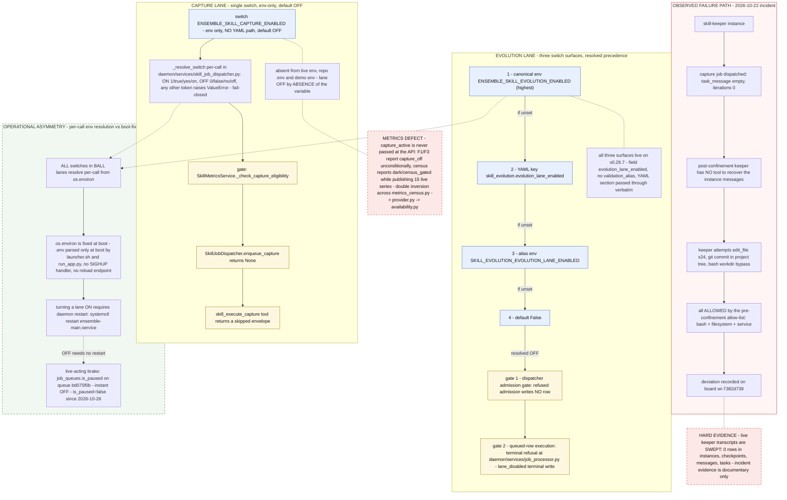

# Charter-Original Diagram — the Appendix B baseline

**Purpose.** This file preserves the **charter-validated original** of the Appendix B Mermaid diagram in
`../phase0-investigation.md` (§B.3), so that the diagram's diff against its source stays reproducible
**without needing the prod database**.

## Provenance

| Fact | Value |
|---|---|
| What this is | the block **exactly as the Charter agent issued it**, verbatim — including the `BALL` typo and the three-surface `CST` |
| Why it needed preserving | git could supply no baseline: the planning file is **untracked** (`git status --porcelain` → `?? …/phase0-investigation.md`; `git log --all -- <path>` empty; `git ls-files` empty; no stash, no sibling-worktree copy, no other copy on disk) |
| How the original was recovered | **read-only** from the prod daemon's own message store — `message_queue.message_id = 05a884b4-43ec-49fe-b98f-6593fd216a60`, instance `4175a230-baa4-429d-a5ee-237b9ee5149c`, source `internal_agent:9f42eaf8-…` (this commission's tree root), enqueued `2026-11-09 05:35:24Z` — by the Phase-0 round-1 review's TASK-1 worker, inside a `BEGIN READ ONLY` transaction against `ensemble_prod` @ `10.44.0.2:5432`. The mermaid block sat at lines 76–148 (fences) / 77–147 (content) of that message. |
| When it was written into the repo | **2026-11-09**, in review round 3 — after the `/tmp` scratch copy (`/tmp/mermaid-validate-0bXaeR/original_block.mmd`) was identified as the only other holder. A prod-DB deletion would otherwise have destroyed the sole copy of the pre-edit diagram. |
| Content hash | the content-only form's `sha256`, as recorded by the round-1 review = `c139812146dd4f2d84e9eb837076595996927e22752f0fc4ee8cc049cba60fe7`. This file additionally carries the two fence lines, so its own byte count differs by those. |

## The diff against Appendix B — exactly two node-label lines

```diff
@@ -8,7 +8,7 @@
         CG3["skill_execute_capture tool returns a skipped envelope"]
-        CST["absent from live env, repo .env and demo env - lane OFF by ABSENCE of the variable"]
+        CST["absent from repo .env, live .env, live process env and demo process env - lane OFF by ABSENCE of the variable"]
         CSW --> CRES --> CG1 --> CG2 --> CG3
         CSW -.- CST
@@ -43,7 +43,7 @@
     subgraph BRAKE["OPERATIONAL ASYMMETRY - per-call env resolution vs boot-fixed os.environ"]
         direction LR
-        O1["ALL switches in BALL lanes resolve per-call from os.environ"]
+        O1["ALL switches in BOTH lanes resolve per-call from os.environ"]
```

**Everything else is byte-identical:** 25 node ids (identical set), 23 edges (identical list and order — `-->`×16,
`-.-`×4, `-.->`×3), 3 `classDef` directives, 3 `class` assignments, 2 `style` directives, 4 subgraphs with 4 `end`,
7 comments, identical fences, LF-only whitespace with 0 CR / 0 tabs / 0 trailing whitespace, and 71 content lines
in both forms.

> **Do not "correct" the `BALL` typo or the three-surface `CST` in the block below.** They are the charter's
> original, preserved deliberately so the diff above can be re-derived — the Appendix B copy in
> `phase0-investigation.md` is the corrected one, and that file must stay byte-identical to its current state.

## The charter-original block (verbatim)


