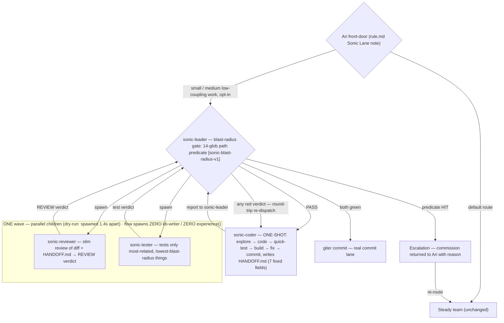

# Sonic Team v1 — Morning Report (ENSEMBLE-31)

> **Status: STAGED v0.29.23 · promote-ready · NOT promoted · live untouched (v0.29.20) · one bounded dry-run PASSED · nothing else pending.**

Prepared 2026-11-13 (UTC) for the Emperor's morning read. Overnight lane ran 2026-11-12; the promote ceremony is yours and only yours.

**In one paragraph:** Sonic Team v1 adds 4 new agents (content-only — zero migrations, zero daemon code) that run small/medium low-coupling commissions in a single fan-out wave with a fixed-schema handoff, a blast-radius escalation gate, and zero kb-writer/experience() spawn mass. The release is staged as v0.29.23 with 4-way sha identity, all gates green, one fenced end-to-end dry-run passed in 16m26s. Nothing else is pending on this lane.

---

## 1. What v1 is (60-second version)

**4 new agents, pure content addition. The steady team is untouched.**

| Agent | Role | Key mechanics |
|---|---|---|
| **sonic-leader** | Peer orchestrator — same level as `leader`, own team (`team_members`: sonic-coder, sonic-reviewer, sonic-tester, giter) | Carries the **14-glob blast-radius path predicate** `[sonic-blast-radius-v1]` in its workflow prompt; HIT → commission returned to Ari (steady team) with reason. Spawns reviewer+tester in ONE wave. |
| **sonic-coder** | **ONE-SHOT**: explore → code → quick-test → build → fix → commit; writes `HANDOFF.md` | `recursion_limit_multiplier: 7` (live default 300 → **2100**); all four agents pinned `llm_model: agentic`. |
| **sonic-reviewer** | Slim review of diff + HANDOFF.md → `REVIEW:` verdict | Agentic model; one round by design. |
| **sonic-tester** | Tests **only the most-related, lowest-blast-radius** things | Scoped pack run, not a full suite. |



**The five design pillars:**

1. **Neutralized handoff (v1) = fixed-schema `HANDOFF.md`** — 7 fields: files touched / what changed / what is UNTESTED / known risks / how to verify / bash-raises used / blast-radius self-assessment vs predicate. NOT a new snapshot transform: byte-exact arbitrary-content mint does not exist today (only checkpoint-keyed mint); documented as the **v2 path** with the explicit-`snapshot_id` relay trap (automatic cross-agent snapshot search fails closed under vsss agent-space scoping).
2. **Blast-radius gate** — 14-glob path predicate (daemon core, services, migrations, release/promote scripts, auth/secrets, routers/sources/mcp) in sonic-leader's workflow → escalates to the steady team. Prompt-level, no infra.
3. **Ari front-door** — default stays STEADY; sonic is **opt-in positive selection** for small/medium low-coupling work. Surgical +9-line Sonic Lane note in `agents/ari/rule.md`; seal re-pinned (35 rows / 0 mismatches; ari rule.md `8d6ca1642a34…515f9`, prior `fc0a7542…`).
4. **Lightweight mandate** — sonic flow spawns **ZERO kb-writer / ZERO experience()**. Attacks the measured #1 hidden cost: 975 spawns = **46.4% of ALL instances**.
5. **Model pins** — all four pinned `llm_model=agentic`. The coding lane is 402-exhausted until **2026-11-17T11:43:43Z**; the `quick` alias does not exist; explicit pins also dodge default-pool drift onto the dead lane.

**Clock math:** the ×7 multiplier (300 → 2100 steps) removes the recursion wall; the **125-min task cap is the real clock** → intake rule: coder-estimate ≤ ~90 min, else escalate.

---

## 2. Why this design (evidence in one page)

**Leg A — steady-team anatomy (prod DB, dispatcher-supplied):**

| Measure | Steady team (observed) | Sonic v1 target |
|---|---|---|
| Feature commission wall | median **8–41 h** | ≤ 4 h |
| Instances per commission | **22–143** | 5 (dry-run: exactly 5) |
| Review cycles | 1–3 | 1 by design |
| Build share of wall | 30–60% | unchanged (real work) |
| Review+approval share | 15–25% | one wave, pre-approved giter envelope |
| Inter-phase gaps | 10–20% (worst **4.5 h**) | < 5% (one-wave fan-out) |
| Dispatch latency per hop | p50 **775 s** / p90 **4258 s** | minimize hop COUNT (round-trips are the first-order cost) |
| kb-writer share of instances | **46.4%** (975 spawns) | 0 |
| Token/usage telemetry | **NONE exists daemon-side** | out of v1 (open decision d) |
| Bash | 1800 s hard cap exists (~79 timeout fires/window); >10 min = **0.106% of 75k runs** | prompt rule: ≤10 min default, raise to leader, 30 min hard max |
| Recursion wall | 6× recursion-limit-300 terminal events in window | ×7 multiplier on coder only |

**Leg B — infra feasibility verdicts:** peer-orchestrator = **EXISTS** (plain dir-scan discovery; zero daemon code) · one-shot coder = **PARTIAL**, fixed by the ×7 line · snapshot transform = **PARTIAL** (v2) · reuse/revive = **EXISTS**, bounded (168 h) · giter lane = **EXISTS** as-is.

**Leg C — risk/gates:** blast radius derivable today via one-glob path classes (semantic blast radius = only NEEDS-BUILDING part, out of v1) · pack registration in PACKS.md is the only gate-verification path (aegis lesson: a pinned condition in no registered pack cannot be gate-verified).

---

## 3. What was built (the release)

| Field | Value |
|---|---|
| Version | **v0.29.23** |
| Tag | annotated object `0ade29c3ccc0865e5e73e50c63051a80b6929786` → peeled commit `3db6ba97e356b20e5bbb688044ae7e1ee2192a45` (= `origin/latest`) |
| Release dir | `/home/nea/agents-ensemble/releases/v0.29.23` (175M) |
| Staged at | **2026-11-12T23:03:37Z** (manifest) |
| Binary sha256 | `ff14fdcbaa2234b296b89710a09cec12077a927e64ad0793626ebcd01dbadfde` — **4-way identical** (release dir == dist == manifest == sidecar) |
| `current` symlink | unchanged at stage time (`readlink` → `releases/v0.29.22`; stage never flips) |

**Changes:** 20 new agent prompt/meta files (4 dirs × 5) · 1 new registered pack (`test/packs/sonic_agent_defs_unit_test.sh` + `sonic_agent_defs_checks.py`; PACKS.md row `:4869`) · `agents/ari/rule.md` +9-line Sonic Lane note · baseline regenerated **181 → 197** (+16 sonic rows; 8 modified rows = ari + 7 pre-existing vsss drift repairs) · 6 test-file count registrations (50/48/197 families) · **zero migrations; zero daemon-code changes** (single `daemon/__init__.py` line = sanctioned version bump); **zero changes to steady-team agent defs**.

**Commits (branch `feature/sonic-team-v1`, pushed):**

| Commit | What |
|---|---|
| `78391e0ad` | plan set |
| `64211ff22` | content build (31 files, +1661/−36) |
| `11e0de9fd` + `e66e34264` | docs (stage-truth) |
| `a0e5ac20b` | tester evidence |
| `58201fb4c` | merge → `latest` |
| `3db6ba97e` | version bump (= tag peel = origin/latest) |

---

## 4. Verification evidence (all gates)

### 4.1 Plan gates
3 approver iterations (2 blockers → 2 → 1, **all fixed at source**) → **APPROVED, 0 blocking**. Reviewer council (deep-review, 2 councilors agentic+coding, unanimous): **APPROVE-WITH-NOTES** — 4 MUST-FIX all folded before their gate-order deadline: MF-1 dry-run `OPENAI_*` forwarding, MF-2 umask/redaction pins, MF-3 D16 live-contact reconciliation, MF-4 giter named as bump/tag actor. 15 advisories non-blocking (morning-report items).

### 4.2 Test pack (`sonic_agent_defs`)
- **PASS ×2** (run twice; inner 12 s; identical results).
- **11 green fixture legs · 22 red counter-mutation legs** — non-vacuity proven by real mutations hitting expected assertion ids (e.g. `FAIL A4 llm_model=coding`, `FAIL A6 missing handoff header "## What is UNTESTED"`, `FAIL A8 rule.md plane count=2`).
- Real-resolver legs PASS (leader spawns exactly the 4; coder deny-by-default; high-risk spawn negatives denied).
- Terminology pins: **23 passed**. Green scoped suite at HEAD: **116 passed / 27 skipped / 0 failed**.
- **Base-red adjudication:** exactly **5 pre-existing reds at base, ZERO new, none sonic/ari-attributed** (compare file+condition, never parametrize ids — ids renumber when sonic `.md` files enter collection). Duty pack = **4 canary reds by design** (single documented root cause: canary/rule.md lacks the duty block).

### 4.3 E2E dry-run — **the centerpiece: PASS**
Single bounded fenced run (the one permitted; no retry used) · **22:29:00Z → 22:45:26Z = 16m26s of the 180-min wall** · **V0–V8 all green, zero F-class failures**.

| What | Evidence |
|---|---|
| Real pipeline | lane probe → sonic-leader → sonic-coder one-shot → HANDOFF.md **7/7 exact headers** → sonic-reviewer `REVIEW: PASS` → sonic-tester **1 passed** → real giter commit `0b2db327e` on scratch branch `dryrun/sonic-team-e2e-20261112` (HANDOFF.md +44; `tiny_feature.py` a−b → a+b exactly) |
| Instance audit | **exactly 5 instances** (leader + coder/reviewer/tester/giter); **ZERO kb-writer, ZERO experience(), ZERO invoke_agent_and_wait** |
| One-wave proof | reviewer 22:37:09.25 + tester 22:37:10.63 — **1.4 s apart** |
| Speed | dispatch → commit ≈ **4.5 min** (vs 78-min p50 model) |
| Isolation | FD-isolation clean ×3; zero sweep-kill lines; `ENSEMBLE_BOOT_SWEEP_STALE_SUBPROCESSES=0` pinned; live daemon **PID 2147839** and demo **PID 3547188** unchanged/alive throughout |
| Teardown | residue-free (ports freed, DB dropped, claim removed, worktree+branch removed, scratch-llm.env shredded) |

### 4.4 Stage verification — **all legs PASS** (tester lane, reads-only)
4-way sha **independently re-hashed identical** · release `agents/` ≡ gated tree (`diff -r` empty) · baseline **197/197, rc=0** · migrations delta `ac9849bf7..v0.29.23` = **0** · steady-team content diff vs base = **exactly the 6 expected lines** (4 × sonic dirs + ari/rule.md + baseline) · `current` unchanged · install `.env` marker count=1, mode 600.
**Disclosed:** staged-binary boot deliberately NOT exercised (artifact-only choice — content-only release, 0-code delta; 4-way sha + release≡tree identity short-circuit; booting would resolve the live install root for ~zero information gain). Rationale in the RESULTS file.

---

## 5. Promote command (the Emperor's ceremony — NOT executed)

```bash
cd /home/nea/ensemble-src-wt-scripts-pin && ENSEMBLE_UPGRADE_LIVE=1 VERSION=v0.29.23 bash scripts/upgrade/promote.sh live --f2-verified-closed
```

**Ceremony notes:**
1. **PROMPT-ARTIFACT human-lane re-stamp required at promote** — the amended `ari/rule.md` edit + seeding the 4 sonic agents' artifacts. Prompt artifacts are DB-versioned; the release files alone do not activate them.
2. Manifest line reads `rollback_safe=true source=explicit=true … contains_contract_phase=true` — see disclosure #1 / A-STAGE-1; `contains_contract_phase=true` is the expected legacy-tree property, not a defect.
3. Releases currently **4 dirs** (v0.29.20–23) — over keep-3; eviction is promote-side, oldest candidate **v0.29.20** (protect live + v0.29.23).
4. Live v0.29.20 keeps its exposure profile until this promote lands.

---

## 6. Disclosures & deviations (complete)

1. **A-STAGE-1 (ceremony disclosure):** explicit `ENSEMBLE_ROLLBACK_SAFE=1` was used — stage.sh's unset/derive path is unusable on this tree (full-history DDL grep → 106 matches → exit 78). Rationale: content-only release; tag-to-tag delta `v0.29.22..v0.29.23` contains **exactly one** migration — the vsss lane's `20261112_124200_add_snapshot_agent_space_key.sql` (already in base `ac9849bf7`, NOT sonic content; UP is additive `ADD COLUMN`; DROPs only in the DOWN block; rolling back to the prior release tolerates the extra column) → rollback is data/schema-safe.
2. `contains_contract_phase=true` = expected legacy-tree property (same legacy-migration grep), not a defect, not a stop condition.
3. daemon/scripts delta = **1 file** (`daemon/__init__.py` `__version__` string from the sanctioned bump) — semantically content-only.
4. `ENSEMBLE_SELF_ENV=live` marker written to the install `.env` (idempotent stage behavior; mode 600 preserved).
5. Manifest token line is **stdout-only** (stages, unlike promotes, are not journaled in `state.json`); every fact independently artifact-verified; only `source=explicit=true` (stage-time env) is not artifact-verifiable.
6. Staged-binary boot NOT exercised (artifact-only verification; 4-way sha + release≡gated-tree identity short-circuit).
7. D13: the baseline regen repaired **8 pre-existing modified rows** (vsss re-pins never regenerated) — rides this release, disclosed.
8. A22 formalized in-tree: gate criterion = exactly 5 pre-existing reds at base, none sonic/ari (the literal "0 failed" was unsatisfiable on this base).
9. Dry-run deviations: D1a/D9a (driver performed seed/teardown, not the giter lane — tester-authorized; throwaway fixture branch), D8 not simulated — all recorded in the RESULTS file.
10. Bump message amended to house format (`chore(release): bump version to 0.29.23`); version re-derived at bump time (v0.29.22 was top; v0.29.23 minted).
11. Six test files had count registrations updated (50/48/197 families) — comments synced; **no assertion weakened** (reviewer-verified).
12. Reviewer advisory items deferred to v1.1 fast-follow (none block v1): pack docs claim a nonexistent "inner 240s guard"; pack lacks 6 load-bearing prompt-property assertions (leader invoke_agent_and_wait ban, ~90-min intake guard, giter pre-approval envelope, coder one-shot discipline, bash-rule literals, lightweight mandate); duty tripwire desensitized by the 4 permanent canary reds; A20b bashism.

---

## 7. Open decisions for the Emperor

| # | Decision | v1 default | Recommendation |
|---|---|---|---|
| (a) | Coding-lane re-pin after the 2026-11-17 reset: sonic-coder → coding/coding2? | **stay agentic** until measured | Re-pin only after ≥5 real sonic runs show agentic is the bottleneck (1-line meta.json change + baseline re-pin) |
| (b) | Direct chat addressing of sonic-leader | Ari-fronted only | Confirm keep |
| (c) | Privilege scope | minimal tool grants, NO inheritance from leader categories (reviewer-verified) | Confirm acceptable |
| (d) | Measurement loop | none (no daemon-side token substrate exists) | If cost measurement is wanted: a SEPARATE proxy-side accounting lane (llm-supervisor-proxy); v1 success proxies = rework cycles, wall-clock, instance counts — all queryable today |
| (e) | Blast-radius superset (14 globs incl. routers/sources/mcp) | KEPT conservative | Confirm |
| (f) | Snapshot v2 | not in v1 | Enabling `snapshot_enabled` later requires the explicit-`snapshot_id` relay (vsss makes automatic cross-agent search fail-closed) |
| (g) | Promote sequencing | — | Promote v0.29.23 directly over live v0.29.20, or land 21/22 first? Ceremony's call; flag any ordering constraint you know |
| (h) | v1.1 hardening list (240s wording, 6 pack assertions, duty tripwire re-arm, A20b bashism) | proposed as next small lane | Accept? |
| (i) | New anomaly lane **84a83a76** — FD-inheritance port capture (a spawned daemon inherits the parent's listener fd; fix = O_CLOEXEC/close_fds at spawn; found by the dry-run pre-flight, mitigated in the harness) | not retrofitted into v0.29.23 | Route as a stand-alone daemon-side lane |

---

## 8. Artifact index

| Artifact | Path |
|---|---|
| Plan set (6 docs + decisions) | `.agents/shared/planning/sonic-team/` (plan-overview · decisions · phase1–4 specs) |
| Reviews | `plan-review.md` · `code-review.md` (same dir) |
| Findings | `findings-B-infra.md` · `findings-C-risk.md` (same dir) |
| Dry-run boot procedure + helpers | `dryrun-boot-procedure.md` · `fenced-launch.py` · `dryrun-verify.py` (same dir) |
| Tester gate report | `.agents/tester/RESULTS/2026-11-13-sonic-v1-gate.md` |
| Stage verification | `.agents/tester/RESULTS/2026-11-13-sonic-v1-stage-verification.md` |
| Dry-run evidence bundle | `/tmp/ensemble-sonic-dryrun/` (`prep/INDEX.md` + `evidence/`) |
| Stage record (KV) | `wt.active.feature/sonic-team-v1.ensemble31-sonic-v1` |
| Branch / tag / release | `feature/sonic-team-v1` (pushed) · tag `v0.29.23` · `/home/nea/agents-ensemble/releases/v0.29.23` |

*Assembled from the plan set, both tester RESULTS files, and the stage KV record — no facts re-derived. Giter commits this file.*
