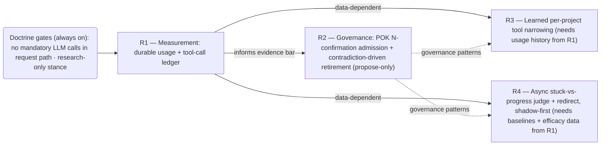

# TokenEconomizer Study — Final Report

**Commission:** RECOVERY + FINISH — synthesize the final report from the two completed evidence packs after the prior writer mission died mid-write.
**Emperor's original ask (2026-11-18):** "Read the docs, then download the source from GitHub (Microsoft TokenEconomizer: research blog + github.com/microsoft/TokenEconomizer). Investigate, learn from them, compare with our system. I want to find out what we can learn from them to improve our ensemble."
**Stance:** RESEARCH + RECOMMENDATION ONLY. Nothing here has been adopted, decided, or started. Every proposed commission below awaits explicit Emperor approval.
**Sources (authoritative, read end-to-end):** `evidence-external.md` (external study; clone pinned `f1b91a40e9537c3e5fce146385366cbb009f5ecc`, 275 lines) and `evidence-internal.md` (internal inventory; ensemble tree `bf4bfde6e`, 173 lines), both in this directory. All quantitative claims below trace to those packs; no numbers were invented. External `file:line` anchors are carried faithfully from the external pack; none were re-verified against the clone by this writer (filesystem tools are bounded to the ensemble workdir — see the citation rule in `decisions.md`).
**Companion adjudication:** `decisions.md` (D1–D7, citation rule, evidence gaps) in this directory.

---

## §0 Executive summary

**What TokenEconomizer is.** A Microsoft open-source (MIT, stdlib-only Python) *plugin* — not a framework — that sits on the session logs of 10 existing coding-agent CLIs (Claude Code, Codex, Copilot CLI, and 7 more), treats the agent as a black box, and learns per-repository cost-saving behavior from experience: one-line "micro-skill" notes injected into future sessions, tool-list pruning, and a failure-loop guard. The shipped plugin is deliberately MORE conservative than the research paper behind it (arXiv 2610.22732): it never terminates a turn itself, keeps micro-skills OFF by default, and leaves its LLM tool-judge dormant — the paper's aggressive behaviors (rollout termination, per-task tool judge, re-audit) exist only in the benchmark harness (external pack §5; `plugin/config.py:22` "The plugin never stops a turn itself").

**Verified headline results (theirs).** 18.4–30.9% mean cost cut across 277 SWE-Bench tasks, 6 repos, 5 agent+model combos, 3 seeds — cheaper in **all 30** repo×setting cells, savings NET of the plugin's own model calls, Pass@1 broadly stable (+1.3/+0.9/+1.6/+2.6 in four settings, −1.0pp on one) (external pack §1 claim 9, §2.5). The motivating profiling: agents received 23 tool descriptions per turn while 16 were never called; after ≥5 accumulated tasks, **30% of tool calls repeated an action from an earlier same-repo task** (only 7% matched another repo's history); the 17% of tasks that failed accounted for **32% of spend** (external pack §1 claims 4–6).

**The honest comparison.** We are not behind on memory or safety — we are ahead on governance, tiering, and retrieval. We have distilled per-project notes (POK) with supersede lineage and audience-scoped injection, an adaptive skill store with a 3-stage BM25→embedding→LLM search, episodic memory (memoir) with nightly reflection, and snapshot warm-starts. What we lack, verified gap-by-gap, is the *measurement substrate* and the *lifecycle rigor over learned knowledge* that their results are built on: nothing in the ensemble durably records tool calls or token usage per project; our POK admits a note on first write with no confirmation bar; our POK retirement is manual-only with a 30-day stale decoration that ranks down but never retires; our tool surfaces are static per-agent allow-lists (the one manual narrowing — the PM Plane keep-set — cut prompt tokens 60,635 → 29,313 and is standing proof of the ceiling); and our loop/stall detection is purely syntactic — no stuck-vs-progress predicate exists anywhere in our repo, and our only content redirect (the loop-breaker repair, LLM-authored) fires on a purely syntactic counter — no stuck-vs-progress judgment gates any redirect.

**Recommendation (all pending decision).** Four ranked commissions: **R1** a durable usage + tool-call ledger (measurement first — prerequisite for everything else, cheapest, lowest-risk); **R2** POK governance upgrades — N-confirmation admission plus contradiction-driven retirement, propose-only first; **R3** learned per-project tool narrowing, intersection-only with restore-on-demand (data-dependent on R1); **R4** an async, shadow-first stuck-vs-progress judge that redirects rather than terminates (data-dependent on R1). Explicit non-adoptions guard the hot path: no mandatory LLM calls in the request path, no controller-initiated termination of agent work, no parallel micro-skills store duplicating POK, no second billing engine inside the ensemble.

**Bottom line for the Emperor:** their 18–31% savings came from measuring waste, then acting on the measurements. We currently cannot run their Step 1 on our own data — that is R1, and it is the only commission that unlocks the rest.

---

## §1 Their verified architecture in our words

All anchors below are clone paths at pinned SHA `f1b91a4`, carried from the external pack. Anchor roots follow the external pack's convention: paths beginning `plugin/` are repo-root-relative (the installable plugin layer — hooks, scripts, `config.py`), while bare module paths (`lifecycle.py`, `judge.py`, `pricing.py`, `cli.py`, …) are `tokeneconomizer/`-package-relative, exactly as the pack cites them.

### 1.1 Two layers — the plugin is the conservative configuration of the paper

The shipped plugin and the paper's experiments harness share only the `tokeneconomizer/` core package; `experiments/` is not installed with the plugin (external pack §0; README.md:518-523). Every mechanism below exists in real code — this is not a stub release (53,766 lines of Python, offline unit tests 50 in tests/ (73 incl. experiments/tests/); external pack §5 closeout) — but several paper behaviors are harness-only arms (§1.5).

### 1.2 Integration surface — hooks, fail-open, one entry point

- **10 hosts**, one declarative hook-JSON each. Claude Code: SessionStart (15s), UserPromptSubmit (20s), PostToolUse/PostToolUseFailure (60s), Stop (10s), SessionEnd (10s) (`plugin/hooks/hooks.json:3-70`).
- The 63-line POSIX launcher fails **open by construction** — if no Python is found it prints `{}` and the host proceeds untouched (`plugin/scripts/te-hook:61-63`). Every exception in the entry point becomes `{}` plus a timestamped traceback (`tokeneconomizer/plugin/hook.py`).
- Per-host adapters normalize tool names, fold tool results at `RESULT_CAP=20000` chars, and isolate all format knowledge in one package (`tokeneconomizer/trace/`) — "the format knowledge lives here and nowhere else" (external pack §6.1).

### 1.3 Storage — no database; repo identity is the key insight

State lives in `~/.tokeneconomizer`: per-repo JSON documents, append-only `ledger.jsonl`, and audit `events.jsonl`, written atomically (pid-suffixed tmp + `os.replace`) with file locks that degrade to no-op where unavailable — "a lost update is recoverable, a crashed hook is not" (external pack §6.2; `store.py`). **Repo identity** is `<slug>-<sha1[:10]>` of a canonical ladder BY_REMOTE (origin URL parsed in-process from `.git/config` — "a hook that shelled out to git would pay a subprocess on every tool call") → BY_PATH → BY_DIR (`paths.py:200-279`): every clone/worktree of one remote shares learned state.

### 1.4 Controller loop — producer/consumer across a process boundary

In-session hooks are budget-bound and do almost nothing slow; the **fold** (session digest) runs detached after SessionEnd. Three independent fold triggers (SessionEnd, next SessionStart's sweep, and a 600s-quiet heuristic) plus a `folded.json` dedupe give exactly-once folding (external pack §6.3). The judge, when used, also runs **off the critical path**: the hook writes a request file, spawns a detached judge, and a *later* hook call picks up the verdict "with the redirect already written, so the agent never waits" (`plugin/judge.py:1-16, 103-110`; external pack §6.3).

### 1.5 The three mechanisms

**(a) Micro-skills** — one-line repo notes admitted only after evidence accumulates, retired when contradicted:
- Admission: **K_PROMOTE = 3 confirming sessions with pairwise-disjoint edited-file sets** (`lifecycle.py:17, 80-88, 113-115`) plus a firing gate — the note injects only when **≥4 exercised sessions show a need rate ≥ 0.40** (`lifecycle.py:22-23, 95-102`).
- Support score qᵢ = Σ γ^(i−j)·(confirm − λ·contradict) with **γ=0.8, λ=5.0**; retire when score < 0; **high-stakes facts retire on first contradiction** (`lifecycle.py:18-21, 116-119`).
- Manual forget is a permanent blacklist; automatic retirement is sticky + revision-locked (external pack §3.1 nuances).
- Contradiction detection is **regex/predicate detectors over the session's command+output blob**, never file contents sent to a model; proposer candidates must cite ≥2 window tasks (external pack §3.1; `distiller.py:31-33, 323-332, 725-740`).
- OFF by default in the plugin ("proposer costs model calls and savings are repo-dependent"; external pack §5 item 2). A free LLM-less `envfacts` layer (≤4 facts, ≤150 tokens) renders before the paid manual.

**(b) Tool pruning** — evidence-based, protect-the-core, reversible:
- Core run/edit tools are never pruned (**PROTECTED_TOOLS = 20 names** + host interactive sets; web tools never pruned; `toolprune/tools.py:41-48`; `plugin/adapter.py:37-57`).
- Plugin rule (no model calls): mask a tool after **prompts ≥ 10 spanning ≥ 2 sessions, or ≥ 5 sessions of any length** (defaults `plugin/config.py:187-189`); the paper's rule (evidence streak 3 + LLM judge) is a harness arm — the judge prompt ships but is **dormant in the plugin** (`toolprune/README.md:11-13`).
- Deny lists are written only after **60 min repo-session idleness** to protect warm prompt caches, take effect next session, and are recorded so **`te toolprune restore`** can undo exactly the plugin's own additions; a tool used during re-audit is never masked again (external pack §3.2).

**(c) Failure-loop guard** — cheap gate → async judge → redirect; the human decides:
- Tier-0 heuristic gate (repeated failure signatures, error density) opens the question; a **leakage-safe digest** (commands, search patterns, file *basenames*, error signatures, counters — never contents) goes to an LLM judge returning `{"stuck": bool, "confidence": 0.0-1.0, "reason"}`; verdict prompt explicitly biases to sparing: "Favor SPARING (stuck=false) when there is any sign of progress" (`loopguard/judge.py:15-27`; external pack §7.1 verbatim).
- Stuck → a **2–4 sentence redirect** that names the observed repetitive pattern and proposes a materially different next step, with hard constraints "Do NOT tell it to stop, give up, or reduce effort — only redirect" (`loopguard/judge.py:66-80`); count-mirror template fallback (`rules.py:183-198`).
- A judge-unvetoable **hard backstop at 2.5× a per-repo p90 turn envelope** exists — but in the shipped plugin even that only produces a developer-facing notice ("Press Esc to interrupt it"); **the plugin never stops a turn itself** (`plugin/config.py:21-27`; `plugin/controller.py:396-412`; external pack §7.1 "definitive answer"). Termination exists only in the benchmark harness.

### 1.6 Cost accounting — cache-aware, overhead-attributed, self-charged

Metric = **effective_tokens**: `input×1.0 + cache_read×w_cr + (cache_write−1h)×w_cw + cache_write_1h×w_cw1h + output×w_out`, weights keyed on exact billed model id (snapshot 2026-07-27 + additions 2026-11-13) — because ~90%+ of raw tokens are discounted cache re-reads, raw totals bias A/B tests in both directions (external pack §7.2; `pricing.py`). A per-mechanism **overhead ledger** (optimizer/judge/nudge-writer tokens) is charged to the session that triggered it, so headline savings are net of the plugin's own spend. Side calls ride the **user's own agent CLI** (no separate key; default side-model `haiku` — a deliberate departure from the experiments, which used the task model so overhead couldn't look cheaper; external pack §5 item 10).

### 1.7 Evaluation discipline

277 SWE-Bench tasks across 6 repos in chronological order, 5 agent+model settings, 3 seeds, official graders, paired cells never pooled, an answer-key guard, and every auxiliary call charged to its task (external pack §2.5, §7.3). Ablations: tool pruning −13.2/−17.7%, micro-skills −11.8/−14.3%, loop guard single digits (CC settings). Their fixed-strategy competitors (RTK, RepoMap, Serena) each helped some repos and hurt others — the paper's central claim: **cost control must adapt per repository** (blog claim 7).

---

## §2 Cross-system mapping — what we already have vs what's missing

Five rows, as commissioned. "Already covered" marks our equivalent machinery honestly — neither inflated nor undersold. Internal anchors at ensemble tree `bf4bfde6e` (tree-lag caveats in `decisions.md`).

| # | Their mechanism | Their evidence | Our equivalent (ALREADY covered) | Verified gap |
|---|---|---|---|---|
| 1 | **Micro-skills** vs our **POK / skills / memoir / snapshots** | Admission needs 3 disjoint-session confirmations + 0.40 need-rate fire gate; contradiction (λ=5) retires; permanent forget (`lifecycle.py:17-23, 113-119`) | **Covered — the stores exist and are richer in governance:** POK = distilled per-project notes with slug lineage, supersede-in-one-commit, audience tiers, curator authority, caps (pin 2, family 3), 8-entry/2,900-char injection budget (`pok_service.py:294, 477-493, 507-590`; `models.py:169-177`). Skills = learned admission (LLM keeper verdicts, 0.85 embedding dedup) + retirement (fix/A-B/stale). Memoir = episodes → beliefs with nightly reflection. Snapshots = R11 8-field digest warm-starts with 3-stage selection | **Not covered:** admission is single-shot in every store (POK first write = active; `verify_count`/`record_verification` primitives have ZERO callers, `repository.py:253-266`); retirement is manual-only in POK (30-day stale decorates + ranks down, never retires; `pok_service.py:123`, `pok_injection.py:243-249`); memoir belief CORRECT-supersession is the sole working contradiction retirement (`syntheses_repository.py:208-300`) — the pattern exists, unapplied elsewhere |
| 2 | **Tool pruning** vs our **static tools.allow** | Evidence rule 10 prompts/2 sessions or 5 sessions; 20 protected tools; 60-min quiet write; one-command restore (`plugin/fold.py:143-152`; `cli.py:540-552`) | **Covered — narrowing exists, statically:** per-agent allow/deny choke point `_apply_tool_filter` (`daemon/tools/instance.py:7715`), privileged-category stripping, CR-3 read-only MCP strip (`mcp_service.py:955-990`), and the hand-built PM keep-set: 28 literal plane verbs cutting 60,635 → 29,313 prompt tokens (`agents/project-manager/meta.json:50-77`; fc9_baselines.json) | **Not covered:** no LEARNED narrowing anywhere (all mechanisms static config or static patterns); no per-project dimension at all (`create_instance_tools` receives no `project_id`, `instance.py:3245`); no restore-on-demand primitive (restore = hand-editing the allow list) |
| 3 | **Failure-loop intervention** vs our **wedge-guard / watchdog / loop breaker** | Syntactic gate → async LLM stuck-vs-progress judge → 2-4-sentence redirect; never terminates; human decides (`loopguard/judge.py:15-27, 66-80`; `plugin/config.py:22`) | **Covered — detection + repair text exist:** loop breaker fires at 3 identical syntactic signatures and repairs history with an LLM-authored "try a DIFFERENT approach" summary (`daemon/graph.py:1403-1535, 1996-2091, 2131-2169`); symptom-repair engine; wedge-guard heartbeat chain (1800s, 3 emissions → terminate under governance); watchdog notices; wedge captures; `job_inject`/`set_injection` can deliver content mid-flight (`manager.py:4909`) | **Not covered:** every detector is syntactic or host-metric — **no stuck-vs-progress predicate exists anywhere in the repo** (internal pack §E "KEY ANSWER"); the only live-turn LLM judge (watchover) explicitly refuses progress judgment (`agents/watcher/soul.md:20`); `set_injection` has exactly four writer sites, all external actors — no judge producer; no resume-and-redirect primitive |
| 4 | **Per-repo adaptivity** vs our **per-project scoping** | Repo identity `<slug>-<sha1>` from origin URL; all learned state keyed by it; savings appear by the 6th task per repo (`paths.py:200-279`; paper Fig 5b) | **Covered — scoping exists in knowledge layers:** POK and critical notes are project-scoped with project-keyed injection; snapshots enforce project match (mismatch = cold start, fail-closed); project access gating on instances/jobs | **Not covered:** no per-project adaptivity in the TOOL layer (row 2) and none in cost behavior — nothing per-project is *learned* from usage; their finding that fixed strategies help some repos and hurt others (blog claim 7) is precisely about the layer where we are most static |
| 5 | **Cost accounting** vs our **proxy metering** | Cache-aware effective_tokens; per-mechanism overhead ledger; every plugin call self-charged (`pricing.py`; `ledger.py:19-26`) | **Covered — metering exists, outside the repo:** the llm-supervisor-proxy meters LLM spend (system-level, not in the ensemble repo); main-lane `usage_metadata` IS populated at the graph chokepoint; the decision lane has a full USD/token ledger with a $50/mo ceiling and operator kill channel (`overlay.py:840`, `kill.py`) | **Not covered:** usage is **never persisted or aggregated** in the ensemble (only in-graph readers, `graph.py:3864/3875/3915`); no per-task/agent/project token table (all repository models + 130 migrations searched); tool calls survive only inside 168h-TTL checkpoints with no project key and unnormalized args — their "30% repeated calls" study is not runnable on our data today |

---

## §3 Ranked commissions (PROPOSED — nothing decided, nothing started)

Ranking rationale (adjudicated in `decisions.md` D6): **measurement before action** — their entire result chain starts from profiling data we cannot currently produce; governance upgrades are independent of new data and close the highest-integrity gaps; the two behavioral mechanisms are data-dependent on R1 and must arrive shadow-first.

### R1 — Durable usage + tool-call ledger (measurement substrate)
- **Value: HIGH.** Unlocks everything else: a repeat-rate/waste study on OUR data (their motivating stat — 30% same-repo repeated tool calls — is unmeasured here), per-project cost visibility, and the evidence feed R3 needs. Without it, R3/R4 cannot even be evaluated.
- **Effort: MEDIUM.** A new table keyed by project/instance/task (tool name + args hash + timestamp; token usage persistence off the already-populated `usage_metadata`). The internal pack names the exact prerequisite shape (§G, Confirmed Gaps #5). No LLM calls, no hot-path change — a write-side tap.
- **Risk: LOW.** Additive storage; no behavior change; no authority questions. Retention policy must be defined (checkpoints' 168h TTL is the cautionary tale).
- **Doctrine fit:** composes cleanly — no mandatory LLM calls anywhere, purely observational, compatible with the optional-accelerator principle (it accelerates every later decision; it forces none). Existing maintenance-sweep lanes (`daemon/manager.py:4571-4790`) are the natural retention home.

### R2 — POK lifecycle governance: N-confirmation admission + contradiction-driven retirement
- **Value: HIGH.** POK is our highest-leverage learned store (it already steers every project-scoped session via injection); its integrity bar is the weakest link — first-write admission + manual-only retirement.
- **Effort: MEDIUM.** The unused `verify_count`/`record_verification` primitives (`repository.py:253-266`) are the natural anchor for an N-confirmation bar (plus a `pok_verify` path); the memoir belief `CORRECT → supersede_with` pattern (`syntheses_repository.py:208-300`) is the repo's own proven, atomic, re-supersede-safe retirement implementation to copy.
- **Risk: MEDIUM.** Two hazards the packs surface: (1) fuzzy-match contradiction detection re-opens the class deliberately banned after the 2026-09-10 hijack lesson (`pok_service.py:151-156`) — a detector must be exact-shape or curator-arbitrated; (2) a retirement sweep touches rows nobody rewrites ("silent rot") and must resolve the curator-authority question or stay **propose-only**. Their design is instructive: contradictions are cheap regex/predicate detectors over observations, never model-judged text comparisons.
- **Doctrine fit:** strengthens existing gates rather than adding any; curator tiers, pin caps, and forward-only archive all stay untouched; propose-only first means no new autonomous mutation at all.

### R3 — Learned per-project tool narrowing (intersection-only + restore-on-demand)
- **Value: HIGH.** The PM keep-set proved the ceiling manually: 60,635 → 29,313 prompt tokens per session on one agent's MCP surface (fc9_baselines.json). A learned projection generalizes that per project.
- **Effort: MEDIUM-HIGH.** Single choke point after `_apply_tool_filter` (`instance.py:7715`): resolve `project_id` via the existing `_get_instance_project_id` (`:592`), fetch the learned set, **INTERSECT** — intersection can only remove, preserving the strict-subset security invariance (a project can never grant what the agent's allow list lacks). Plus a restore primitive (their `te toolprune restore` analog) and a protected-core set.
- **Risk: MEDIUM.** Wrong masks could blind an agent mid-task — their mitigations copy directly: protect core tools, write masks only on idle boundaries, make every learned removal reversible, and never mask a tool that has ever been used. Default-OFF / opt-in per project.
- **Data-dependence:** needs N-sessions of usage history (their bar: ≥10 prompts across ≥2 sessions, or 5 sessions) — **blocked on R1**.
- **Doctrine fit:** no LLM calls at all in the learning rule (evidence-counting only); static-config authority model unchanged (the learned set only narrows what config already grants).

### R4 — Async stuck-vs-progress judge + semantic redirect (shadow-first)
- **Value: MEDIUM-HIGH.** Their loop-guard ablation is single-digit savings — the smallest of their three mechanisms — but it targets our most expensive failure mode: the analogous failure tail (unmeasured here; theirs was 17% of tasks = 32% of spend), and long wedged commissions. The redirect (not the kill) is the transferable idea.
- **Effort: MEDIUM.** The pieces exist separately: the Decision Module is the natural infrastructure home (per-seam gating, USD/token ceilings with auto-trip, operator-only kill channel, content-free logging — all generalize per seam_id); the watchover pattern is the judge shape (persona + verdict + live-turn injection, `graph.py:12336`, `:12763-12773`); `set_injection`/`job_inject` is the delivery primitive (`manager.py:4909`). Missing: the progress predicate, the judge producer, the graph trigger point.
- **Risk: MEDIUM-HIGH.** Highest-touch mechanism: it must never sit in the request path (their own design runs the judge async, verdict picked up by a later hook — "the agent never waits"); it must NEVER terminate work (even their shipped plugin doesn't); and non-shadow operation requires the Emperor-ratified SHADOW→DECIDING transition the Decision Module already fences. Their prompt discipline transfers verbatim: bias-to-sparing, leakage-safe digest, redirect-don't-stop constraints.
- **Data-dependence:** needs R1 for turn-count envelopes/baselines and for measuring whether redirects actually help (their envelope is a per-repo p90 of ended-green turns — we persist nothing comparable).
- **Doctrine fit:** composes as Decision-Module seam #2 with `ADVISORY_ONLY` monotonicity; shadow mode logs and acts on nothing — the standing P1 doctrine (shadow-only, Emperor-ratified) already describes exactly this shape.

### Sequencing

R2 is sequenced second not because it depends on R1's data but because R1's measurements should inform the evidence bar (how many confirmations, over what window) before the bar is cast in policy.

---

## §4 Explicit NON-adoptions

The boundary — each entry names what we will NOT take, and why:

1. **No mandatory LLM calls in the request path.** Their judge sits async and off the critical path even for them (`plugin/judge.py:1-16`; "the agent never waits", external pack §6.3/§7.1). Any synchronous in-turn judge gating tool calls or turns is rejected outright — this is standing doctrine, and their architecture agrees with it.
2. **No controller-initiated termination of agent work.** The paper's controller terminates rollouts (second stuck verdict ends the task; judge-unvetoable 2.5×B forced stop) — harness-only. Even the shipped plugin refuses: "The plugin never stops a turn itself … the person decides" (`plugin/config.py:21-27`; `plugin/controller.py:396-412`). We propose the same line: detection may escalate to a human (our watchdog already does, under governance); a cost controller never kills work autonomously.
3. **No parallel micro-skills store.** Their one-line-note store duplicates what POK already does with strictly more governance (tiers, pins, caps, audience scoping, lineage). Adopting their store alongside POK would fork the knowledge base; the correct move is strengthening POK's lifecycle (R2), not importing a second store.
4. **No automatic rewriting of agent tool configuration from learned state.** Their mask rewrites the agent's own settings files between sessions. In our system tool surfaces are governed config (meta.json allow-lists, versioned prompts, curator authority); a lane that silently rewrites them would bypass that governance. R3's intersection projection is read-side and reversible precisely to avoid this class.
5. **No second billing/pricing engine inside the ensemble.** Their `MODEL_WEIGHTS` price snapshot (frozen 2026-07-27 + 2026-11-13, with vendor-drift comments) is a maintenance liability we don't need: the llm-supervisor-proxy is and remains the meter authority. R1 persists usage events; it does not re-price them. (If a cache-aware effective-token metric is ever wanted, it is a read-side formula over R1's data — not a second meter.)
6. **No adoption of their per-repo identity scheme.** `<slug>-<sha1-of-origin-URL>` keying solves a problem we don't have — we already key projects, instances, and knowledge by first-class project identity with access gating. Noted as a good idea in their context; not applicable here.

---

## §5 Decision asks for the Emperor

Each ask is framed to be answerable as-is; a "no" kills the item cleanly.

1. **RATIFY the sequencing?** Approve the order measurement (R1) → governance (R2) → data-dependent (R3, R4) as the standing plan for any follow-on commissions from this study. *If yes:* R1 becomes the first commission to draft; *if no:* name the reorder and the reasoning overrides D6.
2. **COMMISSION R1 (usage + tool-call ledger)?** Scope choice inside the ask: (a) tool-call ledger only, (b) tool-call + token-usage persistence, or (c) both + a one-time retrospective waste study over the first N days of data (their 30% repeat-rate question, run on us). *Recommended:* (c) — the study is the point of the ledger.
3. **R2 design posture — propose-only or auto-dispute?** For contradiction-driven POK retirement: (a) detectors may only PROPOSE retirement/dispute, a curator applies (zero new autonomous mutation), or (b) auto-dispute (mark `disputed=True`, suppress injection, never delete) with curator arbitration after. *Recommended:* (a) first, (b) only after the detector's precision is measured on real data. Sub-ask: set the N-confirmation admission bar (their value: 3 disjoint sessions; ours TBD from R1 data) — or defer the number until R1 produces evidence.
4. **R3 guardrail ratification (design study only)?** Confirm the four invariants before any design work: intersection-only (can narrow, never grant), protected-core set (run/edit/read always retained), idle-boundary writes only, one-command restore. *If ratified:* R3 design proceeds only after R1 has ≥ the evidence horizon their rule uses (≥10 prompts across ≥2 sessions or 5 sessions per project). *If not:* state which invariant changes.
5. **R4 lane choice?** (a) Decision-Module seam (shadow-first, ADVISORY_ONLY, existing ceiling/kill apparatus) — *recommended*; (b) watchover-pattern sibling judge; (c) drop R4 entirely (their ablation says it's the smallest lever — single-digit savings). *If (a):* non-shadow operation remains gated on the Emperor-ratified SHADOW→DECIDING transition, unchanged.
6. **CONFIRM the non-adoption boundary (§4)?** A standing yes/no on the six items, so future commissions from this study inherit the fence without re-litigating it.

---

*Written by doc-writer (recovery mission), 2026-11-18, from the two evidence packs only. All external anchors pinned to clone SHA `f1b91a4`; all internal anchors pinned to ensemble tree `bf4bfde6e` (lags `origin/latest` (`2618eb212`); conclusions verified at the pinned tree per the pack — caveats in `decisions.md`). No adoption, implementation, staging, promote, or live contact occurred in the making of this report.*
