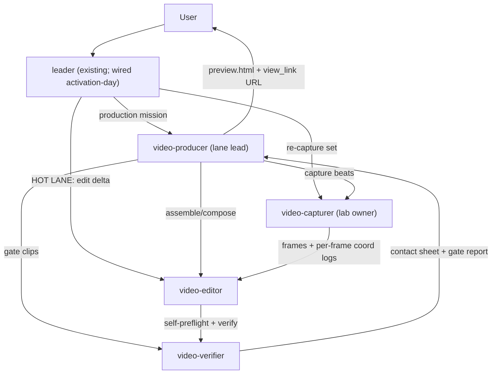

# Video Team Architecture — Purpose-Built Video Agents for ensemble

**Deliverable:** A of A/B/C (B = agent definitions, C = test plan — same branch, tonight)
**Status:** DESIGN — night-stage docs only. Zero daemon changes, zero existing-agent edits, nothing merged/pushed.
**Base:** `feature/video-team-scaffold` @ `1132fa4cb` (= origin/latest at open)
**Author instance:** coder (video-team-night)
**Companion deliverables (same dir):** B materialized as the four agent trees under `agents/video-*/` (B, this instance, done) + the data contracts under `.agents/shared/planning/video-team/data/`; C = `test-plan.md` (C, follows). There is no `agent-definitions.md` summary file.

---

## 0. Scope, Fixed Decisions, and Requirement Traceability

The team is **four first-class ensemble agents**, prefix `video`, same tier as `leader`
(agents are registered by directory scan — `daemon/registry.py:577-609`, `iterdir` at
`:609`; a new directory under `agents/` IS registration; prompt content loads at spawn
time via an mtime-keyed cache — `daemon/loader.py:1311-1324`, recompute `:1368-1376`).
The existing `leader` agent is **untouched tonight**; wiring it is an activation-day step
(§12).

The substrate posture is **DECIDED — HYBRID, not relitigated**: OpenFilm is the engine
for the fast demo/guidance lane (v1-v5 proven); HyperFrames is the leading candidate for
a later film/commercial lane — tonight we write **only its evaluation plan** (§3.2), we
build nothing; OpenReel is **learn-from only** — its action-based undoable edit log
becomes the co-work governance shape (§8).

### 0.1 The nine DO-DIFFERENTLY requirements (each traceable to a section)

| # | Requirement | Where addressed |
|---|---|---|
| 1 | Persistent purpose-built lanes (revive, don't respawn); amortized standing lab | §2, §12 step 6 |
| 2 | Tools carry their own contracts — kill per-dispatch constraint preambles | §5.4, §13 (skill contracts) |
| 3 | Machine-checked preflights failing in seconds | §5.1 |
| 4 | Shot plan as schema'd data + diff review | §1.3, §4 of shot-plan contract (§5.3), §8 |
| 5 | Two lane profiles with two gate sets | §6 |
| 6 | Golden-file regression MP4s (determinism CI with committed goldens) | §6.3 |
| 7 | All-intra + stream-copy for exact trims | §7 |
| 8 | Cap-and-flag iteration policy by default, with disclosed remedies | §6.4 |
| 9 | Block catalog as EDITABLE SOURCE (v1: marching-ants, teaching pointer, instant-summary) | §10 |

### 0.2 Gates that earned their keep in v1-v5 (design inputs, from HANDOFF.md)

| v1-v5 catch | Consequence in this design |
|---|---|
| CSS-alpha nondeterminism | transitions are ffmpeg `xfade` on decoded frames, never browser alpha compositing (§7.4) |
| Range-render nondeterminism (v5: 1245/1650 frames wrong) | range render is BANNED; edits are stream-copy segments of all-intra intermediates (§7.2) |
| Unpinned-clip render bug (60,300 frames — KICKOFF-BRIEF-SOURCED; the in-HANDOFF corroboration for the duration-preflight rationale is the 83 s over-target v2 cut, HANDOFF §3) | duration preflight P1 before any assemble (§5.1) |
| Blank-frame scan | camera clamp at capture + luma scan gate G-BLANK (§5.1 P7) |
| plan == performed | G-PLAN: performed-timeline diff vs authored plan (§5.2) |
| Geometry measurement | bbox pins from per-frame logged coordinates, ≤2 px tolerance (§5.2, §7.3) |
| Pointer fidelity in zoom windows | pointer driven by REAL per-frame input coordinates (v2 measured max deviation 0.0044 px) (§10 block 2) |
| 3-launch re-capture | film-profile gate: three independent captures must agree (§6.3) |

---

## 1. Topology & Lanes

### 1.1 The four agents

| Agent id | Role | Key property |
|---|---|---|
| `video-producer` | Lane lead + planner. Quick planning from templates; asks the user only for deltas; turns requirements into a SCHEMA'D shot plan (`shot-plan.json`). Owns the openable-project lifecycle and the iteration loop. | Data + diff review — no markdown round-trips. |
| `video-capturer` | **The lab owner.** Playwright/CDP capture harness, fixture tenants, local stack, warm caches, per-frame input-coordinate logs, parallel shots, per-shot sha invalidation. | Amortized standing lab (§2.3). |
| `video-editor` | **THE HOT LANE.** Trims, text swaps, zoom/crop changes in seconds with NO re-capture. All-intra intermediates + ffmpeg stream copy. | Most common user request is MODIFY A VIDEO; this path is the fastest thing the team does (§7). |
| `video-verifier` | Cheap per-clip pixel gates. Blank/luma scan, plan==performed, geometry, contact sheets. | Gates are scripts with exit codes, not vibes (§5). |

### 1.2 Dispatch / spawn wiring — which edges exist tonight vs activation-day

**Tonight (Deliverable B creates these as NEW files — no existing-agent edits):**

- `video-producer` `team_members: ["video-capturer", "video-editor", "video-verifier"]`
  — producer is the lane lead; it spawns and revives the three executors.
- `video-capturer`, `video-editor`, `video-verifier`: `team_members: []` — executors
  are spawn-free leaves. Parallelism is parallel OS processes inside one lane agent
  (`proc` background processes), NOT parallel agent spawns — one capture instance at a
  time on the 16 GB M1 is a standing constraint carried from the landscape study
  (Chromium 150-400 MB/instance, no cap on the render path).

**Activation-day (edits to EXISTING files — morning approval required):**

- `agents/leader/meta.json` `team_members` gains all four: `video-producer`,
  `video-capturer`, `video-editor`, `video-verifier`. Leader needs ALL FOUR (not just
  producer) because the hot lane dispatches `video-editor` directly — see §1.3.
- Census pins that assert leader's roster / the commissioned tool sets update in the
  same activation PR (§12 step 5 for the leader roster; §12 step 2b for the
  commissioned `view-views` audience; §12 step 4 for the per-agent packs; the pin
  family pattern is
  `tests/unit/test_maintenancer_agent.py` — exact-equality asserts over `meta.json`).

**What does NOT change:** no new tool category, no `TOOL_REQUIRED_AGENTS` row
(`daemon/tools/_auth.py:35`), no `PRIVILEGED_TOOL_CATEGORIES` change
(`daemon/tools/_tool_registry.py:446`). The v1 tool surface is entirely EXISTING
categories (`bash`, `proc`, `filesystem`, `image`, `question`, `instance`,
`service`, …). Unimplemented tools fail closed at spawn — so v1 grants ONLY categories
that exist today; §12 step 3 proves resolution before any lane is dispatched.

### 1.3 Lanes (dispatch flows)

1. **Production lane** — user → `leader` → dispatch `video-producer` (mission brief) →
   producer plans from templates, asks the user only for deltas (delta intake is a
   schema diff, not prose), writes `shot-plan.json` → G1 plan review (§5.2) →
   producer → `video-capturer` (capture exactly the invalidation set, §9) → producer →
   `video-editor` (assemble + compose per lane profile) → producer → `video-verifier`
   (gate set) → producer assembles the iteration preview page → `view_link` URL to the
   user (§4).
2. **HOT LANE (modify)** — user → `leader` → dispatch `video-editor` DIRECTLY (revive,
   don't respawn) with an action-log delta → editor appends the undoable action (§8),
   executes via stream copy (§7), runs the fast preflights itself (seconds), hands to
   `video-verifier` for the cheap gate set → preview URL back. No producer hop when the
   edit is fully specified; producer re-plans only if the edit implies a plan change.
3. **Verify-only lane** — after any manual artifact swap or user veto (§8.3), a
   standalone verifier pass re-gates the affected clips.
4. **Product-change lane** — the user changes the product itself (e.g. ydfrontend) →
   `leader` → `video-capturer` re-captures the invalidation set against the new build
   (`fe_build_sha` changed, §9) → producer reviews whether surface changes imply plan
   deltas → editor recomposes.

### 1.4 Topology diagram



---

## 2. Persistent-Lane Mechanics (ensemble revive/checkpoint semantics as the runtime)

**Instance REUSE is the default. Revive, don't respawn** — the kickoff brief names
lane revival the single biggest v1-v5 speed win (design rationale carried from the
brief, not a HANDOFF-documented measurement: HANDOFF's v1-v5 ran on one orchestrator
plus the capture harness, with no lane-revive measurement recorded).

### 2.1 How persistence works (the machinery we ride)

- `send_message` to a terminal instance (`COMPLETED`/`TERMINATED`/`ERROR`/`FAILED`)
  revives it `RUNNING` **reusing its checkpoint** — the full conversation/graph state
  comes back with the message. The canonical classification constant is
  `TERMINAL_INSTANCE_STATUSES` (`daemon/constants.py:1006-1011`); the enqueue-path
  terminal-revive decision is the `is_terminal_revival` membership test over those four
  statuses inside `_prepare_enqueued_message`
  (`daemon/services/instance_messaging.py:2451-2456`, the A1 revival carve-out
  `:2433-2470`, method def `:2130`); auto-resume of
  `IDLE`/`WAITING_CHILDREN`/`COMPLETED` on enqueue at `:2165`; just-revived terminal
  handling at `:2434-2453`.
- Revive cost asymmetry (agent-tool path): reviving from `COMPLETED`/`TERMINATED` is
  free. Reviving from `ERROR`/`FAILED` consumes the per-child revive budget
  (one failure-revive; the next terminal revive of ANY kind is refused — spawn a
  replacement). **Lane discipline follows directly: lanes must END THEIR MISSIONS CLEAN
  (COMPLETED/TERMINATED), never die mid-error.** A lane that hits an unrecoverable state
  reports the failure as its result and ends clean; the lead decides.
- Long-mission survival: instance timeout 60 min (`config.yaml:203`), task timeout
  125 min (`config.yaml:490`), job-child force-fail 3600 s
  (`daemon/services/job_processor.py:159`). A film mission fits a task; a hot-lane edit
  is seconds-to-minutes. Long captures are chunked per beat — the beat is the resume
  unit, exactly the shot-instance discipline proven in the substrate sketch §5.2.

### 2.2 Lane lifecycle policy

- **Mint once per lane**: the lead spawns each lane agent once (activation-day for
  producer → executors; leader → producer at first mission), then addresses the SAME
  instance id forever via `send_message` revival.
- **Lane registry** lives in `shared_meta_kv`:
  `video.lanes.<project>.<role> = {instance_id, last_state, last_seen, lab_version}` —
  the lead resolves "the capturer" from the registry, never by re-spawning. Lost
  instance id → the lead may revive by id if known; otherwise mint once and record.
- **Lane health**: a lane's resting state between missions is `COMPLETED` (free
  revive). The lead never abandons an `ERROR`-state lane silently — one failure-revive
  is budgeted for genuine transient faults (daemon restart mid-mission), after which a
  fresh instance is minted and the registry row updated.
- **Warm start**: `spawn_instance` snapshot warm-starts are available for the EXECUTORS
  (tester/developer-v2 style `snapshot_enabled: true` — B sets this on the executor
  metas) so a re-minted lane after a crash inherits the previous lane's working
  experience instead of cold-starting.

### 2.3 The amortized standing lab (the capturer's empire)

Everything in `/Users/nguyenminhkha/All/Code/Yedda/video-lab/` (~2 GB) is a STANDING
ASSET, rebuilt rarely, kept warm: capture harness (`tools/capture.mjs` +
`tools/lab-lib.mjs`), fixture tenants (uid 9001 / tenant 1706, NUMERIC uid), local stack
(proxy :8987 → layout :8981 → local Postgres `ydlab_layout`, lab-auth :8591, FE dev
server :4300), pinned clones (`ydbackend` @ 02d84e2, `frontend-engine` @ 20cdd448 with
`useLocalHostLayoutServer=true` — never committed), pinned body mocks (unmocked endpoint
→ loud HTTP 599). The capturer owns start/stop/health (`state/stop-backend.sh`,
`scripts/render-verify.sh`) and keeps the stack warm between missions so a hot-lane
session never pays cold-start. In the ensemble world the long-lived stack processes are
held by the capturer's `service` tool (service_start/service_status/service_logs) so
they survive the lane's own turns; the 3-launch re-capture gate (§6.3) is the guard
against a stale warm stack lying to us.

---

## 3. Substrate Strategy (HYBRID — decided)

### 3.1 OpenFilm — engine of the fast demo/guidance lane (v1-v5 PROVEN)

- MIT, `npx -y openfilm@latest`, pin 0.3.1 for reproducibility. ~7.7 s/150 frames on
  `h264_videotoolbox`. Output already faststart-ordered (verify, don't blindly remux).
- **Do not trust `look`'s determinism check** — it samples only 12 frames; our own
  full-frame per-frame SHA-256 gate is the real proof, plus an independent re-capture
  for cross-checks (§5.2, §6.3).
- Chrome reuse is impossible unpatched → the ~197 MB Chrome Headless Shell download is
  accepted cost; the engine version is recorded in provenance on every capture (it
  drifted to Chrome 157 under us during v2).
- `capture` is a first-class verb for live pages — the muscle memory of v1-v5.
- Rejected upstreams stay rejected: Remotion (NOT open source; $100/mo min Automators
  tier + mandatory telemetry from 5.0), ComfyUI/AnimateDiff/ViMax (stochastic, wrong
  domain), GUI NLEs (the user is not a video-tools person). Full 27-candidate survey:
  `frontend-engine` @ 20cdd448 (SUBJECT REPO — read via
  `git -C /Users/nguyenminhkha/All/Code/Yedda/frontend-engine show 20cdd448:.agents/shared/planning/video-builder/landscape-and-recommendation.md`;
  NOT local to this worktree — the path above is subject-repo-relative).

### 3.2 HyperFrames — EVALUATION PLAN ONLY (the later film/commercial lane)

HyperFrames is the leading candidate for the film lane — **USER-DECIDED in the kickoff
brief; do not relitigate**. **Tonight: no install, no spike, no code.** The evaluation
below is what the morning-approved mission executes.

**Provenance note (fix round 1):** the license/fee facts attached to HyperFrames
(heygen-com org, Apache-2.0, no per-render fees) are **KICKOFF-BRIEF-SOURCED and
UNVERIFIED against the pinned docs** — the 27-candidate landscape study at 20cdd448
enumerates no HyperFrames/heygen/OpenReel rows, and the vendored copy under
`plugins/opendesign/copy_freely/design-templates/hyperframes/` traces only to a
template URL (that copy being inert, with no ensemble-side executor, IS verified by
the architecture sketch). Gate E1 therefore reads the upstream source itself and is a
hard prerequisite for any build decision.

**The flagged-unverified question the evaluation MUST resolve first:** whether
HyperFrames has a **first-class live-page capture verb**
(OpenFilm's `capture` analog — picture of a live web page as footage), or is
HTML-as-video composition only (our vendored copy under
`plugins/opendesign/copy_freely/design-templates/hyperframes/` is inert template data
with no ensemble-side executor — the architecture sketch verified this). If capture is
absent, HyperFrames can only ever be a composition layer, and the film lane would still
depend on a capture substrate.

**Evaluation protocol — a test project, fixed criteria, pass/fail gates:**

| # | Criterion | Test | PASS gate | FAIL ⇒ |
|---|---|---|---|---|
| E1 | License + cost | **Read the upstream source** (repo LICENSE, pricing/fee docs) and record the verified org/license/fee facts — the kickoff-brief facts (heygen-com / Apache-2.0 / no per-render fees) stay UNVERIFIED until this gate runs | OSI license, zero per-render fees, no telemetry mandate — all verified from source | stay OpenFilm |
| E2 | **Capture verb exists** | Probe: drive the lab's fixture tenant page through HyperFrames' capture surface (if any) | EITHER a working live-page capture producing frame-accurate deterministic frames, OR a definitive documented absence (both answers resolve the question) | if absent: reclassify HyperFrames as composition-only; film lane needs a capture substrate decision |
| E3 | Determinism contract | Two renders of the same 3-beat test project | identical per-frame SHA-256 (frame sequence is the artifact; container bytes need not match) | stay OpenFilm |
| E4 | Performance | Same beats through OpenFilm for A/B | wall time ≤ 2× OpenFilm on this M1 | note, don't fail |
| E5 | Output shape | ffprobe the export | h264 / yuv420p / 1920x1080 / 30 fps / faststart, or native frame-sequence export we can feed our compose lane | stay OpenFilm |
| E6 | Agent-authorability | Does it print/ship a self-contained contract (OpenFilm MANUAL pattern)? Headless, no GUI? | an agent can drive it with zero human GUI interaction | stay OpenFilm |
| E7 | Range/partial render | Render one beat of three | per-beat render supported AND deterministic (if nondeterministic like OpenFilm range render, it's disqualified from EDIT use regardless) | restrict to full renders |

**Decision output:** an evaluation report at
`.agents/shared/planning/video-team/hyperframes-evaluation.md` (mission-written; NOT yet
on disk — produced by the executed evaluation mission, not tonight) with GO / NO-GO for the film lane. NO-GO changes nothing — OpenFilm
continues. GO changes only the FILM lane; the fast demo lane stays OpenFilm either way.

### 3.3 OpenReel — learn-from only

**Provenance note (fix round 1):** OpenReel is **KICKOFF-BRIEF-NAMED** as learn-from-
only; it is not enumerated in the pinned landscape docs, and no upstream license,
engine, or capability claims are made or relied on here. What we take is the PATTERN
the brief points at. We steal ONE pattern: the **action-based undoable edit log with
human veto** — every
mutation of the video is a first-class, revertible action record, and the human can veto
any of them. It becomes the co-work governance shape (§8.2). Nothing else from OpenReel
(license, engine, or workflow) is adopted.

---

## 4. Vision-Channel Design + EXACT Activation Spec

**HARD v1 REQUIREMENT: the team MUST be able to watch what it makes.** v1-v5 shipped
five videos with zero human/model eyes on the full product — a film is not done until
the team can see it. Two consumers, two channels:

### 4.1 Channel A — the TEAM's own eyes (agent vision; works TODAY, no changes)

- The capture already writes PNG frames + per-shot contact sheets. Any agent holding
  the existing `image` category reads stills directly from disk
  (`daemon/tools/image_tools.py:510` registers the category; local-path reads are
  sanctioned by operator policy — unconfined readable local paths). The verifier's
  contact sheets + keyframe stills are the team's eyes; producers and editors hold
  `image` too so they can eyeball gate evidence.
- PNG also travels the servable lanes: the `planning` root serves it
  (`image/png` in the MIME map, `daemon/services/live_views.py:193`), and the
  `tmp-images` substrate accepts exactly the raster set png/jpeg/gif/webp with sidecar
  MIME (`daemon/routers/tmp_images.py:24`, allowlist rejection message at `:44-50` —
  **MP4 is NOT accepted there**, which is why Channel B exists).

### 4.2 Channel B — servable video for the HUMAN (preview-page lane works TODAY; direct-MP4 lane needs the deltas below)

**Preview-page lane (ZERO daemon/config change — the v1 default):** each iteration
writes a **self-contained preview page** (`preview.html`: the mp4 + contact sheet
base64-inlined, zero external URLs — the exact shape v1-v5 shipped, HANDOFF §3) under
the subject project's planning tree, and mints a URL through the existing passcode lane:

- Layout: `<subject-repo>/.agents/shared/planning/video/<project-id>/out/<iter>/preview.html`
- Serve: the seeded `planning` root — `project_scoped`, path
  `.agents/shared/planning`, resolved by project shortname, **no extension allowlist
  and no required_rel_subpath** (`daemon/config.py:5152-5158`) — so `.html` serves as
  `text/html` (MIME map entry `daemon/services/live_views.py:183`).
- Mint: `view_link('planning', '<project-shortname>/video/<project-id>/out/<iter>/preview.html')`
  (`daemon/tools/live_views.py:113`) — passcode + public URL; the OAuth fronting
  exempts `/views/public` (`daemon/routers/live_views.py:16-19`); per-IP verify rate
  limit knobs `ENSEMBLE_LIVE_VIEWS_VERIFY_RATE_LIMIT_*` (`daemon/config.py:5209-5215`);
  global kill-switch `live_views.enabled` (`daemon/config.py:5197-5201`).
- **Grant required:** `view-views` is a PRIVILEGED category
  (`daemon/tools/_tool_registry.py:446` set; entry at `:471`), so the allow entry must
  be explicit in the holder's `tools.allow` — the empty-allow inherit universe never
  auto-grants it (privileged strip `_strip_privileged_category_tools`,
  `daemon/tools/instance.py:7608`). Tonight B puts `view-views` in `video-producer` and
  `video-editor` `tools.allow` **in the new files** (no existing agent is touched).
  Activation-day: the commissioned-set pin test
  `tests/unit/tools/test_live_views_tool.py:244-343` (ari/leader/designer +
  named non-commissioned agents) gains the two video agents, and the registry comment
  (`daemon/tools/_tool_registry.py:457-470`) is updated to name the new commissioned
  users. This is a user-visibility policy extension → Open Question OQ1.

### 4.3 Direct-MP4 fast lane — EXACT activation spec (every change cites file:line; ALL flagged for morning approval; ZERO land tonight)

| # | Change | Kind | Exact location | Why | Verify | Rollback |
|---|---|---|---|---|---|---|
| V1 | Add `"mp4": "video/mp4"` to the CLOSED MIME map | daemon source | `_EXT_TO_MIME`, `daemon/services/live_views.py:182-205` (append before closing brace `:205`) | today `.mp4` falls through `mime_for_extension` (`:326-340`) to `application/octet-stream` + `X-Content-Type-Options: nosniff` = a download, never inline playback | unit test: `mime_for_extension("mp4") == "video/mp4"`; live: serve one mp4, browser plays inline | delete the line; map is data; **restart the daemon** — `_EXT_TO_MIME` is a module-level constant loaded at import, so the new entry is not live until the process restarts |
| V2 | Range/206 seek support on the serve paths | daemon source | whole-file reads at `daemon/routers/live_views.py:1787` (public lane GET, route `:2871`) and `:2962` + `:3083` (direct lane GET `:3013` / HEAD `:2889`); the read primitive is `_fd_read` `:443`; **zero** `Range`/`206`/`Accept-Ranges` handling exists (grep-verified) | a `<video>` element plays but cannot seek without Range support; scrubbing a 55 s cut is the actual human use. SCOPE DECISION (explicit): public-lane HEAD (`daemon/routers/live_views.py:2877`, `_public_head` `:2338-2365`) is OUT of scope — it returns headers-only 200 / Content-Length: 0 by design and must NOT carry Accept-Ranges; only the direct lane (GET `:3013` / HEAD `:2889`) and the public-lane GET `:2871` gain Range support | unit: `Range: bytes=0-1023` → `206` + correct slice + `Accept-Ranges: bytes` header; live: seek in a browser | revert the route patch; whole-file 200 behavior is today's byte-identical fallback |
| V3 | `video-artifact` servable root | config (no source) OR daemon seed | EITHER operator `config.yaml` `live_views.roots:` override (REPLACE semantics — the operator must re-declare `designer-artifact`/`planning`/`tmp-images`; documented `daemon/config.py:5120`, seeded `:5087`, `tmp-images` entry `:5160-5167`) with `{type: filesystem, path: <deliverables dir>, allowed_extensions: [html, png, md, mp4]}`; OR (permanent) a fourth entry in `_seed_phase1_roots()` `daemon/config.py:5087` before `:5167` (i.e. after the `tmp-images` entry ending `:5166`) | extension allowlists are enforced per root at serve time (`daemon/services/live_views.py:1267-1271`); **no existing root serves `mp4` inline** — the seeded `planning` root has `allowed_extensions` default None (`daemon/config.py:4948`) = no extension gate, so an mp4 under `planning` already serves as `application/octet-stream` (download, not playback; V1 alone makes it play inline). A dedicated `video-artifact` root is still warranted for: (i) MIME correctness + dedicated access policy (a root whose allowlist names `mp4` deliberately), (ii) retention/cleanup separation from docs, (iii) keeping deliverables out of the planning namespace that the planning root exposes. `designer-artifact` is gated to the `design/mockups` subpath (`:5133-5151`); `planning` has no mp4 intent | boot INFO shows 4 roots; `view_link('video-artifact', …mp4)` mints; uniform 404 for a disallowed ext | remove the root entry; restart |
| V4 | 32 MiB cap: keep, document | none | `MAX_SERVED_BYTES = 32 MiB`, `daemon/services/live_views.py:174`, enforced `:1279-1283` | a 1:30 1080p cut at CRF 20-23 lands ≈1.5-8 MB — fits with headroom; the cap is a guardrail, not a blocker | preflight P8 asserts deliverable < 32 MiB (MAX_SERVED_BYTES — the real serve cap; the threshold is derived FROM the cap, no invented margin; an over-cap file returns a uniform silent 404, so P8 makes the failure loud and early) | n/a |
| V5 | Commissioned-set + pins for `view-views` | test + comment (existing files) | `tests/unit/tools/test_live_views_tool.py:244-343` (gain `video-producer`, `video-editor`); `daemon/tools/_tool_registry.py:457-470` comment names the five commissioned users | the privileged category's audience is pinned by test; an unpinned grant is invisible drift | run the pin test at activation | revert both hunks; the meta.json allow entries become inert (tool refuses) |

**Sequencing note:** V1+V2+V3 are the "customer-facing mp4" deltas the substrate sketch
scoped out of its v1. Our preview-page lane makes them OPTIONAL for v1: the team can
watch (Channel A) and the human can watch (Channel B preview pages) with **zero daemon
changes**. Land V1-V5 only when the user wants direct in-browser mp4 playback/seek on a
servable URL (Open Question OQ4).

---

## 5. Preflight / Gate System

### 5.1 Machine-checked PREFLIGHTS (fail in seconds, before any expensive step)

Every preflight is a script with a stable exit code and a one-line reason — the capturer
and editor run them locally; no LLM judgment involved. The executor is
`video-lab/tools/preflight.mjs` (NOT yet on disk — same convention as
`hyperframes-evaluation.md`; authored in §12 step 7a before the self-test runs);
its `--help` output carries the contract per §5.4.

| ID | Check | Fails when | Cost |
|---|---|---|---|
| P1 | **Duration cap** | ffprobe duration > the lane profile cap (fast: 90 s hard — the locked 1:30; film: per-plan cap). `duration_frames` max derives as cap_s (90) x max_fps (60) = 5400, so the schema's 1800 ceiling was incoherent and is raised to 5400 (see shot-plan.schema.json) | <1 s |
| P2 | **Clip pinning** | any assemble/trim input's sha ≠ its MEASURED manifest sha; any referenced beat clip missing | <1 s |
| P3 | **Engines named** | provenance.json lacks openfilm version, Chrome/engine version, ffmpeg version | <1 s |
| P4 | **Viewport floor** | any capture viewport width < 1024 (locked: no mobile framing; deliverable 1920x1080) | <1 s |
| P5 | **Fixture-only tenants** | capture base URL not in the localhost allowlist (127.0.0.1/localhost); tenant markers ≠ fixture uid 9001/tenant 1706 | <1 s |
| P6 | **Localhost-only DB** | lab stack DB host ≠ localhost (`ydlab_layout`) | <1 s |
| P7 | **Blank/luma frame scan** | near-blank (uniform-luma) stretches detected in the capture (the camera-clamp detector) | seconds (sampled pre-assembly; full scan in verify) |
| P8 | **Deliverable size cap** | deliverable bytes >= the serve cap (MAX_SERVED_BYTES, 32 MiB — `daemon/services/live_views.py:174`) | seconds (stat + compare; full derivation in `data/preflights.json` P8 rationale) |

### 5.2 Gate sets (the checks that JUDGE, run by the verifier)

| Gate | What it proves | Mechanism |
|---|---|---|
| G-PLAN (plan == performed) | the executed timeline IS the authored plan | performed-timeline (from capture meta) diffed against `shot-plan.json` actions; any drift fails |
| G-BLANK | no dead frames ship | full-resolution luma-uniformity scan per clip |
| G-GEO (geometry measurement) | overlays/camera land where the plan says | per-frame logged bboxes vs plan positions, tolerance ≤ 2 px |
| G-POINTER (pointer fidelity) | the teaching pointer tracks REAL input, incl. inside zoom windows | pointer overlay coords vs harness input-coordinate log; deviation ≤ 0.005 px (v2 measured max 0.0044 px) |
| G-DETERM (full-frame determinism) | the render is the artifact | per-frame SHA-256 of every frame, two independent renders (NOT OpenFilm `look`'s 12-frame sample) |
| G-3LAUNCH (three-launch re-capture) | capture is stable against warm-stack lies, font loads, ambient state | three independent capture launches produce identical frame sequences (film profile only) |
| G-FASTSTART | container is streamable | moov precedes mdat (`ffprobe -v trace` or atom walk) |
| G-SPEC | codec/pixfmt/fps/duration conform | ffprobe: h264 / yuv420p / 1920x1080 / fps / duration ±1 frame of plan |
| G-GOLDEN (golden regression) | no silent quality slide between iterations | frame-hash compare vs committed goldens (`goldens/<beat-id>/`); first divergent frame is the evidence (film profile only) |
| G-EYES (contact sheet review) | a pair of agent eyes has SEEN the video | verifier builds the contact sheet + keyframe stills and READS them (image category); verdict text names what it saw |

### 5.3 The schema'd shot plan (data, not markdown)

`shot-plan.json` carries the substrate sketch's schema forward (schema_version bump):
`schema_version`, `project_id`, `profile` (`fast-demo` | `film+goldens`), `video`
{title, fps, cap_s, aspects[], silent: true}, `beats[]` — each beat: `id`, `surface`,
`route`, `state.requires[]`, `state.asserts[]`, `actions[]` (absolute `at_frame`,
vocabulary: navigate/click/hover/drag/type/key/wait_for/wait_frames/assert/set_fixture),
`blocks[]` (block-catalog refs, §10), `duration_frames`, `camera[]` (zoom/crop windows),
`overlays[]` (lower-thirds/captions keyed to frame ranges), `aspects[]` with sparse
`action_overrides`. **Review is a diff of this file** — the producer presents the plan
delta (1 turn), not a prose storyboard round-trip.

### 5.4 Tools carry their own contracts (kills per-dispatch preambles)

Every team-facing tool is a CLI script or skill whose surface IS the contract:
`--help` prints usage, inputs, exit codes, refusal codes; the per-agent skills embed the
same contract tables. Dispatch prompts reference the contract by name and carry only the
mission delta — never a re-explained constraint preamble. This is OpenFilm's MANUAL
pattern (the landscape study's pattern #4) applied to our own toolbelt.

---

## 6. Two Lane Profiles + Two Gate Sets

### 6.1 Profile: `fast-demo` (the default)

Cheap gates, minutes turnaround. For guidance/demo cuts where the user iterates fast.

- Gates: P1-P8 + G-PLAN + G-BLANK + G-FASTSTART + G-SPEC + G-EYES. Single-render (no
  determinism CI). Goldens OFF.
- Compose: stream-copy-first (§7) — a trim-only change never re-encodes.

### 6.2 Profile: `film+goldens` (strict)

For customer-facing cuts. Everything in fast-demo PLUS — the full film gate set, all
ten: G-PLAN, G-BLANK, G-FASTSTART, G-SPEC, G-EYES, G-GEO, G-POINTER, G-DETERM
(full-frame per-frame SHA-256 across two independent renders), G-3LAUNCH (three
independent capture launches of the same plan must produce identical frame sequences —
guards warm-stack lies, font loads, ambient state), G-GOLDEN (committed-golden
regression, §6.3).

**Film-cap precedence:** when a cut could be run under either profile (a film lane
carrying demo-derived caps), the film profile's gate set and tolerances WIN — the
stricter film caps are never relaxed to demo levels, and a demo-profile cut never
inherits film goldens. Profile selection is a producer decision recorded in the
plan's `profile` field; the verifier refuses a profile mismatch.

- G-GEO and G-POINTER enforced at film tolerances (≤2 px / ≤0.005 px).
- Contact-sheet + keyframe review surfaced to the human alongside the agent verdict.

### 6.3 Golden-file regression MP4s (requirement 6)

For film-profile projects, the verifier commits **golden artifacts** and re-runs them as
regression CI: `goldens/<beat-id>/` inside the project tree (§8.1 layout) holds the
golden per-beat clip + its
per-frame sha256 manifest + provenance (engine versions, fixture sha, fe_build_sha).
A later iteration re-renders and compares at frame-hash level; any drift is a loud
regression, not a silent quality slide. Storage location is Open Question OQ3 (repo
weight vs lab).

### 6.4 Cap-and-flag iteration policy (requirement 8)

By default a lane session auto-iterates up to a **cap** (fast-demo: 3 gate-fail-fix
cycles per beat; film: 2), then STOPS and flags the user with the failure evidence and
**disclosed remedies** ("fix the fixture seed", "relax tolerance to 3 px", "re-capture
with engine pin X"). The team never silently burns iterations past the cap, and never
loosens a gate on its own authority — remedies are proposals, the user (or leader)
chooses.

---

## 7. Exactness Strategy

### 7.1 Layered artifact model

- **FOOTAGE track** — captured product pixels, encoded **all-intra** per beat (every
  frame a seek point). Never carries text. v3/v5 footage was all-intra — the property
  that makes exact trims possible at all.
- **OVERLAY track** — lower-thirds, captions, marching-ants indicators, summary panels:
  browser-rendered transparent assets (this host's ffmpeg has NO drawtext/subtitles/ass —
  the text-in-browser lesson is structural, landscape study §6.3 ruling 1), keyed to
  frame ranges and to the per-frame logged geometry (§10).
- **POINTER + ripples** — capture-time layer driven by the harness's REAL per-frame
  input coordinates (a decorative overlay teaches nothing — v2 lesson); recorded to the
  per-frame input-coordinate logs so G-POINTER can audit it and zoom windows can be
  reasoned about post-hoc.
- **CAMERA** — zoom/crop windows are plan data over the full-frame footage; a camera
  move is a crop re-encode, never a re-capture.

### 7.2 Why stream copy, and why range render is banned

OpenFilm range render is NONDETERMINISTIC — v5 proved it (1245/1650 frames wrong on a
range render). Therefore: **edits never re-render footage through the engine.** A trim
is `ffmpeg -ss/-to` accurate-seek + `-c copy` over all-intra segments; an assembly is
the concat demuxer with `-c copy`. Zero-encode edits are byte-exact by construction.

### 7.3 Compose = one cheap encode, only when pixels change

- Trim-only change → pure stream copy (seconds, no encode).
- Overlay/camera/text change → swap the overlay asset (browser render, ~1-2 s) or
  recompute camera crops, then ONE hardware compose encode
  (`h264_videotoolbox`, CRF 20-23 ladder pre-measured: a 30-60 s UI video lands 1.5-3 MB;
  yuv420p, `+faststart`). ~55 s of footage composes in seconds.
- The expensive thing — CAPTURE — never runs on the hot lane.

### 7.4 Transition discipline

Camera moves/zooms, not cuts, for the main story (the user's approved design language).
Where a transition IS needed, it is ffmpeg `xfade` on decoded segments — never browser
alpha compositing (CSS-alpha nondeterminism catch).

---

## 8. Co-Work Openable-Project Model

**A video is an OPENABLE PROJECT** — the user can inspect, veto, and even change the
product under it.

### 8.1 Project layout (canonical; the subject repo owns it)

```
<subject-repo>/.agents/shared/planning/video/<project-id>/
├── brief.md                  # requirements + locked decisions (terse, human-readable)
├── plan/shot-plan.json       # the schema'd plan (§5.3) — the diff-review surface
├── edit/action-log.jsonl     # the undoable edit log (§8.2) — append-only
├── build/
│   ├── beats/<beat-id>/      # frames/, clip.mp4 (all-intra), manifest.json (MEASURED tier),
│   │                         #   meta/ per-frame input-coordinate + geometry logs
│   ├── overlays/<block-id>/  # rendered overlay assets + render specs
│   └── captures/invalidation.json  # per-beat sha ledger (§9)
├── out/<iter>/
│   ├── deliverable.mp4  ├── preview.html  ├── contact-sheet.png
│   ├── verify-report.json           # gate verdicts, machine-readable
│   └── provenance.json              # engines, shas, plan==performed evidence
└── goldens/<beat-id>/           # film profile only (§6.3)
```

### 8.2 The action log (the OpenReel steal — governance shape)

Every editor mutation is ONE append-only record in `edit/action-log.jsonl`:
`{seq, ts, actor, kind, params, inputs_sha, outputs_sha, reversible, veto}` where
`kind ∈ {trim, text-swap, zoom-crop, overlay-swap, re-capture, block-param}` (extensible
via the block catalog, §10), inputs/outputs are pinned by sha, and `veto` starts
`pending`. Fast-lane edits land with the veto window OPEN — deliver fast, disclose
fully (requirement 8's spirit applied to governance). Reverting action *N* = re-derive
the prior segment set via stream copy from the pinned inputs — cheap because §7 makes
every state reconstructible.

### 8.3 Human veto + user-changes-the-product

- **Veto:** the preview page lists the iteration's actions with before/after stills; the
  user marks any action `vetoed` → the editor (or the lead on a verify-only lane)
  reverts it, re-runs the cheap gates, re-mints the preview. A vetoed action stays in
  the log (history is append-only) marked vetoed.
- **The product changed:** the user edits ydfrontend and wants the video re-captured
  against the new build → `fe_build_sha` changes → the capturer re-captures the
  invalidation set (§9) — the team re-captures against the NEW product, the plan's
  asserts tell us what still must hold (G-PLAN re-judges; failed asserts surface as
  plan-delta proposals to the producer, i.e. the user is asked only about real deltas).

---

## 9. Incremental Invalidation via Per-Shot Sha

**Change one beat → re-capture one beat.** A beat is VALID iff all five pinned inputs
match its ledger entry in `build/captures/invalidation.json`:

```
beat_valid(beat) := beat_sha(beat) == ledger.beat_sha
                 ∧ fixture_sha == ledger.fixture_sha
                 ∧ fe_build_sha == ledger.fe_build_sha
                 ∧ harness_sha == ledger.harness_sha
                 ∧ lab_stack_sha == ledger.lab_stack_sha
```

`beat_sha` = sha256 over the canonical serialization of that beat's subtree of the
plan's `beats[]` array (stable key order, no timestamps — the substrate sketch's
diffability rules). The ledger is written by the capturer at capture time (MEASURED tier).

| What changed | What re-captures | What doesn't |
|---|---|---|
| one beat's actions/blocks in the plan | that beat only | everything else |
| caption/lower-third text (overlay track) | nothing — re-render the asset (§7.3) | footage |
| camera window on one beat | nothing — recompute crops + compose | footage |
| fixture payload (mock body) | beats binding that fixture (`state.requires` refs) | others |
| FE build (user changed the product) | beats on affected routes (conservative default: all beats whose `route`/`asserts` touch a changed route; capturer publishes the diff-report) | untouched routes |
| harness version | ALL beats (harness_sha mismatch) + 3-launch re-run if film profile | — |
| lab stack version | ALL beats (lab_stack_sha mismatch) | — |

P2 (clip pinning) makes stale-ledger assembly IMPOSSIBLE: an editor handed a beat whose
ledger is stale refuses in seconds (§5.1).

---

## 10. Block Catalog v1 (EDITABLE SOURCE — requirement 9)

The catalog is versioned DATA (`catalog/blocks.json` in the lab, mirrored per project),
not code forks: a block = {id, layer (capture-time | overlay | camera), params schema,
render contract, geometry source, gates}. v1 ships exactly three:

| Block | Layer | Geometry source | Notes |
|---|---|---|---|
| `marching-ants-indicator` | overlay | per-frame logged bboxes (§7.1) | animated dashes + terse label over elements that WILL change ("Sort X before Y"); the approved v1→v3 design language |
| `teaching-pointer` | capture-time | the harness's REAL per-frame input coordinates | visible pointer + click ripples + touch indicators; G-POINTER audits fidelity incl. zoom windows (v2 max deviation 0.0044 px); a decorative overlay teaches nothing |
| `instant-summary-panel` | overlay | measured result-landed frame index | appears the INSTANT the result does — no dead seconds (the v2→v3 fix that cost v2 ~10-15 s) |

Adding a block = catalog entry + its renderer + its gates — the producer can PROPOSE a
new block by editing the catalog (proposal lands as a plan-delta the user approves);
no engine surgery. Block params referenced from `shot-plan.json` beats by id.

---

## 11. Later Slots (deliberately NOT tonight's build)

| Slot | Lane | Precondition | Note |
|---|---|---|---|
| `video-colorist` | grade/palette passes as overlay-track LUT actions | film lane live; action-log `kind` extension | teal palette (--teal #4aaab6 family) is the current house look |
| `video-sound` | audio track / music bed | **ONLY if the user re-opens the locked SILENT decision** — do not relitigate; the slot is a placeholder, not a plan | container would carry silent AAC explicitly at that point (sketch §8 pattern) |
| `video-scriptwriter` | on-screen copy drafting + caption-script variant per audience | producer templates mature; copy gates join G-EYES | terse benefit-first voice is already the house rule |
| `motion` (block-catalog growth, not an agent) | new overlay block kinds (e.g. animated callouts) | catalog proves itself in v1 | block catalog is the extension point (§10) — an agent slot only if authored motion becomes a volume lane |
| daemon-native `video-*` tool categories | capture/edit/verify as first-class registry tools | volume justifies census-pin churn; bash-lane v1 proven | §12 keeps this OFF the critical path |

---

## 12. Ordered Activation Plan (for morning approval — numbered; NOTHING below runs tonight)

> Ordering rule honored: **daemon tool/category implementations land BEFORE agent
> activation** — unimplemented tools fail closed at spawn. v1 grants only EXISTING
> categories (§1.2), so step 3 is a resolution proof, not an implementation. Every step
> names what changes, which files, what verifies it, what rolls back.

1. **Ruling pass (human, morning):** approve/reject OQ1-OQ4 (§14) + this plan.
   *Rollback: n/a.*
2. **2a — (If OQ4 = land-now)** Vision-channel deltas V1→V4 (mp4 MIME, Range/206,
   `video-artifact` root, 32 MiB cap documentation) exactly as specced in §4.3 —
   daemon source (`daemon/services/live_views.py:182-205`, `daemon/routers/live_views.py`
   serve paths), config/seed root (`daemon/config.py:5087`). *Verify: the §4.3 verify
   column for V1-V4, per delta. Rollback: per-delta reverts in the same table.* If
   OQ4 = preview-only: skip; preview lane needs none of this.

2b. **(If OQ1 = grant)** Commissioned-set pin extension + registry comment for the
    `view-views` audience — V5 only (`tests/unit/tools/test_live_views_tool.py:244-350`,
    `daemon/tools/_tool_registry.py:457-470`). This step is INDEPENDENT of OQ4 and runs
    whenever OQ1 = grant, so under the plan's recommended defaults (OQ1 = grant,
    OQ4 = preview-only) the two video agents (producer + editor) never ship a
    PRIVILEGED-category grant with no pin. *Verify: the pin test green with the two new
    entries. Rollback: revert the pin + comment hunks; the meta.json allow entries then
    become inert (the tool refuses).*

   > Steps 2a and 2b are independently gated (2a on OQ4, 2b on OQ1); 2b runs even when
   > 2a is skipped. Downstream step numbers (3-10) are unchanged.

   **OQ1 = deny branch:** strip `view-views` from `video-producer` and `video-editor`
   `tools.allow` (meta.json + the §13 inventory) and skip step 2b entirely; delivery
   degrades to artifact paths only (no preview URL minting). The rest of the plan
   is unchanged.
3. **Tool-resolution proof (spawn-blocking gate):** with B's agent definitions present,
   boot (or dry-resolve) the four agents and assert every `tools.allow` entry resolves
   to an existing category OR a known literal tool name (e.g. `subtree_messages` /
   `subtree_status` pass through the literal-name leg, `daemon/tools/instance.py:575`) —
   zero fail-closed surprises at first dispatch. Denial proof: assert the literal-name leg
   contains EXACTLY `{subtree_messages, subtree_status}`; `resolve_tool_filter` does not
   validate literals, so a typo leaves a tool silently ungranted. Files: the four
   new `agents/video-*/meta.json` + a throwaway dry-resolve script (the per-agent
   census packs do not exist yet — they are step 4's deliverable; use an existing pin
   file such as `tests/unit/test_maintenancer_agent.py` for the shape). *Verify: the
   dry-resolve script green + one spawn smoke per agent (worker-pool boot on a DEV
   instance, never the prod daemon). Rollback: the metas are inert files until
   registered; removing them un-registers.*
   **Flagged for activation-day verification:** whether the section-reference
   integrity gate should resolve section NAMES (not just format-check them) — the
   format-vs-resolution question; verify the video agents' `(See X)` references
   resolve to real headings as part of this step.
4. **Census pins for the new agents** (ACTIVATION PR, not the scaffold commit —
   B's definitions are tonight's uncommitted scaffold and must not absorb activation-day
   edits): four `tests/unit/test_video_*_agent.py` exact-equality packs mirroring
   `tests/unit/test_maintenancer_agent.py` (meta schema, allow/deny contract, registry
   discovery, prompt-convention compliance). Leader-membership is asserted in these packs
   only AFTER step 5 (the step where the four edges actually land); until step 5 the
   packs assert the team-internal edges (producer -> capturer/editor/verifier) and the
   resolution/visibility pins, and relax to include leader membership at step 5.
   *Verify: pytest green. Rollback: delete the test files.*

4b. **Census/addendum reconciliation (gated on the morning ruling — do NOT fold into
    the scaffold commit):**
    - **OQ-B1** — baseline re-pin: `agents/.prompt-artifacts.sha256` +16 rows
      (181 → 197); re-pin `BASELINE_EXPECTED_ENTRIES` to the generator output count
      (197); `test_aegis_security_family.py::EXPECTED_BASELINE_ROWS` coupling must move
      in the SAME commit.
    - **OQ-B2** — full roster row set: rows 46→50, declaring 25→29, live 15 (unchanged),
      not-live 10→14, declaring-nothing 21 (unchanged), registered 45→49,
      registered-not-live 30→34, `sum(1 for r in rows if not r.live)` 31→35, and the
      exact `false_agents` name list gains the four sorted video ids. Re-derive the
      manifest first; do not hand-edit counts.
    - **OQ-B3** — canary duty-block append (`agents/canary/rule.md` gets the same
      byte-identical append the aegis-lane agents received) in the same commit as OQ-B1.
    - **OQ-B4** — snapshot pin (`tests/unit/tools/test_snapshot_tools.py:1835`): GATED
      on the morning ruling for the pre-existing developer-duplicate debt. The pin is
      RED at base INDEPENDENTLY of the scaffold; this step's assertion cannot go green
      until that ruling lands. Do NOT paper over (do not extend the pin with the
      duplicate `developer` entry).

5. **Leader wiring (activation-day ONLY — leader untouched tonight):**
   `agents/leader/meta.json` `team_members` += the four video ids. Files:
   `agents/leader/meta.json` + every census pin asserting leader's roster
   (grep the pin family first — e.g. `tests/unit/test_maintenancer_agent.py` asserts
   leader membership patterns; update ALL same-PR). *Verify: leader census green;
   spawn-smoke: leader spawns `video-producer` on dev. Rollback: revert the one-line
   roster change + pins.*
6. **Lane minting + registry:** leader mints the four lanes ONCE (producer; producer
   mints its three), records instance ids in `shared_meta_kv`
   (`video.lanes.<project>.<role>`). The `snapshot_enabled` executors' first
   snapshots are BEST-EFFORT at lane-minting time and are re-armed after the
   first real mission (§12 step 8) — lane minting (step 6) precedes any mission,
   so a snapshot cannot be taken before a lane has run. *Verify: registry rows
   present; a ping mission round-trips the production lane. Rollback: terminate
   instances; KV rows are deletable.*
7. **Standing lab arm (capturer):** capturer brings the lab stack warm under `service`
   management, runs P1-P8 against the v5 artifacts as a self-test, and records
   `lab_stack_sha` + `harness_sha` into the ledger. Self-test leg count: 16 legs =
   8 preflights (P1-P8) x (positive leg + negative leg); P8 adds 2 legs to the
   prior 14-leg (P1-P7) count. *Verify: preflight all-green on the KNOWN-GOOD v5
   cut (the best possible base proof). Rollback: `service_stop` the lab
   stack; nothing else depends on it.*

   7a. **Author the preflight executor (NEW — must run BEFORE the self-test above):**
       write `video-lab/tools/preflight.mjs` implementing P1-P8 per
       `data/preflights.json`, with a `--help` contract per §5.4 (stable exit codes:
       0 pass / 1 named fail / 2+ harness fault). The executor does NOT exist on disk
       today (`find <video-lab> -name "*preflight*"` = 0 hits); this step creates it
       in the video-lab repo (NOT this repo) before the self-test consumes it.
       *Verify: `preflight.mjs --help` prints the P1-P8 contract; a run against the
       v5 artifacts exits 0. Rollback: delete the file; the self-test cannot run
       without it.*
8. **First real mission (production lane, `fast-demo`):** one beat re-capture + one
   trim + preview mint end-to-end on the tabs-feature project. *Verify: G-SET fast-demo
   green; human opens the preview URL. Rollback: the project tree is additive; delete
   the iteration dir.*
9. **Hot-lane acceptance:** one leader→editor direct edit (text swap) timed end-to-end.
   *Verify: < 1 minute wall, veto window present, gates green. Rollback: veto the action
   (§8.3) — that IS the rollback.*
10. **(Later, gated on §11)** film profile + goldens; HyperFrames evaluation mission
    (§3.2); daemon-native video tool categories.

---

## 13. Artifact Map — EXACT file inventory Deliverable B creates

All paths under the worktree root. Sanctioned deltas to EXISTING files (explicitly
declared, per the fix-round-1 adjudication):

- `.gitignore` — ONE leader-authorized negation line (scoped
  `!.agents/shared/planning/video-team/data/` with comment) so the generic `data/`
  rule does not swallow the contracts of record below.
- The three census-pin packs (`tests/unit/test_pok_grant_pins.py`,
  `tests/unit/test_anomaly_report_grant_pins.py`,
  `tests/unit/test_anomaly_report_duty_prompts.py`) — mechanical constant rows only
  (carve-out).
- `tests/unit/tools/test_snapshot_tools.py` — NOT sanctioned: N1 stopped on a
  pre-existing base quirk (see OQ-B4 below); the four video metas keep
  `snapshot_enabled: true` per the design decision, and the pin is left
  as-is pending the pre-existing developer-duplicate debt (do NOT paper
  over).
- `pok` + `nest-report` appended (house grant convention, tail-ordered) to EVERY new
  agent's `tools.allow` — required by the pok/nest-report grant-completeness walks.

Everything else B creates is NEW files; leader's meta.json is step 5 of §12, a
separate approved activation. The four per-agent census packs are DEFERRED to
activation (step 4) — NOT created by B.

```
.agents/shared/planning/video-team/data/        # contracts of record (parseable data)
├── shot-plan.schema.json     # the shot-plan JSON Schema (§5.3/§9); un-gitignored by the
├── action-log.schema.json    #   sanctioned .gitignore negation above
├── lane-profiles.json        # two profiles + iteration caps (§6)
├── gate-sets.json            # the two gate sets, all 10 gates (§5.2/§6)
├── preflights.json           # P1-P8 machine definitions (§5.1)
└── (activation-day, video-lab repo — NOT this repo)
    └── video-lab/tools/preflight.mjs   # P1-P8 executor (§12 step 7a; not yet on disk)
├── block-catalog.json        # v1 catalog, editable source (§10)
└── invalidation-spec.json    # per-shot sha validity inputs + matrix (§9)

agents/video-producer/
├── meta.json                 # id "video-producer"; tools.allow: instance, subtree_messages,
│                             #   subtree_status, question, filesystem, context, shared_meta_kv,
│                             #   todo, time, help, midflight, image, knowledge, view-views,
│                             #   pok, nest-report;
│                             #   team_members: [video-capturer, video-editor, video-verifier];
│                             #   snapshot_enabled: true
├── soul.md                   # persona: lane lead; delta-intake planner; data-first
├── rule.md                   # cardinal ≤7: no markdown round-trips; ask only deltas;
│                             #   never publish externally; caps honored; lanes end clean
├── workflow.md               # production-lane loop; plan-diff review; iteration budget
├── tools_note.md             # per-tool operational boundaries
├── skill-set.yaml            # video-planning (auto_load), video-project-ops
└── skills-template/
    ├── video-planning.md     # templates → shot-plan.json; delta intake; G1 diff review
    └── video-project-ops.md  # openable-project lifecycle; action-log governance; veto flow

agents/video-capturer/
├── meta.json                 # tools.allow: bash, proc, service, filesystem, image, context,
│                             #   shared_meta_kv, todo, time, help, midflight, knowledge,
│                             #   pok, nest-report;
│                             #   team_members: []
├── soul.md / rule.md / workflow.md / tools_note.md
├── skill-set.yaml            # video-capture-harness (auto_load), video-lab-ops
└── skills-template/
    ├── video-capture-harness.md  # determinism rules; parallel shots; per-frame coord logs;
    │                             #   invalidation ledger write; 3-launch protocol
    └── video-lab-ops.md          # stack start/stop/health via service; fixtures; warm caches

agents/video-editor/
├── meta.json                 # tools.allow: bash, proc, filesystem, context, shared_meta_kv,
│                             #   todo, time, help, midflight, image, view-views,
│                             #   pok, nest-report;
│                             #   team_members: []
├── soul.md / rule.md / workflow.md / tools_note.md
├── skill-set.yaml            # video-exact-edit (auto_load)
└── skills-template/
    └── video-exact-edit.md   # all-intra + stream-copy; action-log append; compose ladder;
                               #   self-preflight P1-P8; hot-lane turn contract

agents/video-verifier/
├── meta.json                 # tools.allow: bash, proc, filesystem, image, context,
│                             #   shared_meta_kv, todo, time, help, midflight, knowledge,
│                             #   pok, nest-report;
│                             #   team_members: []
├── soul.md / rule.md / workflow.md / tools_note.md
├── skill-set.yaml            # video-gates (auto_load)
└── skills-template/
    └── video-gates.md        # preflights + both gate sets; contact-sheet reading protocol;
                               #   golden regression run

tests/unit/test_video_{producer,capturer,editor,verifier}_agent.py
                               # ACTIVATION-DAY (step 4) — per-agent census packs are
                               # deferred; NOT created by B
```

B's prompts follow `docs/agent-prompt-writing-guide.md` in full: first person, one
concern per file, cardinal/guideline split, section-name cross-references only (no
`.md` path tokens), no system-internals in prose. Skill versions start 1.0.0 and the
frontmatter version is the source of truth.

---

## 14. Open Questions (for morning)

| # | Question | Recommendation if unanswered |
|---|---|---|
| OQ1 | Extend the `view-views` commissioned set (ari/leader/designer since 2026-10-07) with `video-producer` + `video-editor`? This is a user-visibility policy change, pinned at `tests/unit/tools/test_live_views_tool.py:244-343`. | **Grant both** — the team cannot deliver preview URLs otherwise; the tool is a read-only URL minter; the pin + registry comment land in §12 step 2b (independent of OQ4 — runs whenever OQ1 = grant). |
| OQ2 | **Reclassified (iteration 2):** verification-class, NOT user-decision-class. Verify/register the subject repo as an ensemble project (step 1 of §12 carries the default: verify via API/DB read, register if absent — operator action, not code). Kept listed for traceability but no approval gate. | n/a — default is complete. |
| OQ3 | Where do film-profile GOLDENS live — committed in the subject repo (repo weight: ~2-8 MB per beat-clip per golden generation) or in `video-lab` with only sha256 manifests committed in-repo? | **Lab + hashes in-repo** — determinism evidence without binary repo bloat; revisit if CI must run away from this machine. |
| OQ4 | Land the direct-MP4 daemon deltas (V1-V5, §4.3) now, or ship v1 preview-page-only and defer? | **Preview-page-only for v1** (zero daemon change, the human can watch tonight-shaped output); land V1-V5 before any sharing beyond local human review. |

### Addendum (Deliverable B, 2026-11-11) — activation-day census items outside B's write scope

| # | Item | Exact remediation at activation |
|---|---|---|
| OQ-B1 | The prompt-artifact baseline manifest (`agents/.prompt-artifacts.sha256`, 181 non-blank rows today) is outside B's authorized write scope, and the duty pack pins its row count (`BASELINE_EXPECTED_ENTRIES = 177`, `tests/unit/test_anomaly_report_duty_prompts.py` — a pin ALREADY STALE at base: the manifest holds 181 rows vs the 177 pin) plus per-duty-file coverage (`test_the_baseline_covers_every_duty_file`). B's four new agents carry exactly four depth-2 prompt artifacts each (soul/rule/workflow/tools_note) → +16 rows. | Re-run the baseline generator (its output count is the pin), append the 16 sorted rows (181 → 197), and re-pin `BASELINE_EXPECTED_ENTRIES` to the generator output — 197 — in the same activation commit. The pin is described as the GENERATOR OUTPUT COUNT, not a hand constant. Until then `test_the_baseline_covers_every_duty_file` REDs on this branch by design (and the count pin was already RED at base, 177 vs 181). |
| OQ-B2 | The skill-roster manifest (`.agents/shared/planning/skill-system-revival/roster.md`) and its census pins (`tests/services/test_skill_roster_manifest.py`) re-derive from `agents/*/meta.json`; B's four agents (skill_injection: false) change the derivation, and the manifest file is outside B's write scope. Affected pins (verified against the live tree, not review arithmetic): census rows 46 → 50; declaring 25 → 29 (15 live + 14 not-live); declaring-nothing 21 (unchanged); registered agents 45 → 49; registered-not-live 30 → 34; `sum(1 for r in rows if not r.live)` 31 → 35 (distinct from registered-not-live); and the exact `false_agents` name list gains the four sorted video ids. | Re-derive the roster manifest, then bump ALL of those count rows — 46→50, 25→29, 15 live (unchanged), 10→14 not-live, 21 declaring-nothing (unchanged), 45→49 registered, 30→34 registered-not-live, 31→35 (not-live rows) — and extend the `false_agents` list with the four sorted names — `video-capturer`, `video-editor`, `video-producer`, `video-verifier` — in the SAME activation commit. Re-derive at activation; do not hand-edit counts. |
| OQ-B3 | `agents/canary/rule.md` carries NO duty block — `test_every_duty_file_carries_the_byte_identical_block` REDs at base, BEFORE any scaffold change. Pre-existing-at-base; canary is an existing agent outside the scaffold's write scope (no duty block was added to it). | Activation-day: append the byte-identical duty block to `agents/canary/rule.md` (the SAME template append the aegis-lane agents received), in the same commit as the OQ-B1 baseline re-pin. |
| OQ-B4 | N1 (snapshot pin) — STOPPED. `tests/unit/tools/test_snapshot_tools.py:1835` (`test_gate_flag_enabled_on_targets`) is RED at base INDEPENDENTLY of the scaffold: the base-equivalent derivation (excluding `agents/video-*/`) yields `['developer', 'developer', 'tester']` because BOTH `agents/developer/meta.json` AND `agents/developer[v2]/meta.json` carry `snapshot_enabled: true` with the shared agent_id `developer`; the pin's expected list is `['developer', 'tester']`. The reviewer's base-GREEN measurement was wrong; the tester's base-RED suspicion is correct. Empirical evidence: run output `snapshot_enabled targets drifted: ['developer', 'developer', 'tester', 'video-capturer', 'video-editor', 'video-producer', 'video-verifier']`. | Per the caller's guard ("if the base quirk makes the pin unfixable without touching pre-existing debt, STOP and report — do not paper over"), the pin is NOT extended and the four video metas keep `snapshot_enabled: true` (design decision stands). Remediation is pre-existing-debt work: either remove `snapshot_enabled` from `agents/developer/meta.json` (v1; behavior change, requires its own ruling) or change the test's derivation to dedupe by agent_id — both are OUTSIDE this scaffold's scope and are reported, not applied. |
