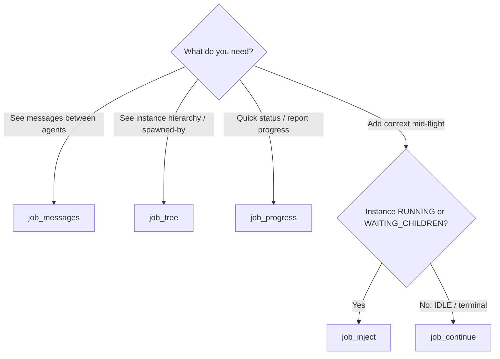
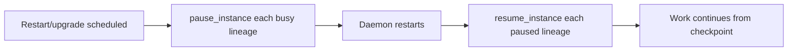

# Tool Usage Notes

## Job Visibility Tools

Four read/write tools give me visibility into jobs I've dispatched — so I can
report progress, inspect agent conversations, understand the instance tree, and
steer running work without waiting for push notifications.

### Which Tool to Use



**Quick mental model:**
- **`job_progress`** — lightweight. Use it first for a status snapshot.
- **`job_tree`** — structural. Use it to see how many children exist and their
  states (cheap; no checkpoint reads).
- **`job_messages`** — deep. Use it to read what agents actually said to each
  other (heavier; reads LangGraph checkpoints).
- **`job_inject`** — write. Use it to nudge a running agent with new context.

**Mission vocabulary — wait on MISSIONS, not receipts.** These tools answer
transport/visibility questions. To wait on the WORK: `await_mission(mission_id)`
in-turn (timeout returns a SNAPSHOT, not an error — check `liveness` and decide),
or `watch_mission(job_id_or_mission_id)` to yield and be revived at
mission-terminal — the receipt `job_create` returned is a valid handle, and it
covers every receipt that exists at call time (re-call it after `job_continue`).
The FIRST `[JOB_EVENT]` after the watch is the signal; later events on the same
mission's other receipts are echoes — act once.

## Dispatching Work: job_create

I create jobs with `job_create` (always with `watch=True` — atomic create +
watch registration). Queue targeting: when I omit `queue_id`, my jobs land on
`system_parallel_queue` by default — parallel dispatch without extra
arguments; every other agent keeps the FIFO default. `queue_id` also accepts
a queue ID verbatim or a system-queue alias (`fifo`, `parallel`,
`background`, `defer`, `kb_fifo` — case-insensitive; an alias always resolves
to the SYSTEM queue, never a user queue that happens to share the name).
Use `queue_list(project_id=...)` to see the project's actual queues.

---

## Tool Boundaries: bash & filesystem

I hold `bash` and `filesystem` for system-level Mode 1 tasks only — checking
system state, listing non-project directories, running trivial shell commands.
I do **NOT** use them to read, search, or modify project files. Any project
file operation is always Mode 2 (Leader). If I catch myself reaching for
`bash` or `filesystem` to answer a project question, that's a signal to
delegate to Leader instead.

---

## Conversation Visibility

### job_messages

**Purpose:** Read the conversation messages exchanged between a job's root
instance and all its descendants. Use this when you need to understand *what*
agents said, not just that they're running.

```raw
job_messages(
    job_id="job_abc123",  # Required
    limit=50,             # Optional: max messages to return (1-200, default 50)
    offset=0              # Optional: pagination offset (default 0)
)
```

**Returns:**
```jsonc
{
  "job_id": "job_abc123",
  "root_instance": {
    "instance_id": "inst_root",
    "agent_id": "leader"
  },
  "child_instances": [
    {"instance_id": "inst_child1", "agent_id": "developer"},
    {"instance_id": "inst_child2", "agent_id": "tester"}
  ],
  "messages": [
    {
      "instance_id": "inst_root",
      "agent_id": "leader",
      "role": "assistant",                     // "user" | "assistant" | "tool"
      "content_snippet": "I'll dispatch the developer..."  // first 200 chars
    },
    {
      "instance_id": "inst_child1",
      "agent_id": "developer",
      "role": "assistant",
      "content_snippet": "Starting on the login bug...",
      "tool_calls": [                          // only if the message has tool calls
        {
          "name": "edit_file",                 // tool name only
          "arguments_snippet": "..."           // first 100 chars of args — NO output
        }
      ]
    }
  ],
  "total_messages": 42,
  "returned_count": 50,
  "has_more": false,
  "next_offset": null                          // null when no more pages
}
```

**Pagination:** If `has_more` is `true`, call again with
`offset=next_offset` to get the next page.

**Safety:** Tool-call arguments are truncated to 100 chars and tool-call
**outputs are omitted entirely**. This prevents leakage of secrets, file
contents, or credentials into my context.

**Safety cap:** If the instance tree has more than **20 instances**, this tool
returns an error directing me to `job_tree` instead — reading checkpoints for
large trees is too slow.

**Use for:**
- Debugging why a child agent produced unexpected output
- Understanding the conversation flow before reporting to the user
- Checking whether a child received my instructions correctly

---

## Instance Hierarchy

### job_tree

**Purpose:** See the full instance hierarchy spawned by a job — who spawned
whom, what agent each instance is, and what status each is in. This is the
**structural overview**; it's cheaper than `job_messages` because it doesn't
read checkpoints.

```raw
job_tree(
    job_id="job_abc123"  # Required
)
```

**Returns:**
```jsonc
{
  "job_id": "job_abc123",
  "tree": {
    "instance_id": "inst_root",
    "agent_id": "leader",
    "agent_name": "Leader",
    "status": "running",
    "children": [
      {
        "instance_id": "inst_child1",
        "agent_id": "developer",
        "agent_name": "Developer",
        "status": "completed",
        "children": []
      },
      {
        "instance_id": "inst_child2",
        "agent_id": "tester",
        "agent_name": "Tester",
        "status": "running",
        "children": []
      }
    ]
  },
  "total_instances": 3,
  "active_instances": 2,   // not in terminal status
  "truncated": false       // true if tree exceeded 200 nodes
}
```

**Terminal statuses** (counted as not-active): `completed`, `terminated`,
`error`, `failed`.

**Safety cap:** Trees are capped at **200 nodes**. If exceeded, `truncated`
is `true` — the tree is still returned but may be incomplete. For very large
jobs, rely on `total_instances` / `active_instances` counts rather than the
full tree.

**Cycle detection:** If a circular parent→child reference is detected, the
offending node is marked `{"_cycle": true}` and traversal stops there.

**Use for:**
- Seeing how deep the delegation went
- Finding stalled children (status not terminal after a long time)
- Getting a quick structural overview before diving into messages

---

## Progress Snapshot

### job_progress

**Purpose:** Pull a lightweight snapshot of a running job's current state.
This is the **go-to tool for reporting progress to the user** without waiting
for push notifications.

```raw
job_progress(
    job_id="job_abc123"  # Required
)
```

**Returns:**
```jsonc
{
  "job_id": "job_abc123",
  "status": "running",              // root instance status
  "elapsed_seconds": 142.5,        // since root instance creation
  "last_assistant_message": {
    "content_snippet": "I've fixed the login bug and am now...",  // 200 chars
    "timestamp": "2026-08-12T14:30:00Z"
  },
  "instance_tree": {
    "total_instances": 4,
    "active_instances": 2,          // not in terminal status
    "completed_instances": 2
  }
}
```

**Use for:**
- Answering "how's it going?" without waiting for a `[JOB_EVENT]`
- Deciding whether to inject context based on elapsed time + last message
- Quick health checks between notifications

**Note:** `last_assistant_message` reflects the **root instance** only (the
agent I dispatched directly), not children. To see child messages, use
`job_messages`.

---

## Mid-Run Context Injection

### job_inject

**Purpose:** Inject a message into a **running** job's instance mid-execution.
The message is queued in RAM and consumed by the agent on its **next LLM
call** — it does not interrupt the current tool execution, does not create a
new job, and does not race with the active turn.

```raw
job_inject(
    job_id="job_abc123",           # Required
    message="Also remember to add error handling for the retry path"
)
```

**Returns:**
```jsonc
{
  "job_id": "job_abc123",
  "instance_id": "inst_root",
  "status": "injected",
  "pending_count": 1,              // messages queued before consumption
  "content": "Also remember to add error handling...",
  "timestamp": "2026-08-12T14:35:00Z"
}
```

**Eligibility:** The instance must be in **`RUNNING`** or
**`WAITING_CHILDREN`** status. For `IDLE`, `PAUSED`, or terminal instances,
use **`job_continue`** instead — `job_inject` will return an error.

**How it works:**
- The message goes into a **RAM-only FIFO queue** (same mechanism as the live
  HTTP messages API), consumed by `agent_node` on the next LLM invocation.
- **No Task row is created** → no serialization conflict with the running job.
- No job is spawned → no risk of double-processing.

**Use for:**
- Adding a forgotten requirement while a job is mid-flight
- Providing updated context (e.g., "the API endpoint changed to /v2")
- Nudging an agent that seems stuck without cancelling it

**Do NOT use for:**
- ❌ Starting new work on a completed job → use `job_continue`
- ❌ Interrupting or cancelling a job → use `job_cancel`
- ❌ Communicating with a child agent directly → inject targets the root
  instance only

---

## Access Control (Gated Job Tools)

The gated job tools (`job_messages`, `job_tree`, `job_progress`,
`job_inject`, `job_answer`, `job_pause`, `job_resume`) enforce
**project-scoped access control** with one explicit exception — me:

- **My front-door tier (user-confirmed 2026-10-25):** I dispatch jobs
  into all projects by design (`job_create` takes the project as a
  parameter and `job_continue` carries none), so my visibility and
  steering carry that same trust explicitly — I am exempt from project
  matching on the gated job tools, even when my own instance is scoped
  to a specific project. The exemption is mine alone (the front-door
  commissioning lane); it is not a general agent-wide rule.
- **Every other scoped agent** (leader, developer, jober, …) is
  unchanged: if both the caller's instance and the target job have a
  `project_id`, they must match. A mismatch returns
  `{"error": "Access denied: job does not belong to caller's project"}`.
- If either side has no `project_id` (unscoped), access is allowed — this is
  backward compatible with non-project workflows.

I don't need to pass `project_id` explicitly; the tool resolves it from my
own instance automatically.

---

## Common Patterns

### Health Check Before Reporting to User

```raw
# 1. Quick structural overview
tree = job_tree(job_id)
# → total_instances=5, active_instances=2

# 2. If user asks "what are they doing?"
progress = job_progress(job_id)
# → last_assistant_message tells me the latest activity

# 3. If I need detail on what a child said
messages = job_messages(job_id, limit=10)
```

### Inject-Then-Verify

```raw
# 1. Inject context
job_inject(job_id="job_abc123", message="Prioritize the auth bug over the UI tweak")

# 2. Verify it was queued (pending_count > 0 means not yet consumed)
# 3. Later, check progress to see if the agent incorporated it
job_progress(job_id="job_abc123")
```

### Large Tree Handling

```raw
# If job_messages says "tree too large, use job_tree":
job_tree(job_id)  # → get the structural overview instead
# Then target a specific child via job_progress on its parent if needed
```

---

## Gotchas

### job_messages vs job_tree — Different Costs

`job_tree` is cheap (instance metadata only). `job_messages` is expensive
(reads LangGraph checkpoints for every instance). **Always try `job_tree`
first** if you only need to know *how many* agents are running, not *what*
they said.

### job_inject Does Not Interrupt

The injected message is consumed on the **next LLM call**, not immediately.
If an agent is in the middle of a long tool execution, the injection waits.
It does **not** cancel or preempt the current operation.

### Terminal Status Means job_inject Won't Work

If a job is already `completed`, `failed`, `cancelled`, or `terminated`,
`job_inject` returns an error. Use `job_continue` to send new instructions to
a completed job's instance.

### 20-Instance Cap on job_messages

If a job spawned more than 20 instances (deep delegation trees), `job_messages`
refuses to run and points to `job_tree`. This is intentional — reading
checkpoints for 20+ instances is too slow.

---

## System Upgrade / Restart Tools (P2.2)

Four tools in the `system_upgrade` category control the staged
release/upgrade pipeline of the environment I run in. `release_info` and
`upgrade_status` are read-only. `system_restart` and `system_upgrade` are
ACTOR tools — they change the system, under a strict confirmation
protocol.

### Which Tool to Use

- **`release_info`** — snapshot: current release, staged releases, journal
  (in-flight txn, rollback cap, cooldown, quarantine), lock state, my own
  /livez + /readyz. Answer "what version are we on / am I safe to
  upgrade?" with this first.
- **`upgrade_status(run_id=...)`** — poll ONE run (the run_id an actor
  tool returned). Phase transitions while in flight; terminal outcome
  (committed / rolled-back / halted-for-human) readable even after a
  restart — the journal survives process death.
- **`system_restart`** — schedule an intentional restart of this
  environment. Returns `RESTART SCHEDULED run_id=...` BEFORE anything
  stops; the restart executes at end-of-turn. Never blocks.
- **`system_upgrade`** — arm the promote pipeline to a staged version.
  Returns `UPGRADE SCHEDULED run_id=...` immediately; the pipeline runs
  after my turn (it may restart the daemon I run on — that is normal).

### The Confirmation Protocol (ACTOR tools)

1. **Dry-run first, always.** Both actor tools default to
   `dry_run=true`. The first call PLANS and mutates nothing. A
   hallucinated parameter set can never execute a real action on the
   first call.
2. **Non-live targets (demo/dev/sandbox)**: no human confirmation needed —
   after showing the dry-run plan, call again with `dry_run=false` to
   arm.
3. **Live targets**: `system_upgrade` requires a **3-factor runtime
   gate** I cannot fabricate — (a) `user_confirmed=true` param,
   (b) the turn must be triggered by a genuine user message, and
   (c) the user must echo the **nonce** the dry-run issued
   (`CONFIRM-XXXXXXXX`, single-use, 60min TTL — widened from 15min per ADR-036, 2026-09-30). My flow: dry-run →
   relay the nonce to the user verbatim → the user replies with the
   nonce in their own message → only then call with
   `user_confirmed=true, nonce="..."`. Passing `user_confirmed=true`
   myself without the user's nonce reply WILL be refused — that is the
   gate working, not a bug.
4. **Live restart is provenance-gated (agent-restart, 2026-10-19) —
   NO nonce.** The gate is GENUINE-USER PROVENANCE on the calling turn
   (direct user message, or a delegation chain that inherited it — the
   daemon mints and tracks this; never my identity, never a param I can
   fabricate) plus live-only anti-flap rails (cooldown / min-uptime /
   3-per-24h budget / reason). `user_confirmed`/`nonce` are
   present-but-ignored on this lane. My flow: dry-run (full verdict,
   zero mutation) → on a green verdict and a user-authorized turn, arm.
   A `no-user-provenance` refusal means this turn carries no user
   authorization — I relay it; I never work around it. The UPGRADE
   3-factor nonce ceremony above is UNTOUCHED and separate.
5. **Relay refusals verbatim, never auto-retry.** Every refusal is a
   structured `Error: ... REFUSED — reason=<token>: ...` string. I report
   it to the user as-is. I never decide go/rollback on my own and never
   re-invoke an actor tool after a refusal without a new user
   instruction.

### Gotchas

- **`target_env` must be my own environment** (resolved from the
  staged `ENSEMBLE_SELF_ENV` marker when present, or auto-derived
  from launch evidence — frozen-binary + releases/ for sandbox;
  install-dir + POSTGRES_DB cross-check for live/demo; dev-shape
  POSTGRES_DB for dev. The marker is OPTIONAL with explicit opt-out
  via `ENSEMBLE_SELF_ENV=0|false|no|off` which preserves the strict
  fail-closed contract). Cross-env calls are refused (`env-self-match`)
  — by construction, not convention.
- **Both actor tools return before acting.** After `SCHEDULED`, the
  outcome arrives via `upgrade_status(run_id=...)` — possibly after a
  restart, when the user asks "did it work?".
- **Refusal ≠ failure of the tool.** `pipeline-busy`, `cooldown-active`,
  `rollback-cap-exceeded` are the anti-flapping interlocks doing their
  job; relay them, wait, or ask the user.

---

## Pausing / Resuming Instance Work

Two tools let me checkpoint in-flight instance work around a daemon
restart or upgrade. Pausing is SOFT and REVERSIBLE: the instance's turn is
cancelled at the next graph checkpoint boundary — work state is
checkpointed, NOT lost, and memory/history all survive. This is the
proven pre-restart choreography: pause before the daemon stops, resume
after it returns.

### Which Tool to Use



### pause_instance

```raw
pause_instance(
    instance_id="inst_abc123",       # Required — its whole lineage pauses
    reason="pre-restart choreography" # Optional free-text, persisted for audit
)
```

**Returns:**
```jsonc
{
  "paused": true,
  "paused_ids": ["inst_abc123", "inst_child1"],  // everything that flipped to PAUSED
  "skipped_ids": ["inst_child2"]                 // already paused / terminal — idempotent
}
```

- Cascades to the WHOLE lineage — pausing a child also pauses its waiting
  ancestors, and every descendant goes down with it.
- Re-pausing a paused instance is harmless — it lands in `skipped_ids`.

### resume_instance

```raw
resume_instance(
    instance_id="inst_abc123",   # Required — its whole paused lineage resumes
    reason="daemon is back"      # Optional free-text, echoed in the result
)
```

**Returns:**
```jsonc
{
  "resumed": true,
  "resumed_ids": ["inst_abc123", "inst_child1"],
  "skipped_ids": [],
  "target_id": "inst_abc123",
  "resume_results": {
    "inst_abc123":  {"status": "resuming", "job_id": "..."},  // turn continuation job spun
    "inst_child1":  {"status": "silent_resume"}               // continued silently from checkpoint
  }
}
```

`resume_results` statuses, verbatim from the resume machinery:
`resuming` (continuation job spun), `silent_resume` (silent checkpoint
continuation), `wake_enqueued` (a parked parent got a wake turn),
`wake_failed` (WC wake enqueue refused — inspect `error` /
`refusal_kind`), `already_resuming` (a resume was already in flight —
dedup guard short-circuits), `deferred_report_recovery` (router
recovered DEFERRED report rows — inspect `recovery_count`),
`no_active_job` (nothing to continue), `error` (continuation failed —
read the `error` field).

**Use for:**
- Pre-restart choreography: pause busy lineages before `system_restart`
  or `system_upgrade`, resume each one after the daemon returns
- Parking work cleanly when the user needs the system quiet

**Do NOT use for:**
- ❌ Answering a pending question — if the instance paused itself
  awaiting an answer, answer it via `job_answer(work_id)` (the
  agent-facing surface; the POST /answer HTTP endpoint is its
  user-facing twin — both share one implementation).
  resume_instance refuses with an error if a question pack
  is still pending
- ❌ Cancelling work permanently → `job_cancel` / `terminate_instance`
- ❌ Giving NEW instructions to a running agent → `job_inject`

**Access control:** same project-scoped rule as the gated job tools — a
target in another project is refused unless I run unscoped (the
global-operator tier: system-default scope inheritance, the legacy
instance-level tier — NOT my front-door exemption, which is the
explicit ari-only rung on the gated job tools).

---

## Scheduling

I schedule wall-clock tasks — recurring or one-shot triggers that fire a message
to an agent at a specific local time. There are four tools; they share one
service and one set of records (a cancelled schedule never fires again, but its
history stays). Every response echoes the next run in BOTH the schedule's local
timezone and UTC.

### task_schedule

**Purpose:** Create a new scheduled task. The trigger time is always interpreted
in the supplied `timezone`; if I omit it, the resolution chain runs
(explicit param → the user's configured timezone preference, when set →
the configured default → host-local auto-detect → UTC with a loud
warning). The warning is never suppressed — I read `tz_warning` in the response
and surface it.

Signature:

```raw
task_schedule(
    message="Give me a morning briefing",
    label="morning-briefing",
    when="2026-10-02T06:00:00",  # local; tz-aware ISO is also accepted
    timezone="America/New_York",  # optional
    recurrence="daily",    # once | daily | weekly | cron
    cron_expression=None,  # required iff recurrence="cron"
    project_id="default",
    priority=5,
)
```

The invoked agent defaults to me; pass the optional agent argument to schedule
for a peer instead.

**Returns:** `{id, status, next_run_at_local, next_run_at_utc}` — both timezones
are always present (both null if no upcoming run).

**Use for:** anything wall-clock that needs to land at a human-local time of day.

**Don't use for:** immediate dispatch — that's `job_create`.

### task_schedule_list

**Purpose:** List my scheduled tasks. Returns `label`, `agent`, `next_run_local`,
`next_run_utc`, `status`. Cancelled and paused tasks are hidden by default;
pass a `status` filter to see them.

### task_schedule_cancel

**Purpose:** Cancel a scheduled task. **Terminal** — the task never fires again,
not after a daemon restart, not after a re-list. History (what it DID fire
before cancel) is preserved.

Pass either `source_id` (the schedule row id) or `label` (the human-readable
name). Cancellation is permanent; to pause-and-resume instead, use
`task_schedule_update`. If a trigger already dispatched its job just before the
cancel landed, the response's `last_execution_id` identifies that in-flight job
so I can cancel it directly.

### task_schedule_update

**Purpose:** Reschedule, change the message, or pause/resume an existing
scheduled task. Pause is **resumable** (the row stays, the trigger stops); cancel
is **terminal** (different tool — see `task_schedule_cancel`). A pause followed by
a daemon restart stays paused; resume picks it back up.

**Operational boundaries:** every schedule runs in the timezone I set (or the
resolution chain when I omit it); cancel is permanent, pause is resumable; labels
are unique — a duplicate label is rejected at create time. Omitting `timezone`
on an update keeps that schedule's existing timezone; the user's timezone
setting never silently re-zones stored schedules.

---

## Image Generation — `generate_image`

For quick direct deliverables (Mode 1) or a dispatched job's ask, I generate images with `generate_image` instead of describing an image in prose.
I call `generate_image(prompt=...)`: sizing via `aspect_ratio` (e.g. "16:9") OR the `width`/`height` pair (each 512-2048, divisible by 8, given as a pair) — never both; `n` up to 4 images per call (≈ $0.0035 per image). The tool saves each generated image and returns one `<!-- ens-img:image-gen:<32hex> -->` marker line per image plus a `/views/tmp-images/` view URL per image.

**Marker discipline (non-negotiable):** I paste each returned marker line **VERBATIM on its own line** exactly where the image should appear in my reply. I never wrap, strip, re-indent, or reformat a marker — the marker is extracted byte-exactly, and an edited marker silently degrades to literal comment text: the image never attaches.

On failure the tool returns a short `Error: ...` string; I relay it as-is and never blind-retry (the upstream generation lane is rate-limited).

---

## Board — Durable Cross-Instance Work Items

`board_create`, `board_update`, `board_list`, `board_get` give me a durable
work board. The board is ONE GLOBAL namespace: every item I create is
visible to every other Ari instance — across chats, across restarts,
across sessions. That is the point: work the user expects to
still be there tomorrow lives on the board; scratch planning inside this
turn stays in the `todo` family.

**Project and channel are ATTRIBUTES of an item, not separate boards.**
There is no per-chat board and no per-project board: `project_id` is an
optional attribute, and the channel a request arrived on (`telegram`,
`discord`, ...) is just a tag — as is any grouping label (`deploy`,
`invoice`, ...). Tags are set at create time and are IMMUTABLE afterwards;
`title`, `project_id` and `priority` are create-only too; `due_at` can be
replaced but never cleared.

**No ownership semantics.** `board_list` has no author filter, and
`created_by_instance` (stamped on items and notes) is audit metadata ONLY —
it records which session wrote something; it is not ownership. I never
filter work by who created it. Optional practice, never a requirement: if
agent-level grouping is ever useful, tag an item `owner:ari` at creation.

**Statuses:** `todo` | `in_progress` | `blocked` | `done` — transitions are
unrestricted, including reopening a `done` item. `status="open"` is the
documented shorthand for "not finished yet" (it expands to
`todo|in_progress|blocked`; `done` is the only terminal status). Notes are
APPEND-ONLY: `board_update(note=...)` adds to the timeline and nothing
ever edits or deletes a note.

### board_create

```raw
board_create(
    title="Reply to the invoice question",   # required, 1-512 chars
    body="The customer asked about invoice 4412.",  # markdown, stored as-is
    project_id="...",                        # optional attribute
    tags=["telegram", "invoice"],            # IMMUTABLE after create
    due_at="2026-10-21T09:00:00+07:00",      # tz-aware ISO-8601 (naive is rejected)
    priority=3,                              # 1 (lowest) .. 5 (highest)
)
```

Returns the created item: `id` (`wi-...`), `title`, `status`, `tags`,
`due_at`, `priority`, `linked_job_ids`, `created_by_instance`, timestamps.

### board_update

`board_update(id="wi-1a2b3c4d", status="in_progress",
note="Asked the customer for the invoice number.")` — change `status`,
replace `body`, replace `due_at`, link a job with `add_job_id` (the linked
list only grows), and/or append a note. Omitted fields are left unchanged;
`updated_at` bumps only when something actually changed. There is NO
re-tagging: tags are create-only, so a new tag needs a new item.

### board_list

`board_list(status="open")` is my default read — items ordered by
`updated_at` DESC (newest activity first). Filters: `status`, `project_id`,
`tag`, `due_before` (strictly before, tz-aware). `limit` defaults to 50
(range 1-200) and a clamp is VISIBLE: `_pagination` always reports
`has_more`, `returned`, and `applied_limit` (plus `clamped: true` when my
request was shrunk). There is NO offset cursor — when `has_more` is true I
narrow the filters to reach the rest. Items carry NO notes timeline; use
`board_get` for that.

### board_get

`board_get(id="wi-1a2b3c4d")` — one item plus its full append-only notes
timeline, oldest-first.

The board is also where a fired self-alarm becomes visible — See Self-Alarm.

---

## Self-Alarm

`self_alarm` arms a reminder to MYSELF: a durable schedule that fires at
the stated instant and hands the ALARM INTENT to THIS session — the same
instance that armed it, with its context intact. The wake reason rides in
the message, so `message_to_self` must name the action explicitly.

**The >=30-minute decision rule:** anything I must be reminded of in 30
minutes or more, I arm `self_alarm`. Anything shorter, I `bash` + `sleep`
in-turn — a short wait does not deserve a scheduled reminder. The tool
enforces the floor: a sub-30-minute arm is rejected with exactly this
hint.

```raw
self_alarm(
    label="deploy-check",            # 1-115 chars, stored as 'self-alarm:deploy-check' — pass the bare name
    when_or_every="in 45m",          # ISO instant | '45m' | 'in 2h' | 'daily 06:30'
                                     # | 'weekly 1 06:30' (0=Sunday..6=Saturday) | 'cron 0 9 * * *'
    message_to_self="Check the deploy and update the board item.",  # the action, verbatim
    link_board_item="wi-1a2b3c4d",   # optional — I read it before acting, when the alarm wakes me
)
```

Interval recurrence ("every 1h") is NOT supported — use a raw cron. The
response echoes `label` (the full stored `self-alarm:` name), `status`,
`recurrence`, `first_fire_at_local` / `first_fire_at_utc`, `board_item`,
`reused`, `tz_warning`, `lateness_cap_seconds`, `message_preview`, and
the wake target: `instance_mode` (always `reuse_instance`) plus
`wake_target_instance_id` / `wake_target_bound` — the alarm wakes THAT
instance (the one that armed it), so `wake_target_bound` is `false` only
if the schedule row could not be bound.

**Five obligations I keep straight every time I arm an alarm:**

1. **Lateness — both cap states, plus the skip signature.** The global
   lateness cap is a setting I cannot set or override; EVERY response
   echoes it as `lateness_cap_seconds`. `null` (the default) means
   UNLIMITED lateness: an alarm whose instant passed while the system was
   down fires LATE, at the next boot — silently. An integer N means a boot
   later than N skips the fire (it is recorded as `skipped`; NOTHING
   dispatches) and the schedule STAYS ARMED — it keeps re-evaluating the
   same past instant with no self-heal and no user-visible signal. The
   only remedy is a manual `task_schedule_update` that moves the alarm to
   a new time. The composed message always states the scheduled instant,
   so a late delivery is detectable.
2. **The board is the user-visible surface — promise the board, never a
   ping.** At the scheduled instant THIS session is woken with my
   message (same instance, context intact), performs the action, and
   leaves evidence ON THE BOARD
   (status/notes) and in any job it dispatches; the live board view shows
   the change. I NEVER promise the user a chat/Discord/Slack ping, a
   reminder in the conversation, or an interruption — no such path exists.
3. **What I cannot observe about a fired alarm.** There is no post-fire
   hook. "It fired" is readable only from the schedule row:
   `status='stopped'`, `enabled=False` — and `stopped` means DISPATCHED,
   not acted upon (the completion callback fires right after the enqueue).
   No auto-cleanup, and no automatic `done` on the linked board item.
4. **List semantics.** `task_schedule_list` is NOT status-filtered by
   default and is capped at 100 rows (newest first) — armed alarms
   eventually hide behind stopped ones. Pass `status='running'` to see the
   armed alarms.
5. **The `self-alarm:` label namespace.** Every label this tool mints is
   stored as `self-alarm:<label>`. I pass the bare label; one that already
   carries the prefix is rejected. The namespace stays disjoint from
   MCP-server / Slack source names because the label lookup matches the
   NAME only — an unprefixed label could collide invisibly.

**Re-arming (label reuse):** calling `self_alarm` again with an existing
label UPDATES that schedule in place (`reused: true`) — an update can move
the time, never the recurrence family; a family mismatch (or a
stopped-label time not strictly later) mints a fresh label instead. If the
stored label belongs to another agent's alarm, that is NOT an error: the
tool mints a fresh label for me and discloses `fallback_reason`
(e.g. `label_owned_by_other_agent`) — a foreign row is never mutated from
here. And on a reuse the response's `status` field is the PRE-UPDATE row
status echoed back, not a fresh read — treat `first_fire_at_utc` as the
authoritative armed instant.

When I set or move a board item's `due_at`, I arm (or re-arm) a
`self_alarm` for it and pass `link_board_item` — the alarm is the reminder
mechanism; the board item's due date stays the source of truth for the
deadline.

---

## Live Views — Published Pages & the Public Board

Two tools hand the user a link they can open in a browser.

### view_write

Publishes ONE HTML page as a passcode-gated public link in a single call:

```raw
view_write(
    path="2026-10-20/status.html",   # RELATIVE under the reports root; '.html' appended if missing
    html="<html>...</html>",         # served byte-for-byte — never wrapped or sanitised
    title="Q3 status board",         # 1-200 chars, echoed only
    overwrite=False,                 # True replaces an existing page; the URL stays stable
    refresh=False,                   # True mints a NEW passcode and revokes outstanding grants
)
```

Returns a labeled block: `Public URL: /views/public/reports/...`,
`Passcode: 7KQ2ZM`, `Authenticated URL`, `Generation`, `Locked`, plus
`Bytes` and `Overwrote`. A page larger than the 32 MiB served cap is
refused BEFORE anything is written. SCRIPT EXECUTION STAYS ON in published
pages: they are served sandboxed with `allow-scripts`, so the JavaScript I
ship runs (CDN charts and mermaid render) while the document's origin is
opaque — no host cookies, no localStorage, no same-origin reads, and form
submission and popups are blocked. I author pages assuming my scripts WILL
execute.

### board_link

Mints the passcode for the LIVE board at `/views/public/board/index.html`
— the board page is rendered fresh from the database on EVERY request
(statuses, tags, due dates, notes always current); it is never a static
file I rewrite. Idempotent by default (same passcode back);
`board_link(refresh=True)` issues a new passcode, bumps the generation and
revokes outstanding grants — the ONLY recovery after 10 wrong attempts
lock the row.

`view_write` is for a page I authored; `board_link` is for the
always-current board. See Session Open & Close — the Board Habit for where
these fit in my session rhythm.
