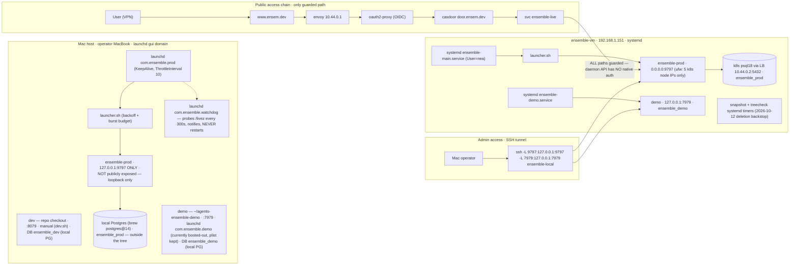
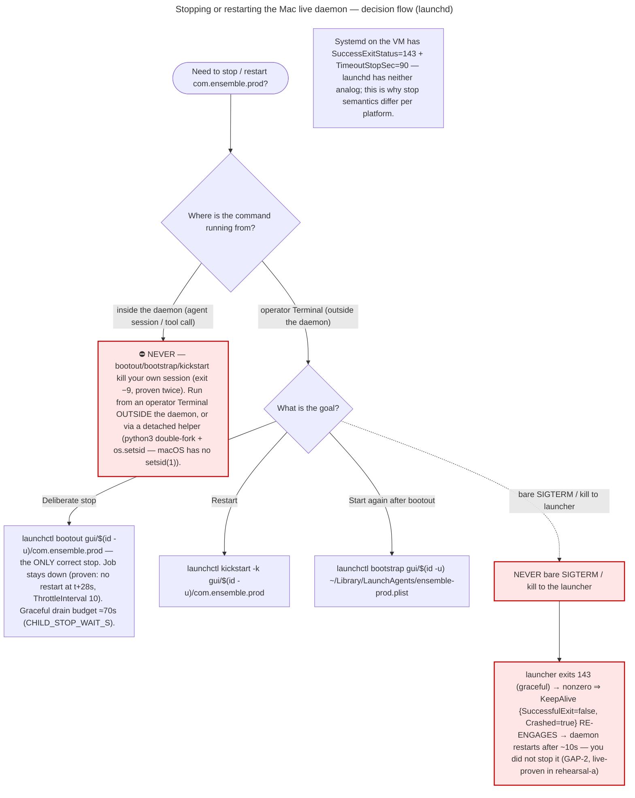

# Deployment Guide

- **Canonical since:** 2026-11-10 · commission `wi-52666630` (*macOS deployment topology*), branch `feature/macos-deployment-topology`.
- **Revision 2 (2026-11-10):** all placeholders resolved with landed/verified facts (guard merged; launcher leg-2 implemented + verified); §7/§8 refreshed verbatim from the **rehearsal-corrected** checklists (G5 98 L, Stage 2 140 L — as they then stood; both since corrected again, now 120/142 L).
- **Revision 3 (2026-11-10, final doc pass):** doc-review findings applied — **§0 Quick Start** added (fresh-box happy path + the from-zero handover, depth demoted to §6.7) · plist path-asserts replaced by the three-verdict `plutil -extract … raw` form (TOOL MISSING / UNREADABLE KEY / STALE PATH) · `/readyz` component truth stated (MCP advisory, never gating) · journal minute-figures correctly labelled (13 min = sweep duration, 30 min = in-flight-txn TTL) · guard contract stated plainly (both `INSTALL_DIR` + confirm var; the confirm var never implies a path) + a **positive live-install example** · §7/§8 re-copied from the corrected checklists (G5 120 L, Stage 2 142 L).
- **Revision 4 (2026-11-10, final):** doc-review command audit + rehearsal (d) folded — §0 retargeted to `$HOME/agents-ensemble` (fresh-box-only, no sudo, branch + freshness assertions, de-tilde/no-spaces rule, full-URL curls, endpoint-based verify, plist-overwrite warning); plist PATH block stated **mandatory** with the silent-degradation caveat until v0.29.10; watchdog `state=running` false-failure fixed (§0, §7 4.4, §10, §11); leg-2 stated as **shipping with v0.29.10**; rehearsal (d) recorded (§13); `make stop` re-stated ownership-scoped in the caller docs; Python floor corrected to 3.13.
- **Revision 5 (2026-11-10, release retarget):** the **v0.29.9 tag already exists and is pushed** (`dd238d4a`) — cut by the **Decision Module P1 lane** (shadow-only), and it **does NOT contain our leg-2**. Every leg-2/doc claim below is retargeted to **v0.29.10**; §11 carries the release-composition note.
- **Audience:** the operator and any AI assistant / engineer with shell access to the Mac or the VM who needs to deploy, supervise, upgrade, stop, or recover a running Ensemble install.
- **Scope:** the whole deployment model — one model, **four deployments, two supervisors** (macOS launchd + Linux systemd) — plus the two-stage hardening plan (Stage 1 relocation → Stage 2 ownership/gating, gated on v0.29.10).
- **Folding note:** this guide **folds and supersedes** the interim *macOS Deployment Handoff* runbook of 2026-11-09 (its safety list, exit-code contract, acceptance checklist, troubleshooting and day-to-day tables are carried here, updated to the narrowed no-touch rule). Where the architect's design and the handoff draft disagreed, **the design wins** and the disagreement is flagged (see §10 note on `setsid`, and §5 on the plist template). The **from-zero handover** lives in §0 (compressed) with its depth demoted to **§6.7**.

---

## 0. Quick start — macOS (fresh box)

**What you get:** the Ensemble daemon under **launchd** (auto-restart on crash, survives logout/reboot), serving the API + web UI at **http://127.0.0.1:9797** (loopback only — the daemon has **no native auth**; never expose it). ~15 minutes, mostly build time.

> **FRESH BOX ONLY.** If a daemon already exists at `$HOME/agents-ensemble`, **STOP** — this page is not an upgrade path (§6 covers deploy/upgrade). This operator's live daemon IS at that path.

### Before you start

| Need | Requirement |
|---|---|
| macOS | a currently-supported macOS on **APFS** — designed and rehearsed on macOS 14.4.1 |
| Python | **3.13+** (`pyproject.toml: requires-python = ">=3.13"`) and **uv** |
| PostgreSQL | server + client on `localhost:5432` |
| Node | **18+ with `npx`** — the MCP stdio servers spawn it (`context7`) |
| Ports free | **9797** (live API + UI; 127.0.0.1 only) · 7979 if you also run demo · 5432 for PostgreSQL |
| Disk | **≥5 GB free** (the install tree is ≈122 MB; the frontend + PyInstaller build dominates) |
| Credentials | an OpenAI-compatible API key |

**Drill first (one line):** to rehearse before live, run the identical sequence with `INSTALL_DIR="$HOME/agents-ensemble-demo"`, `PORT=7979`, DB `ensemble_demo`, and the demo plist label `com.ensemble.demo` — the guard then asks for `ENSEMBLE_INSTALL_DEMO=1` instead.

### 1 · Clone the repo and ASSERT the branch

A fresh `git clone` lands on `origin/master` — a v0.3.3-era tree with **no install guard, no `launcher.sh`**, and a Makefile whose `INSTALL_DIR` **defaults to the live dir**. Check out the integration branch and prove it:

```bash
git clone <repo-url> agents-ensemble && cd agents-ensemble
git checkout latest

# durable assertion — the guard files must exist on this branch:
test -f scripts/install-dir-guard.sh && test -f launcher.sh \
  || { echo "NOT the right branch (no guard/launcher) — STOP"; exit 1; }

# ancestry assertion — latest must contain the guard commit (the sha moves as
# commits land; the file check above is the durable form):
test "$(git rev-parse --abbrev-ref HEAD)" = latest \
  && git merge-base --is-ancestor 424494082 HEAD
```

### 2 · Install the daemon (no sudo — a `$HOME` target needs none)

```bash
# freshness: the target must NOT already exist (an existing daemon = STOP, per the caveat above):
[ ! -e "$HOME/agents-ensemble" ] || { echo "TARGET EXISTS — not a fresh box — STOP"; exit 1; }

uv python install 3.13
uv venv --python 3.13 && source .venv/bin/activate
uv sync

cp .env.prod.example .env.prod
$EDITOR .env.prod      # set: OPENAI_API_KEY, OPENAI_MODEL, POSTGRES_PASSWORD
                       # and: comment out OPENAI_BASE_URL_BACKUP
                       # (PORT=9797, POSTGRES_DB=ensemble_prod are preset)

psql postgres -c "CREATE ROLE ensemble LOGIN PASSWORD '<your-prod-db-password>' CREATEDB;"
createdb -O ensemble ensemble_prod                # tooling never creates/drops the live DB

# guard forms — the canonical live path is live-set EVEN on a fresh box; the confirm
# var states INTENT, never a path. Absolute path (a leading '~/…' is expanded once by
# the Makefile before the guard sees it; spaces / trailing slash / '$' are refused):
export INSTALL_DIR="$HOME/agents-ensemble"
export ENSEMBLE_INSTALL_LIVE=1

make install INSTALL_DIR="$INSTALL_DIR"   # builds frontend + binary; stages .env.prod → .env, launcher, plists
```

A bare `make install` refuses: the **guard script exits 78**; make surfaces it as an **Error 78** with **process exit 2**. `INSTALL_DIR` and the confirm var are **both** required.

### 3 · Stage the launchd jobs and start them (SAME `INSTALL_DIR` — the plist embeds it)

```bash
make plist-install    INSTALL_DIR="$INSTALL_DIR"   # → ~/Library/LaunchAgents/ensemble-prod.plist
make watchdog-install INSTALL_DIR="$INSTALL_DIR"   # → ~/Library/LaunchAgents/ensemble-watchdog-watcher.plist

launchctl bootstrap gui/$(id -u) ~/Library/LaunchAgents/ensemble-prod.plist            # RunAtLoad → starts now
launchctl bootstrap gui/$(id -u) ~/Library/LaunchAgents/ensemble-watchdog-watcher.plist
```

Never stage plists for a different tree than the one you installed. **Never `sudo` the two plist targets.** Re-running either **overwrites the plist with no `.bak`** — snapshot it first if you need the old one.

### 4 · Verify — the "done" condition (endpoint-based)

```bash
launchctl print gui/$(id -u)/com.ensemble.prod | grep -E 'state|pid|program'   # the pid is the LAUNCHER's
curl -fsS http://127.0.0.1:9797/livez     # FULL URL — curl 8.4.0 rejects the ':9797/livez' short form
curl -fsS http://127.0.0.1:9797/readyz
ps -o pid,ppid,command -p "$(lsof -t -iTCP:9797 -sTCP:LISTEN)"   # the LISTENER is a grandchild
grep -E 'Context7|MCP warm-up pool' "$INSTALL_DIR/data/launcher.err.log" | tail -5
```

| Signal | Healthy looks like |
|---|---|
| `launchctl print` | `state = running` + a pid — the **launcher's** pid; the daemon listener is its grandchild |
| `/livez` | `{"status":"alive",…}` |
| `/readyz` | `status: ready` — components `database`, `queue_freshness`, `services`, `checkpoint_saver` |
| `ps` chain | launcher ppid = 1; the :9797 listener's ppid = the launcher's pid — never your shell |
| `launcher.err.log` | MCP warm-up pool ready; `context7 healthy: True` |

**MCP health has NO endpoint signal.** The plist's `EnvironmentVariables.PATH` block is **mandatory**: without it context7 fails **silently** — `healthy: False`, `primed 0/2` — while `/livez` and `/readyz` stay GREEN (rehearsal-d, third independent confirmation; MCP is advisory under `detail.mcp` and never gates status). The staged plist ships the PATH block **with v0.29.10** — until that release lands, expect context7 to report `healthy: False` with `primed 0/2` on an otherwise-green daemon; **MCP health is verifiable ONLY in `data/launcher.err.log`** (the grep above).

> ⚠️ **leg-2 is NOT in v0.29.9.** If you install from the **v0.29.9 tag**, its staged plist carries **no** `EnvironmentVariables.PATH` — so the daemon comes up with context7 `healthy: False` / `primed 0/2` while `/livez` and `/readyz` stay GREEN (silent MCP degradation). Until v0.29.10 lands, either apply the §6.7 PATH step to the installed plist, or accept that MCP is degraded. **The live Mac is unaffected** — its installed plist already carries the PATH block (applied at the cutover).

### 5 · Day-2 commands

```bash
launchctl kickstart -k gui/$(id -u)/com.ensemble.prod    # restart
launchctl bootout    gui/$(id -u)/com.ensemble.prod        # STOP — never SIGTERM/kill: it comes back
launchctl print      gui/$(id -u)/com.ensemble.prod        # status
tail -f "$INSTALL_DIR/data/launcher.err.log"              # daemon STDERR — the daemon log surface
tail -f "$INSTALL_DIR/data/launcher.log"                  # supervisor stdout (0 bytes is normal)
tail -f "$INSTALL_DIR/data/logs/ensemble.log"             # daemon file log
```

**Watchdog:** `com.ensemble.watchdog` fires every 300 s (`StartInterval`, no KeepAlive) — `launchctl print` showing *not running* **between ticks is normal**. Judge it by `data/watchdog.log`, `last exit code = 0`, and a **rising `runs` count**, read from `launchctl print gui/$(id -u)/com.ensemble.watchdog | grep runs` (live observation: `state = not running, runs = 43, last exit code = 0` — healthy; no ops probe needed).

**Already running the daemon by hand?** The handover (pre-flight → plists + PATH step → the one restart → verify → observer → rollback) is in **§6.7**.

**Rollback (one line):** `launchctl bootout` both jobs, then `ENSEMBLE_INSTALL_LIVE=1 make uninstall INSTALL_DIR="$INSTALL_DIR"` — supervised forms in §6.3/§6.7.

**If it fails:** see **Troubleshooting** (§10) — each symptom maps to its cause and the exact fix.

**Linux:** the VM lane in §6.3 is an **operator runbook, not a fresh-box procedure** — never rehearsed from zero.

---

### Sources & evidence key

Citations appear inline as `[KEY §x]` so any claim can be traced:

| Key | Source |
|---|---|
| `[ARCH]` | `.agents/shared/planning/macos-deployment-topology/architecture-recommendation.md` (council-unanimous design, 2026-11-09; corrected 167 L) |
| `[G5]` | `.agents/shared/planning/macos-deployment-topology/g5-stage1-relocation.md` (Stage 1 gated checklist, **corrected 120 L** — plutil three-verdict assert) |
| `[ST2]` | `.agents/shared/planning/macos-deployment-topology/stage2-hardening.md` (Stage 2 design + checklist, **corrected 142 L** from rehearsals b+c + doc review) |
| `[RA]` | `.agents/shared/planning/macos-deployment-topology/rehearsals/rehearsal-a-launchd-demo.md` (launchd demo rehearsal, 2026-11-09) |
| `[RB]` | `.agents/shared/planning/macos-deployment-topology/rehearsals/rehearsal-b-relocation.md` (relocation drill, 2026-11-09 — lossless-move + rollback proofs) |
| `[RC]` | `.agents/shared/planning/macos-deployment-topology/rehearsals/rehearsal-c-staged-flip.md` (staged-release flip drill, 2026-11-09 — `mv -hf` + release-ID proofs) |
| `[RD]` | `.agents/shared/planning/macos-deployment-topology/rehearsals/rehearsal-d-usr-local-shape.md` (install-shape drill, 2026-11-10 — silent-MCP-failure + non-$HOME-root + EACCES proofs) |
| `[HANDOFF]` | the interim *macOS Deployment Handoff* runbook (2026-11-09) — folded here |
| `[VM-README]` | data-center-scripts `infranstructure/ensemble-vm/README.md` (VM canonical ops record) |
| `[GUARD]` | `scripts/install-dir-guard.sh` + `Makefile` (guard merged: commit `c46f1523c`, merge `--no-ff 424494082`) |

---

## Table of contents

**Start here:** [§0 Quick start — macOS (fresh box)](#0-quick-start--macos-fresh-box) — a fresh macOS box to a launchd-supervised, health-checked daemon, one page, copy-pasteable.

1. [The topology at a glance](#1-the-topology-at-a-glance)
2. [Safety rules — read before running anything](#2-safety-rules--read-before-running-anything)
3. [Why production must leave `$HOME` — the two-stage story](#3-why-production-must-leave-home--the-two-stage-story)
4. [Supervision — systemd (the model) vs launchd](#4-supervision--systemd-the-model-vs-launchd)
5. [PATH & MCP on macOS — the two-layer fix](#5-path--mcp-on-macos--the-two-layer-fix)
6. [Install · deploy · stop · upgrade · promote · rollback](#6-install--deploy--stop--upgrade--promote--rollback)
7. [Stage 1 — relocation to `/opt/ensemble` (G5)](#7-stage-1--relocation-to-optensemble-g5)
8. [Stage 2 — hardening (⛔ BLOCKED-ON v0.29.10)](#8-stage-2--hardening--blocked-on-v02910)
9. [Operator day-to-day](#9-operator-day-to-day)
10. [Troubleshooting](#10-troubleshooting)
11. [Verified current state (2026-11-09/10)](#11-verified-current-state-2026-11-0910)
12. [The incident lesson & pending operator decisions](#12-the-incident-lesson--pending-operator-decisions)
13. [Rehearsal outcomes](#13-rehearsal-outcomes)

---

## 1. The topology at a glance

**One model, four deployments, two supervisors.** The same launcher/daemon pair runs in every environment; only the supervisor (launchd vs systemd), the port, and the database differ. Never invent a fifth shape — a new environment is a new row in this table, agreed first.



### The unified topology table `[ARCH §vi]`

| | dev (Mac repo) | demo (Mac) | live (Mac) | live (VM) | demo (VM) |
|---|---|---|---|---|---|
| **Install dir** | repo worktree, `./dev.sh` | `~/agents-ensemble-demo` | `~/agents-ensemble` → **`/opt/ensemble` after Stage 1** | `~/agents-ensemble` (releases/ layout, `current` symlink) | `~/agents-ensemble-demo` |
| **Port** | 8079 | 7979 | 9797 | 9797 | 7979 |
| **Supervisor** | manual (Terminal) | launchd gui `com.ensemble.demo` (currently booted-out; plist on disk per rehearsal-a/c end-state) | launchd gui `com.ensemble.prod` + `com.ensemble.watchdog`; root LaunchDaemons snapshot/treecheck (+ optional R1 health timer) at Stage 2 | systemd `ensemble-main.service` (nea) + snapshot/treecheck timers | systemd `ensemble-demo.service` (nea) |
| **Process owner** | operator | operator | operator (**NEVER root**) | nea (never root) | nea |
| **Who may touch live** | n/a (dev) | operator (drill env, first-use protocol) | Today: any operator-uid process incl. agent lanes. Post-Stage-2: tree writes gated to `data/`+`releases/`; promote root-gated (human password); gui bootout still possible — detected ≤60 s | root (unit) / nea (tree) / polkit root-transient promote (nonce) | nea |
| **Exposure** | 127.0.0.1 | 127.0.0.1 | **127.0.0.1 only**; public path = www.ensem.dev → envoy → oauth2-proxy → casdoor → svc ensemble-live → 192.168.1.151:9797; Mac↔VM via SSH tunnel (below) | binds 0.0.0.0 but **ufw allows 9797/tcp from the 5 k8s node IPs only** | 127.0.0.1 |
| **DB (name + location)** | local PG `ensemble_dev` | local PG `ensemble_demo` (⚠️ rehearsal note: the demo-era checkpointer connects to `…/ensemble` while the app DB is `ensemble_demo` — flagged for topology survey `[RA §9 S10]`) | local PG (brew postgres@14) `ensemble_prod` — **outside the tree, NOT covered by tree snapshots** (§12) | k8s psql18 (PG 18.4.0) via LB `10.44.0.2:5432`, user `ensemble`; daily pgdumpall CronJob cluster-side `[VM-README §Rollback]` | k8s psql18 `ensemble_demo` |
| **Tooling / PATH** | full interactive shell | as live | homebrew `/opt/homebrew` (**no node in brew**), nvm `~/.nvm` alias default `22`→`v22.21.1` (rot-prone version dir), uv/uvx `~/.local/bin`, local Postgres | uv 0.12.5 (Py3.13.15), system Node 22.23.2 + npm 10.9.8, binutils, postgresql-client, git; PATH = systemd default (`/usr/local/sbin:/usr/local/bin:/usr/sbin:/usr/bin:/snap/bin`), `npx=/usr/bin/npx` | as VM live |

The **"who may touch live"** column is the no-touch rule of §2 made self-evident: on the Mac, *today*, any operator-uid process — including agent lanes — can write or delete the live tree; Stage 2 exists to change exactly that.

### The hard rule (verbatim) `[ARCH §vi]`

> The daemon API has **NO native auth** — agent-spawning endpoints are **NEVER public**. The only public path is the guarded www.ensem.dev chain; VM-side ufw is the LAN backstop; Mac live is loopback-only.

Corollaries, all live-proven configuration `[VM-README §Public exposure]`:

- **All paths** through the public chain are guarded (unlike `llm.ensem.dev`, which passes `/v1` direct) — the daemon cannot authenticate anyone by itself.
- `www.ensem.dev` is **deliberately absent from public DNS** (VPN-only via `10.0.8.1`; operator Macs use `/etc/resolver/ensem.dev`). **Never** create a public/Cloudflare record for it.
- VM live binds `0.0.0.0` but **ufw admits 9797/tcp only from the 5 k8s node IPs** — the guard chain cannot be bypassed over the LAN.
- Mac live is **127.0.0.1 only** — it is not, and must never be, on the public chain.
- Human/admin access to the VM daemons is via SSH tunnel from the Mac:
  ```bash
  ssh -L 9797:127.0.0.1:9797 -L 7979:127.0.0.1:7979 ensemble-local
  ```

---

## 2. Safety rules — read before running anything

**The narrowed no-touch rule (2026-11-09) — current, binding:**

- The **LIVE install** (`/Users/nguyenminhkha/agents-ensemble`, post-Stage-1 `/opt/ensemble`), the **:9797 daemon**, and **`~/Library/LaunchAgents`** are **read-only at most** for assistants and agents — never write, stop, or restart them. Only the operator's own hands (or an operator-gated checklist they execute) mutate live.
- The **demo install** is read-only for agents *while a rehearsal lane is executing there*. Demo writes/removals are legitimate **only inside an explicit operator-named rollback or drill** — and even then **agents prepare, the operator executes** `[ARCH §viii]`.
- Agents write **only inside their worktree**. Agents author **documentation only** — never code, never configs, never anything executable.
- **NEVER run `launchctl bootout` / `bootstrap` / `kickstart` for any ensemble job from inside the daemon** — it kills your own session (exit −9, proven twice, including an agent's own tool call) `[G5 §Phase 3]`, `[HANDOFF §6.3]`. Every such step lives in a gated checklist for an outside-the-daemon actor.

**NEVER, under any other circumstance `[HANDOFF §4, updated]`:**

1. Run `make install`, `make uninstall`, `make deploy-live`, `make deploy-demo`, `scripts/deploy.sh`, `scripts/stop-ensemble.sh`, or `scripts/upgrade/*` against the live install *without the operator present and the guard confirm var set* (§6.4). The Makefile's `INSTALL_DIR ?= $(HOME)/agents-ensemble` **defaulted to the live dir** for the entire pre-guard era — the 2026-11-09 incident (§12) was exactly this.
2. `rm -rf` anything under `~/agents-ensemble*` — that glob also catches `~/agents-ensemble-demo` and `~/agents-ensemble-salvage` (prefix hazard, host-verified `[G5 §Phase 1.4]`).
3. Kill the daemon outside a sanctioned stop step (§6) — and on the Mac a "stop" is **`launchctl bootout`, never a bare SIGTERM** (§4, GAP-2).
4. Touch the `ensemble_prod` database, the live `.env`, or any credential.
5. Run `make clean`, `make pyinstaller-clean`, or any other `make` target "to be safe" — most are harmless, but `make` as a habit near this repo is the exact failure mode of §12. Documentation and read-only inspection need **no `make` at all**.

**When any interrupting step is allowed:** only when **no agent mission is in flight** on the target daemon — a restart kills in-flight agent work (this is what made the 2026-11-09 incident worse than a mere outage). If you cannot tell whether work is running, ask the operator first `[HANDOFF §5]`.

---

## 3. Why production must leave `$HOME` — the two-stage story

### The hazard, precisely

The Makefile historically defaulted `INSTALL_DIR ?= $(HOME)/agents-ensemble` — which **is the live install directory**. From any repo checkout or worktree, a bare:

- `make uninstall` ran `rm -rf $(INSTALL_DIR)` — **deleting production**, ungated;
- `make install` first ran `scripts/stop-ensemble.sh $(INSTALL_DIR)` — **killing the live daemon** — then re-staged files onto the live dir.

On **2026-11-09** a build lane did exactly this from a worktree: the live install was wiped, the daemon died, and the operator had to revive it by hand `[HANDOFF §4.1]`. Two structural traps made it easy:

1. **The default target is the live dir** — the operator never typed the path; the Makefile supplied it.
2. **The `~/agents-ensemble*` prefix hazard** — the live dir is a string-prefix of the demo and salvage dirs, so globs and substring `sed`s aimed at "the ensemble installs" hit all of them `[G5 §Phase 1.4]`.

The install guard (§6.4) now refuses these paths unless explicitly confirmed — that is the *naming* defense. But a guard is a gate someone can open; the deeper fix is structural.

### Naming defense vs capability defense

- **Stage 1 (relocation to `/opt/ensemble`)** is the **naming defense**: after the move, the Makefile default no longer *names* the live tree. A careless `make install` from a worktree would target `$HOME/agents-ensemble`, which will simply not exist. Same volume ⇒ the move is one atomic `rename(2)` `[G5 §Phase 2.2]`. Rehearsal-d supplied the runtime half of the evidence: a user-owned non-`$HOME` root (`/tmp/ensemble-drill`, zero sudo) ran end-to-end — the launcher self-locates, writes logs + `.launcher-state` + db-wal at the new root, launchd boots it, health green `[RD]`.
- **Stage 2 (root-owned tree)** is the **capability defense**: the top level and read-only subset become `root:wheel`, so a bare `rm -rf /opt/ensemble` from any operator-uid process (agent lanes included) **fails at the first root-owned child**; `make uninstall` is both guard-gated **and** EACCES-blocked — belt and suspenders `[ARCH §iii.1]`.

### The accurate protection model — what the VM does and does not prove

The VM's protection is **deploy/supervision-layer**: a root-owned unit, a root-gated (polkit, nonce) promote, and snapshot/treecheck backstops — **not** filesystem self-delete-proofing. Its tree is `nea:nea 775` and **was deleted twice on 2026-10-12** by agent-authored test code; what answered "prod vanished" in seconds was the *backstop*, not permissions `[ARCH §iii preamble]`, `[VM-README]`, `docs/runbooks/install-dir-protection-layer1-arm.md`.

So Stage 2 deliberately mirrors the VM's *actual* lesson — supervision gating + defense-in-depth — and then goes one better than the VM's residual (where `nea` can still delete its own tree and holds `NOPASSWD:ALL`): on the Mac, bare deletion dies at the first root-owned child, and there is **no NOPASSWD surface today — the design adds none** `[ARCH §vii.8]`.

The stage order is not stylistic. Stage 2 re-shapes supervision and ownership around a boot path that re-reads the upgrade journal; the launcher's O(n) journal **mitigation** (shipped in v0.29.9 — 2 of the 4 boot-path walkers linearized; three remain O(n²), so the wedge class is mitigated, not cured — §8) must be **running** before we rely on boot behavior under changed supervision — and the rest of our launcher work (leg-2) must ship with it — hence ⛔ Stage 2 is **BLOCKED-ON v0.29.10** `[ST2 §Journal Rationale]`.

---

## 4. Supervision — systemd (the model) vs launchd

The VM's systemd unit is the **canonical model**; the Mac's launchd jobs are a direct port with three mapped gaps. In both cases the **launcher is the supervisor-in-the-loop**: exit-code map (0/75/78/other), exponential backoff, and crash-burst budget all stay inside `launcher.sh`; the OS supervisor adds only boot-start and restart-on-death — no second supervisor is wrapped around it `[ARCH §i]`.

Two-tier supervision on the Mac, by design `[HANDOFF §3]`: launchd supervises the *launcher* (re-runs it only if the launcher itself dies, 10 s throttle); the launcher supervises the *daemon* (backoff + burst budget). A clean exit 0 is treated as **intentional** — launchd stays hands-off, so "it did not come back" after a clean stop is correct, not a bug.

### launchd ↔ systemd mapping `[ARCH §i]`

| systemd (VM, canonical) | launchd (Mac) | Delta / gap |
|---|---|---|
| `Type=simple`, `ExecStart=<install>/launcher.sh`, `User=nea` | gui LaunchAgent `com.ensemble.prod`, `ProgramArguments[0]` = `<install>/launcher.sh`, runs as operator | Same shape: launcher stays the supervisor-in-the-loop |
| `Restart=on-failure` + `RestartSec=10` | `KeepAlive {SuccessfulExit=false, Crashed=true}` + `ThrottleInterval 10` | Equivalent for crash-level revival; clean exit 0 stays down on both. KeepAlive is an **OR**: restart on ANY nonzero exit **or** crash signal `[RA §2]` |
| `RestartPreventExitStatus=78` | **NO ANALOG — GAP-1** | See below |
| `SuccessExitStatus=143` | **INVERTED — GAP-2** | Exit 143 (graceful SIGTERM stop) is nonzero ⇒ launchd **restarts** it after 10 s. **Stop on the Mac = `launchctl bootout` ONLY — never a bare SIGTERM.** Live-proven on demo: bootout stays down at t+28 s; launcher exits 143 on graceful stop; bare SIGTERM re-engages KeepAlive `[RA §6]` |
| `TimeoutStopSec=90` | **NO KNOB — GAP-3** | Stop budget = launcher `CHILD_STOP_WAIT_S=70`. **Measured** (rehearsals b/c, 4 bootouts): SIGTERM → `Graceful shutdown complete` → exit 143 in **1–2 s** every time; the 70 s budget never engaged; no KILL escalation observed `[ST2 §GAP-2/GAP-3]`. Document ≈70 s as the bound |
| `KillMode=mixed` | launchd default (TERM to job, then KILL) | Acceptable; single-TERM contract preserved via the bootout path |
| `StandardOutput/Error=journal` | `data/launcher.err.log` etc. (stderr = the daemon log surface under launchd) `[RA §9 S3]` | MCP health is **advisory and never gates `/readyz`** — it is evidenced in `launcher.err.log` |
| Drop-in `Environment=` (full-list reset; ADR-014: `.env` authoritative) | launchd supplies a **minimal default PATH**; the plist must positively supply anything more | **Two-platform env pattern** — the root cause of the PATH incident (§5) |
| `LimitCORE=4GB` (drop-in) | none | Not ported (macOS core-dump handling differs; not required) |
| Root-owned unit 0600 (carries POSTGRES_* env) | plist under `~/Library/LaunchAgents` is operator-writable today | Optional layer O1 at Stage 2 `[ST2 §Optional layers]` |
| `WantedBy=multi-user.target` (boots at boot) | gui agent logs in with the user | Single-operator Mac: equivalent in practice; no `Persistent=true` catch-up — missed timer windows during sleep are skipped |

### The launcher exit-code contract `[HANDOFF §8]`

| Launcher exit | Meaning | Supervisor reaction (launchd) |
|---|---|---|
| **0** | clean, intentional stop | **no restart** (by design) — to start again: `launchctl kickstart -k` (or `bootstrap` after a bootout) |
| **75** | boot tempfail | launcher retries internally with capped backoff; launchd sees the retry churn only if the launcher itself dies |
| **78** | fatal refusal (config/binary/dir) | launchd **will re-run it every 10 s** — one no-op childless pass, ~4 log lines, zero operator signal (GAP-1); a `bootout` keeps it down |
| other nonzero | crash | backoff + burst budget inside the launcher; KeepAlive revival at the launchd layer after ThrottleInterval |

### GAP-1 — launchd cannot discriminate exit codes

There is no `RestartPreventExitStatus` analog. A 78 refusal re-executes a no-op childless launcher pass every 10 s indefinitely. plist restructures were **rejected** (man-verified race-prone / breaks deliberate-stop semantics) — the sanctioned mitigation is **observability, not churn elimination** `[ARCH §i GAP-1]`:

- the launcher writes `<INSTALL_DIR>/.launcher-refused` (one line `epoch=<ts> reason=<binary|config|dir>`, atomic tmp+mv) on **every** exit-78 path, including the pre-loop fatals that today leave no trace;
- the marker auto-clears on the next successful binary resolution (recovery self-heals);
- the watchdog latches once per marker mtime and also alerts on `last_exit=78` from the state file it already reads.

On the VM this is a no-op: systemd leaves the unit dead at 78; the marker is a passive file. **Status: future work** — the refuse-marker + watchdog `last_exit=78` latch did not ship with leg-2 (§6.6 follow-ups).

### GAP-2 — deliberate stop semantics (the one that bites)



Live proof (rehearsal-a, demo): `launchctl bootout` → job **unloaded** (`Could not find service`), still absent at t+28 s (> ThrottleInterval 10), port free, graceful drain ~1 s (checkpointer closed, MCP pool drained, DB disposed) — the 70 s budget never engaged `[RA §6, §9 S13]`. Re-observed ×4 in rehearsals b/c: TERM → exit 143 in 1–2 s each time `[G5 §Phase 3.1]`.

### GAP-3 — stop budget

launchd has no `TimeoutStopSec`. The stop budget is the launcher's `CHILD_STOP_WAIT_S=70` — plan for **up to ~70 s** of downtime on any deliberate stop/restart `[HANDOFF §5]`. **Measured reality** (rehearsals b/c, 4 bootouts): graceful shutdown completes in **1–2 s** every time; the budget never engaged and no KILL escalation was observed — the unexercised remainder is only the >70 s pathological case. Re-measure only if the shutdown path changes `[ST2 §GAP-2/GAP-3]`.

### The env-definition pattern difference (root cause of the PATH incident)

- **Linux:** a drop-in **zeroes the supervisor environment** (`10-zero-env-reset.conf`) so `INSTALL_DIR/.env` is the single authoritative env source (ADR-014). systemd's default PATH happens to resolve `npx`/`node`/`uvx` anyway.
- **macOS:** launchd hands a job only `/usr/bin:/bin:/usr/sbin:/sbin` and **positively supplies** whatever the plist declares. If the plist declares nothing, stdio MCP servers that spawn `npx` die at boot (§5).

Same doctrine, different axes: env-*file* authority for secrets/DB/ports on both platforms; PATH is a *supervisor-environment* concern that Linux gets for free and macOS must supply. **Never persist PATH to `.env`** — it rots across Node/tool upgrades `[ARCH §iv]`.

---

## 5. PATH & MCP on macOS — the two-layer fix (as implemented + verified)

Both layers are **implemented and independently verified** (leg-2, SHIP, 0 blockers — **ships with v0.29.10**; test state in §11).

**Layer 1 — plist `EnvironmentVariables.PATH` (macOS supervisor-env layer): a STATIC anchor string.**

```
/opt/homebrew/bin:/usr/local/bin:/usr/bin:/bin:/usr/sbin:/sbin
```

Stable directories only — zero user dirs, **zero nvm version dirs**. The string is static **on purpose**: the nvm path must stay dynamic, and it is the *launcher* layer (Layer 2) that keeps it dynamic. Baking `~/.nvm/versions/node/v22.21.1/bin` into a plist rots the day nvm updates.

Why the layer is **required** — same-box A/B proof on the demo install `[RA §5]`:

| Boot | PATH context | context7 (stdio / npx) | eager warm-up |
|---|---|---|---|
| Aug-era manual run | full user PATH (interactive) | `Context7 MCP Server v4.0.3 running on stdio` · `healthy: True` | primed 2/2 (plane: 177 tools, context7: 2) |
| launchd boot #1 | `/usr/bin:/bin:/usr/sbin:/sbin` (launchd default) | `FileNotFoundError: [Errno 2]` from `uvloop subprocess_exec` (npx unresolved) · `healthy: False` | primed 0/2 |
| launchd boot #2 (PATH block added) | prod-pattern PATH | `Context7 MCP Server v4.6.0 running on stdio` · `healthy: True` | primed 1/2 (plane still failing — not PATH-class, see below) |

Mechanism: `context7` spawns `npx` (daemon/mcp/builtin_servers/context7.py:56), which resolves at `~/.nvm/versions/node/v22.21.1/bin/npx` — a directory that exists only in a full user PATH `[RA §5]`. Rehearsal-b then proved the **preservation** side: the installed PATH value stayed byte-identical (shasum) across the anchored relocation sed AND the round-trip, and context7 booted healthy at the drill path `[RB]`. Rehearsal-d made this the **third independent confirmation** and added the sharpest form of the fact: with **no** PATH block, context7 fails **silently** — `healthy: False`, `primed 0/2` — while `/livez` and `/readyz` stay GREEN; MCP degradation has NO health signal `[RD]`.

**Template drift — RESOLVED by leg-2:** the repo template `scripts/ensemble-prod.plist` used to **omit `EnvironmentVariables` entirely** (citing ADR-014) while the installed prod plist carried a PATH block — a next install from the bare template was born-broken for stdio MCP `[RA §2 divergence, §9 S4]`. The template ships the static anchor string above **with v0.29.10** — it is **not** in v0.29.9 — so until that release lands a fresh install's plist may lack the block: §0 states the degraded expectation (context7 `healthy: False`, `primed 0/2`, endpoints green) and §6.7.2 the remedy.

**Layer 2 — the launcher `_path_*` family (cross-platform shared surface; VM no-op).** Runs after `load_env_file`, before binary resolve `[ARCH §iv]`, as implemented:

1. **`ENSEMBLE_LAUNCHER_PATH` set → verbatim FULL replacement** (top precedence — it replaces PATH outright, it does not prepend).
2. **Probe:** `npx` **and** `uvx` **and** `node` all resolve → log **one** line, change **nothing** — PATH byte-unchanged. This is the VM case (system Node at `/usr/bin/npx`; packaging luck made it work — the probe makes it guaranteed).
3. **Synthesize (any of the three missing): PREPEND** to the existing PATH, in design-exact order:
   - the stable anchors `/opt/homebrew/bin`, `/usr/local/bin`, `$HOME/.local/bin` (only those that exist),
   - plus **dynamic nvm resolution**: read `~/.nvm/alias/default` → glob `~/.nvm/versions/node/v<alias>*` → take the **numeric-latest** `v*` dir whose `bin/node` is executable. **Never a baked version** — `v22.21.1` rots when nvm updates. (`lts/*`-style aliases are unsupported — the resolver warns gracefully and moves on; see §6.6 follow-ups.)
4. **Nothing addable → loud WARNING, exit status 0** — optional MCP tooling must never wedge daemon boot; behavior degrades to today's status quo.

**ADR-014, reconciled:** the doctrine (Linux zeroes supervisor env so `.env` is authoritative) governs **env-file authority for secrets/DB/ports**. PATH is a supervisor-environment and host-execution concern — a different axis; the old template's ADR-014 citation conflated the two, and that conflation was the defect `[ARCH §iv]`.

**Known non-PATH failure (do not chase):** `plane` MCP fails `Connection closed` in **both** PATH contexts — it is streamable-HTTP (remote endpoint/credential-side), pre-existing, tied to the outstanding Plane key rotation `[RA §5, §9 S6]`.

**Where MCP health is read from:** `/readyz` components are `database`, `queue_freshness`, `services`, `checkpoint_saver` — **MCP is advisory**, reported under `detail.mcp`, and **never gates status** ⇒ **`/readyz` is NOT MCP proof** (on older binaries it carries no MCP component at all). MCP evidence = the daemon's stderr surface, `data/launcher.err.log` (grep `Context7 … running on stdio`, `healthy: True/False`).

**Supply-chain note:** `context7` spawns via **unpinned** `npx -y @upstash/context7-mcp` and drifted v4.0.3 → v4.6.0 across demo boots `[RA §9 S5]`. Pinning is a separate work item — out of scope here, but expect the version line to move on its own.

---

## 6. Install · deploy · stop · upgrade · promote · rollback

### 6.1 Mac — today (flat install, launchd-supervised)

The Mac live install is deliberately **FLAT** — no `releases/`, no `state.json` journal — until the Stage-2 release lands (v0.29.10 — §8 explains why). Consequences `[HANDOFF §9]`:

- `system_upgrade` / `upgrade_status` tools **do not work** on this box — expected, not a bug.
- In-place binary upgrade = **atomic on-disk swap first, then a sanctioned restart** — `mv` never affects the running process, so: swap binary → `launchctl kickstart -k gui/$(id -u)/com.ensemble.prod`. Stopping the daemon kills live agent sessions mid-turn: warn the operator **before** any restart.
- A fresh install (pre-Stage-1 world) follows `docs/setup.md` Method 2 plus §7's relocation — but only the operator runs it, with the guard (§6.4).

### 6.2 Mac — post-Stage-2 shape

After Stage 2 the top level is root-owned, so **raw top-level deploys (binary/launcher/agents direct `cp` as operator) die at EACCES** — by design. Deploy becomes: drop payload into operator-writable `releases/` + promote (symlink flip inside `releases/`; needs **no root**; the flip mechanic is the `mv -hf` form of §8 — atomic, no ETXTBSY, the running binary inode is never overwritten) `[ARCH §iii]`, `[VM-README §Self-restart]`, `[RC F1]`. Top-level writes route through `/usr/local/bin/ensemble-privrun` (§8).

### 6.3 VM — tag-pinned manual runbook `[VM-README §Deploy]`

```bash
ssh ensemble-local
cd ~/ensemble-src
git fetch --tags && git checkout v0.11.1        # new tag
git rev-parse HEAD                              # verify expected SHA

# frontend build is NOT run by deploy.sh — do it once per checkout:
(cd frontend && npm install && npm run build)

# Linux ETXTBSY gotcha: stop daemons BEFORE deploy:
sudo systemctl stop ensemble-main ensemble-demo

ENSEMBLE_DEPLOY_LIVE=1 bash scripts/deploy.sh live    # ~30 min cold, ~2 min warm
bash scripts/deploy.sh demo

# re-own under systemd:
bash scripts/stop-ensemble.sh ~/agents-ensemble 9797
bash scripts/stop-ensemble.sh ~/agents-ensemble-demo 7979
sudo systemctl start ensemble-main ensemble-demo
curl -s http://127.0.0.1:9797/livez   # expect version bump
```

Gotchas carried from the VM record: stale-`dist` binary reuse (rm `dist/ensemble-prod` before tag builds), binutils required for PyInstaller, run cold builds under `nohup`. Deploy exit codes: `0` ok · `78` config refusal · `75` health gate unreachable · `1` generic.

**VM rollback** uses `make uninstall` — **with the guard confirm var** (§6.4):

```bash
sudo systemctl disable --now ensemble-main ensemble-demo
cd ~/ensemble-src && sudo env ENSEMBLE_INSTALL_LIVE=1 make uninstall INSTALL_DIR='/home/nea/agents-ensemble'
rm -rf ~/agents-ensemble-demo
# DBs ensemble_prod/ensemble_demo: pg_dump before dropping (daily pgdumpall
# CronJob already backs them up cluster-side)
```

### 6.4 The Makefile install guard — MERGED

The guard (`scripts/install-dir-guard.sh` + Makefile wiring) makes every mutating make target refuse unsafe invocations `[GUARD]`.

**The rule, plainly:** **BOTH `INSTALL_DIR` and the confirm var are required — and the confirm var does NOT imply a path.**

- `INSTALL_DIR` is **always required** — a bare `make install` refuses with **exit 78** ("INSTALL_DIR is not set") instead of defaulting to `$HOME/agents-ensemble` (the old default *was* the live dir). **Path-spelling rules** (each violation refuses with **exit 78** — the guard is fail-closed, not silently-wrong):
  - **Absolute path required.** A relative `INSTALL_DIR` is now **REFUSED** — the arm has **landed** (tester's base-leg A/B: at base, `..` → exit 0 and `agents-ensemble` + `ENSEMBLE_INSTALL_LIVE=1` → exit 0; at the tip, **all → 78**). Note this refusal itself ships in **v0.29.10** — v0.29.9's guard still accepts a relative path (§11).
  - **A leading `~/` is expanded ONCE**, by the Makefile, before the guard sees it — so `INSTALL_DIR=~/agents-ensemble` resolves to the **live** path and still needs the confirm var.
  - **No spaces**, **no trailing slash**, **no `$`** in the path.
- The confirm var is required **only when the target is in the guard's live set**: `$(HOME)/agents-ensemble`, `$(HOME)/agents-ensemble-demo`, `/opt/ensemble`, **plus any `ENSEMBLE_LIVE_INSTALL_DIRS` entries** (the set is extensible). `ENSEMBLE_INSTALL_LIVE=1` confirms a live target; `ENSEMBLE_INSTALL_DEMO=1` confirms the demo dir. **Any other path needs no confirm var** — and registering your own path in `ENSEMBLE_LIVE_INSTALL_DIRS` is how you keep destructive protection on it.
- **Env-var naming (repo convention):** `ENSEMBLE_<VERB>_LIVE=1` — `ENSEMBLE_INSTALL_LIVE` on the `make install` lane, `ENSEMBLE_DEPLOY_LIVE` on the `deploy.sh` lane, `ENSEMBLE_STAGE1_MOVE_LIVE` / `ENSEMBLE_STAGE2_HARDEN_LIVE` on the two gated stages (§7, §8). **A confirm var states INTENT only — it never implies a path** (the path comes from `INSTALL_DIR`).
- **Guard-wired targets (exactly 7):** `install`, `uninstall`, `install-deps`, `stop`, `stop-by-port`, `plist-install`, `watchdog-install`.
- Refusal = the **guard script exits 78**; make surfaces it as `make: *** [Makefile:<line>: <target>] Error 78` with **process exit 2** (make prints its own format — the literal string `make: *** Error 78` is not what you will see). The refusal text prints the resolved path, the exact confirm var, and both command forms — it teaches the correct invocation.
- ⚠️ **`make -n` is NOT a dry-run of the guard.** Under `-n` the guard recipe never executes, so `-n` can never show a refusal — it **prints the destructive sink instead**. Never cite `make -n` as proof that a refusal fires; run the target for real.
- Env vars do **not** survive plain `sudo` (env_reset) — the sudo-correct form is:
  ```bash
  sudo env ENSEMBLE_INSTALL_LIVE=1 make uninstall INSTALL_DIR='<path>'
  ```

**Positive example — installing ONTO a live path (the deliberate case):** both forms are required, and the confirm var names the *intent*, not the path:

```bash
# live install path → INSTALL_DIR + confirm var, both explicit:
export INSTALL_DIR="$HOME/agents-ensemble" ENSEMBLE_INSTALL_LIVE=1
make install INSTALL_DIR="$INSTALL_DIR"                 # stages .env.prod → .env, launcher, plists
make plist-install    INSTALL_DIR="$INSTALL_DIR"        # → ~/Library/LaunchAgents/ensemble-prod.plist
make watchdog-install INSTALL_DIR="$INSTALL_DIR"        # → ~/Library/LaunchAgents/ensemble-watchdog-watcher.plist

# a path OUTSIDE the live set needs no confirm var at all:
make install INSTALL_DIR="$HOME/agents-ensemble-fresh"
```

Never `sudo` the two plist targets. If you deliberately adopt a non-built-in install root (e.g. a future `/opt/ensemble`), register it once — `export ENSEMBLE_LIVE_INSTALL_DIRS="<dir>"`, single entry — so the confirm var (and destructive protection) applies to it; and note an outside-`$HOME` root on stock macOS needs a one-time `sudo mkdir -p <dir> && sudo chown "$USER" <dir>` (§13 rehearsal-d: `/usr/local` is `root:wheel`, admin `mkdir` = EACCES).

**Merge status:** guard commit `c46f1523c` (3 files, path-limited) merged **`--no-ff` as `424494082`** onto `c113531f2`; `origin/latest` + the feature branch pushed 0/0. **Zero live change** — merge-safety was pre-verified GREEN (zero CI anywhere: pushing to latest/tag cannot mutate any install on either host; a repo merge ≠ a live change).

### 6.5 The worktree caveat — the guard alone is not sufficient

**A worktree branched before the guard merge (`424494082`) still carries the OLD Makefile.** Running `make install`/`uninstall` from such a worktree behaves exactly like 2026-11-09: the default `INSTALL_DIR` is the live dir, no refusal. Two defenses, both required:

1. **Re-sync worktrees from `latest` after the guard merge** (`git merge-base --is-ancestor` check, or re-create the worktree) — and treat any pre-guard worktree as armed.
2. **Stage 1 relocation is the structural backstop** — after the move to `/opt/ensemble`, the stale default names a directory that no longer exists.

This is why the guard is described as *naming* defense only — **defense-in-depth, never the sole barrier**; the capability defense is Stage 2 (§3), and the structural fix remains the G5 relocation.

**Parallel-build residual (accurate shape — not "closed").** `.NOTPARALLEL: install` closes the prerequisite race **for `install`** (target-scoped on make ≥ 3.82; whole-invocation on this host's make 3.81), but it does **NOT** cover **`make -j dev`** (`dev: stop sync start`). That gap is **repo-scoped, disclosed in the help text** (`Makefile:119-121`) and **accepted** — not claimed as fixed.

### 6.6 `ENSEMBLE_LAUNCHER_STATE_FILE` — as implemented (leg-2)

The state-file relocation ships with v0.29.10 (implemented in leg-2), **default unchanged**:

- **Precedence (shipped, F-07):** install **`.env`** (duplicate keys: **last wins**) → **inherited env** → **classic default** `$INSTALL_DIR/.launcher-state`. The launcher's STATE_FILE assignment runs **after** `load_env_file`, so the `.env` is authoritative.
- **Byte-identical behavior when unset** — the VM is unaffected, proven by test (no `.env` line ⇒ classic default, exactly as before).
- The **sweep-defer counter follows the state file's directory** — state in `data/` ⇒ defer counters in `data/` too.
- `scripts/watchdog-watcher.sh` **resolves the override the same way**: `.env` (last wins) → inherited env → classic default — F-07 aligned both parsers.
- Stage-2 wiring remains one `.env` line (`ENSEMBLE_LAUNCHER_STATE_FILE=/opt/ensemble/data/.launcher-state`, §8 C4); rollback = remove that line.

**Ops notes & known follow-ups:**

- `ENSEMBLE_LAUNCHER_STATE_FILE` is **exported to the child env even when unset** (its value = the classic default). Nothing consumes it in the child today — recorded so nobody mistakes the export for a set override.
- **KNOWN follow-up:** `daemon/tools/upgrade_tools.py:933/:1847` still reads the classic state path — after a real relocation the upgrade UI would show **"launcher state: none"** until it is taught the override. Do not read that as state loss.
- **Future work:** GAP-1 refuse-marker + watchdog `last_exit=78` latch (§4) — did not ship with leg-2.
- nvm `lts/*`-style aliases are **unsupported** in the PATH resolver (graceful warning arm) — numeric version aliases only (`22`, `v22`).
- **F-07 aligned the two `.env` parsers** — both now read the file **last-wins** on duplicate keys (the old launcher-last-wins vs watchdog-head-first asymmetry is **gone**), and both resolve the override in the same order (`.env` → inherited → default). Verified by the tester.

### 6.8 The executor script family — what actually ships (D3)

Until now the install dir's `scripts/` trees were **out-of-band copies**: NO packaging lane shipped them. The staged release payload carried no `scripts/` at all, and `make install` shipped only `scripts/watchdog-watcher.sh`. That gap is what made the **v0.29.16 promote halt** possible — the promote stop step resolves its stop script through a **sibling leg only** (`lib.sh` `stop_via_stop_script`, W4 2026-11-11):

1. the **sibling one level up** of the calling script's dir — `lib.sh` anchors `BASH_SOURCE[1]` (promote.sh's dir), so the leg is `<scripts_dir>/../stop-ensemble.sh`.

**W4 (D2a) removed the old `$(pwd)/scripts/stop-ensemble.sh` fallback** — it was DEAD in the install layout (the executor's cwd IS the install dir, and `make install` ships no `stop-ensemble.sh` under `<install>/scripts/`) and it MASKED a missing sibling with an rc=127 mid-stop. The sibling is now the single source of truth; the shell-side preflight probes (promote.sh §1, restart.sh, rollback.sh — W1/W2) refuse **rc 78 BEFORE any lock/txn/stop** when the sibling is missing or non-executable. PR1 closed the **daemon** side (a fail-closed arm preflight); **this** closes the **shipping** side.

**What ships now, and where** (payload-relative paths — ONE shape, two carriers):

| Path (relative to the payload root / install dir) | What |
|---|---|
| `scripts/upgrade/promote.sh`, `lib.sh`, `stage.sh`, `restart.sh`, `rollback.sh`, `status.sh`, `adopt-unit.sh` | the pipeline's executor scripts |
| `scripts/upgrade/ledger_check.py`, `journal_read.py`, `journal_splice.py`, `_build_frontend.sh` | the pipeline's helper scripts |
| `scripts/upgrade/executor_family.sh` | the **canonical list + placement primitives** (one definition, shared by the payload assembler and the installers) |
| `scripts/stop-ensemble.sh` | the stop step's **sibling** — must be present **AND executable** |
| `scripts/install-dir-guard.sh` | the install-dir guard |

- **Release payload** — `scripts/upgrade/stage.sh` copies the family into `releases/<ver>/` at exactly those relative paths, so `releases/<ver>/scripts/upgrade/promote.sh` (the path §8's promote allowlist already anticipated) and its sibling `releases/<ver>/scripts/stop-ensemble.sh` now EXIST.
- **Flat install** — `make install` and `scripts/deploy.sh` install the same family into `<install_dir>/scripts/…`, so the daemon's resolver candidate `<install_dir>/scripts/upgrade` (frozen binaries carry no repo checkout) and PR1's arm gate (`<scripts_dir>/../stop-ensemble.sh`, executable) are satisfied on a **fresh install**.
- **Integrity coverage** — the manifest gains `scripts_tree_sha256` + `scripts_manifest` (per-file sha256) + `pipeline_scripts_rev`; the family is under the release's integrity contract like the `agents/`/`frontend/`/`plugins/` trees.
- **NO plist ever** — the launchd plists are operator-side (`make plist-install` stages them into `<install_dir>/data/`); they are NOT part of any release payload. The family list is an explicit enumeration and the layout pin test scans the whole staged tree.

**Release obligation (the operator step — NOT an agent step).** `PIPELINE_SCRIPTS_REV` lives in `scripts/upgrade/lib.sh` and `PIPELINE_SCRIPTS_FLOOR_COMMIT` in `daemon/tools/upgrade_tools.py`; the stamp is the commit the shipped scripts claim to contain, so **the first release that ships this family must RE-PIN both constants to a commit that contains the whole family** (D6-8: the two travel together). Until that re-pin, `stage.sh` **refuses** with `PIPELINE_SCRIPTS_REV=… does not COVER the shipped executor family` and names the paths that were absent at the stamped commit — fail-closed on purpose: on a non-git pinned scripts dir the stamp IS the whole provenance (Q2/D6-11), so a stamp that does not cover what ships is a lie. Remedy: re-pin the two constants to the merge commit that introduced the family, then re-stage. **ANCESTOR SEMANTICS (F7/A4, review round 1): the named commit need NOT be the literal last commit to touch `scripts/upgrade/`** — commits may legitimately follow the re-pin (the stamp is not invalidated by later work). The gates are RELATIONAL, not recency-based: the floor gate requires the named commit to be an **ancestor** of the executing tree (`git merge-base --is-ancestor`), the arm-time verdict requires ancestry + parses the stamp VALUE (the lib.sh digest it records is an audit artefact, never a gate input — a checkout carrying local edits still ARMS), and stamp/floor parity is a byte-equality of the two constants. A re-pin is therefore owed only when a *family member ships that the named commit lacks* (the coverage gate), not merely because the tree advanced. Details + the exact edit sites: `docs/runbooks/upgrade-drills.md` §A.8.

### 6.9 D2a — deterministic supervised flip (launchd), fail-safe aborts

The promote lane is now **launchd-aware** (D2a, 2026-11-11). On a launchd-managed Mac the flip is deterministic: **bootout (the barrier) → stop drains with NO second TERM → `launcher_swap($VERSION)` → atomic flip → `launchctl bootstrap` (the JOB starts exactly once via `RunAtLoad`; the bootstrap *command* itself may be re-issued by its 2× retry or answer "already loaded") → post-bootstrap verify (provenance → pid≠pre-stop) → health gate in the CODE order `livez → readyz → version → soak`** (F6: the previous text inverted the verify order — the probes run livez first, then readyz, then the version match, then the soak window). The promote NEVER starts a competing nohup launcher on the supervised path (that race is the 2026-11-11 incident).

**The mode declaration cannot ride the executor env — so D2a runs in AUTO.** The supervision declaration (`ENSEMBLE_SUPERVISION` / `ENSEMBLE_LAUNCHD_LABEL`) is NOT forwarded to the promote executor: the executor env allowlist (`daemon/tools/upgrade_journal.py` `EXECUTOR_ENV_ALLOWLIST`) omits it, and `daemon/manager.py` sets only `INSTALL_DIR`/`PORT` on the executor. Therefore an operator **cannot** rely on `ENSEMBLE_SUPERVISION=launchd` reaching the classify step — on the operator's Mac the classifier **AUTO-probes launchd** (gui domain) and verifies exactly one job whose argv points at `<install>/launcher.sh`. That is why AUTO must be correct: it is the only mode that reliably runs. (Manual runs — `make upgrade-promote` from a shell — DO honor the env; `unsupervised` as a declaration value is D2b.)

**Fail-safe abort end states (never a silent degrade).** Every promote abort names its end state and halts for a human:
- **Classifier refusal (exit 78, pre-mutation):** zero/multiple/unresolvable launchd job (`supervision-not-verified`), declared `launchd` on a non-Darwin host (`supervision-launchd-incapable-host`), declared `script`/opt-out on Darwin (`supervision-unsupervised-declaration-required`), garbage on Darwin (`supervision-declaration-invalid`). Nothing has been stopped or flipped.
- **8b gate halt (exit 78, DISARMED):** all four PREV-manifest branches (`no-previous` / `prev-quarantined` / `prev-missing` / `prev-unsafe`) now **bootout** the launchd job ⇒ **DARK + DISARMED** (no KeepAlive self-revival on the broken binary) + a named journal state (`supervisor-disarmed-*`) + a loud operator message. The recovery command is printed (bootstrap a healthy version). An **empty resolved label** refuses the bootout fail-loud (never a whole-domain teardown). **The disarm is BEST-EFFORT** (one `launchctl bootout` attempt): if the bootout does not confirm, the promote journals DISARM FAILED and prints the manual command — it does not guarantee the supervisor is down; verify + bootout by hand (see the footnote under the availability table below).
- **Verify failure (routes to 8b):** provenance (port holder not `<install>`-anchored), pid==pre-stop, or livez/readyz/version/soak failure ⇒ auto-rollback to `$OLD_CUR` (launcher_swap($PREV) **before** the flip, then bootstrap + re-gate). The launchd verify reason survives into the 8b journal rows.
- **8b rollback-stop-failure arm (exit 1, `supervisor-disarmed-rollback-stop-failed`):** if the FORWARD ROLLBACK's own stop fails, the arm-local disarm attempts a bootout with that named end state — on Darwin the stop IS the disarm mechanism, so this arm is the one place a failed stop can leave the supervisor **LOADED+ARMED on the broken `$VERSION`** (KeepAlive re-arms it) when the disarm bootout also fails. The operator message prints the MANUAL disarm command for that case:
  ```bash
  launchctl bootout gui/$(id -u)/<job-label>     # e.g. com.ensemble.prod — then bootstrap a healthy version
  ```
- **8b re-gate-failure arm (exit 78, halt-for-human per ADR-028):** the auto-rollback LANDED on `$PREV` but its own re-gate failed — **by design NO disarm here** (the rollback's stop already succeeded and its hand-back re-armed the supervisor via bootstrap; disarming would take a degraded-but-serving rollback fully DARK). The end state is `halt-for-human` with the release list; the human picks the next step.

**Availability note (F3 — per arm, not a blanket claim).** What a supervised abort leaves behind depends on the arm:
| Arm | Daemon | Supervisor |
|---|---|---|
| classifier refusal | still running (untouched) | LOADED + ARMED (healthy) |
| 8b manifest-halt branches | DARK | **DISARMED** (bootout at the gate) — see the best-effort footnote¹ |
| verify-fail → forward rollback, re-gate GREEN | SERVING the rollback target | re-ARMED by the rollback's bootstrap |
| verify-fail → forward rollback, re-gate FAILED | degraded-or-dark on `$PREV` | re-ARMED by the rollback's bootstrap (no disarm by design, ADR-028) |
| rollback-stop-failure (F2-arm1) | DARK | **DISARMED if the arm-local bootout confirmed; possibly LOADED+ARMED on the broken version if it did not** — the manual `launchctl bootout` above is the operator backstop |

¹ **Every DISARMED above is BEST-EFFORT** — `_promote_disarm_launchd` is a single `launchctl bootout` attempt; if it fails, the promote prints a loud DISARM FAILED message with the manual command and journals the failure, but it cannot guarantee the supervisor is down. When in doubt after any manifest-halt, verify and disarm by hand:
```bash
launchctl print gui/$(id -u)/<job-label>               # still loaded?
launchctl bootout gui/$(id -u)/<job-label>             # manual disarm (e.g. com.ensemble.prod)
launchctl bootstrap gui/$(id -u) <healthy-plist>       # then start a healthy version
```
The same failure mode is why the rollback-stop-failure row carries the conditional wording inline — no row promises a guarantee the arm cannot always deliver.

Recovery is operator-driven throughout (fail-closed by design).

**SIGKILL-in-window recovery.** A promote SIGKILLed inside the flip window journals NOTHING. On the next launcher boot, the sweep's **comp3-owner-dead** fast path treats a dead owner as reclaimable even with a fresh heartbeat (the promote refreshes the heartbeat, so it is fresh at kill) and disposes the txn; the watchdog also alerts (`supervisor=absent / flipped-current-booted-silently`) on an OPEN `flipped:true` txn with a dead owner. Recovery:

```bash
# watchdog alerted? inspect the open txn + current, then:
launchctl print gui/$(id -u)/com.ensemble.prod | head -20     # is the job loaded/running?
curl -fsS http://127.0.0.1:9797/livez                          # what version is actually serving?
# if the flipped current looks broken → roll back to previous via promote/rollback,
#   or start the LKG manually:
launchctl bootstrap gui/$(id -u) ~/Library/LaunchAgents/ensemble-prod.plist
```

**plist `ExitTimeOut` — raise it to N ≥ 90 (operator, NOT shipped in this PR).** The template carries NO `ExitTimeOut` key today, so launchd's ~20 s default (and the live 5 s job value) TRUNCATES a healthy graceful drain. The launcher's stop budget is `CHILD_STOP_WAIT_S=70` (daemon graceful default 60 s + 10 s margin); set `ExitTimeOut` to **N ≥ 90** so launchd's SIGKILL backstop always sits OUTSIDE the launcher's own drain wait. Edit `scripts/ensemble-prod.plist` (add `<key>ExitTimeOut</key><integer>90</integer>`), re-stage the substituted plist into `$(INSTALL_DIR)/data/ensemble-prod.plist` (the install-time substitution — **never `make install` on a live dir**), then `make plist-install`, then reload (bootout + bootstrap).

**`make plist-install` overwrites with NO `.bak` — snapshot first.** It rewrites `~/Library/LaunchAgents/ensemble-prod.plist` in place. If you have hand-edited that plist (PATH, ExitTimeOut), copy it first:

```bash
cp ~/Library/LaunchAgents/ensemble-prod.plist \
   ~/Library/LaunchAgents/ensemble-prod.plist.bak-$(date -u +%Y%m%d-%H%M%S)
make plist-install INSTALL_DIR="$INSTALL_DIR"
```

### 6.7 Adopting an already-running manual daemon under launchd (from-zero handover)

The **depth** behind §0's compressed handover — for the case where the daemon is **already running by hand** (no launchd job yet) and you are re-parenting it under launchd. Corrected to current forms (guard-era plist staging, the PATH block, the bootout-from-outside rule). **Expect up to ~70 s of downtime, once**; rollback is two `launchctl bootout` commands away.

**6.7.1 Pre-flight (read-only).** If any gate fails, STOP and report — do not continue.

```bash
lsof -nP -iTCP:9797 -sTCP:LISTEN          # who holds the port
pgrep -fl '\./launcher\.sh'              # the manual launcher (ignore postgres autovacuum hits)
launchctl list | grep -i ensemble         # expect only Apple's com.apple.ensemble — a NAME COLLISION, not ours
plutil -lint ~/Library/LaunchAgents/ensemble-prod.plist \
            ~/Library/LaunchAgents/ensemble-watchdog-watcher.plist
curl -s http://127.0.0.1:9797/livez; echo
curl -s http://127.0.0.1:9797/readyz; echo
```

Gate: `/livez` must return `{"status":"alive",…}` and `/readyz` must return ready. (MCP is advisory and never gates `/readyz` — see §5; its evidence is `data/launcher.err.log`.)

**6.7.2 Stage the plists + the PATH block.** Prefer the guard-era staging path, which writes the plists with the real install path already substituted:

```bash
make plist-install    INSTALL_DIR="$INSTALL_DIR"    # → ~/Library/LaunchAgents/ensemble-prod.plist
make watchdog-install INSTALL_DIR="$INSTALL_DIR"    # → ~/Library/LaunchAgents/ensemble-watchdog-watcher.plist
```

If you are hand-copying instead, the plist **must** carry `EnvironmentVariables.PATH` — launchd hands a job only `/usr/bin:/bin:/usr/sbin:/sbin`, and the MCP stdio servers spawn `npx` (§5). The repo template ships the static anchor string (`/opt/homebrew/bin:/usr/local/bin:/usr/bin:/bin:/usr/sbin:/sbin`) **with v0.29.10**; nvm stays dynamic via the launcher's synthesis layer. ⚠️ **An install made from the v0.29.9 tag has NO PATH block** (leg-2 is not in that release) — that is exactly the case this step exists for. Verify the key is really there — a missing key is an *unreadable key*, not a stale path (§7 2.6):

```bash
plutil -extract EnvironmentVariables.PATH raw -o - -- ~/Library/LaunchAgents/ensemble-prod.plist
```

**6.7.3 The one restart — from OUTSIDE the daemon.** `launchctl bootout` SIGTERMs the daemon, and any shell/agent session running INSIDE it dies with it (exit −9). Run these from a terminal outside the daemon, or use the detached python3 helper in §7 Phase 3.

```bash
pgrep -fl '\./launcher\.sh'        # confirm the PID first
kill -TERM <launcher-pid>          # Ctrl-C in the launcher's own terminal is cleaner
while lsof -nP -iTCP:9797 -sTCP:LISTEN >/dev/null 2>&1; do sleep 1; done   # wait for release
launchctl bootstrap gui/$(id -u) ~/Library/LaunchAgents/ensemble-prod.plist   # RunAtLoad → starts now
```

**6.7.4 Verify.** `launchctl print gui/$(id -u)/com.ensemble.prod | head -20` (the printed pid is the **launcher's** — the daemon listener is its grandchild) · `curl -fsS http://127.0.0.1:9797/livez` · `curl -fsS http://127.0.0.1:9797/readyz` · `ps -o pid,ppid,command -p "$(lsof -t -iTCP:9797 -sTCP:LISTEN)"` (the listener's ppid = the **launcher's** pid, and the launcher's ppid = 1 — never your shell) · `tail -30 "$INSTALL_DIR/data/launcher.err.log"` (daemon output is on **stderr** — `launcher.log` can be 0 bytes) · MCP evidence: `grep -E 'Context7|MCP warm-up pool' "$INSTALL_DIR/data/launcher.err.log" | tail -5`.

**6.7.5 The observer.** `launchctl bootstrap gui/$(id -u) ~/Library/LaunchAgents/ensemble-watchdog-watcher.plist` — probes `/livez` every 300 s and notifies via Notification Center if the daemon has been absent >600 s. It **never restarts anything**.

**6.7.6 Rollback (back to a manual launcher).**

```bash
launchctl bootout gui/$(id -u)/com.ensemble.watchdog
launchctl bootout gui/$(id -u)/com.ensemble.prod
cd "$INSTALL_DIR" && ./launcher.sh
```

---

## 7. Stage 1 — relocation to `/opt/ensemble` (G5)

The gated checklist below is carried from the corrected `[G5]` (**120 L** — rehearsal-b + doc-review corrections folded), adapted where noted — heading levels, and this doc's stricter plist-tool wording (§7 2.6 uses the absolute-path/`plutil` forms the source file states loosely). **Status: PREPARE-ONLY.** The **OPERATOR executes every step from a Terminal OUTSIDE the daemon**; no agent — including lanes inside the live daemon — ever runs `launchctl bootout/bootstrap/kickstart` for ensemble jobs (self-kill, proven exit −9).

**Gate (two-factor — this op is service-interrupting):** `ENSEMBLE_STAGE1_MOVE_LIVE=1` env **+** `--confirm-move` flag on the move script (until a developer ships the script, the operator treats this document as the script).

**Env-var naming (repo convention):** `ENSEMBLE_<VERB>_LIVE=1` — `ENSEMBLE_DEPLOY_LIVE` on the `deploy.sh` lane, `ENSEMBLE_INSTALL_LIVE` on the `make install` lane; this move gate uses the same shape. **The confirm var states INTENT only — it never implies a path** (the path comes from `INSTALL_DIR`).

**Result of Stage 1:** tree at `/opt/ensemble`, **operator-owned** (root ownership is Stage 2), plists edited in place, daemon re-bootstrapped, demo untouched.

**Evidence base:** worker host-verified failure-mode stress (same-volume ✓, substring hazard ✓, state-file path-neutrality ✓, `.env` census ✓); rehearsal-a live proofs `[RA]`; **corrections + lossless/round-trip proofs from rehearsals b+c (2026-11-09, demo env)** `[RB]`/`[RC]`.

### Phase 0 — DEMO REHEARSAL FIRST (first-use protocol, first-class)

Rehearse the ENTIRE move sequence against a throwaway clone — zero contact with live or demo trees:

- [ ] R1. `cp -a ~/agents-ensemble-demo /tmp/ensemble-stage1-rehearsal` (allowed write surface: /tmp).
- [ ] R2. Edit the clone's staged plist (`/tmp/ensemble-stage1-rehearsal/data/ensemble-prod.plist`) with the SAME anchored sed as Phase 2, retarget: install path → `/tmp/ensemble-stage1-rehearsal`, label → `com.ensemble.rehearsal.prod` (MUST NOT collide with real labels), port → a rehearsal port (e.g. 8199) via the clone's `.env`.
- [ ] R3. From the OPERATOR Terminal: `launchctl bootstrap gui/$(id -u)` the rehearsal plist; verify state=running + `/livez` on the rehearsal port (era caveat: release ID via `readlink current` + binary sha256 — see 4.2; the binary's self-reported version is NOT a release discriminator `[RC-F2]`).
- [ ] R4. Run the FULL Phase 2–4 sequence against the rehearsal clone (rename to `/tmp/ensemble-stage1-rehearsal-moved` — mv onto a NONEXISTENT target, per corrected 2.1/2.2 — in-place plist sed with the literal-prefix anchor, `plutil -lint` + the 2.6 path assert, a PlistBuddy **human** before/after diff (never a programmatic compare — see 2.6), bootout → bootstrap, verification battery, then the rollback sequence). Every guard below must fire or the rehearsal FAILS.
- [ ] R5. Bootout the rehearsal job; `rm -rf /tmp/ensemble-stage1-rehearsal*` (named, /tmp-scoped — legitimate); confirm zero residue: `launchctl print gui/$(id -u)/com.ensemble.rehearsal.prod` → "No such process".
- [ ] R6. Rehearsal transcript archived to `.agents/shared/planning/macos-deployment-topology/rehearsals/` (alongside rehearsal-a).

**Gate to Phase 1:** rehearsal passed end-to-end INCLUDING rollback, and the operator names this drill in the go-decision.
**Rehearsal record (2026-11-09):** the real-tree variant of this drill (demo ⇄ home-sibling target, operator-executed) PASSED end-to-end including rollback — `rehearsals/rehearsal-b-relocation.md` (lossless move: 1415-file sha manifest identical; rollback byte-identical). The corrections folded into 2.1/2.2/2.6/4.2 below come from that drill — follow the CORRECTED steps.

### Phase 1 — Preconditions & evidence capture (read-only)

- [ ] 1.1 Live daemon healthy: record `launchctl print gui/$(id -u)/com.ensemble.prod | grep -E 'state|pid'` (expect state=running + pid) and `curl -s http://127.0.0.1:9797/livez`.
- [ ] 1.2 Layout census (expected): flat tree — `launcher.sh` + `ensemble-prod` at root; **NO** `.launcher-state`, NO `.sweep-defer-*`, NO `releases/` (journal dormant). If ANY of these now exist → STOP: re-verify state-file path-neutrality before proceeding.
- [ ] 1.3 **Same-volume check (hard refuse if unequal):** `stat -f %d ~/agents-ensemble` vs `stat -f %d /opt`. Unequal ⇒ `mv` silently degrades to copy+delete (hours, inconsistent) — DO NOT PROCEED.
- [ ] 1.4 Plist inventory: `ls -l ~/Library/LaunchAgents/ | grep ensemble` — expect `ensemble-prod.plist`, `ensemble-watchdog-watcher.plist`, `ensemble-demo.plist`. **Only the FIRST TWO are ever edited.** 🔴 Substring hazard (host-verified; rehearsal-b exercised the inverted direction and held): `/Users/nguyenminhkha/agents-ensemble` is a PREFIX of `/Users/nguyenminhkha/agents-ensemble-demo` — a glob `sed` over `*.plist` would corrupt the demo plist into `/opt/ensemble-demo`. Never glob. Never touch `ensemble-demo.plist`.
- [ ] 1.5 Pre-edit assertion on both edit-target plists: `grep -c 'agents-ensemble-demo' <file>` → **0** (proves the anchored sed cannot hit a demo path inside them).
- [ ] 1.6 Byte-state baselines: `cp -p` each target plist to `<name>.bak-stage1` AND `shasum -a 256` both; same for the staged copies inside the tree (`data/ensemble-prod.plist`, `data/ensemble-watchdog-watcher.plist` — they carry the substituted OLD install path from Makefile:345/:352 and must be updated too). Also baseline the supervisor PATH value: `plutil -extract EnvironmentVariables.PATH raw -o - -- ~/Library/LaunchAgents/ensemble-prod.plist | shasum -a 256` (verified on macOS 14.4.1: returns the BARE value). **The watchdog plist has NO `EnvironmentVariables` key** — that keypath errors there ("No value at that key path") and that is EXPECTED for that file, not a failure.
- [ ] 1.7 `.env` census recorded: `.env` contains ZERO path-valued keys — nothing to edit inside `.env`. Re-verify with `grep -n 'agents-ensemble' /opt/ensemble/.env` AFTER the move (expect 0).
- [ ] 1.8 Read-only reference census (report-only, no action): `grep -rl 'agents-ensemble' ~/Library/LaunchAgents/ ~/.zshrc ~/.zprofile 2>/dev/null` — record anything found for the operator's own awareness.
- [ ] 1.9 (Optional, recommended — rehearsal-b F2 method) Pre-move tree manifest: relpath+sha256 of every file + `du -sk` (~seconds for ~227 MB) — gives 2.3 a hard lossless guarantee instead of `ls` spot-checks.

### Phase 2 — The move (operator Terminal, sudo)

- [ ] 2.1 **Target-freshness TEST ONLY — do NOT `mkdir` the leaf.** 🔴 Rehearsal-b F1 (proven in /tmp): pre-creating the target makes `mv tree target` NEST the tree one level inside it on BSD (`/opt/ensemble/agents-ensemble/…`) — 2.3's verify would fail with the operator mid-outage. Instead assert the target is ABSENT: `[ ! -e /opt/ensemble ] && echo FRESH || { echo EXISTS-STOP; exit 1; }`. Sanity only: `ls -ld /opt` (root-owned parent, not SIP-protected; `/opt/homebrew` coexists).
  - ⚠️ If `/opt/ensemble` EXISTS → STOP. Investigate; never merge into a pre-existing dir, never blind-`rmdir` it.
- [ ] 2.2 `sudo mv /Users/nguyenminhkha/agents-ensemble /opt/ensemble` — mv onto the **NONEXISTENT** target path: same-volume `rename(2)`, atomic, CREATES the leaf, preserves ownership/modes. **Lossless-move proven** (rehearsal-b: 1415-file sha manifest byte-identical across the rename, `du` identical). `sudo` is required ONLY because `/opt` is a root-owned parent — a home-sibling drill move needs no sudo anywhere (rehearsal-b F6, the one live-vs-drill difference); everything else transfers 1:1. The RUNNING daemon keeps working through moved inodes (open fds); absolute-path opens will ENOENT until Phase 3/4 — the window is minutes, and bootout/bootstrap closes it.
- [ ] 2.3 Verify: `ls /opt/ensemble/launcher.sh /opt/ensemble/ensemble-prod` exist as DIRECT children (NOT under `/opt/ensemble/agents-ensemble/` — the nesting signature of the 2.1 trap); `ls ~/agents-ensemble` → No such file or directory. If 1.9's manifest was taken: re-run and diff → identical count + total sha (rehearsal-b's marker-A==marker-B proof shape).
- [ ] 2.4 **In-place plist edits — the PATH-PRESERVATION TRAP.** The installed plists' `EnvironmentVariables.PATH` contains `/Users/nguyenminhkha/.nvm/versions/node/v22.21.1/bin` which MUST survive verbatim (it is REQUIRED for MCP spawning — rehearsal-a A/B proof; the value contains no `agents-ensemble` substring, host-verified, so the anchored sed cannot touch it — **preservation rehearsal-proven: the PATH value stayed byte-identical (shasum) across the anchored sed AND the round-trip, and context7 booted healthy at the drill path `[RB]`**). Edit ONLY the two named files, with the literal-prefix anchor and BSD sed's empty-suffix in-place form:
  ```bash
  for f in ~/Library/LaunchAgents/ensemble-prod.plist ~/Library/LaunchAgents/ensemble-watchdog-watcher.plist; do
    sed -i '' 's|/Users/nguyenminhkha/agents-ensemble|/opt/ensemble|g' "$f"
  done
  ```
  Anchors rewritten (verify each before/after — `/usr/libexec/PlistBuddy -c 'Print :<key>'` is fine for a HUMAN diff; its array dump carries `Array { … }` structure noise, so NEVER compare it programmatically — use `plutil -extract … raw`, see 2.6):
  - `ensemble-prod.plist`: `ProgramArguments[1]`, `WorkingDirectory`, `StandardOutPath`, `StandardErrorPath`
  - `ensemble-watchdog-watcher.plist`: `ProgramArguments[1]` (script path — resolves via the tree) and `ProgramArguments[2]` (the explicit INSTALL_DIR arg), `StandardOutPath`, `StandardErrorPath`
- [ ] 2.5 **Staged copies inside the moved tree** — same anchored sed on `/opt/ensemble/data/ensemble-prod.plist` and `/opt/ensemble/data/ensemble-watchdog-watcher.plist` (they are the `make plist-install` source of truth).
- [ ] 2.6 **Lint + path assert on BOTH installed plists — THREE DISTINCT VERDICTS, never a false "stale path".** Tool choice: **`plutil -extract <keypath> raw -o - -- <plist>`** — verified on macOS 14.4.1 to return the BARE path/value (no quotes, no structure) for `ProgramArguments.1`, `ProgramArguments.2`, `WorkingDirectory`, `EnvironmentVariables.PATH`; it exits non-zero with a distinct message for an absent key/index ("No value at that key path or invalid key path") and for a malformed file ("Property List error"). A bare `PlistBuddy -c 'Print :ProgramArguments:1'` compare is NOT used: `Print` of an array emits `Array { … }` structure noise, an absent key yields an empty/error capture, and a missing binary yields "command not found" — all three collapse into a FALSE "stale path" verdict on a healthy plist.
  - **TOOL MISSING** (abort, exit 78): `/usr/libexec/PlistBuddy` (ABSOLUTE path — a bare `PlistBuddy` can resolve to a shell stub) and `plutil` must be present BEFORE any verdict.
  - **UNREADABLE KEY / MALFORMED PLIST** (exit 1): the key or index is absent, or the file is not a plist. Distinct from stale — never "fix" a healthy plist on this verdict.
  - **STALE PATH** (exit 1): a readable path that is not the expected one for THIS step.
  ```bash
  # 2.6 — path-extraction assert (tool-missing / unreadable / stale are DISTINCT)
  [ -x /usr/libexec/PlistBuddy ] || { echo "TOOL MISSING: /usr/libexec/PlistBuddy"; exit 78; }
  command -v plutil >/dev/null 2>&1 || { echo "TOOL MISSING: plutil not on PATH"; exit 78; }

  plist_get() {   # $1=plist $2=keypath -> bare value; non-zero exit if the key is absent/malformed
    out="$(plutil -extract "$2" raw -o - -- "$1" 2>/dev/null)" || return 1
    printf '%s' "$out" | tr -d '\r' | sed -e 's/^[[:space:]]*//' -e 's/[[:space:]]*$//' -e 's/^"//' -e 's/"$//'
  }
  assert_under() {   # $1=label $2=plist $3=keypath
    v="$(plist_get "$2" "$3")" || { echo "UNREADABLE KEY $3 in $2 (absent key/index or malformed plist — NOT a stale-path verdict)"; exit 1; }
    case "$v" in
      "$EXPECT_ROOT"|"$EXPECT_ROOT"/*) [ -e "$v" ] || { echo "STALE PATH $3 -> $v (under $EXPECT_ROOT but absent on disk)"; exit 1; } ;;
      *) echo "STALE PATH $3 -> $v (expected under $EXPECT_ROOT)"; exit 1 ;;
    esac
  }
  EXPECT_ROOT=/opt/ensemble     # POST-move root (RB.4 runs the same block with the PRE-move root)
  assert_under prod ~/Library/LaunchAgents/ensemble-prod.plist             ProgramArguments.1  # <root>/launcher.sh
  assert_under prod ~/Library/LaunchAgents/ensemble-prod.plist             WorkingDirectory   # <root>
  assert_under wd   ~/Library/LaunchAgents/ensemble-watchdog-watcher.plist ProgramArguments.1  # <root>/scripts/watchdog-watcher.sh
  assert_under wd   ~/Library/LaunchAgents/ensemble-watchdog-watcher.plist ProgramArguments.2  # <root> (INSTALL_DIR arg)
  echo "PATH ASSERTS OK (expected root: $EXPECT_ROOT)"
  ```
  → must print `PATH ASSERTS OK` and ZERO stale/unreadable lines. Per-file key shapes (verified on the installed plists): the prod plist has ProgramArguments[0]=`/bin/bash`, [1]=launcher.sh and a `WorkingDirectory`; the watchdog plist has [0]=`/bin/bash`, [1]=watchdog-watcher.sh, [2]=INSTALL_DIR and **NO** `WorkingDirectory` and **NO** `EnvironmentVariables` — do NOT assert those keys there (an absent key is "unreadable", not stale). `plutil -lint` (exit 0) is RETAINED as a necessary-but-BLIND pre-check (it cannot see a stale path — rehearsal-b F3) · `grep -c 'agents-ensemble'` on each plist → **0** · `EnvironmentVariables.PATH` (prod plist only) → shasum UNCHANGED vs the 1.6 baseline (nvm path intact).

### Phase 3 — Supervisor reload (OUTSIDE the daemon — operator Terminal ONLY)

🔴 Never from inside the daemon (exit −9 self-kill). launchd caches the plist at bootstrap, so edited jobs MUST be re-bootstrapped, not just re-kicked:

- [ ] 3.1 `launchctl bootout gui/$(id -u)/com.ensemble.watchdog` then `launchctl bootout gui/$(id -u)/com.ensemble.prod`
  - GAP-2 fact (live-proven `[RA]`, re-observed ×4 in rehearsals b/c with TERM→exit 143 in 1–2 s): bootout KEEPS the job down (no restart at t+28 s with ThrottleInterval 10); the launcher exits 143 on graceful stop. A bare SIGTERM would re-engage KeepAlive 10 s later — that is why stop = bootout ONLY.
- [ ] 3.2 `launchctl bootstrap gui/$(id -u) ~/Library/LaunchAgents/ensemble-prod.plist` then the watchdog plist.

> **Doc note — the bootout-from-outside-the-daemon warning `[HANDOFF §6.3]`, corrected per design:** `launchctl bootout` SIGTERMs the daemon — and any shell, agent turn or tool session running INSIDE that daemon dies with it (exit code −9; proven twice). Either run Phase 3 from a terminal OUTSIDE the daemon, or run the bootstrap **detached** so it survives the stop. Note: stock macOS **ships no `setsid(1)`** `[ARCH §iii.6]` — the interim handoff's literal `( setsid bash -c '…' & )` one-liner presumes a brew-installed `setsid` and fails on a stock host. The portable detached form is a python3 double-fork with `os.setsid()`:
> ```bash
> ( /usr/bin/python3 -c "import os,sys; os.fork() or (os.setsid(), os.fork() or os.execvp(sys.argv[1], sys.argv[1:]))" \
>     bash -c 'launchctl bootstrap gui/$(id -u) ~/Library/LaunchAgents/ensemble-prod.plist' >/tmp/relaunch.log 2>&1 & )
> ```
> If you already ran a bootout without a surviving bootstrap, the daemon is DOWN — bring it back with:
> `launchctl bootstrap gui/$(id -u) ~/Library/LaunchAgents/ensemble-prod.plist`

### Phase 4 — Verification battery (era caveats apply `[RA][RC]`)

- [ ] 4.1 `launchctl print gui/$(id -u)/com.ensemble.prod | grep -E 'state|pid|program'` → state=running, fresh pid, program = `/opt/ensemble/launcher.sh`.
- [ ] 4.2 `curl -s http://127.0.0.1:9797/livez` → 200. **Era caveat (rehearsal-c F2, proven): version strings COLLIDE across releases in this era** — v0.10.7-p2.3 and v0.10.8-p2.3 both self-report `"version":"0.10.5"`, and the embedded string lags release tags generally — the `/livez` version is NOT a release discriminator. **Release ID = `readlink current` + binary sha256** wherever the releases/ layout exists; never gate a flip/move verification on the version string alone.
- [ ] 4.3 `curl -s http://127.0.0.1:9797/readyz` → all-green. **Component set:** `database`, `queue_freshness`, `services`, `checkpoint_saver`. **MCP is ADVISORY — reported under `detail.mcp` and NEVER gates status** ⇒ **`/readyz` is NOT MCP proof** (on older binaries it carries no MCP component at all). MCP health (context7 / webfetch / plane) is evidenced separately in `/opt/ensemble/data/launcher.err.log` — stderr is the daemon log surface under launchd (rehearsal-b capture: `Context7 … v4.6.0 running on stdio` + `healthy: True` proves the preserved PATH works at the moved path). Grep for MCP server startup lines.
- [ ] 4.4 Watchdog: `launchctl print gui/$(id -u)/com.ensemble.watchdog` → **loaded** with `ProgramArguments[2]` = `/opt/ensemble`, and `last exit code = 0`. 🔴 **`state = running` is a FALSE check here** — the watchdog is a `StartInterval` 300 agent with no KeepAlive, so *not running* between ticks is NORMAL; its log must show a successful pass against the new path.
- [ ] 4.5 Old path absent: `ls ~/agents-ensemble` → No such file. Demo untouched: `shasum` `ensemble-demo.plist` == baseline; `launchctl print gui/$(id -u)/com.ensemble.demo` state unchanged (booted-out per rehearsal-a/c end-state); demo tree listing unchanged.
- [ ] 4.6 `.launcher-state`: absent today is CORRECT (pure-number state is written on supervised child exits). After the first crash/stop event, confirm it appears at `/opt/ensemble/.launcher-state` (pre-Stage-2 default) — nothing else to do; relocation with the tree is by design.
- [ ] 4.7 Transcript: operator archives command log + outputs to `.agents/shared/planning/macos-deployment-topology/` (stage1-execution-<date>.md).

### Rollback — exact inverse restoring today's byte-state

Safe at any point; each step is the inverse of its forward step:

- [ ] RB.1 `launchctl bootout gui/$(id -u)/com.ensemble.watchdog` + `launchctl bootout gui/$(id -u)/com.ensemble.prod` (if bootstrapped on new paths).
- [ ] RB.2 `sudo mv /opt/ensemble /Users/nguyenminhkha/agents-ensemble` — target absent ⇒ true atomic rename back (the same corrected mv-onto-nonexistent shape as 2.2; rehearsal-proven in both directions).
- [ ] RB.3 Restore plists from the `.bak-stage1` copies (`cp -p` back) — **byte-state restore, NO reverse-sed** — for both installed plists AND the staged copies inside the tree. **Rollback byte-identity proven** (rehearsal-b: `cp -p`/inverse-sed round-trip both restored shasum-identical files; `cp -p` stays canonical — zero pattern risk).
- [ ] RB.4 `launchctl bootstrap` both from the restored plists; re-run the 2.6 assert with `EXPECT_ROOT=/Users/nguyenminhkha/agents-ensemble` (the **PRE-move** root — the comparison follows the step, not a fixed value) + Phase 4 battery (expect all green on the OLD path).
- [ ] RB.5 Demo + `/opt` residue check: `ls /opt` → no `ensemble` entry.

### Silent half-move inventory (know these before you start) `[G5]`

| Hazard | Detection | Severity |
|---|---|---|
| (a) Plists edited but jobs NOT re-bootstrapped | Jobs keep running on old inodes; looks healthy until next reboot → boot failure | 🔴 masked until reboot — Phase 3 is mandatory, not optional |
| (b) Tree moved but plists NOT edited | Next launchd load invokes a missing program → persistent boot-fail loop. **`plutil -lint` does NOT catch this (lint is syntax-only — rehearsal-b F3); the 2.6 existence assert is the guard** | 🔴 the worst state — Phase 2.4–2.6 must complete before any reboot |
| (c) Watchdog left on old INSTALL_DIR arg | Watcher `cd` fails → FATAL exit 2; transient log noise; possible one `/livez`-absent notification (>600 s) | 🟡 expected transient during the window |
| (d) Staged in-tree plist copies left stale | Next `make plist-install` would install old-path plists | 🟡 Phase 2.5 |
| (e) External rc/scripts referencing the old path | Phase 1.8 census (report-only) | 🟢 operator awareness |
| (f) Target pre-created (`mkdir`) before the mv | `mv tree target` NESTS the tree inside the target on BSD — silent, exit 0 (rehearsal-b F1, /tmp-proven) | 🔴 eliminated by design — 2.1 is a freshness TEST only, never a mkdir |
| (g) Assert cries wolf (missing tool / absent key read as "stale path") | Operator "fixes" a HEALTHY plist — or trusts a real stale path that was masked | 🟡 eliminated by design — 2.6 separates TOOL MISSING / UNREADABLE KEY / STALE PATH, and uses `plutil -extract … raw` (bare value) rather than a PlistBuddy compare |

---

## 8. Stage 2 — hardening (⛔ BLOCKED-ON v0.29.10)

**Status:** ⛔ **BLOCKED-ON v0.29.10** `[ST2]`. Design COMPLETE (council-unanimous Family A); checklist PREPARE-ONLY — the OPERATOR executes, agents prepare. **Corrections folded 2026-11-09 from rehearsals b+c** (`mv -hf` flip, version-string collision, manual-flip journal drift — see Promote below) **+ the doc review's PlistBuddy false-alarm fix (see C7)**.
**Release status (read carefully — two releases, two owners):** the **v0.29.9 tag already exists and is pushed** (`dd238d4a`) — it was cut by the **Decision Module P1 lane** (shadow-only), and it **does NOT contain our leg-2**; it **does** contain our guard, guard-hotfix and launcher O(n) journal fix (they rode in via that lane's drift sync of `44062a853`). **Our remaining content targets v0.29.10** (leg-2 + this documentation + the guard's final refinements). **v0.29.9 is a pushed release tag — it will never be re-cut or re-pointed.** See the composition note in §11.
**Preconditions:** Stage 1 complete (`/opt/ensemble`, operator-owned, plists converged paths) · **v0.29.10 deployed + soaked** (the journal O(n) mitigation itself already shipped in v0.29.9) · demo rehearsal green · developer legs landed (privrun wrapper, macOS twin scripts, launcher PATH/STATE_FILE patches — **PATH + STATE_FILE ship with v0.29.10**, §5/§6.6; refuse-marker + watcher channels remain future work).

**⛔ Wedge-residual condition (added by the tester's sign-off).** Stage 2 is the stage that **restores `releases/` + `state.json`** — and the journal **regrows** (~**675 entries/day** of `mcp_server_state` flooding) while **three boot-path walkers remain O(n²)** (`_js_history_has_event_for_target`, `_js_history_has_defer_reason`, the `_js_journal_update` value-walk; the other two are linear as of v0.29.9) and the pre-FLIP branch has **no size guard** (the 98,304 B constant is a disposition switch, not a bound). **Restoring the journal therefore RE-ARMS wedge risk** until the remaining walkers are fixed. The gate on the v0.29.9 deployment is **not softened** — it **gains** this second condition: the wedge residual must be accepted in writing (C1), and the standing operator rule applies from day one — **`in_flight: null` is the only free pass; trim `history` before a restart**; the guard protects only the flipped branch.

### The journal story — accurate, with real numbers `[ST2 §Journal Rationale]`, `[VM-README §2026-11-01]`

The VM **did** have the boot wedge. On 2026-11-01 an outage hit: at 579 history entries / **95 KB**, the launcher's pure-bash journal sweep burned **~13 min at 100% CPU per boot**, retry-doomed by its own bounded-timeout watchdog — the daemon never spawned while systemd showed "active" — compounded by a halted-promote open transaction. Recovery trimmed the journal and promoted **v0.28.4 → v0.28.7**, which carries the `_journal_sweep` **fast-path** (boot now ~1 s).

Four facts to keep straight:

1. **The wedge was real; the class is now MITIGATED, not cured.** The 2026-11-01 VM outage: at 579 history entries / **95 KB**, each boot's pure-bash journal sweep burned **≈13 min at 100% CPU** on OLD code (that is the **sweep duration** at wedge size), retry-doomed by its own bounded-timeout watchdog — the daemon never spawned while systemd showed "active". **Measured on the current tree (the O(n) walkers ship in v0.29.9): 88.5 s at 20,824 B** — far better than the wedge, but *not* free. Do not call a 37–42 KB journal "harmless": size is not the whole story, the walkers are.
2. **v0.29.9 linearized 2 of the 4 boot-path walkers** — `_js_journal_read` (launcher.sh:926) and `_js_json_sub` (launcher.sh:781) are now O(n). **THREE remain O(n²) and are byte-identical to base**: `_js_history_has_event_for_target` (:1442), `_js_history_has_defer_reason` (:1514), and the `_js_journal_update` value-walk (:1028). **Chars copied scale 4.00× per doubling** of the journal, so the residual cost is still quadratic.
3. **The pre-FLIP branch has NO size guard.** The 98,304 B constant (`SWEEP_JOURNAL_SIZE_GUARD_BYTES`, launcher.sh:133-134) is a **disposition switch, not a bound** — it decides what to do *at* that size, it does not cap the work; and its **defer arm is itself quadratic**. The guard protects **only the flipped branch**.
4. **What survives as an operator rule:** `in_flight: null` is the **only free pass** (nothing to reconcile ⇒ the sweep no-ops); **trim `history` before a restart**; and never assume a green boot means a fast boot.

Also keep in view: journal regrowth is structural — ~**675 entries/day** of `mcp_server_state` events — and the synthetic test fixtures (220–250 KB) are **NOT live sizes** (they deliberately over-stress ~2–3× the observed real wedge point). Do not calibrate operational thresholds from them.

**Label the two minute-figures correctly (they are DIFFERENT quantities) `[ST2 §Journal Rationale]`:** the **≈13 min** number is the **journal-SWEEP DURATION at wedge size on the OLD code** (canonical VM README:221-223). The **30 min** that appears in handoffs is a DIFFERENT quantity — the **in-flight-txn TTL** (`pending_op.expires_at`, README:159), i.e. how long an abandoned transaction lingers — **NOT a sweep duration**. Never present 30 min as a sweep cost. Standing rule unchanged: if a boot sweep exceeds ~1 min, trim history first (README:233-235).

Standing VM rule regardless of the fix: **watch `state.json` size before restarts** (journal `pending_op` vs `in_flight` distinction: `in_flight` = an operation the launcher will recover; an armed-but-expired `pending_op` is inert).

### The chosen layer stack (Family A — council unanimous)

```
                    ┌─ root:wheel ──────────────────────────────────────────┐
 /opt/ensemble      │ read-only: launcher.sh, ensemble-prod, agents/,       │
                    │ frontend/, config.yaml                                │
                    │ .env: root:<operator-group> 640 (see note)            │
                    ├─ operator-writable ───────────────────────────────────┤
                    │ data/**  (DBs, logs, tmp_images, state post-reloc)    │
                    │ releases/ (journal, staging, payloads)                │
                    └───────────────────────────────────────────────────────┘
 supervisor         gui LaunchAgent com.ensemble.prod (operator, NEVER root)
                     gui LaunchAgent com.ensemble.watchdog (notifications)
                     root LaunchDaemon com.ensemble.snapshot  (1800 s)
                     root LaunchDaemon com.ensemble.treecheck  (60 s)
                     root LaunchDaemon com.ensemble.health     (R1, optional)
 root touchpoint    /usr/local/bin/ensemble-privrun  (promote only; INERT until armed)
 store              /private/var/ensemble/{snapshots,alerts}  root:root 700
```

The daemon **stays a gui LaunchAgent as the operator user — NEVER root** (a daemon RCE must never equal root; root supervision was analyzed and rejected: it breaks `SSH_AUTH_SOCK`/git-push lanes, kills the watchdog's osascript notifications, and makes daemon compromise strictly worse than the VM model it mirrors `[ARCH §ii]`).

### Ownership / mode plan (exact) `[ST2]`

| Path | Owner:group | Mode | Notes |
|---|---|---|---|
| `/opt/ensemble` (top) | root:wheel | 755 | Operator cannot unlink/replace top-level entries ⇒ bare `rm -rf` dies at the first root-owned child; `make uninstall` EACCES-blocked AND guard-gated |
| `launcher.sh`, `ensemble-prod`, `config.yaml` | root:wheel | 755 / 644 | Read-only to daemon + lanes |
| `agents/`, `frontend/` | root:wheel | 755 (files 644) | **Behavior change — see the loud callout below** |
| `.env` | root:`<operator-primary-group>` | 640 | **Adjudication:** NOT root:wheel 600 — the launcher (operator uid) must read it to source env; same-uid lanes can read it regardless (VM parity, accepted). Edits via `sudo` or release payloads; group-readable, never world-readable |
| `data/**` | operator:staff | 755 | Writable set — instances.db, `data/logs/`, `tmp_images/`, launcher/watchdog logs+state, vscode-user-data |
| `releases/` | operator:staff | 755 | Writable set — journal, staging, payloads; the promote allowlist's anticipated `releases/<ver>/scripts/upgrade/promote.sh` **now EXISTS** (D3: the staged payload ships the executor script family — `scripts/upgrade/*` + the sibling `scripts/stop-ensemble.sh` + `scripts/install-dir-guard.sh`; see §6.8) |
| `.launcher-state`, `.sweep-defer-*` | (relocated into `data/`) | — | Via `ENSEMBLE_LAUNCHER_STATE_FILE=/opt/ensemble/data/.launcher-state` — resolves the top-dir seam (root-owned top dir ⇒ operator cannot create state files there). **Default stays `$INSTALL_DIR/.launcher-state` — VM untouched** (override implemented in leg-2, §6.6). Rejected: top-dir ACL (deploy plain-cp drops ACLs) |
| `/private/var/ensemble/{snapshots,alerts}` | root:root (self-enforced) | 700 / alerts 755 | Above the no-sudo agent class; NOT under `$HOME`; NOT colocated with `/opt` (an `rm -rf /opt/ensemble*` glob must not take the store with it) |

> ### 🔊 Behavior change: `agents/` becomes read-only — prompt edits flow repo → release payload
>
> Post-Stage-2, agent prompt files under the install's `agents/` are root-owned. **Editing a prompt in the live install is no longer possible; prompt changes are made in the repo and ship inside the release payload.** DB overlay rows still override files, and the loader's mtime cache reaches new spawns via the release — matching prod reality (prompts already ship in the release) `[ARCH §iii.1]`, `[ST2]`. Anyone who today hot-edits `agents/*.md` on the live box must switch to the repo→release flow **before** Stage 2 lands.

**Deploy consequence:** raw top-level deploys die at EACCES → deploy becomes drop-into-`releases/` + promote (§6.2).

### Promote: `/usr/local/bin/ensemble-privrun` (the SOLE root touchpoint)

- C1 port of the VM's `ensemble-promote` gates: canonicalize (`readlink -f`) → exact allowlist → invoker-ownership refusal; BSD `stat -f '%Sp'` replaces GNU `stat -c`; refusals exit 76/77.
- **Shipped INERT** (no sudoers entry ⇒ unreachable). **Arm = user-gated window** (an operator decision): stock admin-group `sudo ensemble-privrun …`, **password every time, never NOPASSWD** (pre-C1 NOPASSWD = ACE — arbitrary command execution).
- **Deliberate divergence from the VM:** the Mac promote is **human-gated** (an interactive sudo password an agent lane cannot answer), not agent-initiable-with-nonce like the VM's polkit promote. Stricter on purpose; revisit only if the operator wants agent-initiable promotes (§12).
- Release-payload promotes need **no root at all** — atomic symlink flip inside operator-writable `releases/`.
- **🔴 Flip mechanic (rehearsal-c F1, /tmp-proven): `ln -sfn releases/<ver> current.new.$$ && mv -hf current.new.$$ current` — `-hf` is MANDATORY.** When `current` is a symlink-to-directory, `mv -f` (and bare `mv`) FOLLOWS the destination and nests the temp link INSIDE the old release — exit 0, `current` UNCHANGED: a **silent no-op flip**. `mv -hf` matches the repo's own launcher twin `_js_flip_current` exactly (the twin is authoritative); on GNU/Linux the parity flag is `mv -T`. Any wrapper/script/doc that flips `current` uses the `-hf` form verbatim.
- **Flip verification (rehearsal-c F2, proven): `readlink current` + binary `sha256`, NEVER the `/livez` version string alone** — this-era binaries share version strings across releases (v0.10.7-p2.3 and v0.10.8-p2.3 both self-report `"0.10.5"`) and the embedded string lags release tags. Rehearsal-c's identity map (per-release binary sha256) is the pattern to replicate in every flip verification step.
- **🟡 Manual flips are invisible to `releases/state.json` (rehearsal-c F4, byte-proven)** — the journal only moves via the promote/rollback tooling, so during ANY manual-flip window the journal's `current` field is stale. **Operator rule:** a manual flip outside `promote.sh` (drill or emergency) must be followed by a journal `current` reconciliation — or the drift explicitly accepted-and-reverted as the drills do.

### Deletion backstop (root LaunchDaemons) `[ST2 §backstop]`

| Element | Spec |
|---|---|
| Jobs | `com.ensemble.snapshot` (StartInterval 1800, RunAtLoad) + `com.ensemble.treecheck` (60 s, RunAtLoad) — root:root, sudo to modify |
| Snapshot mechanics | `cp -Rc` (APFS clonefile; man-documented fallback to copyfile(2) — never hard-fails; copies xattrs/flags). **Rejected:** `rsync -aHAX` (host rsync = samba 2.6.9, no `-X`), `flock` (absent → `shlock`), GNU `head -n -96` (BSD rejects → portable count-prune) |
| Cadence/retention | 30-min snapshots, keep 96 (48 h), UTC-stamped dirs, staging `.incoming-*` + atomic `mv` publish, stale-incoming cleanup |
| Guards | 5 GB free-floor → syslog CRIT + skip (tree ≈122 MB; 96 clones share blocks); `shlock` serialize |
| Coverage | **NOTHING excluded — `.env` and `data/` in** (a restore must reconstruct a working install; secrets protection = root-only 700 store — the VM's stated rationale) |
| Treecheck sentinel | `[ -d /opt/ensemble ] && [ -x /opt/ensemble/ensemble-prod ] && [ -f /opt/ensemble/launcher.sh ]` — 🔴 **the VM's `releases/state.json` sentinel DOES NOT EXIST in the Mac flat layout; a naive port is permanently green.** Add `state.json` to the predicate when the releases/ layout is adopted |
| Alerts | BOTH: root-side `logger` (unified log) + world-readable `/private/var/ensemble/alerts/<epoch>.txt` (outside the watched tree); gui watchdog relays to Notification Center; optional direct `launchctl asuser <uid> osascript` from root daemon (gui-domain osascript itself works — exit 0, rehearsal-c D7 capture; the **root-LaunchDaemon `asuser` arm remains unproven — operator probe**). Detection ≤60 s + ≤15 min watchdog `/livez` second net |
| Restore | stop job → `cp -Rc <snap>/ /opt/ensemble/` → chown per plan → bootstrap → `/livez` (release ID via `readlink current` + binary sha256 per the flip-verification rule) |

### Watchdog additions (gui agent, stays)

Refuse-marker predicate (`.launcher-refused` next to the relocated state file) + `last_exit=78` from `.launcher-state` (already read) + root-alert relay (poll the alerts dir) — each with the existing dedup-latch pattern; absent files skipped silently ⇒ all additions no-op when absent. **Status: future work — did not ship with leg-2** (§6.6).

### GAP-2 / GAP-3 ergonomics

- `ensemble-svctl` shim (optional, recommended): maps `systemctl stop`-shaped calls → `launchctl bootout gui/$(id -u)/<label>` via the existing `SYSTEMCTL_BIN` seam; byte-identical when unset. **Stop = bootout ONLY, everywhere.**
- Stop budget GAP-3: `CHILD_STOP_WAIT_S=70` is the budget. **Measured on demo (rehearsals b/c, 4 bootouts): SIGTERM → `Graceful shutdown complete` → exit 143 in 1–2 s every time; the 70 s budget NEVER engaged; no KILL escalation observed.** The unexercised remainder is only the >70 s pathological case — document ≈70 s as the bound, cite the measurement.
- Detach-before-stop helper (Directive F): macOS ships no `setsid(1)` — every actor path that stops/restarts the daemon goes through a `/usr/bin/python3` double-fork + `os.setsid()` helper.

### Optional layers

- **O1** root-owned plist copy at `/Library/LaunchAgents` (closes operator-writable plist tampering; caveat: loads at any login — single-user Mac acceptable).
- **R1** root health timer `com.ensemble.health` (e.g. 60 s): root polls `launchctl print gui/$(id -u)/com.ensemble.prod` + `/livez`; absent/unhealthy → re-bootstrap from the O1 root-owned plist copy. Heals the proven Ari-class gui-bootout silence within ~60 s. **Recommended include.**
- **chflags uchg:** REJECTED by default (breaks sanctioned mutations; snapshots already cover the accident class). Narrow fallback (`launcher.sh` + `current` only) documented, requires a `nouchg` runbook step — revisit only on wrapper-arm slip or accident recurrence.

### Demo rehearsal plan (first-use protocol — BEFORE any live step) `[ST2]`

All drills on demo (:7979) or throwaway paths; operator executes; agents prepare:

- [ ] D1. Guard refusals: every gated artifact refuses without its env var (exit 78) and names the override in stderr.
- [ ] D2. `ensemble-privrun` end-to-end on the DEMO allowlist (inert → armed in the drill sandbox): allowlist hit, refusal paths (non-allowlisted target, wrong invoker ownership). Flip verification per the Promote rules: `mv -hf` shape + `readlink current` + binary sha256 (never the version string — rehearsal-c F2).
- [ ] D3. Exit-78 visibility: force a demo refusal → marker written → watchdog latch fires ONCE → auto-clear on recovery; `last_exit=78` alert path.
- [ ] D4. Treecheck on a throwaway path (`ENSEMBLE_TREECHECK_PATH` override): healthy → alert; delete the throwaway tree → alert ≤60 s in unified log + alerts dir + watchdog relay.
- [ ] D5. Snapshot + restore round-trip on demo: snapshot lands in the drill store; kill the demo tree; restore; `/livez` green; retention prune behaves.
- [ ] D6. R1 re-bootstrap: bootout the demo job (from Terminal — never from inside a daemon) → R1-equivalent detects + re-bootstraps.
- [ ] D7. Notification channel: gui-domain LaunchAgent `osascript` **works (exit 0, delivered — rehearsal-c capture)**; the open arm is the **root-LaunchDaemon → `launchctl asuser` → osascript hop** — operator probe from a root context.
- [ ] D8. GAP-3: **MEASURED (rehearsals b/c, 4 bootouts): TERM→exit 143 in 1–2 s, 70 s budget never engaged, no KILL escalation.** Re-run only if the shutdown path changes.
- [ ] D9. Launcher PATH block on demo: boot under minimal launchd PATH with and without the plist PATH block (rehearsal-a A/B re-run on the CURRENT binary era) + synthesis path (fake-HOME nvm fixture).
- [ ] D10. STATE_FILE override on demo: `.env` line → state + defer land in `data/`; watcher + upgrade-tools UI read the new location; remove line → back to default.

### Cutover sequence (gated checklist — prepare-only; two-factor gate `ENSEMBLE_STAGE2_HARDEN_LIVE=1` + `--confirm-harden` — env-var naming follows the repo convention `ENSEMBLE_<VERB>_LIVE=1`: `ENSEMBLE_DEPLOY_LIVE` on the `deploy.sh` lane, `ENSEMBLE_INSTALL_LIVE` on the `make install` lane; **the confirm var states INTENT only, never a path**)

- [ ] C1. Preconditions re-verified: **v0.29.10 live + soaked** (the journal fast-path itself is already in v0.29.9); Stage 1 done; D1–D10 green; operator go-decision recorded. **Plus the wedge-residual acceptance (written): three boot-path walkers are still O(n²) ⇒ restoring `releases/` + `state.json` re-arms wedge risk; from day one the operator rule applies — `in_flight: null` is the only free pass, and `history` is trimmed before any restart.**
- [ ] C2. **Full pre-change snapshot** (manual `cp -Rc` of the tree to `/private/var/ensemble/snapshots/pre-stage2-<ts>`) + `pg_dump ensemble_prod` (the DB is NOT covered by tree snapshots — §12).
- [ ] C3. Ownership flip (single scripted pass, sudo, gated): top-level + read-only subset → root:wheel per the plan; `data/` + `releases/` → operator; `.env` → root:`<operator-group>` 640. Verify with `ls -laR` spot checks; daemon keeps running through the flip (open fds unaffected).
- [ ] C4. STATE_FILE wiring: append `ENSEMBLE_LAUNCHER_STATE_FILE=/opt/ensemble/data/.launcher-state` to `.env` (sudo — `.env` is root-owned now); restart via bootout/bootstrap (operator Terminal) → verify state+defer appear under `data/`; watchdog reads them; upgrade-tools UI shows launcher state.
- [ ] C5. `ensemble-privrun` installed to `/usr/local/bin` (root:wheel 755) — **INERT** (no sudoers change). Drill refusal paths (D2 shape) on live-adjacent allowlist entries.
- [ ] C6. Backstop timers: install both LaunchDaemon plists + twin scripts (root:root); `launchctl bootstrap system/` + `kickstart`; verify first snapshot lands, treecheck healthy-quiet.
- [ ] C7. Plist convergence: replace installed `~/Library/LaunchAgents/ensemble-prod.plist` with the template-staged copy (static-anchor PATH — removes the rot-prone nvm version dir from supervisor env; the launcher synthesis block is now the guaranteed layer, plist PATH is the belt); `plutil -lint` **+ the G5-2.6 path assert run VERBATIM with `EXPECT_ROOT=/opt/ensemble`** — i.e. the three-verdict block (TOOL MISSING / UNREADABLE KEY / STALE PATH) using **`plutil -extract <keypath> raw -o - -- <plist>`** (verified on macOS 14.4.1: returns the BARE value; non-zero exit + distinct message for an absent key/index or a malformed file). **Never** a bare `PlistBuddy -c 'Print :ProgramArguments:1'` compare — `Print` of an array emits `Array { … }` structure noise, an absent key yields an empty/error capture, and a missing binary yields "command not found"; all three collapse into a FALSE "stale path" verdict on a healthy plist. `/usr/libexec/PlistBuddy -c 'Print'` remains fine for a HUMAN before/after diff (absolute path). Then bootout/bootstrap both jobs.
- [ ] C8. (If adopted) O1 root-owned plist copy + R1 health timer; kickstart + verify D6 behavior.
- [ ] C9. Verification battery (Stage-1 Phase-4 shape, plus): writable-set writes succeed from a lane (e.g. tmp_images upload); read-only write attempt fails EACCES; snapshot timer fired ≥1; treecheck quiet; watchdog relays a test alert; `/livez` `/readyz` green — `/readyz` components are `database`, `queue_freshness`, `services`, `checkpoint_saver`, and **MCP is advisory under `detail.mcp` and NEVER gates status ⇒ `/readyz` is NOT MCP proof** — MCP health (context7/webfetch/plane) is evidenced from `data/launcher.err.log`; any release flip verified via `readlink current` + binary sha256.
- [ ] C10. Operator decision recorded on **arming promote** (the only remaining root touchpoint): stay inert (deploys = releases/+promote without root) or arm the sudo window.

### Rollback (inverse per element; byte-state where applicable)

- [ ] RB1. Remove the STATE_FILE `.env` line (sudo) → restart → state back at tree top. **Note:** post-C3 the top dir is root-owned ⇒ rollback ALSO restores top-dir operator ownership (or pre-creates the state file as root). Cleanest: run RB in the order C3←C2: undo ownership flip (scripted inverse chown per the C3 record), then `.env` line removal is trivial.
- [ ] RB2. `launchctl bootout system/` both timers + remove plists + scripts (named rm, operator-named rollback — legitimate under the narrowed no-touch rule).
- [ ] RB3. Restore installed plists from pre-C7 `.bak` copies (byte-state) + re-run the G5-2.6 assert with `EXPECT_ROOT=/opt/ensemble` (the paths restored here are the post-Stage-1 ones).
- [ ] RB4. `ensemble-privrun`: `sudo rm /usr/local/bin/ensemble-privrun` (named) — or leave inert (unreachable without arming).
- [ ] RB5. Ownership inverse from the C3 record; verify daemon healthy end-to-end; `cp -Rc` the pre-stage2 snapshot aside before it ages out of retention if an extended rollback horizon is wanted.

### Residual risks after Stage 2 — honest headline `[ARCH §vii]`

Process-kill by same-uid lanes (KeepAlive restores ≤10 s — flap, VM parity); gui-domain bootout incl. the watchdog itself (R1 heals the daemon job ~60 s; the notification relay is the weak point); writable-set destruction ≤30-min RPO via snapshots; disk-fill via writable set; **local API = full control, no native auth — standing**; `.env` readable by same-uid lanes (VM parity, accepted); the wrapper is a new root surface (bounded by gates + password, never NOPASSWD); sudo-capable actors sit above the backstop (the Mac has NO NOPASSWD surface today — keep it that way). Family A is **strictly better than the VM's residual on both axes** (VM: nea can delete its own tree + holds NOPASSWD:ALL ⇒ trivial root).

---

## 9. Operator day-to-day

### Mac (launchd) — from `[HANDOFF §10]`, updated

| Task | Command |
|---|---|
| Boot / start | automatic — launchd starts it at login/boot (`RunAtLoad`) |
| Restart | `launchctl kickstart -k gui/$(id -u)/com.ensemble.prod` |
| Stop (intentional) | `launchctl bootout gui/$(id -u)/com.ensemble.prod` — ⚠️ GAP-2: **bootout ONLY, never a bare SIGTERM** (§4); kills in-daemon agent sessions — check §2 first |
| Start again after stop | `launchctl bootstrap gui/$(id -u) ~/Library/LaunchAgents/ensemble-prod.plist` |
| Check status | `launchctl print gui/$(id -u)/com.ensemble.prod` |
| Logs | `data/launcher.log` (supervisor stdout) · `data/launcher.err.log` (daemon stderr — **the daemon log surface under launchd** `[RA §9 S3]`) · `data/logs/ensemble.log` (daemon file log) |
| Watchdog status | `launchctl print gui/$(id -u)/com.ensemble.watchdog` · `tail -20 data/watchdog.log` |

Expect **~15 s** from bootstrap to ready on current binaries (rehearsal-a measured 18:44:02 → ready 18:44:17 `[RA §4]`). For any deliberate stop/restart plan for **up to ~70 s** (the documented bound) — measured reality is far kinder: 4 observed bootouts each drained gracefully in **1–2 s** (§4 GAP-3).

**Manual `./launcher.sh` — acceptable, but NOT recommended.** It still works as the fallback lane, but versus launchd you lose:

- **crash restart** (KeepAlive revival of a dead launcher),
- **boot persistence** (nothing re-starts it after logout/reboot),
- **the watchdog pair contract** (the watchdog probes the supervised job; a manual daemon is second-class),
- and you gain a **fight-over-:9797 hazard** — if the launchd job is also loaded, the two launchers will contend for the port. If you must run manually: `launchctl bootout gui/$(id -u)/com.ensemble.prod` **first**, then `cd /opt/ensemble && ./launcher.sh` (path is `~/agents-ensemble` pre-Stage-1).

### VM (systemd) — quick reference `[VM-README]`

| Task | Command |
|---|---|
| Restart live | `sudo systemctl restart ensemble-main` (after agent tools: re-own via `stop-ensemble.sh` + `start` — see `[VM-README §Self-restart]`) |
| Stop / start | `sudo systemctl stop ensemble-main` / `sudo systemctl start ensemble-main` |
| Status | `systemctl status ensemble-main` (unit is root-owned 0600 — carries POSTGRES_* env) |
| Logs | `journalctl -u ensemble-main` (stdout/stderr → journal) |
| Deploy / rollback | §6.3 |

---

## 10. Troubleshooting

Folded from `[HANDOFF §8]` with the rehearsal additions. Mac rows assume launchd supervision.

| Symptom | Cause | Action |
|---|---|---|
| `launchctl bootstrap` → "service already loaded" | a previous bootstrap exists | `launchctl bootout gui/$(id -u)/com.ensemble.prod` then bootstrap again |
| daemon will not bind :9797 | the old (manual) instance is still alive | `lsof -nP -iTCP:9797 -sTCP:LISTEN`; wait for it to exit; do **not** force-kill the daemon |
| launchd job exits repeatedly | launcher exit-code contract (§4): **0** = clean (no restart, intentional); **75** = boot tempfail (launcher retries internally with capped backoff); **78** = fatal refuse (launchd WILL re-run it every 10 s as a no-op — a `bootout` keeps it down); other nonzero = crash backoff with burst budget | read `data/launcher.err.log` and `data/launcher.log`; if exit 78 repeats, STOP and report — the config is being refused |
| nothing restarted after a clean stop | by design (exit 0 = intentional) | `launchctl kickstart -k gui/$(id -u)/com.ensemble.prod` |
| **stop "didn't work" — daemon came back after ~10 s** | you sent a bare SIGTERM/`kill` — launcher exits 143, KeepAlive re-engages (GAP-2, live-proven `[RA §6]`) | use `launchctl bootout gui/$(id -u)/com.ensemble.prod` — the ONLY deliberate stop |
| **your agent session died with exit −9 during a stop/bootstrap** | the `launchctl bootout`/`bootstrap` you ran from INSIDE the daemon SIGTERMed your own host process (proven twice, incl. an agent's own tool call) | re-run from an operator Terminal OUTSIDE the daemon, or via the detached python3 helper (§7 Phase 3) |
| **context7 MCP shows `quarantined` / `init_failed` after a supervisor cutover** | the job is missing a real PATH — launchd gave it `/usr/bin:/bin:/usr/sbin:/sbin`, and context7 spawns `npx` (§5, A/B-proven) | apply the plist `EnvironmentVariables.PATH` step (§5), then **reload the job** (bootout+bootstrap — env changes take effect only on reload); the breaker clears on the fresh process. This is a PATH problem, **not an MCP outage** |
| slow (~90 s) or multi-minute 100% CPU at boot | the promote-journal sweep. The 2026-11-01 VM wedge was **≈13 min** per boot at 579 entries / 95 KB on OLD code (that is the **sweep duration** at wedge size). **Measured on the current tree (the O(n) walkers ship in v0.29.9): 88.5 s at 20,824 B** — the class is **MITIGATED, not cured**: v0.29.9 linearized 2 of the 4 boot-path walkers (`_js_journal_read`, `_js_json_sub`); **three remain O(n²)** (`_js_history_has_event_for_target`, `_js_history_has_defer_reason`, the `_js_journal_update` value-walk), chars copied scale **4.00× per doubling**, and the pre-FLIP branch has **no size guard** (the 98,304 B constant is a **disposition switch, not a bound**). NB the **30 min** figure is a **different quantity** — the in-flight-txn TTL (`pending_op.expires_at`), not a sweep cost | on the Mac flat install there is no `releases/` journal ⇒ the sweep no-ops; if it is slow, the install dir HAS a journal → STOP and report. **Operator rule:** `in_flight: null` is the only free pass; trim `history` before a restart (§8) |
| **`current` symlink flip "succeeded" but the old release still runs** | `mv -f`/bare `mv` onto a symlink-to-dir FOLLOWS the destination — silent no-op flip (rehearsal-c F1) | always flip with `ln -sfn releases/<ver> current.new.$$ && mv -hf current.new.$$ current`; verify via `readlink current` + binary sha256 (§8 Promote) |
| **journal `state.json` says a different `current` than the tree** | a manual flip outside `promote.sh` is invisible to the journal (rehearsal-c F4, byte-proven) | reconcile the journal's `current` after any manual flip — or explicitly accept-and-revert the drift as drills do |
| watchdog log shows "absent" alerts | daemon genuinely down >600 s | the daemon job is not running — `launchctl print` it, check `data/launcher.err.log` |
| `launchctl print` on the **watchdog** says *not running* | **normal** — `StartInterval` 300, no KeepAlive: it runs at ticks only | judge the watchdog by `data/watchdog.log` and `last exit code = 0`, never by its `state` field |
| `/livez` version ≠ expected release | **version strings COLLIDE across releases in this era** (v0.10.7-p2.3 and v0.10.8-p2.3 both self-report `"0.10.5"`) and lag release tags `[RC F2]` | release ID = `readlink current` + binary sha256 wherever the releases/ layout exists — never the version string alone |
| `/readyz` green but MCP tools dead | **MCP is advisory and never gates `/readyz`** (components: `database`, `queue_freshness`, `services`, `checkpoint_saver`; MCP is reported under `detail.mcp`) — on older binaries `/readyz` carries no MCP component at all | grep `data/launcher.err.log` for MCP warmup lines (`Context7 … running on stdio`, `healthy: True/False`) `[RA §9 S2]` |
| `plane` MCP `Connection closed` | streamable-HTTP endpoint/credential-side (NOT PATH-class) — fails in both PATH contexts; Plane key rotation outstanding | expected on demo (`PLANE_SYNC_ENABLED=0`); do not chase as a PATH issue `[RA §5]` |
| `.launcher-state` looks stale after a stop | deliberate-stop path exits with the child's code BEFORE `write_state` | harmless — don't read `.launcher-state` after a stop as "last run" telemetry `[RA §9 S7]` |
| upgrade UI shows "launcher state: none" after relocation | `daemon/tools/upgrade_tools.py` still reads the classic state path (§6.6 follow-up) | known, recorded — the state exists at the override location; the reader is the laggard |

> **`setsid` note (flagged contradiction, resolved):** the interim handoff's §6.3 showed `( setsid bash -c '…' & )` as the detached-bootstrap form; stock macOS **has no `setsid(1)`** `[ARCH §iii.6]` — that one-liner works only with a brew-installed `setsid`. Use the python3 double-fork form in §7 Phase 3. The design (later, host-verified) wins over the handoff draft here.

---

## 11. Verified current state (2026-11-09/10)

What is **true now** on the Mac, verified at commission time:

- **launchd cutover: DONE.** `com.ensemble.prod` runs under launchd (pid 51569 observed stable across the rehearsal window, `[RA §1 R7, §7 PR1]`), with `com.ensemble.watchdog` loaded alongside. `/readyz` all-green after the PATH fix. **MCP is advisory and never gates `/readyz`** (components: `database`, `queue_freshness`, `services`, `checkpoint_saver`; MCP is reported under `detail.mcp`) — its evidence is the daemon stderr surface, `data/launcher.err.log`.
- **The PATH fix is live in the installed plist** — the installed `ensemble-prod.plist` carries `EnvironmentVariables.PATH` (1541 B file), which is what makes context7 healthy. The repo **template** fix ships with v0.29.10 (below) — the born-broken drift closes with that release.
- **Live install is FLAT** — no `releases/`, no `state.json` journal, deliberately, until the Stage-2 release lands (v0.29.10 — §8). `system_upgrade`/`upgrade_status` therefore do not work on this box — expected.
- **Demo:** label `com.ensemble.demo` **booted out** (its original unloaded state), `:7979` free, `ensemble-demo.plist` (1680 B, lint OK) **kept on disk** for the next rehearsals `[RA §8]`.
- **Install guard: MERGED.** Guard commit `c46f1523c` (3 files, path-limited) + merge `--no-ff` `424494082` onto `c113531f2`; `origin/latest` + feature branch pushed 0/0. **Zero live change** — merge-safety pre-verified GREEN (zero CI anywhere; a repo merge ≠ a live change). The worktree caveat stands (§6.5): worktrees branched before the merge still carry the old Makefile.
- **Launcher leg-2 (PATH fallback + plist PATH template + STATE_FILE override): implemented + independently verified — SHIP, 0 blockers — ships with v0.29.10** (with this documentation). Test state on the current tree: `tests/test_launcher.sh` **371 passed / 0 failed / 1 skipped** (**372/0/0** with the opt-in row enabled); `tests/test_watchdog_watcher.sh` **90/0**; `tests/unit/test_makefile_install_guard.py` **120 passed / 1 skipped / 121 collected** — the single skip is the **`sudo -n` availability skip** (no passwordless sudo in the sandbox), **validated by the tester as not a red**. **Known flake, quarantined:** the launcher row **`8b-c2`** (bash `SECONDS` whole-second straddle, ~7% of trials) is a **known flake** — a single red there is the flake, **not a regression**. **Reproduce:** from the repo root — `bash tests/test_launcher.sh` (371/0/1), `bash tests/test_watchdog_watcher.sh` (90/0), `uv run python -m pytest tests/unit/test_makefile_install_guard.py` (120 passed, 1 skipped, 121 collected).
- **Release composition (two releases, two owners).** **v0.29.9** (`dd238d4a`, pushed) was cut by the **Decision Module P1** lane — **SHADOW-ONLY** (Emperor-ratified 2026-11-09, staged 2026-11-10, **NO PROMOTE**: a 3-factor ceremony owns its flip, and the operator decides that ceremony — it is not part of any deploy claim made here). Its content: merge `1f94acc6c` (Decision Module P1 into `latest`, over our `44062a853`) → changelog `cbe87070c` → bump `40e6a842c` (52 files, +16,744/−123). **Our release-critical protection IS in v0.29.9** — the guard (`c46f1523c`), the guard-hotfix (`0f60f1ab9`) and the launcher O(n) journal fix (`d9274053d`) rode in via that lane's 19-commit drift sync of `44062a853` (zero conflicts; that lane re-verified tests at the merged tree). **v0.29.9 does NOT contain** our leg-2 (`b79dcf232`: launcher PATH fallback + plist PATH template + `ENSEMBLE_LAUNCHER_STATE_FILE` override + the F-06..F-11 follow-ups), this deployment documentation, or the guard's FIX-1/FIX-2 refinements. **v0.29.10 (ours)** = leg-2 + this documentation + the guard's final refinements. **In v0.29.9 the install-dir guard still accepts a relative `INSTALL_DIR`** (resolved against the make cwd) — verified: `git show v0.29.9:scripts/install-dir-guard.sh | grep -c 'is not an absolute path'` = 0 — **the absolute-path refusal lands in v0.29.10**, which is the gate for that fix. **v0.29.9 is a pushed release tag — it will never be re-cut or re-pointed.**
- **v0.29.10: the launcher-fix is MERGED to `latest`** (merge `44062a853`; branch preserved remotely); its tag cuts after review/tester sign-off, alongside leg-2 + this documentation.
- **Rehearsals (a), (b), (c): ALL PASS** with full transcripts — §13.

### Cutover acceptance checklist (executed 2026-11-09/10 — all green) `[HANDOFF §7]`

| # | Check | Expected |
|---|---|---|
| 1 | `launchctl list \| grep ensemble` | `com.ensemble.prod` AND `com.ensemble.watchdog` present (plus Apple's `com.apple.ensemble` — a name collision, **not ours**) |
| 2 | `launchctl print gui/$(id -u)/com.ensemble.prod` | `state = running` + a `pid` — the **launcher's** pid; no `last exit code` error |
| 3 | `lsof -nP -iTCP:9797 -sTCP:LISTEN` then `ps -o pid,ppid,command -p <listener-pid>` | the **listener is a grandchild**: its ppid = the launcher's pid, and the launcher's ppid = 1 — never your shell |
| 4 | `curl -fsS http://127.0.0.1:9797/livez` | `{"status":"alive", …}` (version string is not a release ID — §10) |
| 5 | `curl -fsS http://127.0.0.1:9797/readyz` | `status: ready` — components `database`, `queue_freshness`, `services`, `checkpoint_saver` (MCP advisory, never gating) |
| 6 | `tail -30 <INSTALL_DIR>/data/launcher.err.log` | a fresh boot with **no repeating crash loop** — daemon output lives on **stderr**; `launcher.log` (stdout) can be **0 bytes** |
| 7 | `launchctl print gui/$(id -u)/com.ensemble.watchdog` + `tail -20 <INSTALL_DIR>/data/watchdog.log` | watchdog `last exit code = 0` AND a **rising `runs` count** across ticks — source: `launchctl print gui/$(id -u)/com.ensemble.watchdog \| grep runs` (live observation: `state = not running, runs = 43, last exit code = 0` = healthy; no ops probe needed) — *not* `state = running` (a `StartInterval` 300 agent with no KeepAlive is normally NOT running between ticks) and *not* "no absent alert" (healthy-by-design wording above) |

---

## 12. The incident lesson & pending operator decisions

### The 2026-11-09 incident, in one paragraph

A build lane ran a `make install`-class target from a **worktree**. The Makefile's `INSTALL_DIR ?= $(HOME)/agents-ensemble` default pointed at the **live install**; the target stopped the live daemon (`stop-ensemble.sh`) and re-staged over the live dir — production wiped, in-flight agent work killed, manual revival by the operator `[HANDOFF §4.1]`. Lessons, all now structural:

1. **`make install`/`uninstall` must never be able to point at the live dir silently** — the guard (§6.4, merged) enforces the refusal; Stage 1 removes the name collision; Stage 2 removes the capability (§3).
2. **Stopping a self-hosted daemon kills live agent sessions mid-turn** — warn before any restart; check for in-flight missions (§2).
3. **Worktrees are armed** — a worktree branched before the guard merge carries the old Makefile (§6.5). Re-sync after the merge.

### The narrowed no-touch rule (2026-11-09) — the full statement

Prohibition = **LIVE install + un-named targets**. Demo writes/removals are legitimate **ONLY inside an explicit operator-named rollback/drill** — and even then **agents PREPARE, the OPERATOR executes**. **NEVER `launchctl bootout/bootstrap/kickstart` for ensemble jobs from inside the daemon** (exit −9 self-kill); all such steps live in gated checklists for an outside-the-daemon actor `[ARCH §viii]`. For assistants and agents specifically: the live install, the :9797 daemon, and `~/Library/LaunchAgents` are read-only at most; agents write only inside their own worktree.

### Operator decisions pending `[ARCH §Decisions Pending]`

1. **Promote arm timing** — ship `ensemble-privrun` inert and defer sudoers arming to a user-gated window (recommended, both councilors), or arm immediately? If armed: wrapper-only + C1 gates mandatory; password sudo, never NOPASSWD. Related: accept the human-gated (non-agent-initiable) promote divergence from the VM?
2. **Snapshot medium** — APFS clonefile 30-min/48 h at `/private/var/ensemble`: disk footprint acceptable, and is Time Machine (or none) the secondary copy, given the store is a single-volume CoW artifact?
3. **DB backup lane** — `ensemble_prod` on the local Postgres has **no tree-snapshot coverage** (the DB lives outside the tree). A separate backup story is needed (pg_dump cadence or basebackup). **Open — decide before relying on snapshots for disaster recovery.**

---

## 13. Rehearsal outcomes

First-use protocol: every stage is rehearsed on demo (or a throwaway clone) before any live step. Transcripts live in `.agents/shared/planning/macos-deployment-topology/rehearsals/`. **All four drills PASS (2026-11-09/10); the corrections they forced are already folded into §0/§7/§8.**

### Rehearsal (a) — launchd supervision on demo — ✅ PASS `[RA]`

Built/booted/verified/stopped/booted-out `com.ensemble.demo` with full evidence; prod asserted untouched (pid 51569 stable, `:9797/livez` 200). Key outcomes:

- **PATH A/B proof** (§5): minimal launchd PATH ⇒ context7 `FileNotFoundError`, `healthy:False`, primed 0/2; PATH block ⇒ `healthy:True`, primed 1/2. `EnvironmentVariables.PATH` is REQUIRED on macOS.
- **GAP-2 proven**: `launchctl bootout` keeps the job down (no restart at t+28 s, ThrottleInterval 10); launcher exits 143 on graceful stop; bare SIGTERM would re-engage KeepAlive. **Stop = bootout ONLY.**
- **Template drift found** (§5): repo template omitted `EnvironmentVariables`; installed prod plist carried PATH — closed by leg-2.
- **Era caveats recorded** (§10): version-string lag; `/readyz` never carries MCP as a gating component (older binaries: no MCP component at all — MCP is advisory); daemon log surface = `launcher.err.log`.
- **Supply-chain drift observed**: context7 v4.0.3 → v4.6.0 via unpinned `npx -y`.
- **Flags for the topology survey**: demo checkpointer connects to `…/ensemble` while the app DB is `ensemble_demo` (S10); gui-domain inherited env (`OPENCODE_*`, `SSH_AUTH_SOCK`) flows into launchd jobs (S11).
- End state: demo booted out, `:7979` free, plist kept for rehearsals (b)/(c).

### Rehearsal (b) — relocation drill — ✅ PASS `[RB]`

The real-tree variant of the G5 sequence (demo ⇄ home-sibling target, operator-executed), end-to-end including rollback:

- **Lossless-move proof:** 1415-file relpath+sha256 manifest identical across the rename; `du` identical.
- **PATH-preservation proof:** `EnvironmentVariables.PATH` byte-identical (shasum) across the anchored sed AND the round-trip; context7 booted `healthy: True` at the drill path.
- **Rollback byte-identity:** `cp -p` restore (and inverse-sed control) both shasum-identical — `cp -p` stays canonical.
- **Found + folded:** the `mkdir`-then-`mv` nesting trap (F1 — became 2.1's freshness-TEST-only rule + hazard row f), `plutil -lint` blindness to stale paths (F3 — became the 2.6 existence assert), the manifest method (F2 — became 1.9), and the same-volume re-proof (1.3).

### Rehearsal (c) — staged-release flip drill — ✅ PASS `[RC]`

Atomic release flip + verification battery on the demo releases/ layout:

- **Atomic flip both directions:** `ln -sfn` + `mv -hf` proven forward AND rollback; binary-sha flip proof (per-release identity map); `state.json` untouched by the manual flips; rollback green.
- **Found + folded:** `mv -f` on a symlink-to-dir = silent no-op flip (F1 — became the Promote `mv -hf` MANDATORY rule); version strings collide across releases (F2 — became the `readlink current` + binary sha256 release-ID rule); manual flips invisible to `state.json` (F4 — became the journal-reconciliation operator rule).

### Rehearsal (d) — install-shape drill — ✅ PASS `[RD]`

- **Silent MCP failure — third independent confirmation:** with **no** `EnvironmentVariables.PATH`, context7 reports `healthy: False`, `primed 0/2` while `/livez` and `/readyz` stay **GREEN**. MCP degradation has **NO health signal**; MCP health is verifiable only in `data/launcher.err.log`. The plist PATH block is therefore **MANDATORY** (§5).
- **A user-owned NON-`$HOME` install root works end-to-end (zero sudo), proven at `/tmp/ensemble-drill`:** the launcher self-locates, writes logs + `.launcher-state` + db-wal at the new root, launchd boots it (launcher ppid = 1), health green — the runtime evidence behind Stage 1's `/opt/ensemble` end-state (§3).
- **Permission finding:** `/usr/local` is `root:wheel drwxr-xr-x` on stock macOS — an admin user **cannot** `mkdir` there (**EACCES**). Any outside-`$HOME` root needs the one-time `sudo mkdir -p <dir> && sudo chown "$USER" <dir>`; §0 deliberately targets `$HOME/agents-ensemble` instead — the only path with a rehearsal-proven install → plist → launchd → bootout → rollback lifecycle.

### The five corrections the drills forced (all folded into §7/§8)

1. **BSD `mv` nesting fix** — the relocation target must NOT pre-exist (2.1 is a freshness test only, never a mkdir; hazard row f).
2. **`mv -hf` MANDATORY** — `mv -f` on a symlink-to-dir silently no-ops the release flip (§8 Promote).
3. **Release ID = `readlink current` + binary sha256** — version strings collide across releases (§7 4.2, §8 Promote, §10).
4. **Manual flips are invisible to `state.json`** — journal `current` reconciliation required after any flip outside `promote.sh` (§8 Promote, §10).
5. **Plist existence-assert beyond `plutil -lint`** — lint is syntax-only, blind to stale paths (§7 2.6, §8 C7).
