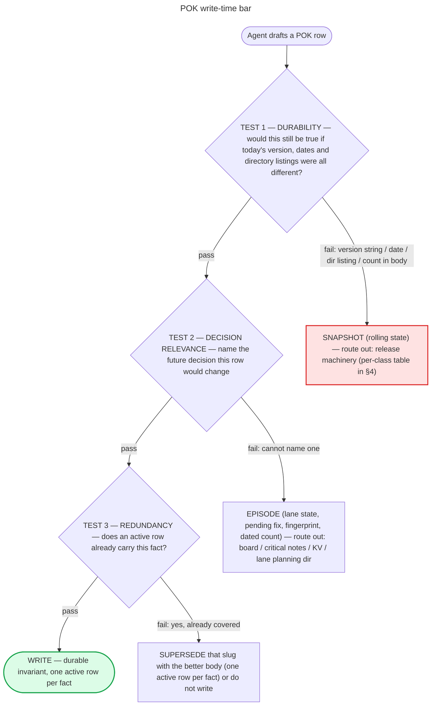

# guideline-pok-durable-vs-rolling-state

**Status:** draft · **Feature:** POK content doctrine — the store holds DURABLE operating knowledge; ROLLING state-snapshots and EPISODES do not belong in it. Motivated by the storage-cap arc 64 → 256 → 512 (this lane: cap-constant commit `6832fd49c` + the curator slug→row resolver fix landing in parallel), a curation pass that could reclaim only ~2% of a capped store, and the PM's deep POK audit (job `f86519a0`) — whose duplicate-fragmentation finding (≈41% of reachable rows) drives TEST 3 of the v2 write-time bar. · **Audience:** operator / agent / both

## 1. Purpose & doctrine

Project Operating Knowledge (POK) is the per-project store of **durable operating knowledge**: invariants, traps, conventions, and contracts that stay true until the code changes them. The ruling this guideline embodies: **rolling state-snapshots are not durable knowledge and must not be parked in POK** — the store has **no time-based expiry** and nothing forces a refresh, so a snapshot written yesterday reads as truth today and rots **silently**. The measured motivation: the store's active-entry cap had to be raised 64 → 256 → 512 because agent writes were being REFUSED (`pok_active_cap`, refuse-never-evict), and a curator curation pass could reclaim only ~2% (3 rows of 256) — the real cause was not capacity but content class: rolling state had been parked in a durable-knowledge store, and curation cannot cure an intake disease.

**v2 extension (this edit, still DRAFT):** the doctrine gains its **write-time bar** — three tests a row must pass at write time (§2), per-class routing out of the store (§4), and a truthful account of the trust machinery (§4) — folded in from the PM's deep POK audit (job `f86519a0`), which measured duplicate fragmentation as the largest defect class (≈41% of reachable rows — "reachable rows" = the rows the audit's read traversal could enumerate at audit time, its measured denominator) and the trust machinery as entirely inert. The bar moves the cure from periodic sweeps to intake discipline; nothing here is ratified, and §9 stands untouched.

## 2. States — and the write-time bar (v2)

The doctrine's state model is a CONTENT-CLASS distinction, judged per row — by the **writer, at WRITE TIME**; the store itself never judges class (the trust machinery enforces form only, §4). The v2 **write-time bar** is three tests. A row belongs in POK only if it passes all three: fail TEST 1 or TEST 2 → the content is routed OUT (per-class destinations in §4); fail TEST 3 → supersede the existing row, or do not write at all.

### TEST 1 — DURABILITY (the existing durable rule, sharpened; kills snapshots)

- **DURABLE (belongs in POK)** — an invariant, trap, convention, or contract. From outside it reads as a rule, not a report.
- **Test question:** *would this still be true if today's version number, dates and directory listings were all different?* If the row's truth depends on them NOT being different, it is not durable.
- **Mechanical smell check:** a body containing a version string, a date, a directory listing, or a count is a **snapshot** — rolling state, out of POK (convert it, §4).
- **ROLLING (does NOT belong)** — release/staging inventories, "current version" claims, dated directory listings, per-lane inventory snapshots, counts-that-change. What happens to it in POK: it never expires, nothing marks it stale, nothing forces a refresh — **rot is silent**. Intake of this class is the disease the cap arc measured.

### TEST 2 — DECISION RELEVANCE (new in v2; kills episodes)

- **Test question:** *name the future decision this row would change.* If you cannot name one, it is an **EPISODE**, not knowledge.
- **EPISODE (does NOT belong)** — lane state, a pending fix, a file fingerprint, a dated count: true now, a narrative of an episode, changing no future decision. Episodes belong to the board / critical notes / KV / the lane's planning directory — all richer than a 240-char row (per-class routing in §4).
- Class boundary worth honoring: an episode can leave durable knowledge behind — the INVARIANT it taught (the trap, the convention), stated without the episode's dates and names. Write the invariant, not the story.

### TEST 3 — REDUNDANCY (new in v2; kills duplicate fragmentation)

- The audit's **largest measured defect class**: duplicate fragmentation, ≈41% of reachable rows — several active rows carrying one fact in different words.
- **Test question:** *does an active row already carry this fact?*
- **Procedure:** query the fact's DISTINCTIVE tokens (`pok_query` on a unique tool name, a refusal code, a distinctive phrase) **BEFORE** `pok_upsert`. If an active row already covers the fact, **supersede THAT slug with the better body** — one active row per fact — or do not write at all.
- **Why it matters:** this turns the audit's merge clusters from a one-off sweep into a **self-correcting store** — writers converge facts at write time instead of fragmenting them, and the sweep becomes unnecessary.

### Row lifecycle (orthogonal; matters only for the one sanctioned inventory exception, §4(e))

active → superseded (a SUPERSEDE chain) → archived (leader/PM curate). A successor row born by supersede is a normal, curatable row — the supersede chain IS the refresh mechanism. A curated archive FREES the slug: the admission prior is resolved against ACTIVE rows only (`daemon/services/pok_service.py`, upsert step 5, scope `"active"`), so a later `pok_upsert` on an archived row's slug creates a FRESH ACTIVE row; the archived row itself stays terminal and forward-only — it can never be un-archived or resurrected.

## 3. EXACT enablement steps

Not config-armed — this is doctrine plus standing knobs; there are no env keys, no commands, no restart requirements:

- Storage cap: `POK_ACTIVE_CAP_PER_PROJECT` = **512** (`daemon/services/pok_service.py:104`, this lane's commit `6832fd49c`; the single-source restatement of the sizing set is row **A-13** in `.agents/shared/planning/project-operating-knowledge/decisions.md`). Verify by grep at use time — anchors drift. At the cap, `pok_upsert` REFUSES (`pok_active_cap`) rather than evicting. The count is enforced in Python only — no SQL CHECK, trigger, or migration encodes it (per the 64→256 historical entry, `CHANGELOG.md:226-230` — left byte-intact).
- The injection budget is a SEPARATE standing constraint — never confuse it with the storage cap: `POK_BLOCK_MAX_ENTRIES` = 8 and `POK_BLOCK_MAX_CHARS` = 2,900 (`daemon/services/pok_service.py:122` / `:120`; budget enforcement in `daemon/services/pok_injection.py:379-380,474`). The storage cap bounds what may EXIST in the store; the injection budget bounds what may RENDER into a prompt per turn.
- Refresh mechanism for sanctioned inventory: **SUPERSEDE** — same slug + changed content supersedes the prior row (admission → supersede-or-insert, `daemon/services/pok_service.py:310`; outcome labels `created | superseded | no-op`, `:240`).
- Curation: `pok_curate` is **leader/project-manager ONLY** (`daemon/tools/pok.py:410`; authority contract `:13`, `:27`). Regular agents govern content CLASS at write time; they cannot pin, dispute, or archive.
- What NOT to do: never encode the count in SQL; never treat the injection budget as the cap; never "cure" the cap by blind-archiving a high-traffic row — the refusal's named archive candidate is the OLDEST row, not the least valuable one.

## 4. The rules that bite

- **THE CONVERSION RULE (the practical bit).** When you catch yourself writing a row that names a version, a directory, a date, or a count-that-changes, you are writing a snapshot — convert it to the INVARIANT instead. Worked example: instead of a row listing today's release directories, write "release inventory is derived from the release dirs + tags; live promote is the user's ceremony." The invariant does not rot.
- **Where rolling state goes instead — per-class routing (v2).** Every class the tests reject has a richer home; routing by class, not by habit:

  | Rejected class (what you caught yourself writing) | Destination | Why the destination is richer |
  |---|---|---|
  | Release/staging inventory; "current version" claims; dated directory listings | the release machinery — release dirs, tags, `releases/state.json` — **the tree is the source of truth** | the tree cannot lie about itself; a row can, silently |
  | Machine-scoped transient state — file fingerprints, in-flight counts, session-scoped values | `shared_meta_kv` | mutable by design, machine-scoped, no 240-char fence |
  | Curated project contracts / traps agents must read | critical notes (`project_cn_*`) | curated, pinned, retrieval-tuned — built for exactly this load |
  | Human-facing project state — milestones, lane progress, episode narratives | the board / PM ledger | the human-facing ledger; updated in place, never rots silently |
  | Lane working state — a pending fix, episode detail, dated counts | the lane's planning directory (`.agents/shared/planning/<lane>/`) | full documents, versioned with the lane, unlimited length |

- **(e) The ONE sanctioned POK exception (unchanged):** IF an inventory must live in POK, it lives as ONE active row per inventory, refreshed by giter via SUPERSEDE (a supersede chain) — never a growing set of dated rows.
- **Silent rot has NO signal.** No expiry event, no stale marker, no refresh pressure; yesterday's truth reads as today's truth. No signal — mitigation is prevention discipline at write time (the conversion rule) plus the sanctioned one-row supersede-chain pattern.
- **Rot is also STRUCTURALLY AMBIGUOUS under supersede.** A rolling-inventory row is not merely stale: its slug can come to carry an ARCHIVED root AND a fresh ACTIVE successor at the same time (curation archives the root; the freed slug admits a new row), and slug resolution then answers differently BY SCOPE (active > archived > superseded) — so "which row is THE fact?" has no scope-free answer. A durable invariant has no such ambiguity: one active row, one fact, one reading.
- **The refusal is a design outcome, not an error.** `pok_active_cap` (value at this release: 512) REFUSES rather than evicts — it NAMES an eviction candidate (`oldest_least_verified`) in the envelope but NEVER evicts anything; curation (`pok_curate`, leader/PM) is the ONLY way to free a slot. The cure is curation plus conversion of snapshot rows into invariants — never mass-archival to free slots for more snapshots.
- **Curation is not intake.** Even a correct curation pass reclaims single-digit rows (~2% observed); only write-time content-class discipline stops the refill.

### The trust machinery (v2): FORM is enforced, VALUE never is

Why write-time discipline is load-bearing — nothing behind the writer checks content:

- **(i) The write path enforces FORM, never VALUE.** The slug regex, the 240-char escaped body budget, the single-paragraph fence, the family cap, the active-entry cap — every check on the write path is a form check. There is **no durability test, no decision-relevance test, no redundancy test at write time**, and dedupe fires only on exact-normalized-body-under-the-same-slug — so re-worded duplicates pass freely. A green `pok_upsert` proves the row is WELL-FORMED; it says nothing about the row being durable, decision-relevant, or novel.
- **(ii) The trust machinery is inert, store-wide (measured by the audit).** `verify_count = 0` on every row the audit examined (reachable rows, at audit time), `pinned = 0`, `disputed = 0`, `source_tier = 'agent'` everywhere. The decay ranking therefore never differentiates, and writers get no feedback from any trust dimension — no signal currently tells you a row went stale, was wrong, or duplicated another (the machinery is inert as measured).
- **(iii) What `access_count` means — and what it must never be read as.** It is **retrieval-driven, NOT use-driven**: it counts query matches, rewarding keyword-matchability, not truth or usefulness. A high-`access_count` snapshot row is still a snapshot; popularity of match is never validation of content.

## 5. Verification & probe

- Cap-constant truth at use time: `grep -n "POK_ACTIVE_CAP_PER_PROJECT = " daemon/services/pok_service.py` → expect `512` (this lane). A number cited from memory is an open defect — anchors drift.
- Snapshot-smell probe over the store: `pok_query` for version/date/dir-shaped terms (a released version string, a dated directory listing, a "current" count); a hit whose body asserts point-in-time state is a conversion candidate. Reads are universal (any agent); archiving the hit is leader/PM only (`pok_curate`).
- A probe not run means nothing: an ungoverned snapshot row in the store is an open risk, not a pass.

## 6. Evidence discipline

- Refusal envelope: `pok_active_cap` (`daemon/services/pok_service.py:460-469`) — refuse-never-evict; the error names the archive-cure vocabulary but never writes an archive itself, and the oldest row is not automatically the right cure.
- Upsert audit is content-free: action + slug + project + actor + audience (`daemon/tools/pok.py:273`) — never the row body.
- Supersede outcomes are recorded as `created | superseded | no-op` (`daemon/services/pok_service.py:240`); a superseded row keeps a readable lineage.
- The "nothing happened" path is the trap: a silently-rotting snapshot row emits NOTHING — no log line, no expiry event. Absence of complaints is not evidence of freshness.

## 7. Rollback

- Cap bump (`6832fd49c`): fix-loss-only — a one-constant change; no migration, no schema change; rows written under 512 coexist with the schema untouched. An OLD binary (cap 256) serving a store that holds more than 256 active rows resumes refusing new admissions (refuse-never-evict); no existing row is lost.
- Doctrine rollback (this guideline): docs-only — removing it changes no store behavior, and snapshot intake resumes silently with it.

## 8. First real use

Has not happened yet as a standing practice — the lane must not be relied upon until it does. The motivating events predate the doctrine and are its evidence, not its exercise: the 2026-11-17 curation pass (3 rows archived, 253/256 active) and the cap bump itself. The first genuine exercise will be the first giter-maintained inventory supersede-chain; until that exists, release inventory must be read from the tree (release dirs + tags + `releases/state.json`), never from POK.

## 9. Status

draft — authored 2026-11-17 by the pok-cap-curator lane's TASK-3 executor; a human ratifies canonical later. Honest gaps: the critical-note id is now filled — `571c4019-f44d-4a46-bbe2-aba4911bf1c2` (filled by commit `7c4972d22`); this lane's CHANGELOG entry landed as commit `3f3072429` under `## [Unreleased]` with title "POK active-entry storage cap 256 → 512; curator slug→row resolver fix"; no board item exists for this lane; §5's probes are ad-hoc greps verified at write time, not a registered test pack. Header converted to the shipped one-line form (`**Status:** … · **Feature:** … · **Audience:** …` at physical line 3, `tests/unit/tools/test_guidelines_registration.py` test_c2 shape); the registration count pin is DERIVED from the directory (`EXPECTED_GUIDELINE_COUNT = len(glob("*.md"))`) — a new guideline file moves it automatically, so no literal bump exists or was needed.

## 10. Source-of-truth pointers

- Cap constant: `daemon/services/pok_service.py:104` — `POK_ACTIVE_CAP_PER_PROJECT = 512` (commit `6832fd49c`); verify by grep at use time.
- Active-cap single-source row: `.agents/shared/planning/project-operating-knowledge/decisions.md` **A-13** — the ONE authoritative restatement of the sizing set; the cap-value marker discipline lives there (bare unmarked cap numbers outside it are a defect in that artifact set).
- Refusal code: `pok_active_cap` — `daemon/services/pok_service.py:461`.
- Curator tool: `daemon/tools/pok.py:410` (`pok_curate`, leader/PM only; authority contract `:13`, `:27`); service `daemon/services/pok_service.py`; repository `daemon/repositories/pok/` (`models.py`, `repository.py`).
- Injection budget: `POK_BLOCK_MAX_ENTRIES = 8` (`daemon/services/pok_service.py:122`), `POK_BLOCK_MAX_CHARS = 2_900` (`:120`); enforcement `daemon/services/pok_injection.py:379-380,474`.
- Guideline house: `docs/guidelines/README.md` (naming, placement, lifecycle); shape `docs/guidelines/TEMPLATE.md`.
- CHANGELOG: entry titled exactly "POK active-entry storage cap 256 → 512; curator slug→row resolver fix" — landed as commit `3f3072429` under `## [Unreleased]`; historical arc: `## [0.29.11] — 2026-11-10` "POK active-entry admission cap raised 64 → 256" at `CHANGELOG.md:226-230` (byte-intact).
- Critical note (doctrine): `571c4019-f44d-4a46-bbe2-aba4911bf1c2` — "DOCTRINE — POK holds DURABLE operating knowledge only; rolling state routes to KV / critical notes / board / release tree; storage cap ≠ injection budget" (convention, high); paired POK pointer row: `pok-scope-01-rolling-state-out` (slug reserved — row lands in a later lane).
- Board item: none found (searched `.agents/shared/` + `git log --grep`, read-only, 2026-11-17).
- Lane commission: tracked via shared_meta_kv claim `wt.claim.pok-cap-curator` (worktree `ensemble-src-wt-pok-cap`, branch `feature/pok-cap-curator-resolver`, no promote).
