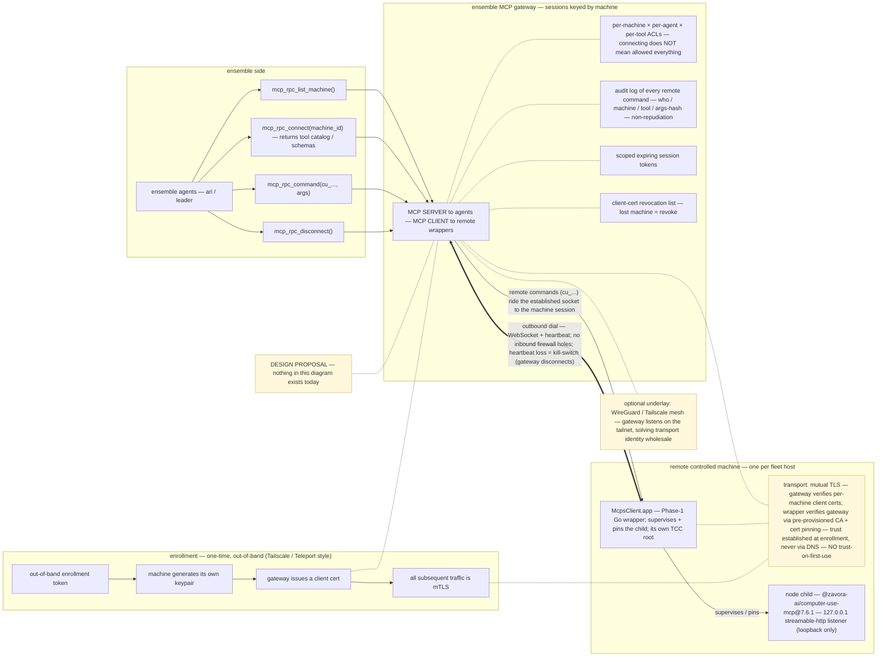

# mcps_client — CU Wrapper & Remote-Hands Architecture

> **DESIGN PROPOSAL — status: proposed / not implemented.**
> Nothing in this document exists in the codebase today: no
> `mcps_client` project, no `.app` wrapper, no gateway, no
> ensemble-side HTTP transport change. This is the agreed design
> (2026-10-16) for the wrapper architecture plus the small future
> ensemble-side change that consumes it. Treat every "proposed"
> verb below as future work.

> **STATUS UPDATE — 2026-10-24.** The daemon-side `cu` builtin described
> below was REMOVED in `feature/remove-cu-builtin`; the `mcps_client`
> wrapper + gateway + `mcp_rpc` path has since shipped and superseded it.
> This document remains the architecture reference for that path — see the
> historical stub at [`docs/mcp-computer-use-server.md`](./mcp-computer-use-server.md).

| Field | Value |
|---|---|
| **Date** | 2026-10-16 |
| **Status** | **Proposed / not implemented** — design proposal (docs-only deliverable) |
| **Audience** | Daemon operators; future maintainers of the `cu` builtin and of the standalone `mcps_client` project |
| **Applies to** | The `cu` builtin ONLY — see Scope below |
| **Related** | [`docs/mcp-computer-use-server.md`](./mcp-computer-use-server.md) — the cu builtin as built today (npx-stdio wiring, TCC notes, pin policy) |

---

## Scope — ONE builtin moves; everything else stays

> **NOT all stdio MCPs move to this architecture. ONLY the
> computer-use MCP — zavora `@zavora-ai/computer-use-mcp@7.6.1`,
> the `cu` builtin — adopts the new wrapper architecture. All
> other stdio MCPs stay exactly as they are.**

This constraint is load-bearing and is repeated wherever the
architecture is discussed below (Phase 1, Phase 2). The TCC
problem this design solves is unique to desktop-control servers;
there is no platform migration here for ordinary stdio servers.

---

## Background — live investigation on the prod machine (2026-10-16)

### How the cu builtin spawns today

The cu builtin spawns via npx (stdio) as a daemon child. The
live process tree on the prod machine:

```
Terminal.app → zsh → launcher → ensemble-prod → npm exec → node (nvm v22.21.1)
```

The node child is the process that posts CGEvents (input
synthesis) and captures the screen.

### How macOS TCC attributes the grant

- TCC attributes permission to the **"responsible process"** —
  the nearest ancestor `.app` bundle in the process tree. For
  today's spawn chain, that is **Terminal.app**.
- Raw binaries (`ensemble-prod`, and equally any plain Go
  binary) are **skipped by the responsibility chain** — they are
  never the attribution target.
- Grants do **NOT** inherit downward from plain parent binaries.
  Wrapping the server in a plain executable buys nothing: the
  grant still lands on the enclosing `.app` context, or nowhere.

### cu_doctor today

`cu_doctor` currently reports **10/14 checks passing**; the two
failures are **Accessibility** and **Screen Recording** (not
granted). The interim workaround already documented with the
builtin: grant Terminal.app both toggles + restart the daemon —
which is precisely the over-broad grant this proposal exists to
replace.

### Upstream already speaks streamable-http

Investigation of the installed zavora package found it
**natively supports streamable-http**:

- `mcp-server.toml` ships `transports = ["stdio", "streamable-http"]`
- `package.json` `bin` includes `computer-use-mcp-http` (`dist/http.js`)

The HTTP path is therefore possible **without any upstream
changes** — the wrapper can drive the pinned package over its own
first-class transport.

---

## Problem

The TCC grant lands on Terminal.app, which is:

- **Too broad** — everything run from the terminal inherits
  desktop power over the host.
- **Wrong-shaped** — the grant should be scoped to the cu server
  only, not to the operator's entire shell environment.

Two further operational costs of the npx-stdio spawn:

- **nvm/npx path fragility** — the daemon's child depends on the
  user's node version manager resolving `npx` and the right node;
  an nvm upgrade can silently break the spawn path.
- **Cold-spawn latency per daemon boot** — every boot pays the
  `npm exec` resolution + package cold-start before the tool
  surface is ready.

---

## Phase 1 — local wrapper (days-scale)

> Scope reminder: ONLY the `cu` builtin moves to this wrapper.
> All other stdio MCPs stay exactly as they are.

```mermaid
flowchart TD
    %% cu builtin on macOS — the contrast is where the TCC responsibility root sits
    subgraph TODAY["Today — npx stdio child of the daemon"]
        T1["Terminal.app — the .app bundle, TCC responsible process"]
        T2["zsh"]
        T3["launcher"]
        T4["ensemble-prod — raw binary"]
        T5["npm exec"]
        T6["node — nvm v22.21.1, running @zavora-ai/computer-use-mcp@7.6.1 in stdio mode"]
        D1["macOS desktop"]
        T1 --> T2
        T2 --> T3
        T3 --> T4
        T4 --> T5
        T5 --> T6
        T6 -->|"posts CGEvents"| D1
        TA1["TCC grant — Accessibility + Screen Recording — lands on Terminal.app: TCC attributes permission to the nearest ancestor .app bundle, the responsible process"]
        TA2["TOO BROAD: everything run from the terminal gets desktop power. Raw binaries like ensemble-prod are skipped by the responsibility chain — grants do not inherit downward from plain parent binaries"]
        T1 -.-> TA1
        T1 -.-> TA2
    end

    subgraph PROP["Proposed Phase 1 — mcps_client local wrapper"]
        P1["ensemble daemon — cu builtin, now a streamable-http client"]
        P2["McpsClient.app — Go supervisor; proper .app bundle with Info.plist + stable bundle ID; installed as LaunchAgent; its OWN TCC responsibility root; code-signed with one stable self-signed cert"]
        P3["node child — vendored pinned node runtime, immune to nvm upgrades, running @zavora-ai/computer-use-mcp@7.6.1 in streamable-http mode"]
        D2["macOS desktop"]
        P1 -->|"HTTP 127.0.0.1 + auth token"| P2
        P2 -->|"supervises / pins"| P3
        P3 -->|"posts CGEvents / screen capture"| D2
        PA["ONE TCC grant — Accessibility + Screen Recording — to McpsClient.app covers the wrapper AND all its MCP children. A raw Go binary would NOT fix attribution."]
        P2 -.-> PA
    end

    classDef note fill:#fff8dc,stroke:#c9b458,stroke-width:1px
    class TA1,TA2,PA note
```



### `mcps_client` — a Go supervisor

A new **standalone Go project** (`mcps_client`) acts as a
supervisor that:

- spawns and **pins** the cu MCP server as its node child, with
  a **vendored/pinned node runtime inside the wrapper** — nvm
  upgrades on the host can no longer break the spawn path;
- exposes MCP over **streamable-http bound to `127.0.0.1`**
  (loopback only) with an **auth token** on the listener.

### `.app` bundle + LaunchAgent — REQUIRED for TCC

The supervisor ships as a **proper `.app` bundle** (e.g.
`McpsClient.app`, with `Info.plist` and a stable bundle ID) and is
installed as a **LaunchAgent**. This is not packaging polish; it
is the mechanism that fixes attribution:

- the `.app`/launchd context makes the wrapper **its own
  responsibility root**, so **ONE Accessibility + Screen
  Recording grant to the `.app`** covers the wrapper and all its
  MCP children;
- a **raw Go binary does NOT fix attribution** — plain binaries
  are skipped by the responsibility chain (see Background), and
  the grant would land somewhere else or nowhere.

### Stable code signing in EVERY build path — mandatory

**One self-signed certificate on the build machine signs every
build.** This is mandatory because macOS TCC keys the grant to
the code identity: each unsigned/ad-hoc rebuild changes the
cdhash and the TCC grant **silently breaks**. Both build paths
must therefore sign with the same stable identity:

| Build path | Where it lives |
|---|---|
| (a) Integrated into this repo's `make install` | the ensemble build pipeline |
| (b) A standalone build script | inside the `mcps_client` project |

### Ensemble side (small change, future PR)

The cu builtin switches from npx-stdio spawn to a
**streamable-http client against `127.0.0.1`**. Implementer
notes for that PR:

- **Generalize the D7-style config-shape guard** — the exact-pin
  match pattern the `/mcp-servers/test-connection` probe uses
  today (see [`docs/mcp-computer-use-server.md`](./mcp-computer-use-server.md)
  → *Version-pin policy*) needs an HTTP-config-shaped variant so
  the guard tracks the new transport shape atomically.
- **Do not inherit the GATING GAP** — `preload_mcp_tools` today
  lists `is_active` rows with **NO availability gate** (known
  blueprint gap; a kill-switch flipped after an ON-boot leaves a
  stale enabled row that cold discovery will happily spawn). The
  HTTP mode must not inherit that gap.

### Concentration risk → internal policy layer

One binary now holds the desktop permissions: any embedded-MCP
bug inside the wrapper equals **full compromise of the host's
desktop**. Mitigation is an **internal policy layer** in the
wrapper:

- per-server enable flags,
- per-tool gating,
- an audit log.

Precedent exists: zavora already ships policy/audit concepts
(`COMPUTER_USE_ALLOWED_APPS` / `COMPUTER_USE_BLOCKED_APPS`, audit
JSONL) that the wrapper can model its layer on.

---

## Phase 2 — remote hands (weeks-scale)

> Scope reminder: within ensemble, remote hands still routes
> desktop control to the `cu` server on each enrolled machine —
> this is not a general stdio-MCP migration. The MCP-native
> protocol below is what makes the wrapper independently
> reusable elsewhere.



### Topology — outbound only

`mcps_client` connects **OUTBOUND** to an ensemble MCP gateway
(**WebSocket + heartbeat**) — there are **no inbound firewall
holes** on the controlled machines.

### Agent-facing tool surface

```
mcp_rpc_list_machine()
mcp_rpc_connect("machine_id")   → returns tool catalog / schemas
mcp_rpc_command("cu_...", args)
mcp_rpc_disconnect()
```

### Wire protocol stays MCP-native

The wire protocol stays **MCP-native internally**: the gateway is
an **MCP server to the agents** and an **MCP client to the remote
wrappers**, with **sessions keyed by machine**. This is what
keeps `mcps_client` reusable by **ANY MCP client in other
projects** — a bespoke RPC vocabulary would kill that reuse.

### Security model — MUTUAL auth, not one-way

| Property | Design |
|---|---|
| **Client verifies server** | Pre-provisioned CA + cert pinning; trust established at enrollment, **never via DNS**; **NO trust-on-first-use** (too phishable for remote hands) |
| **Server verifies client** | Per-machine client certs + revocation list — lost machine = revoke |
| **Enrollment flow** | Tailscale/Teleport-style: out-of-band enrollment token → machine generates keypair → server issues client cert → all traffic mTLS |
| **Command authorization** | Per-machine × per-agent × per-tool ACLs at the gateway; **connecting ≠ allowed everything** |
| **Audit** | Every remote command logged (who / machine / tool / args-hash) — non-repudiation |
| **Sessions** | Scoped expiring tokens; heartbeat doubles as kill-switch (disconnect on loss) |
| **Optional underlay** | WireGuard/Tailscale mesh solves transport identity wholesale — gateway listens on the tailnet |

### Operational notes

- **Screenshot payloads are large** — quality/diff knobs are the
  lever (the cu tools already have quality parameters).
- **Per-command timeouts** — `CU_TOOL_CALL_TIMEOUT_SECONDS`
  already exists on the ensemble side and is the precedent shape.
- **One-time local admin grant per enrolled machine** — the TCC
  grant to the wrapper `.app` is a manual local-admin action per
  machine; MDM profiles are the at-scale answer.

---

## Phase 3 — fleet (outline)

On top of Phase 2's primitives:

- roster UI,
- approval gates for destructive ops,
- revocation UI,
- multi-machine.

---

## Open questions

| # | Question | Note |
|---|---|---|
| 1 | Port allocation | which loopback port the wrapper's streamable-http listener binds |
| 2 | Localhost auth token scheme | how the daemon authenticates to the `127.0.0.1` listener |
| 3 | Builtin config-shape change details | the cu builtin's config-shape/schema change for HTTP mode, and the generalized D7-style guard that must track it |
| 4 | Cross-platform story | Windows/Linux have different permission systems (AT-SPI/X11 vs macOS TCC); the design is **macOS-first** |

---

## Linked documents

* [`docs/mcp-computer-use-server.md`](./mcp-computer-use-server.md) —
  the cu builtin as built today (npx-stdio wiring, TCC grants,
  pin policy, kill-switches, D7 guard).
* `daemon/mcp/builtin_servers/computer_use.py` — single source of
  truth today for the package pin, profile, prefix, and
  kill-switch that the Phase-1 ensemble-side PR will modify.
* `daemon/routers/mcp_servers.py` — the D7-style config-shape
  guard referenced by the Phase-1 implementer notes.
* `daemon/services/mcp_service.py` — `preload_mcp_tools` and the
  availability-gate gap the HTTP mode must not inherit.
