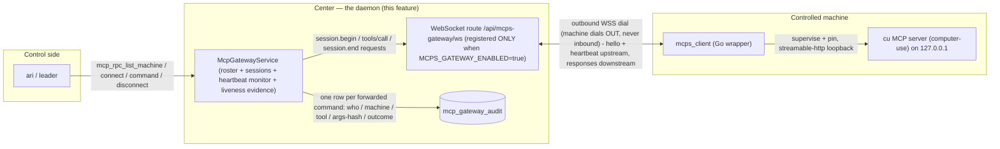
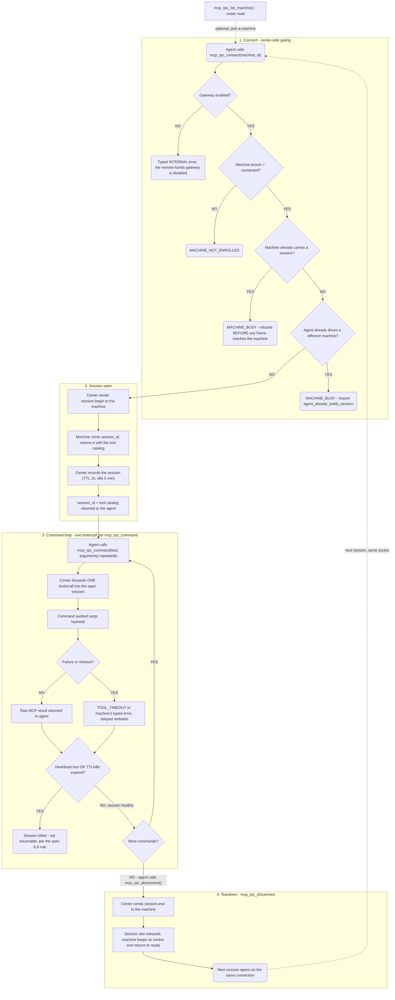

# The remote-hands center gateway (Phase B)

| Field | Value |
|---|---|
| **Date** | 2026-10-22 |
| **Status** | As-built (Phase B) — operator/ops runbook for the daemon-side center of the remote-hands protocol, SPEC.md v0.1 |
| **Audience** | Daemon operators; the `ari` and `leader` agents (the only holders of the `mcp_rpc` tool category) |
| **Protocol** | `mcps_client/SPEC.md` v0.1 (normative, READ-ONLY for this repo) |
| **Phase-A interpretations** | `mcps_client/docs/spec-interpretations.md` |
| **Design proposal (Phase A)** | [`docs/mcps-client-remote-hands.md`](mcps-client-remote-hands.md) |
| **Doc-pin test** | `tests/unit/test_mcps_gateway_docs.py` |

---

## 1. What this is

The daemon is the **center** of the remote-hands protocol (SPEC.md v0.1). A
controlled machine runs the `mcps_client` Go wrapper, which dials **out** to
this daemon over WebSocket; the daemon authenticates the machine on the WS
upgrade, negotiates the protocol version and the capability map, tracks
heartbeat liveness, brokers the sessions, forwards the MCP traffic and audits
every forwarded command.

The machine never accepts an inbound connection (SPEC §2.3) — no inbound
firewall holes, no port-forwarding, no VPN.



### 1.1 The module map

| Module | Owns |
|---|---|
| `daemon/services/mcps_gateway/config.py` | every knob under the `MCPS_GATEWAY_` prefix + the kill switch |
| `daemon/services/mcps_gateway/protocol.py` | the wire vocabulary — the §6.1 envelope, the §6.3 methods, the §5.3 capability map, the §6.5 typed error codes |
| `daemon/services/mcps_gateway/store.py` | the machine roster (presence + liveness), behind a `MachineStore` interface |
| `daemon/services/mcps_gateway/sessions.py` | the session manager — the §8.3 one-session-per-machine lock and the §8.2 one-agent-one-remote rule |
| `daemon/services/mcps_gateway/audit.py` | the remote-command audit (§8.4) — args hashed, never stored |
| `daemon/services/mcps_gateway/service.py` | the center itself: hello exchange, heartbeats, the four MCP methods, the monitor sweep |
| `daemon/routers/mcps_gateway.py` | the thin FastAPI adapter — upgrade auth, the read loop, teardown (the MODULE-LANE transport) |
| `daemon/routers/mcps_gateway_read.py` | the Phase C READ surface — the three OAuth-lane read-only GET endpoints (machines / sessions / audit) |
| `daemon/routers/mcps_gateway_schemas.py` | the Phase C response models — the FE-facing wire contract |
| `daemon/tools/mcp_rpc_tools.py` | the four agent-facing `mcp_rpc_*` tools |
| `daemon/repositories/mcps_gateway/` | the `mcp_gateway_audit` table + writer (the audit sink) |
| `daemon/manager.py` (`mcps_gateway_service` property) | the one-per-process mount both the route and the tools share |

The service package is importable **without** the FastAPI app, so the unit
tests drive the whole protocol against a fake transport.

### 1.2 The machine model (roster + presence)

A machine is a stable `machine_id` that completed the hello exchange
(§5.1). The center keeps a roster (§8.1) with three presence states:

* **`online`** — the heartbeat is within `heartbeat_timeout_ms`;
* **`stale`** — the heartbeat is late (the socket is still open; the session
  may already be dead);
* **`offline`** — the socket is closed.

Reconnect tolerance (§8.1): a machine that reconnects after a blip re-appears
in the roster on its next upgrade; it does **not** re-enroll. A machine
that upgrades but **never sends `hello`** is disconnected after a
pre-hello deadline (30 s) — a silent peer does not hold a socket open
indefinitely.

The v0.1 roster is **IN-MEMORY** — a daemon restart empties it and every
open session dies with it. The store sits behind the `MachineStore`
interface so a DB-backed implementation can replace it without touching the
service (see §6).

### 1.3 The session model

* The **machine mints the `session_id`** (§6.4); the center adopts it. The
  center never mints one.
* A session **belongs to its connection** (§6.8): a socket that dies kills
  the session it carried — the session is *killed*, never paused, and its id
  is dead afterwards. There is **no session resumption in v0.1**.
* Sessions carry a **TTL ceiling** (`MCPS_GATEWAY_SESSION_TTL_MS`, default
  1 h) and an **idle timeout** (`MCPS_GATEWAY_SESSION_IDLE_TIMEOUT_MS`,
  default 5 min); the center enforces both (§3.3) and answers
  `SESSION_EXPIRED` past them.
* The **catalog travels with `session.begin`**: the machine's answer carries
  the `session_id` **and** the remote tool catalog, verbatim (§6.4 — the
  center MUST NOT rewrite, rename or drop schemas). The center issues no
  separate `tools/list` in v0.1.

### 1.4 The one-active-session-per-machine lock (§8.3)

The v1 policy is **exclusivity**: while a session is open on a machine, no
second session may open on it. The SPEC lets the center either queue or
reject; this center **rejects with `MACHINE_BUSY`** — and the lock is
enforced **by the center, before any frame reaches the machine**. The
refusal is **atomic**: the busy-check and the session record happen under
one lock, so a concurrent second connect to a busy machine loses the race
cleanly and is refused by the **center** — it is never delegated to the
machine's own concurrent-`session.begin` refusal (which would merely have
to be translated). A second dimension of the same policy (§8.2) limits
one agent to one remote at a time; a second `mcp_rpc_connect` from an
agent that already holds a session on a *different* machine is also
refused with `MACHINE_BUSY` (`reason: agent_already_holds_session`).
`mcp_rpc_disconnect` (or expiry, heartbeat loss, or socket loss) ends the
session and **releases the slot**; the machine keeps its socket and
returns to `ready`, so the next session opens on the same connection. On
reconnect, the center ends the old connection's session **immediately** —
there is no heartbeat-timeout window during which the machine answers
`MACHINE_BUSY` for a session whose connection is already gone.

### 1.5 Where the audit records land

Every forwarded `tools/call` writes one append-only row into the DB table
**`mcp_gateway_audit`** with **who / machine / tool / args-hash / outcome**
(§8.4 — see §4.3 below for the column set and the hashing). The table is
created by the model's `create_all` at boot (PostgreSQL) plus the migration
`20261022_000001_create_mcp_gateway_audit.sql` (SQLite). The sink is the
DB **unconditionally** — there is no file-sink knob (the audit write is
also off the event loop; see §4.3). The ledger is read over HTTP by the
Phase C read surface (`GET /api/mcps-gateway/audit`, §8); the repository
method `McpGatewayAuditRepository.list_recent(limit, offset)` is the seam
underneath it, and the DB remains the direct path for ad-hoc queries.

### 1.6 The kill switch

`MCPS_GATEWAY_ENABLED` is **DEFAULT OFF**. While it is off the WebSocket
route is **NOT REGISTERED AT ALL** — the daemon answers **404** on the path;
it is not "registered but rejecting". The four `mcp_rpc_*` agent tools
refuse with a typed error, and the service object still exists (the manager
mounts it) so the tools can answer with a typed refusal instead of
vanishing. Full activation procedure: §2.

### 1.7 The audit projection (one helper, ONE read site)

The wire shape of an audit row is produced by **one** helper —
`audit_row_to_wire(row)` next to `AuditRecord` in
`daemon/services/mcps_gateway/audit.py` — and installed at exactly **ONE
read site**: the wire router (`daemon/routers/mcps_gateway_read.py` —
the helper's single production call, pinned by a source census in
`tests/unit/test_mcps_gateway_audit_projection.py`). The in-memory
sink's read (`MemoryAuditSink.list_recent`) deliberately returns the
STORAGE shape — the DB row's keys minus `id` — and never projects; the
projection happens at the router only. The contract
is `AUDIT_WIRE_KEYS`: ids `""` → `None`, text `None` → `""`, and the
storage-only members `id` and `detail` are **never emitted**.

The **write path is EXCLUDED by design, not as a gap**: the repository's
write projection persists `id` (the primary key) and `detail` (the
center-authored classification) — a wire projection at the write site
would drop both, and the stored row is separately pinned. Normalisation
happens at exactly **ONE** point (the router), so the helper is
shape-agnostic AND idempotent: it accepts `created_at` OR `timestamp`,
never synthesizes "now", and feeding an already-projected dict is a
no-op.

Two real divergences the helper absorbs (history worth keeping):

* **id-absence** — the in-memory record has no `id` member while the
  DB row does; the projection drops it on both sides.
* **empty-vs-synthetic stamp** — the memory sink exposes `""` verbatim
  when the producer left `created_at` unset, while the DB WRITE path
  substitutes `now_utc_iso()` at write time ⇒ the same logical record
  reads back differently per sink (empty → wire `None` from memory; a
  real stamp from the DB). The projection maps both to the same wire
  shape; the divergence is then only in the VALUE, as documented.

---

## 2. Enablement & activation

This is the critical ops section. The gateway ships dark and needs two
things to come alive:

1. **Enable the env var** — set `MCPS_GATEWAY_ENABLED=true` (plus at least
   one enrollment token, §2.3) in the daemon's environment.
2. **Restart the daemon.** Env changes are NOT hot-reloaded — the route
   table is composed once at boot inside `create_app` (`daemon/api.py`),
   and the running service holds a **boot-time config snapshot**
   (`McpGatewayService.__init__` takes `load_gateway_config()` once;
   `manager.__init__` builds it), so **activation requires a daemon
   restart**. That is also true for every OTHER knob in §2.2: the values
   are read when the service is CONSTRUCTED, not at call time — editing
   an env var on a running daemon changes nothing until the restart. (The
   `load_gateway_config()` function itself reads the environment each
   time it is CALLED, which is why a unit test that builds a fresh
   service with `monkeypatch.setenv` sees the new value.)

**Restart discipline:** an agent living inside this daemon cannot run
stop-then-launch sequentially from its own turn — any live turn dies when the
daemon stops. Wrap both in ONE pre-detached supervisor: the `setsid` one-liner
is the Linux form (macOS has no `setsid` — use a python `os.fork()` +
`os.setsid()` supervisor, the mechanics that fired 2026-10-24, exactly once).
Honest state: end-to-end detach→daemon-up is NOT yet verified — that launch
crash-looped on PyInstaller _MEI extraction and the recovery was user-manual.
Sanitize the launch env, poll past the launcher backoff (>120s), ALERT (page
the user) on a not-alive outcome; full runbook in `agents/gaia/workflow.md` (CONFIG).

### 2.1 What "off" means concretely

* The route `/api/mcps-gateway/ws` does not exist — an HTTP/WebSocket
  client gets a **404**, and the daemon logs
  `remote-hands gateway is DISABLED (MCPS_GATEWAY_ENABLED) — the route ...
  is not registered` at boot.
* **All four `mcp_rpc_*` tools refuse while the gateway is disabled** —
  every one of the four service entry points (`roster`, `connect`,
  `command`, `disconnect`) runs the same enabled assertion and returns
  `{"error": {"code": "INTERNAL", ...}}` with the message `the
  remote-hands gateway is disabled`. The tool layer never looks healthy
  while the transport is dead.
* No machine can enroll: there is no listener at all.

### 2.2 The knobs

Every knob lives under the `MCPS_GATEWAY_` prefix and is loaded by
`load_gateway_config()` — which reads the environment when it is CALLED
(never at import time). The RUNNING service keeps the snapshot taken at
construction, so an operator flips a knob with **edit + daemon restart**
(§2); a unit test flips one with `monkeypatch.setenv` because it builds a
fresh service afterwards.

| Knob | Default | Unit | Meaning |
|---|---|---|---|
| `MCPS_GATEWAY_ENABLED` | `false` | boolean | the kill switch — the whole transport |
| `MCPS_GATEWAY_PATH` | `/api/mcps-gateway/ws` | path | the route path (a path outside `/api` mounts at the app level) |
| `MCPS_GATEWAY_TOKENS` | *(empty)* | comma-separated list | enrollment tokens — **empty means nobody may enroll** (fail closed) |
| `MCPS_GATEWAY_ALLOWED_MACHINES` | *(empty)* | comma-separated list | per-machine allowlist of `machine_id`s — empty = every authenticated machine is enrolled |
| `MCPS_GATEWAY_HEARTBEAT_INTERVAL_MS` | `15000` | ms | §3.3 heartbeat interval the center advertises — the CLIENT sends a heartbeat on this cadence (it adopts the center's value; the shipped client validates the triplet — `heartbeat_timeout_ms >= 3 x interval`, `client_dead_detect_ms >= 3 x interval` — the same rule the reference client enforces at `internal/remote/protocol.go:266-278`) |
| `MCPS_GATEWAY_HEARTBEAT_TIMEOUT_MS` | `45000` | ms | §3.3 the SERVER-side client-silence kill threshold — after this much heartbeat silence from the machine, the center kills the session and closes the socket; presence also flips to `stale` past it |
| `MCPS_GATEWAY_CLIENT_DEAD_DETECT_MS` | `45000` | ms | §3.3 how long the CLIENT waits for evidence the server is alive — **advisory to the client and enforced client-side**; the center advertises it, the client's own death detector uses it |
| `MCPS_GATEWAY_COMMAND_TIMEOUT_MS` | `30000` | ms | the center's own bound on ONE `tools/call` / `session.begin` / `session.end` wait — past it the answer is `TOOL_TIMEOUT` |
| `MCPS_GATEWAY_READ_TIMEOUT_MS` | `5000` | ms | the OPERATOR READ SURFACE's bound on one DB read (§8.5) — a read that exceeds it answers the degraded body (200 + `degraded:true`), never a hung request |
| `MCPS_GATEWAY_SESSION_TTL_MS` | `3600000` | ms | §3.3 session TTL ceiling (the center enforces it) |
| `MCPS_GATEWAY_SESSION_IDLE_TIMEOUT_MS` | `300000` | ms | §3.3 session idle timeout (the center enforces it) |
| `MCPS_GATEWAY_PING_INTERVAL_MS` | `200` | ms | the WebSocket liveness-ping cadence — the default matches the protocol authority's reference center (it pings at 200 ms); the knob exists so operators can lengthen it |
| `MCPS_GATEWAY_AUDIT_ENABLED` | `true` | boolean | the remote-command audit (§8.4) — `false` skips the audit write entirely |

Parsing rules (`config.py`): booleans accept `1/true/yes/on` and
`0/false/no/off` case-insensitively — anything else logs a warning and keeps
the default; an unparseable or non-positive integer logs a warning and keeps
the default; `CLIENT_DEAD_DETECT_MS` below 3× the heartbeat interval is
**reported** (warning) but not clamped — the operator picked it. Every
warning lands in the daemon log at config load.

Derived behavior (not knobs): the housekeeping sweep runs at
`min(0.1 s, heartbeat_timeout/10)` so a timeout fires on schedule — within
a few percent of the advertised tolerance, with **zero grace** added (the
advertised value must be the real one). The ROUTER also emits **liveness
evidence** — a WebSocket **CONTROL frame (a ping), not a protocol
message** — on the `MCPS_GATEWAY_PING_INTERVAL_MS` cadence (default
200 ms, matching the protocol authority's reference center; raise the
knob to lengthen it). This is the gateway's liveness evidence to the
client: §3.3 makes the client treat "no inbound frame of any kind" as
server death, and a center that only answered requests would look dead to
a correct client — which would reconnect-loop. Being a control frame, the
ping is invisible to the protocol layer (§6.1 carries "one JSON object
per WebSocket text message" — a ping is not a text message). If the ASGI
protocol object is unreachable the transport cannot ping; the daemon logs
one WARNING per connection saying so (an in-process test client has no
protocol object by construction and is not warned).

### 2.3 Enrollment tokens

* Tokens are **operator-provisioned, out-of-band** (SPEC §1: "Token issuance
  happens outside the protocol — there is no enrollment method on the wire").
  Paste one into the machine's client config yourself.
* `MCPS_GATEWAY_TOKENS` is a **comma-separated list** — **multiple tokens
  are supported** (one per machine, or a shared fleet token — the center
  does not care).
* **Empty means nobody may enroll** — the gate is fail closed. A gateway
  enabled without tokens refuses every upgrade and logs
  `the remote-hands gateway has no enrollment tokens; every upgrade is
  refused (fail closed)`.
* The comparison is **constant time** (`hmac.compare_digest`) over **every**
  configured token — the loop never short-circuits, so the comparison time
  does not leak *which* token was presented. There is no plaintext
  downgrade and no fallback path.
* **Rotation = edit the env var + restart the daemon** (§2). The token is
  checked on every WS upgrade, but the token LIST is what a restart
  refreshes reliably alongside route registration — treat restart as part
  of every rotation. (The comparison is constant-time over the UTF-8
  **bytes** of both sides, so a garbage credential answers a clean 401
  instead of crashing the handler.)

### 2.4 Configuring the remote client (the path matters)

The client dials the **center URL** from its own config (`CenterURL`). The
reference client (`mcps_client/internal/remote/transport.go`) **appends its
own default path `/remote-hands/v1` only when the configured URL has no
path** — so for THIS center the configured URL **must include the gateway
path**:

```
wss://center.example:8443/api/mcps-gateway/ws
```

A URL without a path (`wss://center.example:8443`) would make the client
dial `/remote-hands/v1`, which this daemon does not serve → 404. The client
also refuses non-TLS schemes (`ws://`/`http://`): the remote hop is WSS
only (§3.1). On `http(s)://` input it rewrites the scheme to `wss://`.

---

## 3. Security posture — v0.1, stated honestly

The v0.1 tier is a **bearer enrollment token on the WS upgrade + ordinary
server-certificate verification**. Nothing stronger is claimed.

### 3.1 What v0.1 actually does

* The credential travels in the `Authorization: Bearer <token>` header of
  the WSS **upgrade request** (§3.1/§4.1) and is re-presented on every
  reconnect (§6.8). There is **no `auth` method on the wire** — a refused
  upgrade exchanges **no protocol message at all**: the protocol channel
  does not exist yet.
* The TLS hop is verified against the client's trust store (ordinary
  server-cert verification). Note the center itself enforces **no TLS of
  its own**: the WSS guarantee is the client's refusal of `ws://` plus the
  operator's TLS termination in front of the daemon port — an
  unencrypted exposure of the daemon port would be heard by this route.
* The **remote client also supports optional SPKI pinning of the server
  certificate** (`ServerPinSHA256` in its config — the lower-case hex
  SHA-256 of the center's public key). The pin is enforced **in addition
  to** ordinary verification and is a **client-side** concern; the center
  presents an ordinary certificate and knows nothing about pins. SPEC §4.1
  recommends pinning ("fixed trust, never DNS, no trust-on-first-use").

### 3.2 What v0.1 does NOT do

* **mTLS / client certificates are NOT implemented in v0.1.** The
  `client_cert` capability is advertised **`false`** by both sides (SPEC
  §5.3 marks it "optional — reserved for v0.2+"). mTLS is **planned for
  v0.2**; until then the enrollment token is the machine's only credential
  and a stolen token enrolls the thief.
* **No protocol-level auth method exists.** A rejected upgrade answers
  **HTTP 401** with `WWW-Authenticate: Bearer realm="ensemble-gateway"`
  (the realm is advisory — SPEC v0.1 is silent on it) and a plain-text
  body. **Never 403**: the shipped client treats a **401 as fatal**
  (`AUTH_FAILED` → the operator must re-enroll out of band) and anything
  else as transient — a 403 would put the client into an endless reconnect
  loop. **Only the 401 is fatal to the client.**
* **Per-machine allowlist vs per-tool ACL.** `MCPS_GATEWAY_ALLOWED_MACHINES`
  is a **working v0.1 per-machine gate** (a machine outside the list is
  refused `MACHINE_NOT_ENROLLED` at hello). The **per-tool ACL is the v0.2
  tier** and does not exist — `TOOL_DENIED` is reserved for v0.2+ and is
  never emitted (§6.5). There is **no deny-list knob of any kind** in v0.1.

### 3.3 The agent-side authority (two gates, both required)

Only agents whose `meta.json` explicitly lists `mcp_rpc` in `tools.allow`
get the four tools — currently `agents/ari/meta.json` and
`agents/leader/meta.json` **and nowhere else**. The posture is two layers:

1. the `mcp_rpc` category is in `PRIVILEGED_TOOL_CATEGORIES` — one of the
   opt-in-only categories — so the empty-allow inherit universe never
   auto-grants the authority to drive a remote desktop;
2. a **literal tool name** in an allow list bypasses the category gate
   entirely, so every tool body ALSO carries its own
   `agent_id in {"ari", "leader"}` gate (`MCP_RPC_AUTHORIZED_AGENTS`).

The `mcp` category's dynamic prefix sweep matches the `mcp_rpc_*` names
in *shape* (`mcp_<server>_<tool>`), so the sweep is **category-aware**: it
never claims a tool that another registered category owns. Credit where
due — this is **defence-in-depth of a latent lane, not the closing of a
live hole**: the sweep path was **unreachable dead code in production**
(an empty-but-present `mcp` category key is unconstructible from the
registry), so **no agent was actually exposed** before the exclusion, and
the exclusion was **verified to change zero existing toolsets**. The
guard exists so the lane can never open by accident — a future change
that made the sweep reachable would otherwise hand the remote-desktop
surface to every agent whose allow list names `mcp`. The audience (ari +
leader) is a leader ruling for this phase — widening it is a one-line
constant change plus a meta.json edit, not a structural one.

---

## 4. The four tools



The tools **never raise** — every refusal is the typed payload
`{"error": {"code": ..., "message": ...}}` with a §6.5 code the agent can
branch on.

| Tool | Args | Returns | Notes |
|---|---|---|---|
| `mcp_rpc_list_machine` | none | `{"machines": [{machine_id, presence, connected, last_seen_epoch_ms, session_id, agent_id}], "count"}` | a roster read; needs no session; refuses with a typed error while the transport is disabled (as all four tools do) |
| `mcp_rpc_connect` | `machine_id`, `reason?` | `{"session_id", "machine_id", "tools": [...catalog...], "expires_at_epoch_ms"}` | **holds the machine's single session slot**; the machine mints the `session_id` and returns the catalog verbatim |
| `mcp_rpc_command` | `tool`, `arguments?` | the **raw** MCP result of the remote call, or a typed error | forwards **ONE** `tools/call` into the caller's open session; arguments travel verbatim, results come back as the machine produced them (§7 — MCP travels unchanged through the middle); audited per call |
| `mcp_rpc_disconnect` | none | `{"session_id", "machine_id", "ended": true, "result"}` | ends the session and **releases the slot**; the machine keeps its socket and returns to `ready` |

Operational caveats:

* A connect to a machine that already carries a session answers
  **`MACHINE_BUSY`** — decided center-side, before any frame reaches the
  machine.
* A connect to an **enrolled but offline** machine answers
  `MACHINE_NOT_ENROLLED` with `enrolled: true, presence: "offline"` and
  the message *"...is enrolled but currently offline — reconnect
  pending"* — the roster remembers the machine; wait for it to reconnect,
  do **not** re-enroll. A connect to a machine **not in the roster at
  all** answers the same code with `enrolled: false` and the message
  *"...is not in the enrolled roster — re-enrollment is required"*. Same
  code, two meanings — branch on the `enrolled` detail.
* The same agent holding a session on machine A and connecting to machine B
  answers `MACHINE_BUSY` (`agent_already_holds_session`) — one agent, one
  remote (§8.2).
* A command with **no open session** answers `SESSION_NOT_FOUND` — the
  agent must re-connect (and there is nothing to resume, §1.3). The
  error's `data` has two shapes: when a session id exists but is not
  live, `data.session_id` carries that **real session id**; when the
  agent holds **no session at all**, there is no session id to report, so
  `data.session_id` is **absent** and the agent is named in its own
  `data.agent_id` member — the contract member is a session id and is
  never filled with an agent id.
* A machine that does not answer within `MCPS_GATEWAY_COMMAND_TIMEOUT_MS`
  answers `TOOL_TIMEOUT`; the machine's own typed refusals
  (`TOOL_NOT_FOUND`, `TOOL_ERROR`, `PAYLOAD_TOO_LARGE`, `RATE_LIMITED`)
  are relayed verbatim.

### 4.1 Session teardown paths

| Path | What happens |
|---|---|
| `mcp_rpc_disconnect` | `session.end` sent, slot released, machine stays connected |
| TTL (1 h) / idle (5 min) expiry | center drops the session; the next command answers `SESSION_EXPIRED` |
| heartbeat loss (> `heartbeat_timeout_ms`) | session killed + in-band `HEARTBEAT_TIMEOUT` error + socket closed; the machine is expected to reconnect and start over |
| socket loss (either side) | session killed; roster flips to `offline`; the machine re-appears on its next upgrade |

### 4.2 The route

`GET /api/mcps-gateway/ws` — a WebSocket upgrade on the daemon's existing
port (single-port operations; the machine dials out over WSS, §3.1). The
route owns four things and nothing else: the upgrade auth, the read loop,
the teardown, and the **liveness ping** (`MCPS_GATEWAY_PING_INTERVAL_MS`,
§2.2). The route is
**module-lane**: the credential is the module's own bearer
enrollment token, never an OAuth2 token. Without the module-lane tag the
OAuth2 middleware would own the request, see the enrollment bearer and
reject it with a 401 — and every machine would re-enroll forever. A
configured path outside `/api` mounts at the app level instead of inside
`api_router`. If the route is ever reached while the service is not wired
on `app.state` (a boot-order defect), the answer is **503**, not a crash.

### 4.3 The audit (§8.4)

Every forwarded command is audited with **who / machine / tool /
args-hash / outcome** into the append-only `mcp_gateway_audit` table
(indexed on `(agent_id, created_at)`, `(machine_id, created_at)`,
`(tool, created_at)`; `created_at` is an ISO-8601 UTC TEXT stamp):

* The **arguments are hashed** (SHA-256 over the canonicalised JSON — keys
  sorted, so two calls with the same arguments hash the same — lower-case
  hex) and **never stored**: the table has **no arguments column at all**,
  so there is nothing to fill in by accident.
* The outcomes are `ok` / `error` / `timeout` / `denied`; the typed error
  code rides along when a command failed. The `detail` column carries a
  **fixed, center-authored classification** (plus the `error_code`) —
  **peer-authored error text never enters the audit ledger**: a message
  the machine produced stays agent-facing in the tool result and is not
  copied into the row. The hardening goes one step further: a
  **peer-authored error CODE is validated against the protocol
  vocabulary** (`AUDIT_ALLOWED_ERROR_CODES`); anything outside it is
  recorded as **`UNRECOGNIZED_ERROR_CODE`** — a hostile machine cannot
  park arbitrary strings in the ledger through the code column either.
* An **audit failure never aborts a command**: the command describes a
  *remote* side effect that has already happened by the time a row could be
  written, and refusing to report it because the observability write failed
  would turn an audit problem into an availability problem on a path that
  drives a user's desktop. The failure is logged loudly and counted
  (`service.audit_failures`).
* The write is **off the event loop** (`asyncio.to_thread`) — the sink
  opens a synchronous DB session, so a stalled PostgreSQL must not freeze
  the whole daemon — yet still **awaited**, so the row is durable before
  the command returns and a shutdown cannot lose the row of a command
  that already happened.
* The audit write is **bounded (~5 s)**: on timeout the command's result
  still returns to the agent — the audit failure is logged loudly and
  counted, never propagated to the caller.
* `created_at` is a `now_utc_iso()` UTC stamp (the sanctioned
  ISO-8601-TEXT lineage), not a naive timestamp column.
* `MCPS_GATEWAY_AUDIT_ENABLED=false` skips the write entirely (no row, no
  attempt).

### 4.4 The audit ledger's limits (the §8.4 argparse divergence)

SPEC §8.4 says the arguments are "**hashed**, not stored verbatim" — and
names **neither an algorithm nor a canonicalisation**. The two
implementations chose differently, and the consequences are real:

* **The two audit heads are NOT JOINABLE** for arguments containing
  non-ASCII text, `<` / `>` / `&`, or floats. The center canonicalises
  with Python `json.dumps(sort_keys=True, separators=(",", ":"),
  default=str)` — which escapes non-ASCII (`ensure_ascii=True` by
  default) and folds non-JSON types with `str()` — while the shipped
  client re-encodes with Go's `json.Marshal`, which HTML-escapes
  `<`/`>`/`&` and prints floats in shortest-roundtrip form. The same
  logical call therefore produces two different hashes, one per ledger.
* **Go's float64 normalisation COLLIDES** `{"n": 1}` and `{"n": 1.0}`
  into one hash (Go decodes every number as float64) — a documented
  consequence of `json.Marshal`, not a defect.
* **The center's own documented collisions**: `None` and `{}` can fold
  to the same canonical text under `default=str` for non-JSON types, and
  `default=str` folds decimals/datetimes to their `str()` forms.
* **Recommendation (carried in the SPEC §10 pointer, never asserted as
  Go-side hash equality)**: amend §8.4 to normatively pin **JCS (RFC
  8785)** — or minimally *sorted keys + `ensure_ascii=false` +
  shortest-roundtrip numbers* — so an args hash is comparable across
  implementations.

---

## 5. Protocol conformance summary

Reference: `mcps_client/SPEC.md` v0.1. The shipped reference client
(`mcps_client/internal/remote`) is the interop ground truth.

| SPEC section | Status in this center |
|---|---|
| §2.3 outbound-only dial | implemented — the machine dials out; the route is a plain WS endpoint on the daemon port |
| §3.1 TLS-only transport, bearer on the upgrade | implemented — 401 + `WWW-Authenticate` refusal, no protocol message exchanged on refusal |
| §3.3 heartbeat (interval / timeout / client-dead-detect) | implemented — all three are advertised in the hello result and the client adopts them; the center kills on silence > timeout |
| §5.1/§5.2 hello + version negotiation | implemented — exactly `"0.1"`; a mismatch answers `PROTOCOL_VERSION_UNSUPPORTED` and closes (no silent downgrade); a second hello on one connection answers `INTERNAL` and closes |
| §5.3 capability map | implemented — the center advertises `session: true, tools: true, heartbeat: true, notifications: false, screenshot_delta: false, multi_session: false, client_cert: false`; it demands `session`, `tools`, `heartbeat` of the machine (missing → `CAPABILITY_MISSING` + close) |
| §6.1 envelope, one JSON object per text frame | implemented — every frame carries `v: "0.1"`; an inbound frame with a missing or wrong `v` gets the **socket closed** (the violation is logged as a warning and **no error frame is sent** — mirroring the client's own behavior, no silent tolerance of a version it did not negotiate); binary frames are not part of the protocol and are ignored |
| §6.3 the seven methods | implemented as: machine sends `hello` (request) + `heartbeat` (notification); center requests `session.begin`, `session.end`, `tools/call`. **`tools/list` is never issued by this center** — the catalog rides `session.begin` (§6.4). `notifications/*` from the machine is accepted and dropped |
| §6.4 machine-minted `session_id`, catalog verbatim | implemented — the center adopts the machine's id and stores the catalog unmodified |
| §6.5 typed errors | implemented — center-originated: `PROTOCOL_VERSION_UNSUPPORTED`, `CAPABILITY_MISSING`, `MACHINE_NOT_ENROLLED`, `MACHINE_BUSY`, `SESSION_NOT_FOUND`, `SESSION_EXPIRED`, `HEARTBEAT_TIMEOUT`, `TOOL_TIMEOUT`, `INTERNAL`; machine codes relayed verbatim: `TOOL_NOT_FOUND`, `TOOL_TIMEOUT`, `TOOL_ERROR`, `PAYLOAD_TOO_LARGE`, `RATE_LIMITED`. `TOOL_DENIED` is reserved for v0.2+ and never emitted |
| §6.7 frame-size limit | constant defined (8 MiB protocol default / 32 MiB hard ceiling); not actively enforced by the center in v0.1 |
| §6.8 no resumption / heartbeat loss kills | implemented — a session belongs to its connection; reconnect = new session |
| §7 MCP fidelity | implemented for `tools/call` — the params object is forwarded unwrapped and the result returned raw |
| §8 center obligations (roster/presence/exclusivity/audit) | **RECOMMENDED, not wire-protocol conformance** — SPEC §8 says so itself. This center implements all four anyway: roster + presence (§8.1), one-agent-one-remote (§8.2), one-session-per-machine with `MACHINE_BUSY` reject (§8.3), and the who/machine/tool/args-hash audit (§8.4) |
| §10 conformance kit | **EXISTS (Phase D1)** — `scripts/conformance/run.sh` + `tests/conformance/` in THIS repo: an independent, center-agnostic pack mapped 1:1 onto the §10 areas, pointable at any center with a URL + a machine (five pointing keys, §10 below) |

**Deliberately NOT implemented in v0.1:** the MCP notification relay. The
`notifications/*` server→client relay is NOT implemented in v0.1 — the
center advertises `notifications: false` **honestly** (the capability map
never claims a relay that does not exist) and drops any `notifications/*`
frame a machine sends. Whether the relay endgame ships is an owner decision,
gated until the reference center ships (Phase A interpretation §3.1).

**The §5.3 wording tension (known, unresolved in the spec text):** SPEC
§5.3's table marks the `notifications` capability "**required**", while the
reference client advertises it **false** (it relays none). Phase A's
interpretation §3.1 resolves this by binding the "required" column to the
OFFERING side — enforcing a literal reading against the machine would kill
every connection. The spec text was NOT edited; the resolution lives in the
Phase-A interpretations document.

### 5.1 The test suites

* **The independent conformance suite** lives at
  `tests/integration/mcps_gateway/` — an independent fake remote client
  driving the real gateway over the wire. It is **marker-gated and NOT in
  the default suite** (repo convention: `pyproject.toml` addopts exclude
  `-m integration`). Run it from the repo root with:

  ```
  uv run python -m pytest tests/integration/mcps_gateway -m integration
  ```

  It is self-contained — ephemeral ports, no external services, no
  database — and takes roughly **27 s**. Its SPEC coverage declaration
  (what is exercised, and what is deliberately not) lives in
  `tests/integration/mcps_gateway/COVERAGE.md`.
* **The unit suite carries literal tripwires for the wire codes** — the
  §6.5 typed-code strings appear as literals in
  `tests/unit/test_mcps_gateway_service.py` (and the doc-pin suite holds
  the operator-facing literals) — so default runs still catch string
  drift even without the integration lane.
* **The CONFORMANCE KIT** is a third, independent lane:
  `scripts/conformance/run.sh` shells to
  `uv run python -m pytest tests/conformance -p no:cacheprovider
  --confcutdir=tests/conformance -m conformance`. It is marker-gated
  (`conformance`, deselected by the default addopts) and it imports
  NOTHING from `daemon.*` — every frame is a SPEC transcription. Run
  with no env it SELF-HOSTS an in-kit reference center (a
  self-consistency run); point it at any center with the five pointing
  keys (§10.3). Its mutated-center selftest proves it can go RED for
  the right reason.

---

## 6. Known gaps & Phase C/D

| Gap | Tier / owner | Notes |
|---|---|---|
| Notification relay | owner decision, gated until the reference center ships | advertised false honestly; frames dropped (§5) |
| mTLS / client certificates | v0.2 | `client_cert: false` advertised on both sides; the bearer token is the only machine credential until then |
| Per-tool ACL / `TOOL_DENIED` | v0.2 | unreachable in v0.1 — the code never emits it; the per-machine allowlist is the only machine-level gate today |
| Session resumption | none in v0.1 | a killed/expired session is dead; the agent re-connects and starts over (§6.8) |
| DB-persisted presence/roster | backlog | the roster and sessions are in-memory; a daemon restart empties them and machines re-appear on their next upgrade. Both sit behind interfaces (`MachineStore`, `AuditSink`) for exactly this swap |
| Audit read surface | shipped (Phase C) | `GET /api/mcps-gateway/audit` — the read-only tail of the ledger, newest first, paginated (§8). The repository method `McpGatewayAuditRepository.list_recent(limit, offset)` is the seam underneath it |
| §6.7 frame-size enforcement | backlog | constants defined, no active center-side enforcement |
| §10 conformance kit | **shipped (Phase D1)** | `scripts/conformance/` + `tests/conformance/` — see §10.3. Cross-center behavioural proof still awaits a SECOND real center (the protocol repo's fakecenter is Go-`internal/`, library-only); the mutated-center control + the real-pair gate are today's evidence |
| **Phase C** | shipped | the read surface SHIPPED (§8 — the three OAuth-lane GET endpoints) and the operator management page SHIPPED (§9 — the read-only machines / sessions / audit page). The page is read-only in v1; the write controls arrive with the v0.2 per-tool ACL work (§9.2) |
| **Phase D1** | **shipped** | the interop harness + the real-pair gate + the degraded signal (§8.5) + the audit projection (§1.7) + the conformance kit (§10.3). What remains for ACTIVATION — and the TLS-terminator blocker — is §11 |
| **TLS terminator** | **BLOCKING activation — owner TBD (user decision), date open** | the daemon ships NO TLS knob; the shipped client refuses `ws://`. See §11 |
| `daemon/api.py` double `create_app()` (F-D2) | reported, out of scope | `daemon/api.py` calls `create_app()` TWICE at module level (two `app = create_app()` lines), so one import builds two apps/managers/pools. Reported by the Phase-D1 lane; NOT fixed in this phase (outside its contract) — a boot-cost defect, not a correctness one |

---

## 7. Troubleshooting

| Symptom | Likely cause | What to check / do |
|---|---|---|
| **404 on the route** ("route not found") | the kill switch is off — the route is not registered | `MCPS_GATEWAY_ENABLED` unset/false, or set **after** the daemon booted. Enable it AND restart the daemon (§2). Confirm the boot log says `remote-hands gateway route registered at /api/mcps-gateway/ws`. **Expect reconnect loops from still-configured machines while the flag is off** — see the retire/pause recipe in §7.1 |
| **401 on every upgrade** | wrong or missing token | the client's bearer is not in `MCPS_GATEWAY_TOKENS` (or the list is empty — nobody may enroll). Remember: a 401 is FATAL to the client — it stops cleanly and awaits re-enrollment, so fix the token before restarting the client |
| Machine never appears in the roster | upgrade refused, or hello refused | check the daemon log: `a remote-hands upgrade was refused` → token; `the machine ... is not enrolled at this center` → `MCPS_GATEWAY_ALLOWED_MACHINES` does not list it; `the machine does not support the capabilities [...]` → client too old |
| Machine connects then vanishes in a loop | heartbeat params / network silence | silence > `MCPS_GATEWAY_HEARTBEAT_TIMEOUT_MS` (default 45 s) kills the session AND the socket. If the network genuinely blips longer than the timeout, raise the timeout (and keep `CLIENT_DEAD_DETECT_MS` ≥ 3× the interval — §3.3 expects it, the config warns below 3×). Also check the client is heartbeating at the advertised interval (it adopts the center's values) |
| `MACHINE_BUSY` on connect | the slot is taken | another agent holds the machine's single session, OR this agent already drives a different machine (`agent_already_holds_session`). `mcp_rpc_list_machine` shows the holder (`session_id`, `agent_id`). Wait for the session to end, ask the holder to disconnect, or pick another machine |
| `SESSION_NOT_FOUND` on command | no open session for this agent | the session expired (TTL/idle), was killed by heartbeat loss, or was never opened. Re-`connect` — there is nothing to resume |
| `MACHINE_NOT_ENROLLED` on connect — which case? | same code, two meanings | read the `enrolled` detail: `enrolled: true` + *"is enrolled but currently offline — reconnect pending"* → WAIT for the machine to reconnect (§8.1), do not re-enroll; `enrolled: false` + *"is not in the enrolled roster — re-enrollment is required"* → the roster never knew it (fresh machine, roster wiped by a restart, or `MCPS_GATEWAY_ALLOWED_MACHINES` excludes it) |
| `SESSION_EXPIRED` on command | TTL (1 h) or idle (5 min) passed | re-`connect`; raise `MCPS_GATEWAY_SESSION_TTL_MS` / `MCPS_GATEWAY_SESSION_IDLE_TIMEOUT_MS` if the workload needs longer |
| `TOOL_TIMEOUT` on command | the machine did not answer in time | the center waits `MCPS_GATEWAY_COMMAND_TIMEOUT_MS` (default 30 s). A wedged remote tool or a sleepy machine surfaces here — the bound exists so a wedged machine cannot hang an agent tool forever |
| Client dials the wrong path | `CenterURL` configured without a path | the client appends `/remote-hands/v1` only when the URL has NO path — configure the full URL **including** `/api/mcps-gateway/ws` (§2.4) |
| **503** on the route | the service is not wired on `app.state` | a boot-order defect, not an ops condition — report it; the route answered instead of crashing |
| Audit rows missing | audit disabled or write failing | `MCPS_GATEWAY_AUDIT_ENABLED=false` skips writes; a failing DB write is logged (`the remote-command audit row could not be written`) and counted — it never aborts the command. Query `mcp_gateway_audit` directly |
| Daemon restart wiped the roster | in-memory store (by design in v0.1) | not a fault — machines re-appear on their next upgrade; sessions are dead and must be re-opened |

### 7.1 The reconnect-loop trap — retiring or pausing a center

**Only an HTTP 401 is fatal to the remote client.** Every *other* failure
— connection refused, timeout, a proxy 502, and **the route being absent
because the gateway is disabled (404)** — is treated as *transient*: the
machine backs off and retries, forever. A still-configured machine pointed
at a center that silently disappeared will reconnect-loop indefinitely,
with no daemon-side trace (the route does not exist, so nothing logs it).

Two ways down, deliberately different:

* **Graceful retire / pause — clear the tokens.** Set
  `MCPS_GATEWAY_TOKENS` to empty and restart the daemon. Every upgrade
  then answers **401**, which is the *one* fatal code: each machine
  stops cleanly (`AUTH_FAILED`) and **awaits operator re-enrollment** —
  no loop, and the daemon logs each refused upgrade. This is the way to
  retire or pause a center politely. (Equivalently: remove just that
  machine's token from the list to retire one machine.)
* **Hard kill — `MCPS_GATEWAY_ENABLED=false`.** The route vanishes
  entirely (404) and the transport is gone. This is the emergency
  switch — and **expect reconnect loops from any still-configured
  machine** until you either clear the tokens as above or unconfigure
  the client. Use it when you want the surface gone *now*; do not use it
  when you want machines to wind down quietly.

Both require a daemon restart (§2).

---

## 8. The operator read surface (Phase C)

The daemon-side half of the management page: **three read-only GET
endpoints** over the state the center already keeps. They are ordinary
`/api` routers on the **OAuth API lane** — NOT the module-lane WebSocket
route, which stays the machine transport (§1.6).

| Endpoint | Returns |
|---|---|
| `GET /api/mcps-gateway/machines` | the roster: presence, liveness, the active-session pointer |
| `GET /api/mcps-gateway/sessions` | the live sessions and the §8.3 lock state |
| `GET /api/mcps-gateway/audit` | the remote-command audit tail (§8.4), newest first, paginated |

### 8.1 The two lanes, side by side

| | WebSocket transport | Read surface |
|---|---|---|
| Path | `/api/mcps-gateway/ws` (configurable) | `/api/mcps-gateway/{machines,sessions,audit}` (fixed) |
| Lane | **module-lane** — the module's own enrollment bearer (§3.1 / §4.1) | **OAuth API lane** — the middleware authenticates, the route requires the `mcp:read` scope |
| Registered | only when `MCPS_GATEWAY_ENABLED` is on | **always** |
| Methods | the protocol frames | `GET` only — there is no write route |

### 8.2 Why the read routes are registered unconditionally

The kill switch governs the **transport** (the WebSocket route is not
registered at all while it is off, and the `mcp_rpc_*` tools refuse with
a typed error). The read routes are registered **unconditionally**, which
is the dominant convention for read-only `/api` routers — and it gives
the operator page a **stable contract**: with the gateway off the
payloads degrade to empty lists with `gateway_enabled: false`, instead
of a 404 the page cannot interpret. The read surface only REPORTS
state; it never drives the gateway.

### 8.3 The wire contract

Timestamps are ISO-8601 UTC strings with an explicit offset
(`2026-10-22T07:31:04.512000+00:00`) — the repo-wide wire convention,
not the epoch-milliseconds shape of the agent-facing tool surface.

```json
// GET /api/mcps-gateway/machines
{
  "machines": [
    {
      "machine_id": "mac-studio-01",
      "presence": "online",
      "online": true,
      "connected": true,
      "last_seen_at": "2026-10-22T07:31:04.512000+00:00",
      "session_id": "sess-9f2c1a",
      "agent_id": "leader",
      "busy": true
    }
  ],
  "count": 1,
  "gateway_enabled": true
}
```

```json
// GET /api/mcps-gateway/sessions
{
  "sessions": [
    {
      "session_id": "sess-9f2c1a",
      "machine_id": "mac-studio-01",
      "agent_id": "leader",
      "instance_id": "inst-42",
      "state": "live",
      "machine_locked": true,
      "started_at": "2026-10-22T07:20:00.000000+00:00",
      "last_activity_at": "2026-10-22T07:31:04.000000+00:00",
      "expires_at": "2026-10-22T08:20:00.000000+00:00",
      "tools": ["computer_click", "computer_type"]
    }
  ],
  "count": 1,
  "gateway_enabled": true
}
```

```json
// GET /api/mcps-gateway/audit?limit=50&offset=0
{
  "audit": [
    {
      "timestamp": "2026-10-22T07:31:04.512000+00:00",
      "agent_id": "leader",
      "instance_id": "inst-42",
      "machine_id": "mac-studio-01",
      "tool": "computer_click",
      "outcome": "ok",
      "session_id": "sess-9f2c1a",
      "error_code": null,
      "args_hash": "b1946ac92492d2347c6235b4d2611184b0b6f5b8a9f0e1d2c3b4a5968778695a4b"
    }
  ],
  "count": 1,
  "limit": 50,
  "offset": 0,
  "gateway_enabled": true
}
```

Field notes:

* `presence` is `online` / `stale` / `offline`; `online` is its boolean
  face and `connected` says whether the socket is open.
* `busy` on a machine and `machine_locked` on a session are the SAME
  fact seen from the two sides: the §8.3 exclusive slot is taken, so a
  second `session.begin` would be refused with `MACHINE_BUSY`.
* `state` is `live` — the center keeps only live sessions (a session
  dies with its connection, §6.8; there is no resumption).
* `args_hash` is the SHA-256 of the canonicalised arguments; the
  arguments themselves are never stored (§8.4).
* `count` is the length of THIS PAGE — the number of rows in this
  response — NOT the total size of the audit ledger, which the read
  surface does not expose.

### 8.4 Pagination, auth and failure modes

| Case | Answer |
|---|---|
| `limit` out of range (`0`, negative, `> 200`) | **422** (FastAPI validates before the handler runs) |
| `offset` negative | **422** |
| `offset` beyond the end of the ledger | **200** with an empty `audit` list |
| no credentials | **401** (`AUTH_REQUIRED`) — or a 302 to the login page for a browser request, exactly like every other `/api` route |
| a credential without the `mcp:read` scope | **403** (`SCOPE_INSUFFICIENT`) |
| the gateway service is not wired on `app.state` | **503** (`gateway_unavailable`) — a boot-order defect, not a silent empty list |

**Ordering (D3b, stated honestly).** The audit tail is ordered
`created_at DESC, id DESC`. The secondary key buys **deterministic,
stable pagination**: two rows stamped in the same instant cannot swap
places between page reads, so an offset walk cannot skip or duplicate a
row at a tie boundary. It does NOT buy chronological order within a
same-stamp tie — `id` is a **uuid4** TEXT column, so the tie-break order
is arbitrary-but-stable, not "newest first". (The in-memory sink has no
`id` member and Python's sort is stable, so ties there keep insertion
order — a documented divergence, not a bug to chase.)

The pagination bounds follow the read-only snapshots family
(`limit` default 50, max 200; `offset` default 0).

### 8.5 The degraded contract (200 + `degraded: true`)

Every read response carries a `degraded` boolean (all three envelopes
share the `GatewayReadEnvelope` base — truthful symmetry), and:
`gateway_enabled` is the FEATURE flag; `degraded` is the DATA-READ health
of the request you made. **`degraded` ≠ `gateway_enabled`**: a disabled
gateway is not a degraded read (empty lists + `gateway_enabled: false`),
and a degraded read can happen with the gateway fully on.

Only **`/audit` can actually set `degraded: true`** today. Machines and
sessions are served from the IN-MEMORY lanes (roster + session manager),
which cannot fail independently of the process itself; their `degraded`
is permanently `false`. That is truthful symmetry, not a gap: the flag
is carried everywhere so the FE contract never changes per lane, and it
is set only where a real failure mode exists.

The degraded body:

```json
{
  "audit": [], "count": 0, "limit": 50, "offset": 0,
  "gateway_enabled": true, "degraded": true,
  "error": "audit_unavailable"
}
```

* **Why 200 and not 503**: in this codebase a 503 means "surface not
  wired" (a boot-order defect the FE maps to `gateway_unavailable`); a DB
  outage would be mislabelled. The house precedent for partial reads is
  200 + flag.
* **The bound**: the read is wrapped in
  `asyncio.wait_for(..., MCPS_GATEWAY_READ_TIMEOUT_MS)` (default 5000).
  A HUNG database therefore answers the degraded body within the bound
  instead of hanging the request; a plain exception (engine down) takes
  the same classification path. The classification lives in the SERVICE
  (`audit_tail` returns `(rows, degraded, reason)`); the repository
  RAISES (it no longer swallows to `[]`), so the contract cannot
  silently re-absorb the failure. The bound is **two-layered**: the
  request-level `asyncio.wait_for` cancels the REQUEST, not the query —
  so the audit read ALSO carries a SERVER-SIDE `statement_timeout`
  scoped to that one query (the same millisecond budget, set
  transaction-local by the repository; PostgreSQL only). A HUNG query
  is aborted by the server itself, which RELEASES the pooled
  connection instead of leaking it toward pool exhaustion. FE back-off
  while degraded is deliberately NOT built (BACKLOG).
* **A silent audit lane is NOT an outage — and in production the sink
  is ALWAYS the DB**: the manager mounts `McpGatewayAuditRepository`
  UNCONDITIONALLY (`daemon/manager.py` builds the service with the
  DB-backed sink at construction; there is no runtime sink swap), so
  the read always has a ledger. `MCPS_GATEWAY_AUDIT_ENABLED=false`
  mutes the **write** only (the service's `_audit` returns before
  recording) — the read still answers the existing rows with
  `degraded: false`. A sink with NO read side (`NullAuditSink`, the
  default when a direct constructor passes no sink — the unit-test
  shape) answers `degraded: false` with an empty list: a write-only
  sink is not an outage.
* **The FE rendering**: a degraded audit read draws a DISTINCT banner
  (not the error banner) and KEEPS the last page on screen; the
  machines/sessions tables keep rendering (§9.5).

---

## 9. The management page (Phase C)

The daemon-side half of the management page is §8; this section is the
**frontend half** — a read-only Angular page that renders those three
read surfaces as three tables.

### 9.1 What the page shows

| Section | Endpoint | Renders |
|---|---|---|
| Machines | `GET /api/mcps-gateway/machines` | the roster: the presence badge, online/connected, the last heartbeat, the active-session pointer, the busy flag |
| Sessions | `GET /api/mcps-gateway/sessions` | the live sessions: agent, machine, instance, state, the §8.3 lock indicator, the started/expires stamps, the reported tool chips |
| Audit | `GET /api/mcps-gateway/audit` | the audit tail, newest first: time, agent, machine, tool, outcome badge, session, error code, the truncated args hash (the full hash is the cell's tooltip) |

The page lives at the SPA route **`/mcps-gateway`** and is reachable
from the **gear menu** ("MCP Gateway") — there is NO top-level header
link (the header nav carries the primary destinations only). The route
is lazy-loaded, so the page costs nothing until it is opened.

The audit rows are rendered **in the order the daemon returned them** —
the page never re-sorts the tail.

### 9.2 READ-ONLY v1 — what the page does NOT do

The page reads. There is **no kill, no lock release, no disconnect and
no write verb** anywhere in it — the gateway is driven by the AGENT
TOOLS (`mcp_rpc_*`), never by the browser, and the read surface has no
POST/PUT/DELETE route to call (§8.1). The write controls arrive with
the v0.2 per-tool ACL work; until then the page is strictly
observational.

### 9.3 Running it

In dev:

```bash
cd frontend && npm start
```

The dev server proxies `/api` to `http://localhost:8079`
(`frontend/proxy.conf.json`), so the page talks to the local daemon
with no configuration and no hard-coded host anywhere in the frontend.
Start the daemon with `MCPS_GATEWAY_ENABLED=1` if you want the gateway
transport itself up — the page renders either way (§9.5).

For a production build:

```bash
cd frontend && npm run build
```

which emits `frontend/dist`, served per the repo's deploy conventions.
A daemon rebuild does **not** rebuild the frontend bundle — the FE
dist is a separate deploy artifact.

### 9.4 Polling and pagination

The page polls every **10 s** (`McpsGatewayService.POLL_INTERVAL_MS`).
Ten seconds is the compromise between freshness and load: the machine
heartbeat is 15 s and the presence timeout is 45 s, so presence only
ever moves on a heartbeat — a faster poll would buy nothing, a slower
one would let a machine flap between `online` and `offline` for long
stretches. The poll stops when the page is closed, and a refresh cycle
that is still in flight suppresses the next one (no request pile-up on
a slow daemon).

The audit tail is paginated with a **page size of 50** (the BE default;
the maximum the BE accepts is 200). `count` on the audit response is
the PAGE LENGTH, not the ledger total (§8.3), so **Next is enabled iff
the page came back full** (`count === limit`) and **Previous is
enabled iff `offset > 0`**.

### 9.5 The degraded states

| State | What the operator sees |
|---|---|
| The gateway is off (`gateway_enabled: false`) | a banner naming the enable steps and pointing at `docs/mcps-gateway.md`; the three tables are empty — the read routes stay registered while the transport is off (§8.2) |
| 503 `gateway_unavailable` | an error banner — the gateway service is not wired on `app.state`; a boot-order defect, NOT an empty roster |
| 403 `SCOPE_INSUFFICIENT` | "Token lacks required scope (needs mcp:read)" — the server's own message with its `required` scope list; any OTHER 403 (CSRF guard, reverse proxy) renders the generic `forbidden` label instead, never this one |
| no credentials | the ordinary 401 / login redirect of every `/api` route — the page renders the `AUTH_REQUIRED` (or `not_json`, when the browser followed the login redirect) banner |
| degraded audit read (200 + `degraded: true`) | a DISTINCT degraded banner (not the error banner) — the audit ledger could not be read from the daemon's database (outage or read timeout); the LAST page stays on screen, the machines/sessions lanes keep answering |

The three tables degrade INDEPENDENTLY: a failing roster never blanks
the audit tail. The `degraded` flag is carried by all three envelopes
but only the audit lane can set it today — the machines and sessions
lanes are in-memory and answer `degraded: false` permanently.

---

## 10. The interop harness & the conformance kit (Phase D1)

### 10.1 The real-pair gate (`tests/integration/mcps_gateway/`)

The gate boots the REAL application (lifespan ON — the manager-built
gateway service and its DB-backed audit sink) with TLS on an ephemeral
port, and drives it with the SHIPPED Go client as a subprocess.

**The TLS recipe** (the daemon has NO TLS knob; the harness uses
uvicorn-native TLS — see §11 for why production needs a terminator):

```bash
# A per-run self-signed cert with an IP SAN — a DNS SAN would not match
# a dial to 127.0.0.1.
openssl req -x509 -newkey rsa:2048 -nodes -days 1   -keyout /tmp/center-key.pem -out /tmp/center-cert.pem   -subj "/CN=127.0.0.1" -addext "subjectAltName=IP:127.0.0.1"
```

then `uvicorn.Config(app, host="127.0.0.1", port=0, lifespan="on",
ssl_certfile=..., ssl_keyfile=...)`; the port is read from
`server.servers[0].sockets[0]`. The client trusts the cert through
`remote.ca_pem` (additive trust; chain verification still runs;
`server_pin_sha256` is the optional SPKI pin).

**Process isolation is load-bearing**: the gateway knobs and the
database are read at IMPORT time, so the gate refuses to run in a
process where `daemon.api` was already imported.

**The database fence**: the gate uses `ensemble_dev_test_only` (NEVER
`ensemble_prod`); the fence role must OWN the boot-ALTERed tables
(`MCPS_GATEWAY_FENCE_PG_USER` is the explicit override). The harness
preflights the role in seconds and fails fast.

**The client YAML** (the strict decoder refuses unknown keys;
`child.command` is a SCALAR):

```yaml
listen: {addr: "127.0.0.1:0", token: "<local-token>", path: "/mcp"}
child:
  command: "/tmp/mcps-d1/adversarial.test"   # PRIMARY stub child (below)
  args: ["-test.run=^$"]
  env:
    - "MCPS_ADVERSARIAL_CHILD_MODE=1"
    - "MCPS_ADVERSARIAL_CHILD_RECORD=/tmp/mcps-d1/child-record.jsonl"   # the P3 evidence file the stub writes
  dir: ""
  terminate_grace_ms: 5000
restart: {enabled: true, initial_backoff_ms: 1000, max_backoff_ms: 60000, max_attempts: 0, multiplier: 2.0, jitter: 0.2}
policy: {enabled: true, deny_tools: []}
audit: {enabled: false, path: "/tmp/mcps-d1/client-audit.jsonl"}
remote:
  enabled: true
  center_url: "wss://127.0.0.1:<port>/api/mcps-gateway/ws"
  enrollment_token: "<MCPS_GATEWAY_TOKENS entry>"
  machine_id: "mach_interop"
  ca_pem: "/tmp/center-cert.pem"
  server_pin_sha256: ""
  heartbeat_interval_ms: 15000
  heartbeat_timeout_ms: 45000
  client_dead_detect_ms: 45000
  reconnect_initial_backoff_ms: 250
  reconnect_max_backoff_ms: 2000
  tool_call_timeout_ms: 5000
  max_frame_bytes: 8388608
```

**The stub child — primary + fallback.** PRIMARY: the adversarial
stdio child the client repo already carries, built OUTSIDE the read-only
repo (`go build`/`go test -c ./internal/adversarial` in `mcps_client`,
output to `/tmp`). FALLBACK: any stdio MCP server binary the operator
supplies — the client validates only that `child.command` exists and
speaks MCP; the gateway lane itself needs the child solely so
`session.begin` has a catalog to serve.

**Preflight**: `mcps-client -config <yaml> -check-config` exits 0 on a
valid file (a bad key fails HERE, before any network attempt).

**Failure detection is LOG-based.** The client is a foreground
long-runner with JSON logs on stderr and a fatal remote error does NOT
exit the process — readiness is the log line `child started` followed by
`the center accepted the handshake`; a fatal condition (401, pin
mismatch) is a JSON log record, never an exit code. The compressed
timing profile the gate uses: interval 500 / timeout 1500 / dead-detect
1500 / command 1200 / read 500 ms (the client validates
`timeout >= 3 x interval`, so the pair is chosen deliberately).

**The assertion checklists** live in
`tests/integration/mcps_gateway/COVERAGE.md` (what the real-pair gate
exercises) and `tests/conformance/COVERAGE.md` (the kit's §-by-§
coverage and its NOT-exercised list).

Run the gate:

```bash
uv run python -m pytest tests/integration/mcps_gateway/test_real_pair.py -m integration
```

### 10.2 Why the harness TLS does NOT prove production

The harness terminates TLS IN-PROCESS (uvicorn) on loopback. Production
ships NO TLS of its own (§11) — the operator fronts the daemon port with
a terminator. A harness-green run proves the center↔client PROTOCOL over
a TLS socket; it says **nothing** about whether a real terminator
forwards WebSocket upgrades correctly. That gap is why §11 makes the
terminator a blocking gate, not a detail.

### 10.3 The conformance kit — point it at ANY center

`scripts/conformance/run.sh` + `tests/conformance/` (fully documented in
`scripts/conformance/README.md`). Design facts:

* **Eight env keys, pinned**: the FIVE pointing keys
  (`CONFORMANCE_CENTER_URL`, `CONFORMANCE_TOKEN`, `CONFORMANCE_CA_PEM`,
  `CONFORMANCE_MACHINE_ID`, `CONFORMANCE_EXPECTED_AGENT`) + the TWO
  begin-hook keys (`CONFORMANCE_BEGIN_CMD` / `CONFORMANCE_BEGIN_URL`) +
  the ONE strict knob (`CONFORMANCE_STRICT_CLOSE_CODE`).
* **The begin-hook contract** (B8a): the SPEC has no agent-facing
  `session.begin`, so a foreign center needs an operator-provided hook —
  a shell command or an HTTP endpoint that asks the center to open a
  session; stdout line 1 is the session id, and an optional JSON line
  echoes the agent-visible catalog / audit rows. Neither set ⇒ the
  session areas FAIL FAST with `SESSION-BEGIN-GAP` (the machine-facing
  subset is the scoped run).
* **The mutated-center control** (the proof of life): an in-kit center
  answering `protocol_version: "0.2"`, omitting `heartbeat_timeout_ms`,
  refusing the upgrade with 403, or closing with 1008 makes the kit RED
  with the CORRECT `FINDING <area>/<check>` label and the transcript
  excerpt. A kit that passes everything proves only that it asserts
  nothing.
* **Pins with markers**: G1 (the `HEARTBEAT_TIMEOUT` frame's missing
  `id` — current reference behaviour vs SPEC §6.1) and S2 (close code
  1000 — default a recorded warning; strict knob for a hard assert).
* **Honest scope**: a kit run against THIS center is a
  self-consistency result; cross-center behavioural proof awaits a
  second real center. `tests/conformance/COVERAGE.md` states this and
  the NOT-exercised rows.

### 10.4 The SPEC §10 pointer (proposed — the mcps_client repo is READ-ONLY)

`mcps_client/SPEC.md` §10 remains a **stub placeholder** in the protocol
repo; the user applies the pointer below BY HAND. It is reproduced
verbatim so the two repos cannot drift:

> **Pointer (2026-10-22).** The client half of a harness exists in this repo: `internal/fakecenter` is the server side of this protocol (independently transcribed, TLS on loopback) and `internal/remote/conformance_test.go` drives the real client against it over a real WSS connection. The reference center's interop run and the divergences it found are recorded outside this repo, in `agents-ensemble/.agents/shared/planning/mcps-gateway-interop/research-spec-go.md`. What §10 still does not have is the *runner*: a kit that points a client at an arbitrary center with nothing but a URL and a machine.
>
> **The runner now exists** (added 2026-10-22 by the center implementation): `agents-ensemble/scripts/conformance/run.sh` + `agents-ensemble/tests/conformance/` — an independent, center-agnostic pack mapped 1:1 onto this section's six areas (Handshake / Session lifecycle / Transport / MCP fidelity / Errors / Auth). It imports NOTHING from the center's `daemon.*`; every frame is transcribed from this SPEC. Point it at any center with five keys — `CONFORMANCE_CENTER_URL` (the full WSS path), `CONFORMANCE_TOKEN`, `CONFORMANCE_CA_PEM`, `CONFORMANCE_MACHINE_ID`, `CONFORMANCE_EXPECTED_AGENT` — plus the begin-hook contract (`CONFORMANCE_BEGIN_CMD` or `CONFORMANCE_BEGIN_URL`: how a foreign center is told to open a session) and `CONFORMANCE_STRICT_CLOSE_CODE`. Run: `./scripts/conformance/run.sh`. It proves the six areas' wire behaviour incl. a mutated-center negative control (a kit that cannot go RED proves nothing) and pins the known tensions (G1: `HEARTBEAT_TIMEOUT` carries no `id` vs §6.1; the §5.3 "required" column read offering-side; §10 "byte-identically" vs the client's catalog re-encoding — the kit asserts SEMANTIC equality). Its coverage + independence attestation: `tests/conformance/COVERAGE.md`.
>
> **Recommended amendment (§8.4).** §8.4 says "args hashed" and names neither an algorithm nor a canonicalisation. The two implementations diverge today on non-ASCII, `<>&`, and float arguments (Python `ensure_ascii=True` + `default=str` vs Go `json.Marshal` HTML-escaping + shortest-roundtrip float64), so the two audit ledgers are **not joinable** for those arguments, and Go's float64 normalisation collapses `{"n":1}` and `{"n":1.0}` to one hash. Recommendation: normatively pin **JCS (RFC 8785)**, or minimally *sorted keys + `ensure_ascii=false` + shortest-roundtrip numbers*, so an args hash is comparable across implementations.

---

## 11. What remains for activation (Phase D1 close-out)

**Shipped.** Phase B: the transport + the four `mcp_rpc_*` tools + the
audit ledger. Phase C: the operator read surface (§8) + the read-only
management page (§9). Phase D1: the real-pair interop gate + the audit
degraded signal (§8.5) + the audit projection (§1.7) + the conformance
kit (§10.3) + this document's harness/activation sections.

**What remains is one blocking item and a short checklist.**

1. **The TLS terminator.** The daemon ships **no TLS of its own** and the
   shipped client refuses `ws://` at config load AND at dial — so, as
   shipped, the pair cannot connect. **activation is BLOCKED on a TLS
   terminator until one exists** (owner: **TBD — user decision**, date:
   **open**).
2. **The terminator MUST proxy WebSocket upgrades.** A plain-HTTP
   terminator that strips the `Upgrade` header yields a **404/400** that
   masquerades as a route bug (the route IS registered; the proxy ate
   the upgrade). Verify with a real client handshake through the
   terminator, not with `curl` on the HTTP path.
3. **The harness's own TLS does NOT validate the terminator path**
   (§10.2): a harness-green run proves the protocol over TLS, nothing
   about your proxy. Treat the terminator as untested until a real client
   connects THROUGH it.
4. Then: `MCPS_GATEWAY_ENABLED=1` + at least one token in
   `MCPS_GATEWAY_TOKENS` + **daemon restart** (§2), and the machine side
   configured with the full WSS URL including the gateway path (§2.4).

**Disposition note (F-D2).** `daemon/api.py` contains a doubled
module-level `app = create_app()` (two calls, two app/manager/pool per
import). Reported by the Phase-D1 lane; **out of scope for this phase**
— a boot-cost defect, not a correctness one. Fix before the terminator
work if boot cost matters.

---

*Maintained alongside `tests/unit/test_mcps_gateway_docs.py`, which pins the
operational facts of this page (kill-switch name and default, the restart
requirement, the route path, every knob default, the activation blocker,
and the honest-absence statements) so they cannot silently rot.*

