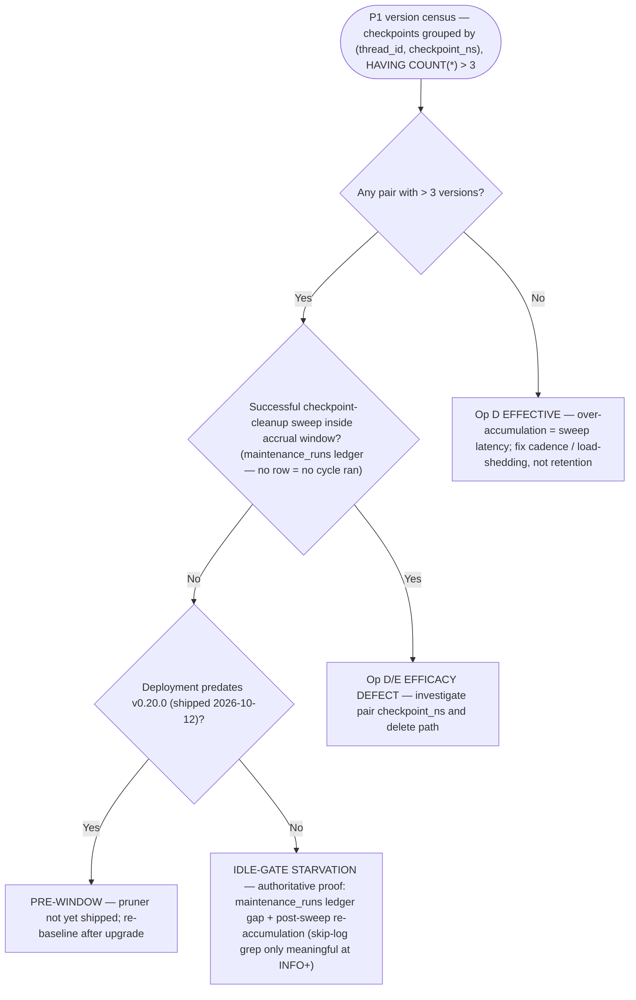

# Runbook: Checkpoint Storage Maintenance — Reclaim, TOAST Hygiene & Maintenance-Efficacy Audit

**Component:** Operational companion to §9 of the LOCKED checkpoint
read-path fixes plan
(`.agents/shared/planning/checkpoint-read-path-fixes/architecture-recommendation.md`,
§9 "Ops Runbook + Maintenance-Efficacy Audit"; evidence appendix §12).
Ships with `feature/checkpoint-quick-wins`.
**Code owners:** `daemon/services/checkpoint_prune.py` (Op E anti-join blob
prune), `daemon/services/maintenance.py` (Op D keep-N retention + the idle
gate + the 24 h checkpoint-cleanup cycle), `daemon/services/vacuum_maintenance.py`
(the dedicated autocommit engine pattern), `daemon/persistence.py` (saver
pool construction, `prepare_threshold`).
**Risk class:** MIXED — §6 is strictly read-only; §1–§5 are operator actions
whose lock/toggle hazards are documented in place. Nothing in this runbook
belongs in an automated lane.

> **Sourcing legend.** Every rule below carries a tag. `[plan §x]` = lifted
> from the locked plan (§9/§12 unless noted); `[expansion]` = standard
> PostgreSQL operator mechanics added to operationalize a plan rule — no new
> system facts asserted; `[this PR]` = finding or behavior from the
> `feature/checkpoint-quick-wins` work — dev-DB verification, audit
> findings, and the logging/behavior shipped by that branch. Related
> operative docs:
> `checkpoint-blob-prune-restore.md` (Op E mechanics + the planner-cache
> note) and `maintenance-console.md` (API surface).

---

## 1. VACUUM FULL policy — manual-only, never in an automated lane

| Rule | Source |
|---|---|
| `VACUUM FULL` stays **manual-only** — already AST-pinned by `tests/integration/test_checkpoint_cleanup_job_wiring_pin.py` and `test_vacuum_maintenance_job_no_full.py`. Keep it that way. | [plan §9.1] |
| It takes `ACCESS EXCLUSIVE` and **stalls every read for its duration**. | [plan §9.1] |
| Never run it in an automated lane, and **never inside a measurement window** — the 2026-10-29 diagnostic report's own **73–99 s** measurements were likely polluted by exactly this. | [plan §9.1, §2 rule 5] |

If a full offline reclaim is ever justified, it is the **last resort** of the
§2 sequence: announce a maintenance window, expect every checkpoint read to
block for the duration, and confirm no benchmark/audit/measurement is in
flight before issuing it.

---

## 2. Reclaim sequence — prune → VACUUM (ANALYZE) → optional pg_repack

```
[step]                      lock class               what you get back
──────────────────────────  ───────────────────────  ─────────────────────────────
1. prune (Op D + Op E)      job transaction only     LOGICAL space (rows deletable)
2. VACUUM (ANALYZE)         SHARE UPDATE EXCLUSIVE   dead tuples → reusable pages;
                                                     statistics refreshed
3. pg_repack (optional)     SHARE UPDATE EXCLUSIVE   OS-level space returned, ONLINE
   (VACUUM FULL fallback)   ACCESS EXCLUSIVE         OS-level, OFFLINE — §1 rules
```

- **Logical free ≠ OS free.** Logical prune frees *logical* space only; the
  OS gets the space back only from `VACUUM FULL` (offline, lock-taking) or
  `pg_repack` [plan §9.1].
- All three checkpoint tables have a PK ⇒ **pg_repack-eligible** [plan §9.1].
  The `pg_repack` extension install is an ops prerequisite for online
  reclaim and **needs DBA sign-off** [plan §10 item 3].
- **Scale caveat:** the dev trio is **~48 MB** against the diagnosed
  environment's **9.80 GiB** toast — the **2.3× bloat is NOT reproducible at
  dev scale**. The TOAST reloptions in §3 are therefore **prevention**, and
  their **prod-scale effect is unverified** [this PR].

```sql
-- Step 2, manual form — one statement per table, autocommit session
-- [expansion of the plan §9.1 sequence onto the named trio]
VACUUM (ANALYZE) checkpoints;
VACUUM (ANALYZE) checkpoint_blobs;
VACUUM (ANALYZE) checkpoint_writes;
```

---

## 3. TOAST autovacuum hygiene — parent reloptions do NOT propagate

**The problem** [plan §9.1, §2 D6]:

- The parent table's `autovacuum_*` reloptions **do not propagate** to its
  toast table — toast `reloptions` measured **NULL**; PG only inherits
  `toast.autovacuum_*`.
- Measured state (2026-10-29, diagnosed environment): the `checkpoint_blobs`
  toast table holds **9.80 GiB** for **4.56 GB** of live blob bytes =
  **2.3× bloat** (≈ **5.9 GB never reclaimed**, ~35.9 M dead toast tuples),
  **growing with every prune sweep**.

### Read this before running the DDL — only half of it changes behavior

`toast.autovacuum_enabled = on` **is already the PostgreSQL default**;
writing it changes nothing. **Only the scale-factor half is a behavior
change** — `autovacuum_vacuum_scale_factor` **0.2 → 0.1** makes autovacuum
trigger on the toast table at half the default dead-tuple threshold. The
`enabled` half is written explicitly so the pair is self-documenting, and so
no operator reads this DDL as *"autovacuum was disabled on the toast table"*
— it was not [this PR — dev-DB verification finding].

### Step 1 — resolve the toast tables [expansion]

```sql
SELECT c.relname AS parent_table,
       t.oid     AS toast_oid,
       t.relname AS toast_name
FROM pg_class c
JOIN pg_class t ON t.oid = c.reltoastrelid
WHERE c.relname IN ('checkpoints','checkpoint_blobs','checkpoint_writes');
```

### Step 2 — apply the reloptions via the PARENT table (primary form)

**Use the parent table with `toast.`-prefixed option names.** This is the
form that was actually executed and verified on the dev DB, and it is the
form that works for a non-superuser table owner — the option is stored on
the parent and inherited by that table's toast relation [this PR].

```sql
ALTER TABLE public.checkpoints
  SET (toast.autovacuum_enabled = on, toast.autovacuum_vacuum_scale_factor = 0.1);
ALTER TABLE public.checkpoint_blobs
  SET (toast.autovacuum_enabled = on, toast.autovacuum_vacuum_scale_factor = 0.1);
ALTER TABLE public.checkpoint_writes
  SET (toast.autovacuum_enabled = on, toast.autovacuum_vacuum_scale_factor = 0.1);
```

One statement per parent table — the exact set executed and verified on the
dev DB [this PR].

> **Why the `pg_toast`-schema form is NOT the default procedure.**
> `ALTER TABLE pg_toast.pg_toast_<oid> SET (...)` raises **"permission
> denied for schema pg_toast"** for a non-superuser owner — on PG14 the
> `pg_toast` schema has `nspacl = NULL`, so no non-superuser grant exists to
> satisfy. It works only for a **superuser or the owner of the `pg_toast`
> schema** [this PR — dev-DB execution finding].
>
> ```sql
> -- ALTERNATIVE — requires superuser / pg_toast schema owner.
> -- Not the default path; the parent form above is the supported procedure.
> ALTER TABLE pg_toast.pg_toast_16418
>   SET (autovacuum_enabled = on, autovacuum_vacuum_scale_factor = 0.1);
> ```

### Step 3 — verify [expansion]

```sql
SELECT reloptions FROM pg_class WHERE oid = <toast_oid>;
-- expect: {autovacuum_enabled=on,autovacuum_vacuum_scale_factor=0.1}
-- on all three toast relations
```

Dev-DB verification confirmed all three toast `reloptions` were set, and the
**parent tables' own `reloptions` were byte-identical** afterwards — i.e. the
change landed on the toast relation only and did not disturb the parent's
own options (**isolation proven**) [this PR].

### Rollback [expansion]

```sql
ALTER TABLE public.checkpoints
  RESET (toast.autovacuum_enabled, toast.autovacuum_vacuum_scale_factor);
ALTER TABLE public.checkpoint_blobs
  RESET (toast.autovacuum_enabled, toast.autovacuum_vacuum_scale_factor);
ALTER TABLE public.checkpoint_writes
  RESET (toast.autovacuum_enabled, toast.autovacuum_vacuum_scale_factor);
-- verify: SELECT reloptions FROM pg_class WHERE oid = <toast_oid>;
-- → back to cluster default (NULL)
```

### Scale caveat — the 2.3× figure does not reproduce at dev scale

The dev trio is **~48 MB**; the diagnosed environment's toast is
**9.80 GiB**. The **2.3× bloat ratio is NOT reproducible at dev scale**, so
the reloptions are **prevention** (stop the ratio compounding per sweep) and
their **prod-scale effect is unverified** — treat the DDL as a cheap,
reversible guard, not as a fix with a measured win [this PR].

Physically returning the already-accumulated ≈5.9 GB still requires §2's
`pg_repack` (online) or `VACUUM FULL` (offline, §1 rules) — the reloptions
never shrink the toast table on disk [plan §9.1 logical/physical split +
§9.3 P5/P6 interpretation].

---

## 4. ANALYZE after every destructive prune — automatic now, manual as backup

- **Rule:** run `ANALYZE` on the trio — `checkpoints`, `checkpoint_blobs`,
  `checkpoint_writes` — after **every** destructive prune [plan §9.1]. This
  kills the stale-statistics class behind the cached-generic-plan regression
  (the measured **8.56 ms** seq-scan vs **0.064 ms** post-`ANALYZE` family
  [plan §10 item 7; house planner-cache note,
  `checkpoint-blob-prune-restore.md` §9]).
- **This PR automates it:** the post-prune `ANALYZE` now runs automatically
  on the maintenance pool, on the dedicated autocommit engine pattern (as in
  `vacuum_maintenance.py`) — never the hot pool [this PR; engine pattern
  from plan §9.1].
- **Why it matters:** the scheduled VACUUM job is idle-gated and on its own
  24 h clock — without a post-prune `ANALYZE` the stale-statistics window
  stays open for **up to 24 h** after a prune [plan §9.1].
- **Manual case** (manual `/execute` prunes, pre-PR builds, belt-and-braces)
  [expansion onto the plan §9.1 trio]:

```sql
ANALYZE checkpoints;
ANALYZE checkpoint_blobs;
ANALYZE checkpoint_writes;
```

On-call check that statistics are current (house form):

```sql
SELECT relname, last_autoanalyze, last_analyze, n_live_tup
FROM pg_stat_user_tables
WHERE relname IN ('checkpoints','checkpoint_blobs','checkpoint_writes');
```

If `last_autoanalyze`/`last_analyze` is NULL or predates the last large
DELETE batch, run the manual `ANALYZE` above.

---

## 5. `prepare_threshold` on the saver pool — `None`, not `0`

- **Status quo being replaced:** the saver is constructed long-lived with
  `prepare_threshold=0` (`daemon/persistence.py:316-338`) [plan §12.2].
- **psycopg3 semantics** [plan §9.1 + §5]:
  - `0` ⇒ **every query is prepared on first execution** — a per-connection
    statement cache (`prepared_max` default 100). After PG's 5-execution
    custom→generic boundary, the cached **generic plan may go stale** ⇒
    seq-scan risk (the measured 8.56 ms → 0.064 ms regression class).
  - `None` ⇒ **prepared statements disabled** — every execution is planned
    fresh.
  - No cross-task race either way: the statement cache is per-connection and
    pool checkouts are exclusive [plan §5].
- **This PR moves the saver pool to `None`** [this PR].
- **Order of operations:** `ANALYZE` first, then `None`, and A/B with
  `EXPLAIN ANALYZE` on the saver connection [plan §9.1] (procedure and
  observed plans: `checkpoint-blob-prune-restore.md` §9).
- **Temper expectations:** the 8.56 ms seq-scan state was **not reproducible
  on prod at audit time** (autovacuum had analyzed 2026-10-29 10:12; live
  plan = index scan) ⇒ the pathology is **episodic** — this change is
  **prevention, not repair** [plan §9.1 + §10 item 7].

---

## 6. Maintenance-efficacy audit — checklist + verification SQL (read-only)

Framing [plan §9.2]: run against the environment being diagnosed (§8);
**a missing row is itself a finding.** All SQL below is read-only — run it
on a replica or with a read-only role [plan §9.3].

### 6.1 Checklist (10 items)

| # | Item | Evidence to collect |
|---|---|---|
| 1 | Deployment/activation window | Was the environment pre-v0.20.0 (Op E shipped **v0.20.0, 2026-10-12**) while the 126-version counts accrued? `git log --oneline --since=2026-10-01 -- daemon/services/checkpoint_prune.py`; deployed binary build id; boot log line `"Checkpoint pool sizing: max_size=… timeout_s=…"` (`persistence.py:250-256`) [plan §9.2; ship date plan §2 rule 2] |
| 2 | **Did the 24 h sweep ever run in the window?** | Ledger SQL below — `maintenance_runs WHERE section='checkpoint-cleanup'`. **No row = no cycle ran** in that window [plan §9.2; ledger-gap note this PR] |
| 3 | **Idle-starvation proof** — the single highest-value item | Skip-log grep below — **only meaningful at INFO or below**; record per-file counts **and each file's time range**. The **authoritative** proof is the **item-2 ledger gap + the post-sweep re-accumulation pattern**, *not* the grep count [plan §9.2; log-level correction this PR] |
| 4 | Effective retention N | `GET /api/maintenance/checkpoint-cleanup/status` → `config.checkpoint_max_per_thread`; deployment env `CHECKPOINT_MAX_PER_THREAD`; floor is 1 [plan §9.2] |
| 5 | Op E skip-guards | Grep `ZERO_REFS_FAIL_SAFE` / `MAX_REFS_EXCEEDED` / `blob_prune skipped: backend is not PostgreSQL` (`checkpoint_prune.py:196-275`); `summary_json.skipped[]` in ledger rows [plan §9.2] |
| 6 | Dry-run posture history | Grep `op=blob_prune_summary` for `would_delete>0 deleted=0 dry_run=1`; `maintenance_runs.env_flags_json` [plan §9.2] |
| 7 | Cadence vs hotness arithmetic | Expected steady state per hot thread = `max(N_keep, checkpoints written per sweep period)`. A 126-version thread ⇒ either (a) it wrote ~126 supersteps in the window (benign — the sweep was merely late) or (b) the sweep has not run for >126 supersteps (starvation/failure). Resolve with items 2 + 3 + P1 [plan §9.2] |
| 8 | VACUUM starvation | `SELECT * FROM maintenance_runs WHERE section LIKE '%vacuum%';` — the VACUUM job **shares the idle gate** (`manager.py:3754-3777`); same skip-log grep as item 3 (**INFO or below only** — same DEBUG-level false-negative caveat) [plan §9.2; log-level correction this PR] |
| 9 | Wedge-capture artifacts | `data/wedge_captures/*/` → `readyz.json` (`detail.pool_state`, `detail.leak_signal`), `checkpoint_perf_tail.json`, `db.json` [plan §9.2] |
| 10 | Bloat-event date | `pg_stat_user_tables` drift + `maintenance_runs` around that date; `checkpoint_blobs` `pg_total_relation_size` history [plan §9.2] |

**Item 3 — the skip-log grep** [plan §9.2; reporting shape + log-level
correction this PR]:

```bash
grep -c "Skipping checkpoint_cleanup: system not idle" ensemble.log*
```

> **Log-level caveat — a zero count can be a FALSE NEGATIVE.** The skip line
> was emitted at **`logger.DEBUG`** (`daemon/services/maintenance.py:261`)
> and prod runs at **INFO** — so the line was **invisible in prod logs
> entirely**. A zero-count grep is therefore **not** evidence that the idle
> gate never starved: on the 2026-10-29 audit it produced a false negative
> across **6.1 days** of logs on an environment that was in fact starving.
> **This PR bumps the line to `logger.info`** [this PR].
>
> Consequence: the grep is **only meaningful at INFO or below**. The
> **authoritative** starvation proof is the **item-2 ledger gap** (no
> `maintenance_runs` row for the window) **plus the post-sweep
> re-accumulation pattern** from P1 — *not* the grep count.

Per rotation file, record **(a) the file path, (b) the file's time range**
(first/last line timestamps), **(c) the match count** — the audit needs all
three, not just a grand total. A large count is direct idle-gate starvation
evidence (feeds §7's verdict); a zero count is **not** exoneration — see the
caveat above.

**Items 2 + 8 — the ledger** [plan §9.2]:

```sql
SELECT run_id, kind, started_at, completed_at, status, advisory, env_flags_json
FROM maintenance_runs
WHERE section = 'checkpoint-cleanup'
ORDER BY started_at DESC;

SELECT * FROM maintenance_runs WHERE section LIKE '%vacuum%';
```

`summary_json` on sweep rows carries the per-op counters (`deleted`,
`bytes`, `skipped[]`, `dry_run`) — quote it verbatim in the audit record
[plan §9.2 items 5–6].

> **Known gap — the version census rides the EXECUTED cycle only.** The
> census in `summary_json` is written by a cycle that actually **ran**.
> **Idle-gate skips and in-flight-lock skips write NO `maintenance_runs` row
> at all**, so `summary_json` stays **silent precisely in the starvation
> case** — the ledger gap is real, but it carries no census payload
> explaining *why* the sweep never ran [this PR — audit finding].
>
> Interim visibility path: the **INFO-level skip log** (this PR bumps the
> skip line from DEBUG to INFO). Closing the gap properly — **writing a
> census/skip row when a cycle is skipped** — is **planned** [this PR].

### 6.2 Version census + distribution buckets [plan §9.3]

```sql
-- P1  per-thread version census — the "126-class" detector
SELECT thread_id, checkpoint_ns, COUNT(*) AS versions,
       MIN(checkpoint_id) AS oldest_id, MAX(checkpoint_id) AS newest_id
FROM checkpoints GROUP BY thread_id, checkpoint_ns
HAVING COUNT(*) > 3 ORDER BY versions DESC LIMIT 50;

-- P2  distribution buckets (the alertable shape)
SELECT CASE WHEN c<=3 THEN 'a<=3_ok' WHEN c<=10 THEN 'b_4_10'
            WHEN c<=50 THEN 'c_11_50' WHEN c<=100 THEN 'd_51_100'
            ELSE 'e_>100_ALARM' END AS bucket,
       COUNT(*) AS pairs, SUM(c) AS versions
FROM (SELECT thread_id, checkpoint_ns, COUNT(*) c FROM checkpoints GROUP BY 1,2) t
GROUP BY 1 ORDER BY 1;

-- P1b  headline avg/max across all (thread_id, checkpoint_ns) pairs
-- [expansion over P1's population]
SELECT ROUND(AVG(c), 1) AS avg_versions, MAX(c) AS max_versions, COUNT(*) AS pairs
FROM (SELECT thread_id, checkpoint_ns, COUNT(*) c FROM checkpoints GROUP BY 1, 2) t;
```

### 6.3 Blob mass, anti-join census, table + toast sizes [plan §9.3; toast join expansion]

The `SUM(pg_column_size(blob))` statements scan the blob table — run
off-peak or on the replica [expansion; read-only posture per plan §9.3].

```sql
-- P3  blob mass by channel (where the bytes live)
SELECT channel, COUNT(*) AS rows, pg_size_pretty(SUM(pg_column_size(blob))) AS bytes
FROM checkpoint_blobs GROUP BY channel ORDER BY SUM(pg_column_size(blob)) DESC;

-- P4  largest threads by blob bytes (the reclaim worklist)
SELECT b.thread_id, COUNT(*) AS blob_rows,
       pg_size_pretty(SUM(pg_column_size(b.blob))) AS blob_bytes,
       (SELECT COUNT(*) FROM checkpoints c WHERE c.thread_id=b.thread_id) AS versions
FROM checkpoint_blobs b GROUP BY b.thread_id
ORDER BY SUM(pg_column_size(b.blob)) DESC LIMIT 25;

-- P5  Op E worklist: unreferenced (reclaimable) blob mass
SELECT COUNT(*) AS orphan_rows,
       pg_size_pretty(SUM(pg_column_size(b.blob))) AS orphan_bytes
FROM checkpoint_blobs b
WHERE NOT EXISTS (SELECT 1 FROM checkpoints c
  WHERE c.thread_id=b.thread_id AND c.checkpoint_ns=b.checkpoint_ns
    AND (c.checkpoint -> 'channel_versions' ->> b.channel) = b.version);

-- P6  table drift + reclaimable space (bloat reality check)
SELECT relname, n_live_tup, n_dead_tup, last_autovacuum,
       pg_size_pretty(pg_total_relation_size(relid)) AS total
FROM pg_stat_user_tables
WHERE relname IN ('checkpoints','checkpoint_blobs','checkpoint_writes');

-- P6b  toast sizes for the trio [expansion of P6 + plan §2 D6]
SELECT c.relname AS parent_table,
       pg_size_pretty(pg_relation_size(c.reltoastrelid)) AS toast_size
FROM pg_class c
WHERE c.relname IN ('checkpoints','checkpoint_blobs','checkpoint_writes');
```

**Bloat ratio** = toast size (P6b) ÷ live blob bytes (P3). Reference shape
(2026-10-29): **9.80 GiB toast ÷ 4.56 GB live = 2.3×** [plan §2 D6].

```sql
-- P7  idle-in-txn census (OPERATOR TOOL — see plan §10; do NOT run from the hot path)
SELECT state, count(*) FROM pg_stat_activity WHERE datname=current_database() GROUP BY state;
```

### 6.4 Blob TYPE audit [plan §9.4]

```sql
SELECT type, count(*) FROM checkpoint_blobs GROUP BY 1;
SELECT type, count(*) FROM checkpoint_writes GROUP BY 1;
```

With `pickle_fallback=False` (`serde/jsonplus.py:100`, `:287-289`), **any
`json`- or `pickle`-typed row raises `NotImplementedError` on load** — a
latent prod-only read failure that any serde change would surface. The dev
DB measured **100% `msgpack`**; **prod is not verified** `[not verified]`
[plan §9.4].

---

## 7. Interpretation rule



Table form [plan §9.3 + §9.2 item 1; the composition into one decision path
is expansion]:

| P1 census | Sweep in window? (item 2) | Deployment window (item 1) | Verdict | Next action |
|---|---|---|---|---|
| empty / all ≤ 3 | — | — | **Op D effective** | The >3-class was sweep latency — fix cadence/load-shedding, **not** retention [plan §9.3] |
| any pair > 3 | yes | — | **Op D/E EFFICACY DEFECT** | Investigate that pair's `checkpoint_ns` and the delete path [plan §9.3] |
| any pair > 3 | no | predates v0.20.0 (2026-10-12) | **PRE-WINDOW** | Pruner not yet shipped — re-baseline after the upgrade [plan §9.2 item 1] |
| any pair > 3 | no | v0.20.0+ | **IDLE-GATE STARVATION** | Authoritative proof = the **item-2 ledger gap + the post-sweep re-accumulation pattern**; the item-3 grep is corroboration only, and only at INFO+ [plan §9.2/§9.3; log-level correction this PR] |

Also [plan §9.3]: `P5 > 0` **with** `P6` showing large `n_dead_tup` ⇒ Op E
is not keeping up (starvation or skip-guard) ⇒ **physical** reclaim requires
VACUUM/repack regardless — §2.

### Worked example — the 2026-10-29 audit on the diagnosed environment [this PR]

The audit run on **2026-10-29** against the diagnosed environment (the
second checkout's DB — §8) concluded **IDLE-GATE STARVATION** — *not* a broken
pruner, *not* a pre-v0.20.0 deployment. The deciding numbers:

| Evidence | Number | What it ruled out / established |
|---|---|---|
| Sweep timing in the ledger | sweeps **cluster at daemon restarts** (boot sweep + in-memory `last_run` reset) | sweeps fired **on restart**, not on the 24 h cadence ⇒ the cadence path was being skipped |
| Gap since the last sweep | **27.3 h** | starvation window longer than one full 24 h period ⇒ a cycle was due and never ran |
| Re-accumulation (P1) | **30.9k checkpoints** across **380 busy pairs** (max **546/pair**) | growth, not a fixed residue ⇒ consistent with *"no sweep ran"*, not *"sweep ran and failed"* |
| Op E anti-join (P5) | **0 unreferenced blobs** | Op E was **fully caught up** ⇒ the pruner works; only Op D (the keep-N sweep) was starved |
| Blob types (§6.4) | **100% `msgpack`** | no latent `json`/`pickle` read-failure class in play |
| Idle-in-txn (P7) | **0** at audit time | no idle-in-txn leak at that moment |

**Verdict: Op D starvation via the idle gate, with Op E healthy.** That is
the shape the decision tree classifies as *any pair > 3 → no sweep in the
window → v0.20.0+ → IDLE-GATE STARVATION* — and it is what redirected the
fix at the gate rather than at the pruner.

---

## 8. Provenance — audit the environment you are diagnosing

All 2026-10-29 measurements cited by the plan were taken against the
**second checkout's database** (`/Users/nguyenminhkha/agents-ensemble/`),
**not** the project workdir [plan §12.3]. The §9 audit must run against that
environment to reproduce them; **where the target environment differs,
re-measure before acting** [plan §12.3]. Cross-referenced source documents
[plan §12.4]:

- `.agents/shared/planning/metrics-collection/checkpoint-bench-20261029.md`
- `.agents/shared/incident-20261028-v02711-…-sweep-loop.md` (its fix item #9
  shares the same misdiagnosis as the superseded report)

---

*Documentation-only runbook. It specifies no code changes; the automated
pieces it references — post-prune ANALYZE on the maintenance pool and the
saver-pool `prepare_threshold=None` — ship with `feature/checkpoint-quick-wins`
per the locked plan §9.*
